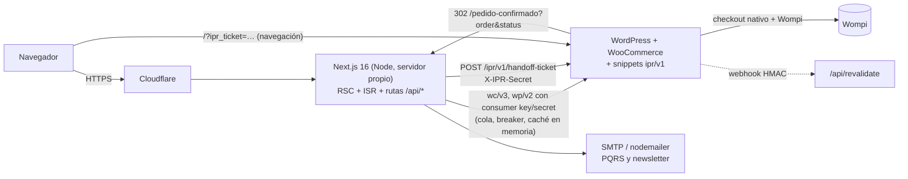

# Entrega 1.1 — Hallazgos del código del frontend (`ipr-frontend`)

| | |
|---|---|
| **Fecha** | 2026-11-18 |
| **Fuente** | Repositorio local `C:\Users\empr16\ipr-frontend` (121 commits, rama con último commit "style(header)…"). Lectura solo; no se ejecutó ni se modificó nada. |
| **Complementa** | `informe_investigacion.md` (auditoría externa del 2026-11-17). **Donde este documento contradice al anterior, prevalece este** (evidencia = código fuente). |

**Qué se leyó:** `CLAUDE.md`, `.env.example`, `package.json`, `docs/documentacion-proyecto.md`, `docs/auditoria-seguridad-y-arquitectura.pdf` (texto extraído), `wp-snippets/ipr-auth-rest.php`, `wp-snippets/ipr-cart-handoff.php`, cabeceras de los snippets de redirección y de las campañas (ruleta Midea, raspa Samsung), `src/lib/{auth,session,rate-limit,sedes-data}.ts`, `src/lib/security/origin.ts`, `src/app/api/{checkout,auth/login,auth/me,auth/update}/route.ts`, `src/store/useAuthStore.ts`, tipos `Product`/`ProductDetail`, `src/features/calculadora/btu-fields.tsx`, `.github/workflows/deploy.yml`.

**Qué NO se leyó, a propósito:** el archivo `.env` (contiene secretos reales: claves de WooCommerce, `HANDOFF_SECRET`, SMTP). No hace falta para la arquitectura. Recomendación: que no se comparta fuera del equipo.
**No leído por límite de tiempo (pendiente):** `src/lib/woocommerce.ts` (~1.200 líneas), `src/lib/wc/*`, `docs/justificacion-headless.md`, `docs/landings-de-marca.md`, `SEO_AUDIT_IPR/`, el repositorio de WordPress (solo existen los snippets).

---

## 1. Lo que cambia respecto al informe anterior

| Tema | Informe 1 (externo) | Ahora (código) | Impacto |
|---|---|---|---|
| Backend | WooCommerce, versión/API **desconocidas** | WooCommerce **REST `wc/v3`** (productos, categorías, atributos, marcas, etiquetas), **WP REST `wp/v2`** (blog, RSE, capacitaciones) y namespace propio **`ipr/v1`** (auth, pedidos, handoff de pago, campañas). Todo consumido **solo desde el servidor Next.js** con claves de WooCommerce. | Alto |
| Sesión | **DESCONOCIDA** (cookie probable) | Confirmado: cookie `ipr_session` `httpOnly`, `sameSite=lax`, `secure` en producción, 30 días. Contiene un **token opaco** (40 caracteres) que WordPress guarda **hasheado (SHA-256)** en `usermeta`. El navegador no lo lee. | Alto |
| Pasarela de pago | **DESCONOCIDA** | **Wompi**, dentro del checkout nativo de WooCommerce (el snippet la preselecciona). | Alto — resuelve D-02 en gran parte |
| Flete | "Acordado al finalizar la compra" (texto web) | El **cliente elige el método de envío en el checkout de WooCommerce**; el texto de la ficha ("valor según transportadora") es informativo. | Medio |
| Precios | Servidor decide (inferido) | **Confirmado:** `/api/checkout` solo envía `{id, quantity}` (máx. 100 líneas, cantidad 1–99); WooCommerce recalcula precio, impuestos y stock. | Positivo |
| `localStorage` | "Guarda `user`" | Guarda `status`, `user` (perfil completo) y `checkedAt` (`ipr-auth`). La auditoría interna indica que incluye datos como NIT/cédula, teléfono y dirección (SEC-08). | Bajo (web) |
| Colores de marca | Tomados del CSS compilado | `docs` indica azules `#0a3651`, `#07628e`, `#0b4970` y **verde `#5ba628`** como colores de marca. El verde no aparecía en mis tokens. | Medio (diseño) |
| B2B | Enlace "¿B2B o mayorista?" | **Ese enlace lleva a la misma página de registro.** No hay flujo, rol ni precio B2B en el código del frontend; los textos hablan de "lista de precios B2B" como atención de asesores. | Alto — reduce D-03 a una decisión de negocio |
| Cotizaciones | No hay flujo propio | Confirmado: si `price == 0` solo hay botón **"Más información" → WhatsApp** con el producto. No hay carrito ni formulario. | Alto |
| Sedes | Horarios/coordenadas no vistos | El tipo `Sede` **no tiene coordenadas ni horarios**; datos en archivos `.ts` (no hay API ni CMS). | Medio |
| Calculadora BTU | Fórmula DESCONOCIDA | **Conocida** (ver §6). | Medio — cierra parte de D-08 |

---

## 2. Arquitectura real (hecho comprobado en código)



- **Hosting del frontend:** servidor propio en DigitalOcean (despliegue por GitHub Actions con SSH y firewall abierto solo durante el despliegue). WordPress mantiene su hosting (Plesk).
- **WordPress como "motor de compra":** el snippet `ipr-front-redirect.php` redirige todo el sitio público de WordPress al frontend; solo quedan en WP checkout, carrito, mi-cuenta/recuperar contraseña, `wp-json`, `wp-content`, `wc-api`, `wc-ajax`, `wp-admin`.
- **Carga a WooCommerce:** un único cliente (`wcGet`) con timeout, reintentos, **circuit breaker** (5 errores → pausa 30 s), concurrencia máxima 4, User-Agent propio, ruta interna opcional que evita Cloudflare, y caché en memoria con "stale-while-revalidate". Hay un **índice en RAM de hasta ~10.000 productos** para las sugerencias de búsqueda (renovado cada 5 min o por webhook).
- **Sin pruebas automáticas** (`CLAUDE.md`: "No existen tests"). CI/CD: solo despliegue; sin `tsc`, lint ni `npm audit` en el workflow (coincide con SEC-10).

## 3. Modelo de datos que ya existe

**Producto (lista)**: `id`, `name`, `slug`, `brand`, `sku`, `price` (COP, IVA 19 % incluido), `formattedPrice`, `category`, `categorySlugs[]`, `imageUrl`, `inStock` (bool), `onSale`, `regularPrice`.
**Detalle**: lo anterior + `description` (HTML de WordPress), `shortDescription`, `gallery[]`, `attributes[]` (atributos de WooCommerce), `categories[]`, `stockQuantity` (numérico, puede ser `null`), `stockStatus`.
**Usuario (`AuthUser`)**: `id`, `email`, `username`, `firstName`, `lastName`, `displayName`, **`roles[]`**, `billing{…}`, `shipping{…}`.
**Pedido (`AuthOrder`)**: `id`, `orderNumber`, `status`, `statusLabel`, `date`, `currency`, `subtotal`, `total`, `paymentMethodTitle`, `items[{name, qty, total}]`. **No incluye** id de producto, imagen, envío, tracking ni dirección.
**Sede**: `slug`, `city`, `name`, `address`, teléfonos (fijo, celulares, ventas repuestos, ventas A/A), WhatsApp, imagen, `upcoming`. **Sin coordenadas ni horarios.**
El **precio que se ve en el frontend es el público**: se lee con la clave de WooCommerce del servidor; no hay precio por rol.

## 4. Qué puede reutilizar la app móvil (y qué no)

| Componente | ¿Reutilizable por la app? | Detalle |
|---|---|---|
| Endpoints `ipr/v1/auth/*`, `/orders` (WordPress) | **Parcial.** Ya aceptan `Authorization: Bearer <token>`, devuelven JSON limpio y están pensados "sin cookies". | Tienen limitaciones de diseño para móvil (§5). |
| Rutas `/api/*` de Next.js | **No directamente.** Autentican con la **cookie**, validan `Origin` en `auth/update` y son del sitio. | Sirven de modelo, no de contrato (R-01 sigue vigente). |
| Catálogo (`wc/v3`) | **No directo.** Requiere clave secreta de WooCommerce, que **nunca** debe ir en una app. | Hace falta una capa pública de lectura (BFF). |
| `lib/woocommerce.ts` + `lib/wc/*` | **Sí, como núcleo del BFF móvil**: ya normaliza productos, resuelve filtros por slug, cachea y tolera fallos. | Es el activo técnico más valioso; reutilizarlo evita duplicar lógica (principio 3 del prompt maestro). |
| Checkout con ticket (`/api/checkout` + `handoff-ticket`) | **Sí, con adaptación.** | Ver §5.4. |
| Wompi vía WooCommerce | **Sí**, abriendo el checkout web en navegador seguro. | Evita PCI propio y SDK. |
| Webhook `/api/revalidate` | Sí (mantiene la caché al día). | — |
| PQRS (`/api/pqrs`) y newsletter | Sí, con un endpoint móvil equivalente. | Hoy limitan por IP en memoria. |
| Campañas (ruleta Midea, raspa Samsung) | Opcional, como WebView/navegador. | Recogen nombre, correo, teléfono y n.º de factura → Ley 1581. |
| Datos de sedes, contactos, ingenieros | Hay que **moverlos a una fuente consumible** (hoy son `.ts` compilados). | Añadir coordenadas y horarios (D-09). |

## 5. Hallazgos de seguridad y diseño relevantes para la app

### 5.1 Verificados en el código actual
| ID | Hallazgo | Evidencia | Gravedad para la app |
|---|---|---|---|
| H-01 | **Un solo token por usuario.** `ipr_auth_issue_token` sobrescribe el hash; **iniciar sesión en la web cierra la sesión de la app y viceversa**, y no hay varios dispositivos. | `ipr-auth-rest.php` L45-50 | **Alta (bloquea multi-dispositivo)** |
| H-02 | **Sin refresh ni rotación.** Vida fija de 30 días, no deslizante; el token solo cambia al cambiar correo/contraseña. | `IPR_AUTH_TOKEN_TTL` | Alta |
| H-03 | **El token se acepta por query string** (`?token=`) además de body y `Authorization`. Se registra en logs y proxies. | `ipr-auth-rest.php` L54 | Media |
| H-04 | **No hay rate limiting en las rutas de auth** (`login`, `register`, etc.); el límite en memoria solo cubre PQRS y newsletter, y es por proceso. El snippet delega la protección de fuerza bruta en Wordfence. | `grep rateLimit` = 0 en `api/auth/*`; comentario en el snippet | Alta para una app pública |
| H-05 | **`permission_callback => '__return_true'`** en todas las rutas `ipr/v1`; la autorización se hace dentro del callback validando el token. Funciona, pero es frágil: un descuido en un handler nuevo queda abierto. | `ipr-auth-rest.php` L372-411 | Media |
| H-06 | **Alta de cuenta sin verificar correo**; la contraseña mínima son 8 caracteres. | `ipr_auth_handle_register` | Media |
| H-07 | **Lookup del token por `get_users(meta_value)`** sobre `usermeta` sin índice propio; costoso con muchos usuarios. | `ipr_auth_user_from_token` | Baja-Media (rendimiento) |
| H-08 | **No hay endpoints** de eliminación de cuenta, recuperación de contraseña por API (se hace en WP), detalle/seguimiento de pedido, favoritos, cotizaciones, dispositivos/push. | Rutas existentes | Alta (funcionalidad faltante) |
| H-09 | **CSP con `'unsafe-inline'`** en scripts; HTML de productos/blog se sanea con función propia basada en expresiones regulares. | `next.config.ts` L27; auditoría SEC-04 | Media (web) |
| H-10 | `/api/revalidate` y snippets aceptan secretos por query string (según auditoría); roles administrador permitidos en API de clientes (SEC-09). | Auditoría | Media |

### 5.2 Hallazgos de la auditoría interna de octubre 2026 (PDF) y su estado actual
La auditoría interna listó 5 hallazgos de severidad alta y 17 CVEs de `npm audit` (2 críticas). Comparado con el **código actual**:

| ID | Estado verificado hoy |
|---|---|
| SEC-01 (redirección abierta y `returnUrl`) | **Corregido**: `returnUrl` ya no lo envía el cliente; se fija desde `PUBLIC_ORIGIN` y el PHP valida contra lista cerrada de dominios. |
| SEC-02 (límite de 50 usuarios) | **Corregido**: la consulta ya filtra por `meta_value => $hash`, `number => 1`. |
| SEC-03 (cambio de correo/contraseña sin contraseña actual) | **Corregido en servidor y frontend**: exige `current_password`, emite token nuevo y `auth/update` valida `Origin` y Zod. |
| SEC-04 (XSS en descripción) | **Parcial**: `ProductTabs` ya aplica `sanitizeHtml`; falta confirmar que el sanitizador sea robusto (no se revisó) y sigue `'unsafe-inline'`. |
| SEC-05 (CVEs en `next` y `nodemailer`) | **No verificado.** `package.json` sigue fijando `next 16.3.4` y `nodemailer ^10.0.3`. No ejecuté `npm audit`. |
| SEC-06 (rate limit) | **Pendiente** en auth (ver H-04). |
| SEC-08, SEC-09, SEC-10 | **Siguen** según lo observado (`localStorage`, `?token=`, CI sin lint/audit). |

> Las correcciones indican un equipo que atiende hallazgos, lo cual es una buena señal de madurez. Aún así, **no se debe afirmar cumplimiento** sin repetir la auditoría y `npm audit` sobre la versión actual (RQ de la Etapa 5).

### 5.3 Qué hay que hacer en el backend antes del lanzamiento móvil (propuesto)
1. **Sesiones por dispositivo**: tabla (o meta multi-valor) con `device_id`, hash del *refresh token*, expiración, última actividad; **access token corto (15 min) + refresh rotativo**; revocación por dispositivo y "cerrar todas".
2. Aceptar el token **solo** por cabecera `Authorization`.
3. **Rate limiting** y bloqueo progresivo en login/registro/recuperación (en Cloudflare + en servidor con almacén compartido, no en memoria).
4. Verificación de correo (o al menos antes de comprar) y recuperación de contraseña por API.
5. Endpoint de **eliminación de cuenta** y exportación/solicitud de datos (Ley 1581).
6. Sustituir `__return_true` por `permission_callback` real.

### 5.4 Checkout móvil (propuesto, a validar)
1. App → `POST /mobile/v1/checkout` con `{items[{id,qty}]}` y `Authorization: Bearer`.
2. El BFF pide el ticket a WordPress (`X-IPR-Secret`, que **solo vive en el servidor**) y devuelve `{url}`.
3. La app abre la URL en **Custom Tabs (Android) / ASWebAuthenticationSession o SFSafariViewController (iOS)**, no en un WebView propio.
4. Tras pagar, WordPress redirige a `https://iprpartesyrepuestos.com/pedido-confirmado?order=…&status=…`. Como el dominio de retorno está en una **lista cerrada** (solo web), el regreso a la app requiere **Android App Links e iOS Universal Links** sobre esa ruta (archivos `assetlinks.json` y `apple-app-site-association`). Alternativa más simple: tras cerrar el navegador, la app consulta el estado del pedido.
5. El carrito puede vivir **local en la app** (igual que en la web); la validación de precio y stock ocurre al pasar al checkout. Productos agotados hacen que `add_to_cart` falle y WooCommerce muestre el carrito.

## 6. Calculadora BTU — fórmula existente (para validación técnica, **no** para publicar sin aprobación)

```
area      = largo × ancho
requerido = area × 600
si alto > 2,5 m:  requerido ×= 1 + ceil((alto − 2,5) / 0,5) × 0,10
requerido += max(0, personas − 2) × 600
requerido ×= factor_clima   (frío 1,00 · templado 1,05 · cálido 1,15)
requerido += equipos × 600
sugerido  = menor capacidad comercial ≥ requerido
            entre 9.000, 12.000, 18.000, 24.000, 36.000 BTU
```
- Rangos de entradas: largo 1–15 m, ancho 1–15 m, alto 2–4 m, ocupantes 1–10, equipos 0–10.
- Si `requerido` > 36.000 BTU no hay sugerencia (`sugerido` queda vacío) → la app debe manejarlo.
- Sirve para enlazar con el catálogo (`filter_capacidad-btu=<n>-000-btu`).
- **Pendiente D-08**: que Ingeniería IPR confirme el método (≈600 BTU/m² como regla simplificada), la unidad, los límites y el texto de descargo ("es una estimación…").

## 7. Impacto en las decisiones pendientes

| Decisión | Estado tras leer el código |
|---|---|
| **D-01** (cómo hablará la app con el backend) | **Mucho más clara.** Recomendación: **BFF móvil versionado (`/mobile/v1`) dentro del propio proyecto Next.js**, reutilizando `lib/woocommerce.ts`, y **ampliar `ipr/v1` en WordPress** solo para lo que no existe (sesiones por dispositivo, eliminar cuenta, etc.). Evita exponer claves y evita duplicar la capa de datos. Requiere aprobación de quien mantiene el repositorio. |
| **D-02** (pagos) | **Resuelta en lo esencial**: Wompi vía checkout de WooCommerce, abierto en navegador seguro (no PCI propio). Pendiente: confirmar con el equipo cómo se confirman pagos (webhook de Wompi → estado WooCommerce) y cómo se evita el doble pago. |
| **D-03** (B2B) | **Decisión de negocio pura**: el código no distingue B2B. Hay `roles[]` en el usuario pero sin precios por rol. |
| **D-04** (cotizaciones) | Sin cambios: hoy es WhatsApp. |
| **D-05** (stock) | Parcial: existe `stockQuantity` (numérico) y `inStock`; **no hay stock por sede**. |
| **D-06** (compra en el MVP) | Más viable que antes: el flujo de compra ya existe y es seguro; el costo está en sesiones/dispositivo y deep links. |
| **D-09** (sedes) | Confirmado: no hay coordenadas ni horarios; hay que crearlos. |

## 8. Nuevas preguntas para el equipo

1. ¿Quién mantiene `ipr-frontend` y `ipr/v1`, y aceptan que el BFF móvil viva en ese repositorio (rama propia, revisión de PR)?
2. ¿Hay entorno de **staging** de WordPress (WooCommerce + Wompi en modo sandbox) y del frontend?
3. ¿Se puede alojar `assetlinks.json` y `apple-app-site-association` en `iprpartesyrepuestos.com/.well-known/`?
4. ¿El rol de WordPress de clientes B2B existe hoy (p. ej. un plugin de precios por rol) o los precios B2B se manejan fuera del sitio?
5. ¿Wordfence u otra protección está activa en WordPress y con qué reglas de fuerza bruta?
6. ¿Cuál es el plan para los hallazgos SEC-05/06/08/09/10 del PDF y quién los gestiona?
7. ¿Las campañas (ruleta/raspa) entrarán en la app? De ser así, ¿dónde se guardan y cuánto se conservan los datos (Ley 1581)?
8. ¿Hay un proceso para `npm audit`/actualizar Next.js (el frontend sigue en `16.3.4`)?
