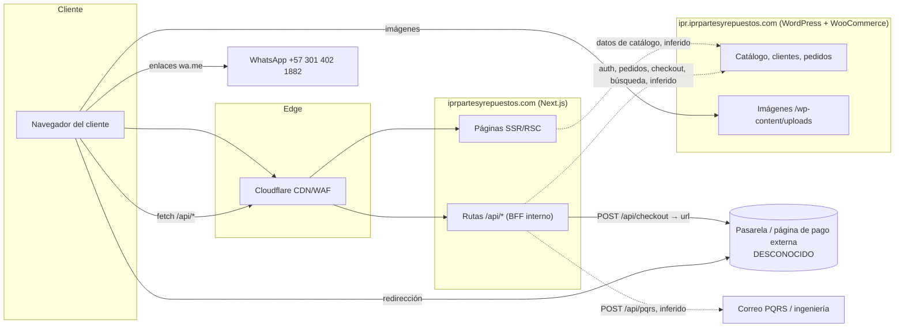

# Entrega 1 — Informe de investigación del ecosistema IPR

| | |
|---|---|
| **Proyecto** | App móvil IPR (Flutter/Dart, Android + iOS) |
| **Fase** | Etapa 0 — Descubrimiento (Primera entrega) |
| **Fecha de la auditoría** | 2026-11-17 |
| **Estado** | BORRADOR para revisión de IPR. No se ha escrito código ni modificado ningún sistema. |
| **Método** | Auditoría "caja negra" y pasiva del sitio público: lectura de HTML, `robots.txt`, `sitemap.xml`, encabezados HTTP y análisis estático del JavaScript público del frontend. |

> **Actualización 2026-11-18:** se obtuvo acceso al código del frontend. Varios puntos "DESCONOCIDO" de este informe quedaron resueltos (sesión por cookie `httpOnly` con token opaco, pasarela **Wompi** vía checkout de WooCommerce, API `wc/v3` + `wp/v2` + `ipr/v1`, fórmula BTU, ausencia de B2B en el código). **Ver `informe_codigo_frontend.md`; donde haya contradicción, prevalece ese documento.**

> **Convención de confianza:** **Alta** = observado directamente y repetible · **Media** = inferido de varias señales coherentes · **Baja** = una sola señal o suposición razonable.
> **DESCONOCIDO** = no hay evidencia; se indica cómo obtenerlo.

---

## 0. Alcance, límites y reglas que se respetaron

**Qué se hizo**
- Se revisaron la home y unas 20 páginas más (productos, marcas, ingeniería, contacto, sedes, PQRS, liquidaciones, capacitaciones, blog, carrito, checkout, login, registro, mi-cuenta, categorías, landing de marca y de ciudad).
- Se revisaron **8 fichas de producto completas** (1 de la home + 6 elegidas al azar del sitemap + 1 de Samsung) y las 8 tarjetas de "más vendidos" de la home (solo nombre, SKU, precio y stock). La muestra es **pequeña**: lo que no aparece en ella (especificaciones, documentos) puede existir en otras fichas.
- Se descargaron y leyeron los 33 archivos JS y el CSS del frontend para identificar rutas de red, almacenamiento en el navegador y tokens de diseño.

**Qué NO se hizo (a propósito)**
- **No se llamó a ningún endpoint `/api/*`.** El `robots.txt` del sitio los excluye (`Disallow: /api/`). Los contratos de la sección 4 salen solo del análisis estático del código del cliente. Su forma exacta de respuesta es **inferida**, no verificada.
- **No se probó `wp-json` ni la API de WooCommerce** en `ipr.iprpartesyrepuestos.com`. Solo se leyeron encabezados de la raíz y su `robots.txt`.
- **No se descargaron los PDF legales** (términos, política de datos personales, etc.). Descargar archivos requiere su autorización; quedan como pendiente (P-12).
- No se creó cuenta, no se inició sesión, no se envió ningún formulario, no se hizo ninguna compra.

**Limitaciones que condicionan las conclusiones**
1. **No hay repositorio ni documentación técnica del backend.** La carpeta de trabajo `ipr-app` estaba vacía. Toda la sección 4.2 del prompt maestro (modelo de datos, autorización, integraciones, manejo de errores) queda **sin cubrir** salvo lo inferible desde fuera.
2. Sin sesión autenticada no se vio la zona privada (`/mi-cuenta`, pedidos, direcciones, precios B2B).
3. El contenido de las páginas es de **hoy** (2026-11-17); el sitio cambia con frecuencia (precios, stock, eventos).

---

## 1. Resumen ejecutivo de hallazgos (para la gerencia)

| # | Hallazgo | Confianza |
|---|---|---|
| 1 | La web actual **no es** el WordPress clásico: es un **frontend moderno en Next.js**, detrás de Cloudflare, que usa **WooCommerce (WordPress)** como backend de catálogo, clientes y pedidos. | Alta |
| 2 | El frontend expone ~10 rutas propias (`/api/*`) que hacen de intermediario con WooCommerce. Son **internas del sitio**, el `robots.txt` las excluye y no hay evidencia de que sean públicas, versionadas ni estables. **No deben ser el contrato de la app móvil.** | Alta |
| 3 | El catálogo en línea tiene **885 productos** y ~216 categorías, con SKU interno, marca, precio en COP (IVA incluido), disponibilidad "En stock" e imágenes. | Alta |
| 4 | **Varios productos no tienen precio ni botón de compra** y se cotizan con asesor (3 de 7 en la muestra aleatoria). La app necesita un flujo de cotización desde el día 1. | Alta |
| 5 | El **carrito vive solo en el navegador** (`localStorage`). El checkout envía al servidor solo `id` y `cantidad` y **redirige a una pasarela/página de pago externa**. Esto es buena base de seguridad, pero la pasarela y el flujo real **son DESCONOCIDOS**. | Alta (hecho) / DESCONOCIDO (pasarela) |
| 6 | **El flete no se calcula en línea**: "valor según transportadora, acordado al finalizar la compra". | Alta |
| 7 | IPR habla de **lista de precios B2B, cupo comercial y facturación electrónica**, pero no se ve en el sitio público cómo se expone eso a clientes empresariales. Es la mayor incógnita de negocio. | Alta (existe) / DESCONOCIDO (cómo) |
| 8 | Las cifras institucionales **no coinciden entre páginas** (p. ej. "10.000 referencias" vs 885 en línea vs 1.418 "repuestos en catálogo"; 31 vs 32 sedes). Hay que definir cuál es la fuente de verdad antes de mostrarlas en la app. | Alta |
| 9 | Hay **recursos reutilizables de alto valor**: 31 sedes con contacto, ~27 landings de marca, 23 artículos de blog, capacitaciones, PQRS, WhatsApp, calculadora BTU. | Alta |
| 10 | **Sin acceso al backend no se puede decidir** si "la app puede reutilizar la API actual". Lo más probable (Media) es que se necesite una capa de API móvil controlada (BFF o endpoints nuevos). | Media |

**Conclusión de la fase:** hay evidencia suficiente para avanzar a *Requisitos* en lo funcional, pero **no** para cerrar la arquitectura de integración. Esa decisión depende de la respuesta a las preguntas P-01 a P-06 (ver `docs/project/decisiones_pendientes.md`).

---

## 2. Arquitectura actual (inferida)

### 2.1 Stack observado

| Capa | Hallazgo | Evidencia | Confianza |
|---|---|---|---|
| CDN / WAF | Cloudflare delante del sitio y del subdominio WordPress. | Encabezados `Server: cloudflare`, `CF-RAY`, `cf-cache-status`. | Alta |
| Frontend web | **Next.js** (App Router, React Server Components, Turbopack), con caché de prerenderizado. | `x-nextjs-cache`, `x-nextjs-prerender`, `Vary: rsc, next-router-state-tree`, rutas `/_next/static/chunks/turbopack-*.js`, payload `self.__next_f.push`. | Alta |
| Backend comercial | **WooCommerce sobre WordPress**, en `ipr.iprpartesyrepuestos.com`. | Texto en `/login`: "Tu cuenta se gestiona de forma segura con el backend de IPR (WooCommerce)". Imágenes en `/wp-content/uploads/...`. Patrones de URL y parámetros (`categoria-producto`, `filter_`, `pa_`, `query_type_`, `orderby`) típicos de WooCommerce. | Alta (WooCommerce) |
| Servidor WP | PHP 8.3, Plesk (Linux), plugin de caché WP-Optimize y gestor de descargas WPDM. El subdominio redirige (302) a la web principal y envía `X-Robots-Tag: noindex`. | Encabezados `X-Powered-By`, `WPO-Cache-Status`, cookie `__wpdm_client`, `X-Redirect-By: IPR`. | Alta |
| Patrón de integración | El Next.js actúa como **BFF** (intermediario): el navegador solo habla con `/api/*` del mismo dominio y el servidor Next habla con WooCommerce. | CSP `connect-src 'self'`; todas las llamadas `fetch` del cliente son a rutas relativas `/api/...`. | Alta |
| Estado en cliente | Carrito y sesión se guardan en `localStorage` (`ipr-cart`, `shopping-cart`, store de auth con `status`, `user`, `checkedAt`). | Código JS (zustand `persist`). | Alta |
| Analítica de terceros | **Ninguna activa**: la CSP (`script-src 'self' 'unsafe-inline'`, `connect-src 'self'`) impediría cargar GA/GTM/Pixel. | CSP + ausencia de dominios de analítica en el HTML. | Alta |
| Fuentes / marca | Poppins y JetBrains Mono (fuentes web); tokens de color en CSS. Ver sección 9. | CSS descargado. | Alta |

### 2.2 Postura de seguridad web (lo que se ve desde fuera)

**Bien:** HSTS con `preload`, `X-Frame-Options: DENY`, `frame-ancestors 'none'`, `nosniff`, `Referrer-Policy` estricto, `Permissions-Policy` restrictivo, `robots.txt` que excluye zonas privadas.
**A mejorar (observaciones, no vulnerabilidades confirmadas):**
- CSP con `script-src 'unsafe-inline'`: reduce la protección contra XSS.
- El **objeto de usuario se persiste en `localStorage`** (`status`, `user`). No se vio que guarde tokens, pero sí datos personales (nombre, correo, direcciones) legibles por cualquier script en la página. Confianza: Alta (hecho) / Media (alcance exacto de `user`).
- **Mecanismo de sesión DESCONOCIDO.** El cliente no envía ningún token en cabeceras, así que la sesión parece ir por cookie. Si es cookie `HttpOnly` + `SameSite`, es correcto; si es un JWT en cookie legible, no. Hay que confirmarlo con el equipo web (P-03).

### 2.3 Diagrama de integraciones (estado actual, inferido)

*Las flechas punteadas son inferencias; no hay evidencia directa del tráfico servidor-a-servidor.*

---

## 3. Inventario de funcionalidades web

Leyenda **App**: ✅ aplica directo · 🔶 aplica adaptado · ➖ solo web / no aplica · ❓ requiere decisión de IPR.

| # | Funcionalidad web | Estado observado | Evidencia | Conf. | App |
|---|---|---|---|---|---|
| F1 | **Home**: buscador, 8 líneas de producto, "más vendidos", métricas institucionales, mapa de red nacional, marcas, calculadora BTU, formación, CTA WhatsApp. | Operativa. | Home HTML. | Alta | 🔶 |
| F2 | **Catálogo** `/productos`: 885 productos, 12 por página, botón "Filtrar productos". | Operativa. | `/productos`, sitemap (885 URLs `/producto/`). | Alta | ✅ |
| F3 | **Categorías**: 8 raíces (Aire Acondicionado, Refrigeración, Eléctricos, Materiales y Consumibles, Herramientas, Tableros y Controles, Ventilación, Refrigerantes) y subcategorías profundas (216 URLs). | Operativa. Una ficha de muestra cuelga de una categoría poco intuitiva ("Válvulas de expansión R404" para un detector de fugas CO2) → **calidad de datos de categoría a revisar**. | Sitemap + JSON-LD de breadcrumb. | Alta | ✅ |
| F4 | **Marcas**: `/marcas` + ~27 landings (Samsung, Midea, Daikin, Danfoss, Copeland, Trane, Embraco, Tecumseh, Gree, Hisense, Elitech, Mastercool, Uniweld, Honeywell, Aspen, Fullgauge, Rowa, Siccom, Soler y Palau, Dorin, Elgin, Fiberglass, Harris, Ziehl-Abegg, Clearway, Chint e IPR propia) con buscador interno por marca. | Operativa. | Sitemap + JS (`/api/marcas/{slug}/productos`). | Alta | ✅ |
| F5 | **Ficha de producto**: galería (hasta 4 imágenes), marca, SKU, precio con IVA, "En stock", cantidad, "Añadir al carrito", descripción HTML, aviso de envío nacional y de garantía. JSON-LD `Product`. | Operativa. **No se vio**: especificaciones técnicas estructuradas, fichas técnicas descargables, compatibilidades, productos relacionados (en las 8 fichas revisadas; muestra pequeña). | HTML de fichas + JSON-LD. | Alta | ✅ |
| F6 | **Producto sin precio** → botón "Más información" en lugar de "Añadir al carrito" (se cotiza con asesor). | 3 de 7 fichas de muestra. | HTML fichas. | Alta | ✅ (cotización) |
| F7 | **Búsqueda**: caja global con sugerencias (`/api/search/suggestions?q=`), página `/buscar?q=`. Placeholder "por marca o referencia". | Operativa. Comportamiento de ranking, tolerancia a errores y búsqueda por SKU: **DESCONOCIDOS**. | JS + `/buscar` responde 200. | Alta/Baja | ✅ |
| F8 | **Filtros / orden**: el `robots.txt` bloquea `filter_*`, `pa_*`, `attribute`, `query_type_*`, `sort`, `orderby`, `view`, `cat`. Hay filtros por categoría, familias y etiquetas (código de `/marcas`). | Existen; qué atributos técnicos se pueden filtrar es **DESCONOCIDO**. | `robots.txt` + JS. | Media | ✅ |
| F9 | **Carrito** `/carrito`: ítems `{id, cantidad}` en `localStorage`; resumen con total. | Operativa, **sin carrito en servidor**. | JS (`ipr-cart`). | Alta | 🔶 |
| F10 | **Checkout** `/checkout`: envía `{items[{id,quantity}], email, billing?}` a `/api/checkout` y redirige a una `url` externa. **No hay selección de envío ni cálculo de flete.** | Operativa. Pasarela, medios de pago, impuestos, cupones, invitado vs. registrado: **DESCONOCIDOS**. | JS (`/api/checkout`). | Alta/DESC. | ❓ |
| F11 | **Autenticación**: registro (email, nombre, apellido, contraseña ≥ 8), login (usuario o correo + contraseña), logout, "¿Olvidaste tu contraseña?". | Operativa. Existe enlace "¿B2B o comprador mayorista? Crea tu cuenta aquí" → **flujo B2B diferenciado: DESCONOCIDO**. | `/login`, `/registro`, JS. | Alta | ✅ |
| F12 | **Mi cuenta**: pestañas Resumen, Pedidos, Perfil (nombre, correo, cambio de contraseña con contraseña actual), Direcciones (facturación y envío). | Operativa (solo visible logueado; estructura leída en el código). No se vio: eliminación de cuenta, favoritos, cotizaciones. | JS de `/mi-cuenta`. | Alta | ✅ |
| F13 | **Favoritos / wishlist** | **No se encontró.** | Sin rutas ni código. | Media | 🔶 nuevo |
| F14 | **Cotizaciones** (formulario/flujo propio) | **No se encontró** flujo propio. Solo "Cotizar por WhatsApp" y "Más información". | Home, fichas. | Alta | ❓ nuevo |
| F15 | **Sedes** `/donde-estamos`: 31 sedes en 9–10 ciudades (Cartagena "próximamente"), ficha por sede con dirección, PBX, teléfonos de venta de repuestos y de aire acondicionado, WhatsApp, "Cómo llegar". Landings SEO por ciudad (18). | Operativa. **Horarios y coordenadas: no se vieron en la ficha revisada.** | `/donde-estamos/...`. | Alta | ✅ |
| F16 | **Directorio de contacto** `/contacto`: 59 contactos (asesores y puntos de venta) por ciudad con "tarjeta/firma". | Operativa. Contiene datos personales de empleados (nombres, correos, celulares). | `/contacto`. | Alta | 🔶 (política de datos) |
| F17 | **Ingeniería** `/ingenieria`: servicios de A/A y refrigeración, 8 ingenieros de contacto en 5 ciudades, directorio. | Operativa. No hay formulario de solicitud: contacto directo por correo/WhatsApp/PBX. | `/ingenieria`. | Alta | ✅ |
| F18 | **Calculadora BTU** (home): volumen, largo, ancho, alto, ocupantes, equipos, clima (frío/templado/cálido); advierte "es una estimación"; abre un resultado con equipos y ofertas. | Operativa. **Fórmula, factores y responsable técnico: DESCONOCIDOS.** | Home. | Alta/DESC. | ✅ (validar) |
| F19 | **Liquidaciones** `/liquidaciones`: 30 productos con precio especial, orden, paginación infinita (`/api/liquidaciones/productos`). | Operativa. | `/liquidaciones`, JS. | Alta | ✅ |
| F20 | **Actividades promocionales** `/actividades-promocionales` | Existe en sitemap; no se analizó el contenido. | Sitemap. | Media | ❓ |
| F21 | **Capacitaciones** `/capacitaciones`: eventos con marcas (ej. Webinar Danfoss 2026-11-19), con estado "Finalizada". | Operativa. | `/capacitaciones`. | Alta | 🔶 |
| F22 | **Blog**: 23 artículos. **Responsabilidad social**: página institucional. | Operativas. | Sitemap. | Alta | 🔶 / ➖ |
| F23 | **PQRS** `/pqrs`: tipo (petición/queja/reclamo/sugerencia), nombre, correo, celular, pedido/factura (opcional), mensaje (≤ 1000), campo "Sitio web" (probable anti-spam). Envía a `/api/pqrs`. Correo de destino publicado: `pqrs@inverprimos.com`. | Operativa. | `/pqrs`, JS. | Alta | ✅ |
| F24 | **WhatsApp**: línea nacional +57 301 402 1882, enlaces con mensaje prellenado (asesoría, atención, compra con "pagar después con Addi") y comunidad de WhatsApp. | Operativa. Addi aparece solo como **texto en un enlace de WhatsApp**, no como medio de pago integrado en el sitio. | Home. | Alta | ✅ |
| F25 | **Páginas legales**: Términos y condiciones, Política de tratamiento de datos personales, Código de ética, Política de diversidad, Política ambiental (PDF). | Existen. **No se leyeron** (P-12). | Footer. | Alta | ✅ |
| F26 | **Factura electrónica y venta por volumen** | Declarado en FAQ. Sin flujo visible. | FAQ en JS. | Media | ❓ |
| F27 | **Responsive** | El sitio se sirve con el mismo HTML para móvil y escritorio (clases Tailwind responsivas, "mobile product reveal"). No se hicieron pruebas visuales en dispositivos. | JS/CSS. | Media | ➖ |

---

## 4. Inventario de servicios y API identificados

### 4.1 Rutas `/api/*` del frontend web (BFF interno)

> **Todas son INFERIDAS desde el JavaScript del cliente.** No se llamaron. El `robots.txt` las excluye. **No son contratos para la app móvil** (ver riesgo R-01).

| Método | Ruta | Uso observado en el cliente | Petición inferida | Respuesta inferida | Auth |
|---|---|---|---|---|---|
| POST | `/api/auth/login` | Inicio de sesión | `{username, password}` | `{user}` o `{error:{message}}` | Sin token en cabecera; sesión probablemente por cookie (DESC.) |
| POST | `/api/auth/register` | Registro | `{email, first_name, last_name, password}` | `{user}` / `{error}` | — |
| GET | `/api/auth/me` | Verifica sesión vigente | — | `{user}` | Cookie (inferido) |
| POST | `/api/auth/logout` | Cerrar sesión | — | — | Cookie |
| POST | `/api/auth/update` | Actualiza perfil (`first_name, last_name, email, password?, current_password?`) **o** direcciones (`{billing, shipping}`) | ver izq. | `{user}` / `{error}` | Cookie |
| GET | `/api/auth/orders` | Historial de pedidos | — | `{orders}` | Cookie |
| POST | `/api/checkout` | Inicia pago | `{items:[{id,quantity}], email, billing?}` | `{url}` (redirección a pago) / `{error}` | Opcional (DESC.) |
| GET | `/api/search/suggestions` | Autocompletado | `?q=` | `{products, total}` | Pública (probable) |
| GET | `/api/marcas/{slug}/productos` | Productos de una marca con búsqueda, paginación y filtros | `?page&perPage&q&category&families&onSale&tags…` | `{products, total}` | Pública (probable) |
| GET | `/api/liquidaciones/productos` | Productos en oferta | `?page&perPage&sort` | `{products, total}` | Pública (probable) |
| POST | `/api/pqrs` | Envío de PQRS | `{tipo, nombre, correo, telefono, mensaje, …}` | `{success, message}` | Pública (+ anti-spam) |

**Observaciones técnicas relevantes**
- Los datos de catálogo de las páginas (ficha, listados, categorías) **no se piden por `/api`**: llegan por renderizado en el servidor (RSC). No hay evidencia de un endpoint `GET /api/productos/{id}` ni de uno de categorías o sedes. Para la app habría que crearlos (o consumirlos desde WooCommerce).
- Formato de error del BFF: `{ error: { message } }` (consistente en auth y checkout); PQRS usa `{ success, message }` (inconsistente).
- No se vio paginación estándar tipo cursor; usan `page` y `perPage` con `total`.

### 4.2 Backend WooCommerce

| Pregunta del prompt maestro | Estado |
|---|---|
| Framework y lenguaje | WordPress + WooCommerce, PHP 8.3 (Alta). Versiones: **DESCONOCIDAS**. |
| ¿Está expuesta la REST API de WooCommerce / Store API / GraphQL? | **DESCONOCIDO.** No se sondeó. Se debe preguntar al equipo web (P-01). |
| Modelo de datos, inventario por sede, listas de precio B2B, descuentos | **DESCONOCIDO.** |
| Integración con ERP/inventario/facturación electrónica | **DESCONOCIDO.** Es esperable (SKU tipo `500-0144`, existencias "En stock"), pero no hay evidencia. |
| Autenticación/autorización, sesiones, tokens | **DESCONOCIDO** (ver 2.2). |
| Pagos | **DESCONOCIDO.** El checkout devuelve una URL externa; la pasarela no está identificada. |
| Documentación, OpenAPI, repositorio | **No proporcionados.** |

### 4.3 Modelo de producto observable (de las fichas)

`id` (numérico, usado en carrito), `sku` (formato `NNN-NNNN`), `nombre`, `slug`, `marca`, `categoría(s)`, `precio` (COP, IVA incluido, puede faltar), `disponibilidad` (en stock / otro), `imágenes[]` (URL en `wp-content/uploads`), `descripción` (HTML).
**No observados:** atributos técnicos estructurados, documentos, compatibilidades, peso/medidas, stock numérico, stock por sede, precio por rol.

---

## 5. Funcionalidades reutilizables vs. faltantes

| Funcionalidad | Reutilizable tal cual | Reutilizable con adaptación | Falta / hay que crear |
|---|---|---|---|
| Datos de catálogo (productos, categorías, marcas, imágenes) | | ✔ (necesita contrato móvil estable y paginado) | |
| Búsqueda por texto | | ✔ (`/search/suggestions`, `/buscar`) | Búsqueda por SKU/referencia garantizada, filtros técnicos |
| Autenticación de clientes | | ✔ (WooCommerce como identidad) | Emisión de tokens móviles + refresh + revocación; "eliminar cuenta" |
| Perfil y direcciones | | ✔ | Validación de direcciones (Colombia), múltiples direcciones |
| Pedidos (historial) | | ✔ | Detalle y estado con tracking |
| Pago | | ✔ (checkout externo con *webview*/navegador seguro) | Pasarela con SDK móvil, idempotencia, webhooks (según P-04) |
| PQRS | | ✔ | Adjuntos, número de radicado, estado |
| Sedes | | ✔ (datos hoy en HTML) | API de sedes con coordenadas, horarios |
| Carrito persistente | | | ✔ Carrito en servidor (o sincronización) |
| Cotizaciones | | | ✔ Flujo completo |
| Favoritos | | | ✔ |
| Notificaciones push | | | ✔ (FCM u otro) + registro de dispositivos |
| Calculadora BTU | | ✔ (lógica ya existe en la web) | Fórmula documentada y validada |
| Contenido (blog, capacitaciones) | | ✔ | API de contenido |
| Precio B2B / cupos | | | ✔ **Definir primero** (P-05) |

---

## 6. Riesgos técnicos identificados (iniciales)

| ID | Riesgo | Prob. | Impacto | Mitigación propuesta |
|---|---|---|---|---|
| R-01 | Usar las rutas `/api/*` actuales como contrato de la app: son internas, sin versionado ni garantía; pueden cambiar con cualquier despliegue web y rompen todas las apps instaladas. | Alta | Alto | Definir contrato móvil versionado (`/v1`) propio; ver P-01/P-02. |
| R-02 | **Cloudflare WAF / Bot Fight** puede bloquear o desafiar (CAPTCHA) peticiones de clientes no-navegador (apps). | Media | Alto | Reglas WAF específicas para la app (cabecera propia + `User-Agent` + rate limiting), no desactivar la protección general. Probar en staging. |
| R-03 | **Sesión por cookie** no encaja bien con móvil; hace falta flujo de tokens. Si la sesión actual es un JWT/cookie con alcance amplio, reutilizarla es riesgo de seguridad. | Media | Alto | Diseñar auth móvil (access corto + refresh rotativo) en el BFF o plugin dedicado. |
| R-04 | **Pasarela de pago desconocida**: define SDK, requisitos PCI, deep links y retorno a la app. | Alta (hoy) | Alto | Resolver P-04 antes de diseñar checkout. |
| R-05 | **Calidad de datos** (categorías incoherentes, descripciones sin especificaciones, precio faltante, cifras contradictorias). La app expondrá los problemas más que la web. | Alta | Medio | Auditoría de catálogo y reglas de calidad mínimas. |
| R-06 | **Precios y stock B2B** no definidos: riesgo de mostrar un precio equivocado o filtrar tarifas a quien no corresponde. | Media | Alto | Que el servidor entregue siempre el precio final según el rol (P-05). |
| R-07 | **Datos personales** (Ley 1581): la app nueva implica nuevos tratamientos (push, ubicación, dispositivo, favoritos). Política actual no revisada. | Alta | Alto | Revisión legal (P-12) y consentimiento específico. |
| R-08 | **Datos personales en `localStorage` de la web** y CSP con `unsafe-inline`. No afecta directamente a la app, pero sugiere revisar la seguridad del backend. | Media | Medio | Informar al equipo web; la app no replicará el patrón (Keystore/Keychain). |
| R-09 | **Sin repositorio ni documentación del backend**: toda la arquitectura de integración carga con incertidumbre. | Alta | Alto | Obtener acceso de solo lectura (P-01). |
| R-10 | **Dependencia de `ipr.iprpartesyrepuestos.com`** para imágenes (las URL de imagen apuntan al almacenamiento original de WordPress, p. ej. `.png`; si hay variantes optimizadas es **DESCONOCIDO**). | Media | Medio | CDN de imágenes / variantes optimizadas en el contrato. |

---

## 7. Restricciones conocidas

1. CSP del sitio limita imágenes a `iprpartesyrepuestos.com` y `ipr.iprpartesyrepuestos.com`; lo que se muestre en la app debe venir de esos orígenes (o de un CDN acordado).
2. Precios publicados **incluyen IVA** y son **por unidad**; referencias sin precio en línea se cotizan.
3. Envío nacional con transportadora aliada; flete **acordado al cerrar la compra** (no automatizado).
4. Marcas con landing propia y contenido propio (p. ej. Trane tiene su propia fuente tipográfica, ver sección 9).
5. Atención comercial real hoy ocurre por **WhatsApp y teléfono**; la app debe integrarse con ellos, no reemplazarlos.

---

## 8. Cifras que no concuerdan (a conciliar con IPR)

| Dato | Fuente A | Fuente B | Nota |
|---|---|---|---|
| Referencias | Home: "+10.000 referencias" (A/A, refrigeración y ventilación) | Catálogo en línea: 885 productos · `/ingenieria`: "1.418 repuestos en catálogo" | Probablemente "10.000" = portafolio total; 885 = publicado en línea. Confirmar. |
| Sedes | Home: "32 sedes" | Home: "31 sedes en 9 ciudades" · sitemap: 31 páginas de sede | Parece mezclar "ciudades" (9) con Cartagena (próxima apertura). |
| Ciudades | "9 ciudades" | `/contacto`: "10 ciudades" (con Cartagena) | Idem. |
| Marcas | Home: "26 marcas" | ~27 landings (incluye IPR propia) | OK si no se cuenta IPR. |

---

## 9. Identidad visual observada (a validar con IPR; **no es el manual de marca**)

Valores leídos del CSS público de la web. Son la **referencia del sitio actual**, no necesariamente los colores oficiales de la marca.

| Token (web) | Modo claro | Modo oscuro |
|---|---|---|
| `--primary` | `#07628e` | `#439be4` |
| `--secondary` | `#eaf4f9` | `#122a3a` |
| `--accent` | `#e8f3fa` | `#163d57` |
| `--foreground` | `#151a21` | `#eaf3f9` |
| `--background` | `#ffffff` | `#0a1320` |
| `--destructive` | `#d64045` | `#f2797d` |

- Tipografía: **Poppins** (principal) y **JetBrains Mono** (datos/códigos).
- Logo: `https://iprpartesyrepuestos.com/logos/logo-ipr-2025.png`.
- El sitio ya tiene **modo oscuro**; hay que decidir si la app lo soportará (decisión de diseño, no se asume).
- **Pendiente:** obtener de IPR el manual de marca (vectores del logo, paleta oficial, uso de tipografías, licencias de fuentes).

---

## 10. Preguntas pendientes para el equipo IPR

Se consolidan con prioridad y responsable en `docs/project/decisiones_pendientes.md`. Resumen:

**Técnicas (bloquean arquitectura)**
1. ¿Pueden dar acceso de solo lectura al repositorio del frontend Next.js y al de WordPress/plugins, o a documentación y entorno de pruebas (*staging*)?
2. ¿Qué versión de WordPress/WooCommerce usan y qué plugins (pasarelas, B2B, inventario, cotizaciones)?
3. ¿Está habilitada la REST API de WooCommerce / Store API / GraphQL? ¿Con qué autenticación y quién la consume hoy?
4. ¿Cómo se mantiene la sesión web (cookie, atributos, expiración)? ¿Se podría emitir un token móvil con refresh?
5. ¿Qué pasarela de pago y qué medios (PSE, tarjetas, Addi, otros) están en el checkout? ¿Hay webhooks e idempotencia?
6. ¿Hay ERP/inventario/facturación electrónica conectados? ¿Con qué frecuencia se sincroniza stock y precio? ¿El stock es por sede?
7. ¿Quién puede crear endpoints nuevos (equipo interno/externo)? ¿Hay entorno de pruebas con datos sintéticos?

**De negocio**
8. Perfiles de cliente reales: ¿qué diferencia a "B2B/mayorista" y cómo se aprueba? ¿Qué precios y cupos ven?
9. ¿Se vende desde la app solo con precio publicado y lo demás por cotización? ¿Quién responde las cotizaciones y en cuánto tiempo?
10. ¿El flete se calculará en la app o se mantiene "acordado al finalizar"?
11. ¿Se permitirá compra como invitado?
12. ¿Quién valida la fórmula de la calculadora BTU y se pueden publicar sus resultados en la app?

**Legales / marca**
13. Política de datos personales y términos vigentes (PDF), registro de bases de datos ante la SIC, canal para derechos del titular, política de eliminación de cuenta.
14. Manual de marca y activos oficiales (logo, paleta, fuentes y sus licencias).
15. Cuentas de desarrollador de Google Play y Apple App Store: ¿existen, a nombre de quién (Inverprimos S.A.S.)?

---

## 11. Clasificación del contenido de este informe

| Tipo | Dónde |
|---|---|
| **Hechos comprobados** | Secciones 2.1 (Alta), 3 (Alta), 4.1 (existencia de rutas), 4.3, 7, 8, 9. |
| **Supuestos / inferencias** | Forma exacta de las respuestas de `/api/*`; existencia de ERP; sesión por cookie; WooCommerce como fuente única de datos de catálogo. |
| **Requisitos propuestos** | Se formalizan en la Segunda Entrega. Aquí solo se listan candidatos (columna "App" de la sección 3). |
| **Decisiones pendientes** | Sección 10 y `docs/project/decisiones_pendientes.md`. |
| **Riesgos** | Sección 6. |

---

## 12. Siguiente paso

Segunda Entrega (**Requisitos**: perfiles, módulos, MoSCoW, MVP) puede arrancar con lo que ya se sabe, **pero** se recomienda cerrar antes (o en paralelo) las decisiones **D-01 a D-06** de `docs/project/decisiones_pendientes.md`, porque cambian el alcance del MVP (compra en línea vs. solo cotización, tratamiento de B2B, tipo de API).
