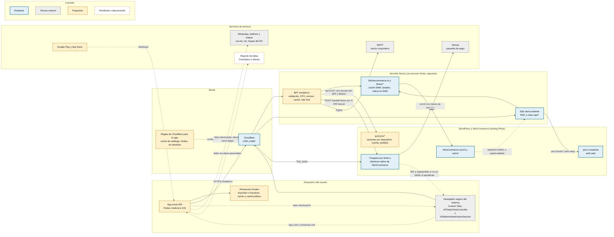
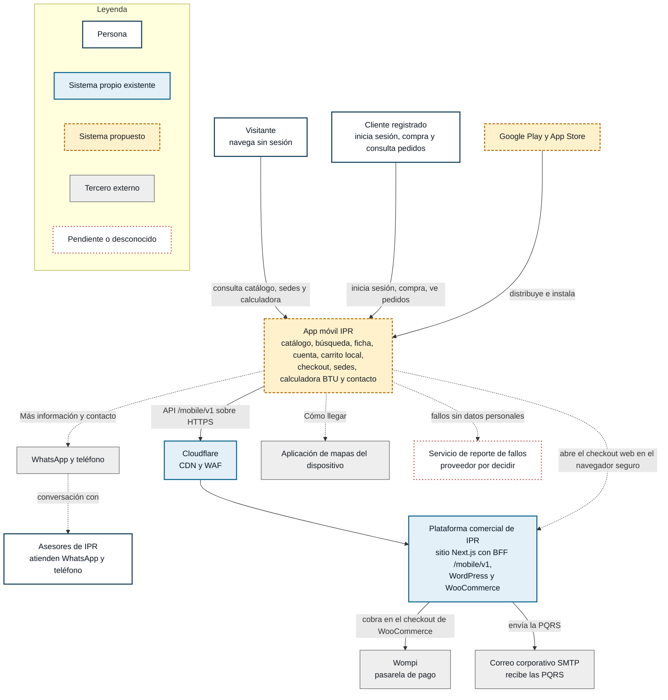
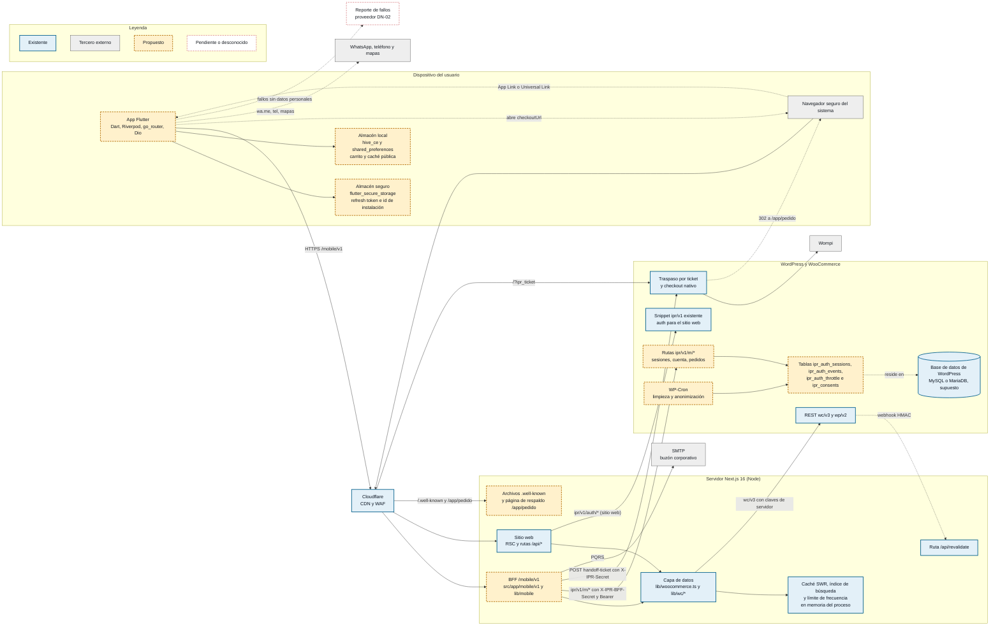

# Diagramas de arquitectura general y C4 — App móvil IPR

| | |
|---|---|
| **Proyecto** | App móvil Flutter (Android/iOS) de IPR Partes y Repuestos (Inverprimos S.A.S.) |
| **Fase** | Tercera entrega: Arquitectura. **No se programa nada.** |
| **Fecha** | 2026-11-18 |
| **Estado** | BORRADOR. Diagramas derivados **solo** de documentos ya escritos; ningún elemento es invención del diagramador. |
| **Contenido** | Diagrama 1 (arquitectura general), diagrama 3 (C4 Contexto), diagrama 4 (C4 Contenedores). El diagrama 2 y el 5 están en [`component_diagrams.md`](component_diagrams.md); los flujos 6 a 10 en [`data_flow.md`](data_flow.md); el 12 en [`deployment_architecture.md`](deployment_architecture.md). El modelo de datos (11) lo elabora otro agente en `docs/04_database/`. |

## 0. Convenciones

### 0.1 Abreviaturas de fuentes (rutas bajo `docs/`)

| Sigla | Documento |
|---|---|
| `OV` | `03_architecture/architecture_overview.md` |
| `FA` | `03_architecture/flutter_app_architecture.md` |
| `ADR` | `03_architecture/architecture_decisions.md` (ADR-001 y ADR-002, **Aprobadas**) |
| `AA` | `05_api/api_architecture.md` |
| `AU` | `05_api/authentication.md` |
| `AC` | `05_api/api_contracts.md` |
| `COD` | `00_discovery/informe_codigo_frontend.md` (prevalece sobre `INV`) |
| `INV` | `00_discovery/informe_investigacion.md` |
| `WCA` | `00_discovery/analisis_capa_woocommerce.md` |
| `RF` | `02_requirements/functional_requirements.md` |

Las ADR-003 a ADR-012 (en `OV` §9) y las ADR-013 a ADR-022 (en `AA` §18) están en estado **Propuesta**: todo lo que dependa solo de ellas se dibuja como **PROPUESTO**.

### 0.2 Estilos usados en todos los diagramas

| Estilo | Significado | Cómo se ve |
|---|---|---|
| **Existente** | Existe hoy en producción (HECHO en `COD`/`INV`) | Relleno azul claro, borde azul sólido |
| **Tercero externo** | Servicio o capacidad que no operan IPR ni el equipo de la app y que ya existe | Relleno gris |
| **Propuesto** | No existe; nace de ADR-001/002 (Aprobadas) o de propuestas aún sin aprobar | Relleno ámbar, borde punteado |
| **Pendiente / desconocido** | Existe como necesidad pero la decisión o el dato está abierto | Relleno blanco, borde rojo punteado |

Líneas: continua = llamada o dependencia directa; punteada = navegación del usuario, retorno asíncrono, configuración o canal de contacto.

Plantilla de estilos (se repite en cada bloque Mermaid para que cada diagrama sea autónomo):

```
classDef existente fill:#e3f0f8,stroke:#07628e,stroke-width:2px,color:#0a1320
classDef externo fill:#eeeeee,stroke:#555555,stroke-width:1px,color:#151a21
classDef propuesto fill:#fff1cc,stroke:#b36b00,stroke-width:2px,stroke-dasharray:5 3,color:#151a21
classDef pendiente fill:#ffffff,stroke:#c2373c,stroke-width:2px,stroke-dasharray:2 4,color:#151a21
```

---

## 1. Arquitectura general del sistema

Vista de extremo a extremo: dispositivo, borde, servidor Next.js, WordPress y terceros. Es el diagrama "de una sola mirada"; el detalle por contenedor está en el diagrama 4.



### 1.1 Leyenda y lectura

- La app habla **solo** con el BFF `/mobile/v1` (ADR-001, decisión 3; `OV` §3, principio P2). Las únicas salidas a otros hosts son el navegador seguro (URL de checkout de una lista cerrada) y los esquemas `tel:`, `wa.me` y mapas.
- El pago **no** ocurre en la app: ocurre en el checkout de WooCommerce con Wompi, abierto en el navegador seguro (ADR-001 decisión 4; ADR-002).
- El retorno (`302 a /app/pedido` y App Link) es un **acelerador**: la fuente de verdad del resultado es la consulta al BFF (diagrama del flujo 8 en `data_flow.md`).
- Las claves de WooCommerce y los secretos entre BFF y WordPress **nunca** salen del servidor (`OV` §2.3).

### 1.2 Tabla elemento → evidencia

| Elemento | Estado | Evidencia (documento y sección) |
|---|---|---|
| App móvil IPR | Propuesto (por crear) | ADR-002; `OV` §2.1 (fila "App móvil IPR"); `FA` §1–§2 |
| Almacenes locales | Propuesto | `FA` §8 (tabla de almacenamiento local); `OV` §9 ADR-007 |
| Navegador seguro del sistema | Tercero (existe en el SO) | ADR-001 decisión 4; `OV` §2.1; `FA` §6.3 (nota sobre `SecureBrowser`) |
| Cloudflare CDN y WAF | Existente | `INV` §2.1 (fila CDN/WAF); `OV` §2.1; `AA` §3.2 |
| Reglas de Cloudflare para la app | Propuesto | ADR-001 condición C3; `AA` §8.1 (Cache Rule), §10.1, §11 (fila Cloudflare); `OV` §8 RA-06 |
| Sitio web existente (RSC y `/api/*`) | Existente | `COD` §2 (diagrama y viñetas); `INV` §2.1 |
| BFF `/mobile/v1` | Propuesto | ADR-001 decisión 1; `AA` §3.1 y §3.2; `AC` §2 (27 endpoints propuestos) |
| `lib/woocommerce.ts` y `lib/wc/*` | Existente (requiere cambios P0) | `COD` §2 y §4; `AA` §4 y §16.1; `WCA` §1 y §5 |
| WooCommerce `wc/v3` y `wp/v2` | Existente | `COD` §1 (fila Backend) y §2 |
| `ipr/v1` existente (auth web) | Existente | `COD` §1 y §5.1; `AC` Anexo A.1 |
| `ipr/v1/m/*` | Propuesto | `AU` §9; `AA` §16.2 (WP-01 a WP-12); ADR-001 decisión 2 |
| Traspaso por ticket y checkout nativo | Existente (se extiende, WP-06) | `COD` §2, §5.4; `AA` §2 F-08, §13; `AC` Anexo A.1 (`handoff-ticket`, `/?ipr_ticket=`) |
| Wompi | Tercero existente | `COD` §1 (fila Pasarela de pago); `OV` §2.1. Confirmación de pago por webhook: **DESCONOCIDO** (`AA` §3.2, fila "WooCommerce + Wompi") |
| SMTP / buzón corporativo | Tercero existente | `COD` §2 (flecha a SMTP, nodemailer); `AA` §3.1 y §9.1 (BFF → SMTP); `AU` §12.2 (fila PQRS) |
| WhatsApp, teléfono y mapas | Tercero existente | `OV` §2.1 (fila WhatsApp/teléfono/mapas); RF-062, RF-074, RF-075 |
| Reporte de fallos (Crashlytics o Sentry) | Pendiente (DN-02) | `OV` §2.1 (fila "Proveedor de reporte de fallos"); `OV` §9 ADR-010; `FA` §17.1 |
| Google Play y App Store | Propuesto (distribución) | `FA` §16 (flavor `prod` → tiendas); `AA` §13.3 (Play App Signing); `AU` §12.2 (requisito de enlace de eliminación de cuenta en Google Play) |
| Flecha `webhook HMAC → /api/revalidate` | Existente | `COD` §2 (diagrama) y §4 (fila Webhook `/api/revalidate`) |
| Flecha `302 a /app/pedido` y App Link | Propuesto | `AA` §13.1 (URL de retorno), §13.3, §15.C; ver inconsistencia IN-01 |
| Flecha `SB → CF → CHK` | Existente en lo esencial | `COD` §2 (`/?ipr_ticket=…` navegación al WordPress); Cloudflare delante de WordPress: `INV` §2.1; ver IN-11 |

**DESCONOCIDO (no dibujado):** número de procesos Node y su despliegue (contenedor o proceso directo) (`AA` §2 F-01); plan de Cloudflare y si admite reglas por ruta (`AA` §17.2 AP-08); si `WOOCOMMERCE_INTERNAL_URL` (ruta que evita Cloudflare) está configurada en producción (`WCA` §1); proveedor de reporte de fallos (DN-02).

---

## 3. C4 Nivel 1 — Contexto del sistema

Personas y sistemas que rodean a la app. La "Plataforma comercial de IPR" se dibuja como una sola caja: es el sistema existente al que la app se conecta a través del BFF propuesto.



### 3.1 Leyenda y lectura

- En el MVP **no hay** roles B2B ni cotización estructurada (ADR-002). Los productos sin precio y las consultas comerciales terminan en WhatsApp con un asesor (flujo 9 en `data_flow.md`).
- "Plataforma comercial de IPR" mezcla elementos existentes (sitio, WordPress, WooCommerce) con el BFF propuesto; se tiñe como existente porque la caja es el sistema vivo al que se extiende (ADR-001).
- Los "Asesores de IPR" no son usuarios del sistema: se comunican por WhatsApp o teléfono. No hay panel de asesores en el MVP (módulo G: cotización estructurada = fase 2, RF-066).

### 3.2 Tabla elemento → evidencia

| Elemento | Estado | Evidencia (documento y sección) |
|---|---|---|
| Visitante | Actor | RF (actor "Visitante" en módulos A–D, I, K); RF-037 (acceso sin sesión) citado en `AC` §2 (nota bajo la tabla) |
| Cliente registrado | Actor | RF (actor "Cliente registrado" en módulos E, F, N); RF-052 (para pagar se requiere sesión) |
| Asesores de IPR | Actor externo al sistema | ADR-002 (consecuencias: "clientes B2B y compras sin precio dependen de asesores"); RF-062 (WhatsApp de la línea nacional); RF-066 (actor "Asesor comercial", fase 2) |
| App móvil IPR | Propuesto | ADR-002 (alcance del MVP); `OV` §2.1 y §6 |
| Plataforma comercial de IPR | Existente (se amplía) | ADR-001 (decisiones 1 y 2); `COD` §2; `OV` §2.1 (filas BFF, capa de datos, WordPress) |
| Cloudflare | Existente | `INV` §2.1; `OV` §2.1; `AA` §3.2 |
| Wompi | Tercero existente | `COD` §1 (Pasarela de pago); ADR-001 contexto (pago en checkout nativo con Wompi) |
| Correo corporativo SMTP | Tercero existente | `COD` §2 (SMTP / nodemailer: PQRS y newsletter); `AC` EP-27 |
| WhatsApp y teléfono | Tercero existente | RF-062, RF-063, RF-064, RF-074 |
| Aplicación de mapas | Tercero (SO) | RF-075 |
| Servicio de reporte de fallos | Pendiente (DN-02) | `OV` §2.1; `OV` §9 ADR-010; RNF-097 (citado en `OV` §2.1) |
| Google Play y App Store | Propuesto | `FA` §16 (flavor `prod`: "Tiendas"); `AU` §12.2 (Google Play) |
| Flecha "abre el checkout web en el navegador seguro" | Propuesto | ADR-001 decisión 4; ADR-002; RF-052 |
| Flecha "cobra en el checkout de WooCommerce" | Existente | `COD` §1 (Pasarela) y §5.4 (punto 3) |

**DESCONOCIDO (no dibujado):** quién opera el equipo móvil (D-15, `OV` §2.1); si el equipo de TI de IPR administra Cloudflare o un tercero (no documentado); medios de pago habilitados en Wompi (RF-053: "DESCONOCIDOS"); herramienta de analítica (PA-08, RNF-103: apagada hasta decidir).

---

## 4. C4 Nivel 2 — Contenedores

Contenedores (unidades desplegables o almacenes de datos) y sus protocolos. Es el nivel donde se ve qué existe y qué es nuevo dentro del servidor y de WordPress.



### 4.1 Leyenda y lectura

- **Un solo proceso Node** es un **supuesto de diseño** (SA-01): lo que depende de memoria compartida (caché SWR, índice, rate limit) se declara como tal. Si hay más de un proceso, cambia la estrategia (Redis, `AA` §14).
- `CCHK` cubre dos piezas existentes del snippet `ipr-cart-handoff.php`: la ruta REST `handoff-ticket` y el consumo del ticket `GET /?ipr_ticket=`. Se extiende (WP-06); no se reemplaza.
- `CIPR` (auth del sitio web) **no** lo consume el BFF: el BFF usa solo `ipr/v1/m/*`. La web conserva su contrato (`AU` §7).
- `CTAB` son tablas nuevas de WordPress creadas por un plugin propio con `dbDelta` (`AU` §8; riesgo RS-02). El detalle de campos lo documenta el modelo de datos (otro agente, `docs/04_database/`).

### 4.2 Tabla elemento → evidencia

| Elemento | Estado | Evidencia (documento y sección) |
|---|---|---|
| App Flutter (Dart, Riverpod, go_router, Dio) | Propuesto | `FA` §1, §5, §6, §7; `OV` §9 (ADR-004, ADR-005, ADR-006) |
| Almacén seguro (`flutter_secure_storage`) | Propuesto | `FA` §8 (filas refresh token e identificador de instalación); `AU` §5 |
| Almacén local (`hive_ce`, `shared_preferences`) | Propuesto | `FA` §8 (filas carrito, caché pública, preferencias); `OV` §9 ADR-007 |
| Navegador seguro del sistema | Tercero (SO) | ADR-001 decisión 4; `FA` §6.3 |
| Cloudflare CDN y WAF | Existente | `INV` §2.1; `AA` §3.2 |
| Sitio web (RSC y `/api/*`) | Existente | `COD` §2; `AA` §3.1 (nodo WEB "SIN CAMBIOS de contrato") |
| BFF `/mobile/v1` (`src/app/mobile/v1`, `lib/mobile`) | Propuesto | ADR-001 decisión 1; `AA` §4.1 (tabla de organización del código) |
| Capa de datos (`lib/woocommerce.ts`, `lib/wc/*`) | Existente | `COD` §4 (fila `lib/woocommerce.ts`); `AA` §4 |
| Caché SWR, índice y límite de frecuencia en memoria | Existente (límite de frecuencia: se corrige, FE-05) | `COD` §2 (viñeta "Carga a WooCommerce"); `AA` §2 F-02, F-11; `WCA` §1 |
| Archivos `.well-known` y página `/app/pedido` | Propuesto | `AA` §13.3; `AA` §16.1 FE-10; `OV` §10 DA-03 |
| Ruta `/api/revalidate` | Existente | `COD` §2 (diagrama) y §4; `AC` Anexo A.2 |
| REST `wc/v3` y `wp/v2` | Existente | `COD` §1 (fila Backend) |
| Snippet `ipr/v1` existente (auth web) | Existente | `COD` §5.1; `AC` Anexo A.1; `AU` §1 |
| Rutas `ipr/v1/m/*` | Propuesto | `AU` §9; `AA` §16.2 WP-01 a WP-12; ADR-014 en `AA` §18 |
| Traspaso por ticket y checkout nativo | Existente (se extiende) | `COD` §5.4; `AA` §2 F-08; `AA` §16.2 WP-06 |
| Tablas `ipr_auth_*` e `ipr_consents` | Propuesto | `AU` §8.1 a §8.4 |
| Base de datos de WordPress (MySQL o MariaDB) | Existente; motor es **supuesto** | `AA` §17.1 SA-02 |
| WP-Cron (limpieza y anonimización) | Propuesto | `AU` §3.5 (fila "Limpieza"); `AU` §12.1 paso 6; `AA` §3.3 (eliminación de cuenta usa WP-Cron) |
| Wompi | Tercero existente | `COD` §1 |
| SMTP | Tercero existente | `AA` §9.1 (fila BFF → SMTP) |
| WhatsApp, teléfono y mapas | Tercero existente | `OV` §2.1; RF-062, RF-074, RF-075 |
| Reporte de fallos | Pendiente (DN-02) | `OV` §2.1, §9 ADR-010 |
| Flecha "`X-IPR-BFF-Secret` y Bearer" | Propuesto | `AA` §3.1 (etiqueta de la flecha BFF → IPR); ADR-014 (`AA` §18) |
| Flecha "`X-IPR-Secret` a `handoff-ticket`" | Existente (secreto actual) | `COD` §2 (flecha `POST /ipr/v1/handoff-ticket`); `AA` §3.1 |
| Flecha "`ipr/v1/auth/*` (sitio web)" | Existente | `COD` §2; `AU` §7 (la web sigue usando el token heredado) |

**DESCONOCIDO (no dibujado):** si WordPress usa la ruta interna que evita Cloudflare cuando el BFF le llama (`WCA` §1); cómo se confirma el pago de Wompi hacia WooCommerce (webhook: SA-05, supuesto no verificado); número de procesos Node y réplicas (SA-01); si el origen solo acepta tráfico de Cloudflare (SA-03); entorno de **staging** (ver `deployment_architecture.md`).

---

## Inconsistencias detectadas

Cuando dos documentos se contradicen se dibuja lo que dice el más específico o reciente y se registra aquí. Los identificadores `IN-xx` son comunes a los cuatro archivos de diagramas.

| ID | Tema | Documentos en conflicto | Qué se dibujó |
|---|---|---|---|
| IN-01 | **Ruta de retorno del pago y alcance de los enlaces verificados.** `/pedido-confirmado` (web actual) frente a la ruta dedicada `/app/pedido` (`/app/*`). | `RF` RF-055, `COD` §5.4, `OV` §1 punto 4 y §2.2, `OV` §10 DA-03, `FA` §6.2 (solo `/pedido-confirmado`) frente a `AA` §13.1, §13.3, §15.C y `AC` EP-23 (`returnUrlPrefix`, solo `/app/*`) | `/app/pedido` (documento de API: más específico y con motivo explícito, no capturar la navegación web normal). Los archivos `.well-known` de `FA` y `OV` deberían alinearse con esa ruta. |
| IN-02 | **Mecanismo principal de retorno.** RF-055 y ADR-001 decisión 4 (Aprobada) presentan los App/Universal Links como mecanismo de regreso y la consulta como alternativa. ADR-008 (`OV`) y ADR-017 (`AA`), ambas Propuestas, invierten el orden. | `RF` RF-055; ADR-001 §4 frente a `OV` §9 ADR-008 y `AA` §18 ADR-017 | Consulta al servidor como fuente de verdad y enlace como acelerador (lo propuesto, más reciente y respaldado por el hecho verificado `handoff.php:464-466`). ADR-008/017 requieren aprobación. |
| IN-03 | **Estado del diseño de N-11/N-12 y ADR duplicada.** `OV` §7 y §10 (DA-02) tratan el identificador de intento y la consulta del resultado como pendientes "en elaboración"; `AC` ya define EP-23 y EP-24. La misma decisión tiene dos números: ADR-008 en `OV` y ADR-017 en `AA`. | `OV` §7.1, §9, §10 frente a `AC` §3 EP-23/EP-24, `AA` §18 | Se dibujan EP-23/EP-24 como contratos propuestos. Conviene unificar la numeración de ADR al aprobarlas. |
| IN-11 | **Cloudflare delante de WordPress.** `INV` §2.1 y `OV` §2.1 lo sitúan delante del sitio, del BFF y de WordPress; los diagramas de `COD` §2 y de `AA` §3.1 no dibujan Cloudflare en el tramo navegador → WordPress, y `WCA` §1 menciona una ruta interna opcional que lo evita. | `INV` §2.1, `OV` §2.1 frente a `COD` §2, `AA` §3.1, `WCA` §1 | Cloudflare en el tramo navegador → WordPress (evidencia técnica de `INV`: cabeceras `Server: cloudflare`). El tramo BFF → WordPress queda **DESCONOCIDO** (pública o interna). |
