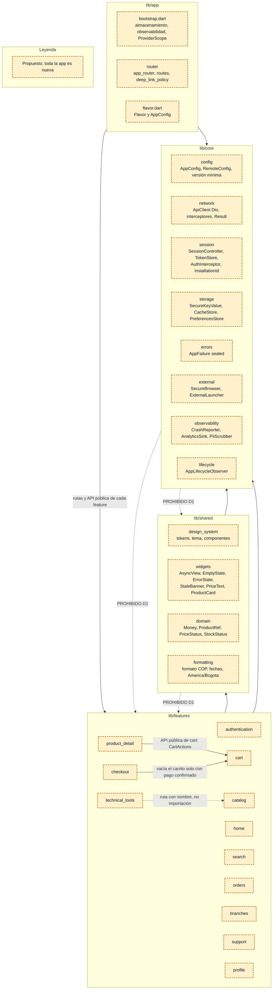
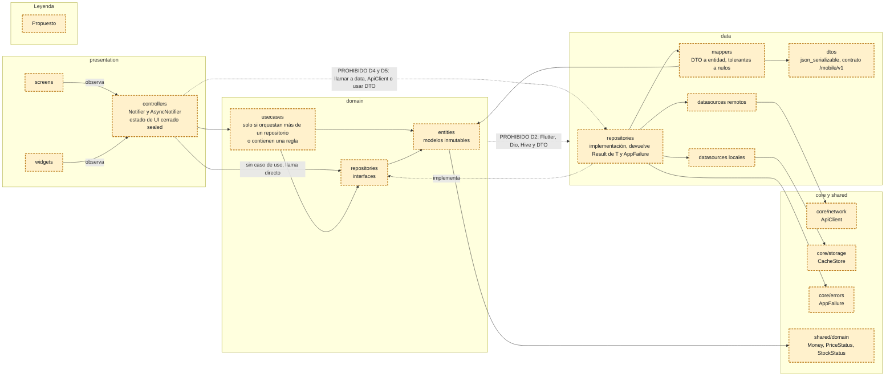
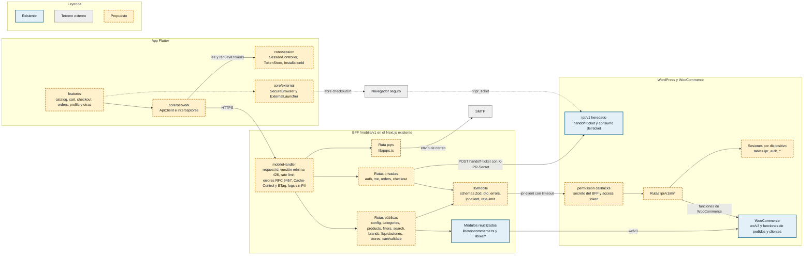
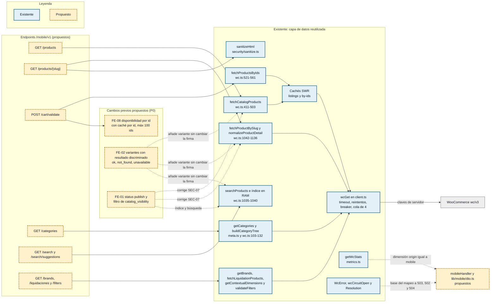
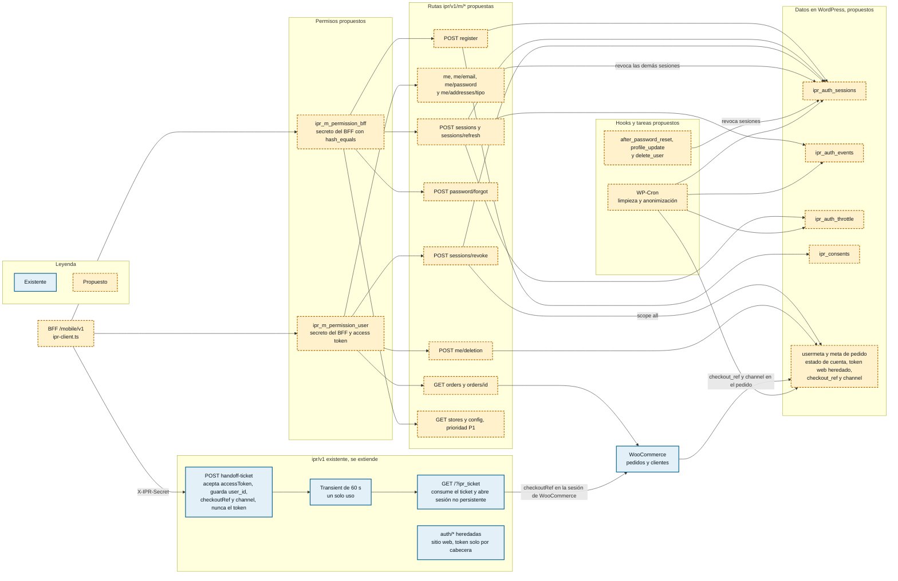
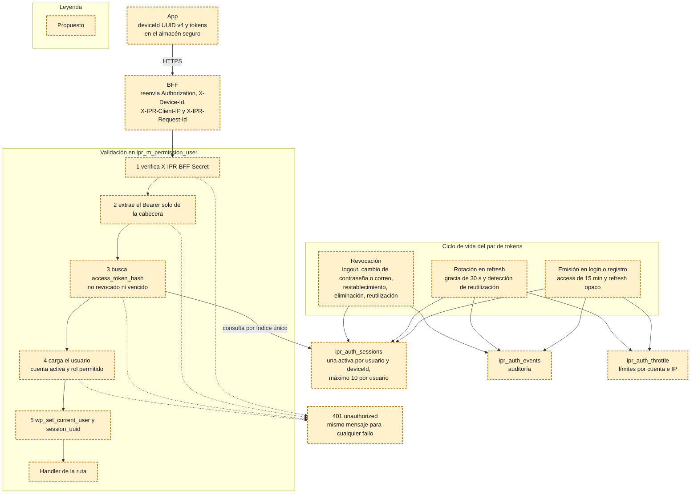
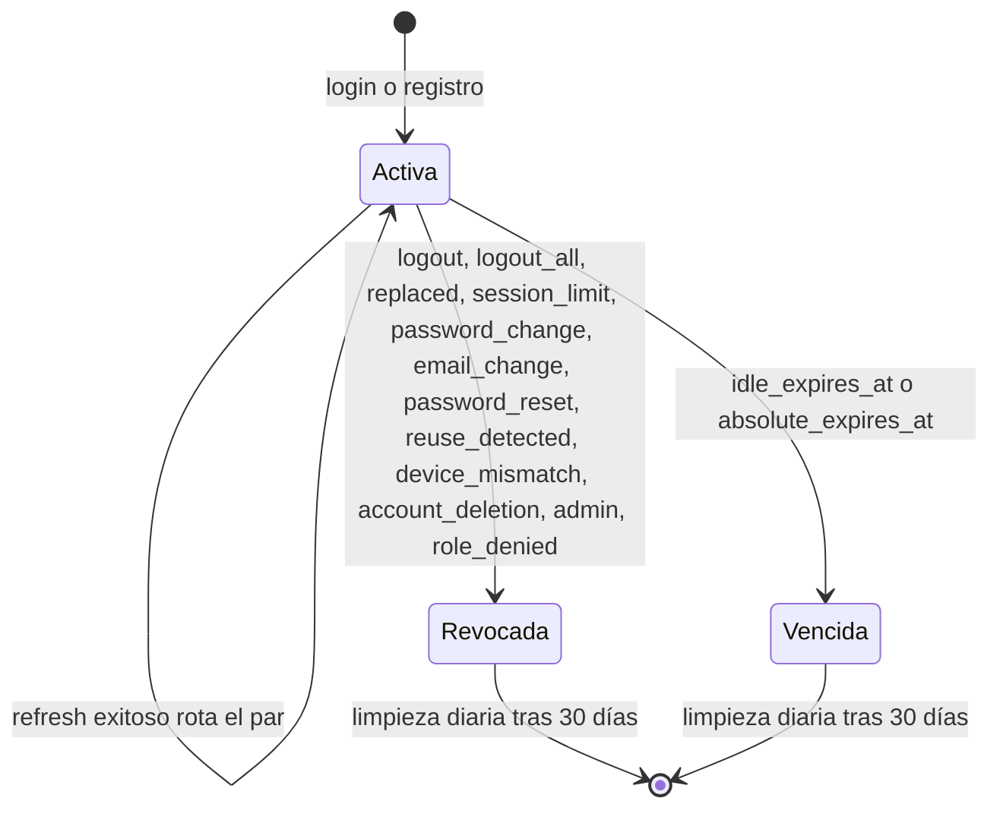

# Diagramas de componentes — App Flutter, BFF, WordPress y sesiones

| | |
|---|---|
| **Proyecto** | App móvil Flutter (Android/iOS) de IPR Partes y Repuestos (Inverprimos S.A.S.) |
| **Fase** | Tercera entrega: Arquitectura. **No se programa nada.** |
| **Fecha** | 2026-11-18 |
| **Estado** | BORRADOR. Derivado solo de documentos ya escritos. |
| **Contenido** | Diagrama 2 (arquitectura interna de Flutter: 2a, 2b, 2c) y diagrama 5 (componentes: 5a vista general, 5b módulos del BFF reutilizados de `lib/woocommerce.ts`, 5c WordPress `ipr/v1`, 5d y 5e sesiones por dispositivo). |
| **Relacionados** | [`c4_diagrams.md`](c4_diagrams.md) (convenciones y siglas) · [`data_flow.md`](data_flow.md) · [`deployment_architecture.md`](deployment_architecture.md) |

## 0. Convenciones

Siglas de fuentes: `OV` = `architecture_overview.md`, `FA` = `flutter_app_architecture.md`, `ADR` = `architecture_decisions.md`, `AA` = `05_api/api_architecture.md`, `AU` = `05_api/authentication.md`, `AC` = `05_api/api_contracts.md`, `COD` = `00_discovery/informe_codigo_frontend.md`, `WCA` = `00_discovery/analisis_capa_woocommerce.md`. Los identificadores `IN-xx` son los de la sección "Inconsistencias detectadas" (comunes a los cuatro archivos de diagramas).

Estilos: **existente** (azul, borde sólido) · **tercero externo** (gris) · **propuesto** (ámbar, borde punteado) · **pendiente o desconocido** (blanco, borde rojo punteado). Toda la app Flutter es **propuesta** (no existe código); los módulos de `lib/woocommerce.ts` y los snippets de WordPress son **existentes**, con los cambios propuestos indicados como nodos propuestos aparte.

```
classDef existente fill:#e3f0f8,stroke:#07628e,stroke-width:2px,color:#0a1320
classDef externo fill:#eeeeee,stroke:#555555,stroke-width:1px,color:#151a21
classDef propuesto fill:#fff1cc,stroke:#b36b00,stroke-width:2px,stroke-dasharray:5 3,color:#151a21
classDef pendiente fill:#ffffff,stroke:#c2373c,stroke-width:2px,stroke-dasharray:2 4,color:#151a21
```

---

## 2. Arquitectura interna de la app Flutter

### 2a. Capas globales, features y dependencias permitidas

Flechas continuas = dependencias permitidas (regla D1 y excepciones de D3). Flechas punteadas con la etiqueta PROHIBIDO = dependencias que la verificación de CI debe rechazar.



**Lectura.**

- Regla de oro: `features → shared → core`; nunca al revés (`OV` §6; `FA` §3.1 D1).
- Una feature **no importa el interior de otra**; solo su archivo público `<feature>.dart` (D3). La única dependencia directa aceptada entre features es hacia la API pública de `cart` (`product_detail` y `checkout`, `FA` §3.2).
- La sesión vive en `core/session` y no en `features/authentication`, para que el interceptor HTTP (core) no dependa de una feature (`FA` §2.2).
- Las features de fase 2 (`favorites`, `notifications`, `quotes`, `content`) **no** se crean (`FA` §2.2).

| Elemento | Evidencia (documento y sección) |
|---|---|
| `lib/app` y sus tres piezas (`bootstrap`, `router`, `flavor`) | `FA` §2.1 (árbol de carpetas) |
| Las 12 features | `FA` §2.1; `OV` §6; trazabilidad RF → feature en `FA` §20 |
| `lib/shared` (design system, widgets, domain, formatting) | `FA` §2.1 y §2.2 (fila `shared/domain`) |
| `lib/core` (8 módulos) | `FA` §2.1 (árbol); `FA` §4 (fila `core`) |
| `features → shared → core`; prohibido lo contrario | `FA` §3.1 D1; `OV` §6 ("Regla de oro") |
| `product_detail → cart`, `checkout → cart` | `FA` §3.2 (filas "Añadir al carrito desde la ficha" y "Vaciar carrito tras pago confirmado") |
| `technical_tools → catalog` por ruta con nombre | `FA` §3.2 (fila "Navegar a otra feature", ejemplo BTU → listado, RF-089) |
| `APPL → CORE` (bootstrap inicializa almacenamiento y observabilidad) | `FA` §2.1 (comentario de `bootstrap.dart`) |

### 2b. Estructura interna de una feature (presentation, domain, data)



**Lectura.**

- `presentation → domain ← data`: el dominio no conoce a nadie; `data` implementa las interfaces de `domain` (`FA` §3.1 D2; ADR-003 en `OV` §9).
- Los **casos de uso** existen solo donde hay regla real: límites del carrito (1–99 y 100 líneas), elegibilidad de compra, fórmula BTU, máquina de estados del checkout (`FA` §4).
- Los DTO nunca salen de `data`; la UI trabaja con entidades (D5). Los repositorios devuelven `Result<T, AppFailure>` y ninguna excepción de red llega a `presentation` (`FA` §7.3).
- Los repositorios y servicios se inyectan con `Provider` y se sustituyen con `overrides` en pruebas (ADR-004, `FA` §5.1); no se dibuja cada provider para no ensuciar el diagrama.

| Elemento | Evidencia (documento y sección) |
|---|---|
| Subcarpetas `screens`, `widgets`, `controllers` | `FA` §2.1 (estructura de `features/<feature>/`) |
| `entities`, `repositories`, `usecases` y su condición | `FA` §2.1; `OV` §9 ADR-003 ("casos de uso solo cuando orquestan más de un repositorio o contienen una regla") |
| `dtos`, `mappers`, `datasources`, `repositories` de data | `FA` §2.1 |
| Controladores con estado `sealed` (`Loading`, `Data`, `Empty`, `Failure`) | `FA` §5.2 |
| `Result<T, AppFailure>` | `FA` §7.3 (último párrafo); `OV` §9 ADR-006 |
| Reglas D2, D4, D5 (prohibiciones) | `FA` §3.1 |
| `datasources → core/network` y `core/storage` | `FA` §3.1 D6 y §4 (filas `data` y `core`) |
| `entities → shared/domain` | `FA` §2.2 (fila `shared/domain`: `Money`, `PriceStatus`, `StockStatus`, `ProductRef`) |

### 2c. Capa de red de la app: interceptores y sesión

Orden de los interceptores de Dio y su relación con la sesión.

```mermaid
flowchart LR
  N_REPO["Repositorio de feature<br/>data/repositories"]
  N_API["ApiClient<br/>Dio, base URL por flavor"]
  N_I1["1 AppHeadersInterceptor<br/>X-App-Version, X-App-Platform,<br/>X-Request-Id, Accept-Language"]
  N_I2["2 AuthInterceptor<br/>Bearer solo en rutas privadas,<br/>un único refresh en vuelo"]
  N_I3["3 RetryInterceptor<br/>solo GET y HEAD, máximo 2 reintentos,<br/>respeta Retry-After"]
  N_I4["4 ErrorMappingInterceptor<br/>respuesta o DioException a AppFailure"]
  N_I5["5 DebugLogInterceptor<br/>solo dev y staging, sin cuerpos"]
  N_HTTP["Cliente HTTP de la plataforma<br/>timeout lectura 10 s, ticket 20 s, PQRS 15 s"]
  N_BFF["BFF /mobile/v1<br/>fuera de la app"]
  N_SES["core/session<br/>SessionController y TokenStore"]
  N_SEC["core/storage<br/>SecureKeyValue"]

  N_REPO --> N_API
  N_API --> N_I1
  N_I1 --> N_I2
  N_I2 --> N_I3
  N_I3 --> N_I4
  N_I4 --> N_I5
  N_I5 --> N_HTTP
  N_HTTP -->|"HTTPS"| N_BFF
  N_I2 -->|"lee token, renueva y, si falla, expire()"| N_SES
  N_SES --> N_SEC
  N_I4 -.->|"Result de T y AppFailure"| N_REPO

  subgraph LEY["Leyenda"]
    L1["Propuesto"]
    L2["Fuera de la app"]
  end

  classDef externo fill:#eeeeee,stroke:#555555,stroke-width:1px,color:#151a21
  classDef propuesto fill:#fff1cc,stroke:#b36b00,stroke-width:2px,stroke-dasharray:5 3,color:#151a21
  class N_REPO,N_API,N_I1,N_I2,N_I3,N_I4,N_I5,N_HTTP,N_SES,N_SEC,L1 propuesto
  class N_BFF,L2 externo
```



| Elemento | Evidencia (documento y sección) |
|---|---|
| Orden y responsabilidad de los 5 interceptores | `FA` §7.2 |
| Cabeceras propias (`X-App-Version`, `X-App-Platform`, `X-Request-Id`, `Accept-Language`) | `FA` §7.1 (fila "Cabeceras propias"). `X-Device-Id` no figura allí: **IN-06** |
| Timeouts (10 s lectura, 20 s ticket, 15 s PQRS) | `FA` §7.1 (la cifra de lectura difiere de `AA` §9.1: **IN-09**) |
| Reintentos solo GET/HEAD, máximo 2, `Retry-After` | `FA` §7.2 (fila 3); `OV` §9 ADR-006 |
| Un único refresh en vuelo y `expire()` si el refresh falla | `FA` §7.2 (fila 2); `AU` §3.4 (último párrafo del algoritmo): **IN-08** |
| `DebugLogInterceptor` solo dev/staging | `FA` §7.2 (fila 5) |
| Tokens en `SecureKeyValue` | `FA` §8 |

---

## 5. Diagramas de componentes

### 5a. Vista general: app, BFF y WordPress



| Elemento | Evidencia (documento y sección) |
|---|---|
| `mobileHandler` y sus responsabilidades | `AA` §4.1 (fila `src/lib/mobile/http.ts`) |
| Rutas públicas y privadas | `AC` §2 (índice de endpoints: columna Auth) |
| `lib/mobile/*` (schemas, dto, errors, ipr-client, rate-limit) | `AA` §4.1 |
| Ruta `pqrs` con `lib/pqrs.ts` | `AA` §16.1 FE-16; `AC` EP-27 |
| Módulos reutilizados `lib/woocommerce.ts` y `lib/wc/*` | ADR-001 decisión 1; `AA` §4 |
| `ipr-client` con timeout y secreto | `AA` §4.1 (fila `ipr-client.ts`); `AA` §9.1 |
| `permission callbacks` y `ipr/v1/m/*` | `AU` §9 (párrafo inicial y tabla de rutas) |
| Sesiones por dispositivo (tablas) | `AU` §8.1 a §8.3; ADR-013 en `AA` §18 |
| `handoff-ticket` heredado y su consumo | `AC` Anexo A.1; `AA` §13.1 |
| `SecureBrowser` y `ExternalLauncher` | `FA` §2.1 (`core/external`) |
| BFF → SMTP | `AA` §3.1 y §9.1 (fila BFF → SMTP) |

### 5b. Módulos del BFF reutilizados de `lib/woocommerce.ts` y `lib/wc/*`

Qué función existente alimenta cada endpoint y qué cambios previos exige (ver `AA` §4 y §16.1). Referencias `archivo:línea` tomadas de los documentos, no re-verificadas aquí.



**No se reutilizan** (`AA` §4, última fila): `formatCOP`, `MenuItem` y migas con URL web; la app formatea con su configuración regional y las URLs web no son contrato.

**Regla de implementación (propuesta):** las rutas `/mobile/v1` no importan `next/headers` ni `cookies()`; solo importan `lib/*` y `lib/mobile/*` (`AA` §4, último párrafo). Así ignoran la cookie `ipr_session` y no hay riesgo de CSRF.

| Flecha o nodo | Evidencia (documento y sección) |
|---|---|
| E1 → `fetchCatalogProducts` | `AA` §4 (fila `GET /products`) |
| E2 → `fetchProductBySlug` y `sanitizeHtml` | `AA` §4 (filas `GET /products/{slug}` y `sanitizeHtml`); ADR-019 en `AA` §18 |
| E3 → `fetchProductsByIds` + disponibilidad por id | `AA` §4 (fila `POST /cart/validate`); `AA` §16.1 FE-08 |
| E4 → `getCategories` | `AA` §4 (fila `GET /categories`) |
| E5 → `searchProducts` | `AA` §4 (filas `GET /search` y sugerencias) |
| E6 → marcas, liquidaciones, filtros | `AA` §4 (filas `GET /brands`, `/liquidaciones`, `/filters`); prioridad P1 |
| `wcGet` y sus protecciones | `AA` §2 F-02; `COD` §2 (viñeta "Carga a WooCommerce"); `WCA` §1 |
| Cachés SWR `listings` (400 claves) y `by-ids` (50 claves) | `AA` §7 (fila Estilo) y §4 (fila `POST /cart/validate`) |
| `WcError`, `wcCircuitOpen`, `Resolution`, `getWcStats` | `AA` §4 (filas "Todas") |
| FE-01, FE-02, FE-08 | `AA` §16.1 |

### 5c. WordPress `ipr/v1`: rutas heredadas, rutas nuevas, permisos y datos



**Lectura.** `X_AUTH` queda sin flechas entrantes a propósito: lo consume el sitio web (no el BFF) y sus cambios son solo de endurecimiento (token solo por cabecera, WP-04; revocación de sesiones de app ante cambio sensible, WP-05).

| Elemento | Evidencia (documento y sección) |
|---|---|
| Permisos `ipr_m_permission_bff` e `ipr_m_permission_user` | `AU` §9 (párrafo inicial); ADR-014 en `AA` §18 |
| Rutas `ipr/v1/m/*` | `AU` §9 (tabla "Método y ruta"); `AA` §16.2 WP-01 a WP-10 |
| `handoff-ticket` extendido, transient solo con `user_id` | `AU` §9 (fila `handoff-ticket`); `AA` §13.1; `AA` §16.2 WP-06; hecho actual en `AA` §2 F-08/F-09 |
| Consumo del ticket y cookie no persistente | `AA` §13.1 (fila "Cookie de WordPress"); `AA` §15.C |
| Tablas `ipr_auth_*` e `ipr_consents` | `AU` §8.1 a §8.4 |
| Metadatos (`_ipr_account_state`, `_ipr_checkout_ref`, `_ipr_channel`, token web heredado) | `AU` §8.5 |
| Hooks `after_password_reset`, `profile_update`, `delete_user` | `AU` §3.5 (filas de revocación) |
| WP-Cron (limpieza, anonimización) | `AU` §3.5 (fila "Limpieza"), §12.1 |
| `R_CFG` (P1) | `AU` §9 (fila `stores`/`config`); `AA` §16.2 WP-13 |

### 5d. Sesiones por dispositivo: validación de un access token y ciclo de emisión y revocación



| Elemento | Evidencia (documento y sección) |
|---|---|
| Pasos 1 a 6 de validación | `AU` §3.6 |
| Access de 15 min, gracia de 30 s, máximo 10 sesiones | `AU` §3.3 (valores **propuestos**, pendientes de aprobación AP-02 y DN-04) |
| Una sesión activa por (`user_id`, `device_id`) | `AU` §8.1 ("Reglas") y §3.5 (fila "Login en el mismo `deviceId`") |
| Rotación y reutilización | `AU` §3.4 |
| Causas de revocación | `AU` §3.5; lista `revoked_reason` en `AU` §8.1 |
| `deviceId` generado y guardado por la app | `AU` §4 |
| Tablas de auditoría y límites | `AU` §8.2 y §8.3 |

### 5e. Estados de una sesión



Evidencia: `AU` §8.1 (campos `revoked_at`, `revoked_reason`, `idle_expires_at`, `absolute_expires_at` y retención de 30 días) y §3.5 (fila "Limpieza").

---

## Inconsistencias detectadas

| ID | Tema | Documentos en conflicto | Qué se dibujó |
|---|---|---|---|
| IN-06 | **Cabecera `X-Device-Id`.** El contrato la exige en `/auth/*`, `/me*`, `/checkout*`, `/orders*`, `/pqrs` y `/cart/validate`; la lista de cabeceras propias de la app no la incluye (solo habla de un identificador de instalación aceptado en el login, T-11). | `AC` §1.1 y `AU` §4 frente a `FA` §7.1 y §7.2 (interceptor 1) | Diagrama 2c sigue a `FA` (las cuatro cabeceras listadas); se señala la omisión. La app debe enviar `X-Device-Id` según el contrato. |
| IN-07 | **Dónde vive el access token.** `FA` §8: access en memoria (secure storage solo si SPK-03 lo exige) y refresh en secure storage. `AU` §5: "access, refresh y deviceId solo en Keystore/Keychain", aunque admite mantener el access en memoria mientras la app está activa. | `FA` §8 frente a `AU` §5 | Almacén seguro con refresh e identificador de instalación (común a ambos); access en memoria como permite `AU`. |
| IN-08 | **Qué ocurre si falla el refresh.** `FA` §7.2: si el refresh falla → `SessionController.expire()`. `AU` §3.4 y AC-044-7: si la renovación falla **por red**, no se borran los tokens y se reintenta con el mismo refresh (ventana de gracia). | `FA` §7.2 frente a `AU` §3.4 | Diagrama 2c rotula "si falla, expire()" (texto de `FA`); en `data_flow.md` (flujo 6) se dibuja la distinción de `AU`. La app debe separar fallo de red de rechazo del servidor. |
| IN-09 | **Timeout de lectura App → BFF.** `FA` §7.1: recepción 10 s. `AA` §9.1: conexión 10 s y respuesta 15 s. | `FA` §7.1 frente a `AA` §9.1 | Se rotula la cifra de `FA` en 2c (documento de la app); alinear con `AA` y RNF-021. |
| IN-12 | **Taxonomía de errores sin 502 ni 504.** El BFF define `502 upstream_bad_response` y `504 upstream_timeout`; `AppFailure` no tiene tipo propio para ellos (el `RetryInterceptor` sí los reintenta en GET). | `AA` §6.3 frente a `FA` §7.2 y §7.3 | No se dibuja un mapeo que no está escrito (se marca **DESCONOCIDO** en `data_flow.md`, flujo 7). |
| IN-01 | **Ruta de retorno `/pedido-confirmado` frente a `/app/pedido`.** Afecta a 5a y 5c solo por referencia (los archivos `.well-known` y la ruta de respaldo). | Ver detalle en `c4_diagrams.md`, sección "Inconsistencias detectadas" | `/app/*` (documento de API). |
