# Flujos de datos — Autenticación, catálogo, checkout, WhatsApp e integraciones

| | |
|---|---|
| **Proyecto** | App móvil Flutter (Android/iOS) de IPR Partes y Repuestos (Inverprimos S.A.S.) |
| **Fase** | Tercera entrega: Arquitectura. **No se programa nada.** |
| **Fecha** | 2026-11-18 |
| **Estado** | BORRADOR. Cada mensaje corresponde a algo escrito en los documentos de `docs/`; lo que no está definido se anota como **DESCONOCIDO** bajo el diagrama. |
| **Contenido** | Flujo 6 (autenticación: 6a a 6e) · flujo 7 (consulta de productos: 7a a 7c) · flujo 8 (carrito y checkout: 8a a 8d) · flujo 9 (productos sin precio y WhatsApp: 9a y 9b) · flujo 10 (integraciones externas: 10a a 10f) |
| **Relacionados** | [`c4_diagrams.md`](c4_diagrams.md) (siglas, estilos y evidencia de contenedores) · [`component_diagrams.md`](component_diagrams.md) · [`deployment_architecture.md`](deployment_architecture.md) |

## 0. Convenciones

- Siglas de fuentes: `OV` = `03_architecture/architecture_overview.md`, `FA` = `flutter_app_architecture.md`, `AA` = `05_api/api_architecture.md`, `AU` = `05_api/authentication.md`, `AC` = `05_api/api_contracts.md`, `COD` = `00_discovery/informe_codigo_frontend.md`, `WCA` = `00_discovery/analisis_capa_woocommerce.md`. Las ADR-003 en adelante son **Propuestas**.
- Todos los endpoints `/mobile/v1` y las rutas `ipr/v1/m/*` son **PROPUESTOS** (no existen hoy, `AC` cabecera). Lo existente hoy: ticket de checkout (`handoff-ticket`), checkout nativo con Wompi, caché y capa de datos de `lib/woocommerce.ts`.
- En los diagramas de secuencia, las rutas de WordPress se abrevian `ipr/v1/m/...`. Los textos evitan llaves y punto y coma por compatibilidad con Mermaid; los cuerpos JSON se describen con palabras.
- Los identificadores `IN-xx` remiten a la sección final "Inconsistencias detectadas".
- Valores de vida de tokens, gracia y límites son **propuestas** pendientes de aprobación (AP-02, DN-04, `AU` §3.3).

---

## 6. Flujo de autenticación

### 6a. Login (sesión por dispositivo)

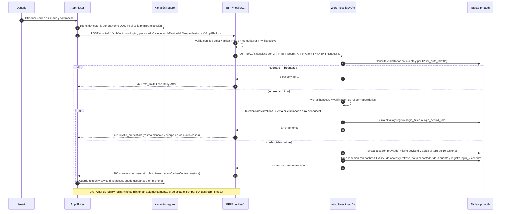

| Paso | Evidencia (documento y sección) |
|---|---|
| `deviceId` UUID v4 generado en la primera ejecución y guardado en almacén seguro | `AU` §4; `AA` §15.A paso 1 |
| Cabeceras `X-Device-Id`, `X-App-Version`, `X-App-Platform` | `AC` §1.1; `AA` §15.A paso 2 (ver **IN-06**) |
| Validación Zod y límite en memoria; llamada a `ipr/v1/m/sessions` con las tres cabeceras `X-IPR-*` | `AA` §15.A paso 3; `AA` §10.1 |
| Limitador por cuenta e IP en WordPress; bloqueo → 429 | `AA` §10.1 (capa WordPress); `AU` §13; `AC` EP-03 (códigos) |
| `wp_authenticate`, rol por capacidades, mismo mensaje en cuatro casos | `AA` §15.A paso 4; `AU` §3.7, §13 (reglas de respuesta) |
| Revocar sesión previa del mismo `deviceId`, tope de 10, hashes SHA-256, borrado de contador | `AU` §3.5 (filas "Login en el mismo `deviceId`" y "Superar 10 sesiones"), §3.2, §13 |
| Respuesta `session` y `user` sin `roles` ni `username`, `no-store` | `AA` §15.A paso 5; `AC` EP-03 |
| Guardado en Keystore/Keychain | `AA` §15.A paso 6; `FA` §8 (ver **IN-07**) |
| POST sin reintento automático | `AA` §9.1 (fila `ipr/v1/m/*` POST) |

El registro (`POST /auth/register`) sigue el mismo patrón con aceptación de términos y consentimientos (`AU` §10); no se dibuja por no estar entre los flujos pedidos. La recuperación de contraseña por correo (`AU` §11) tampoco.

### 6b. Uso del access token y refresh rotativo

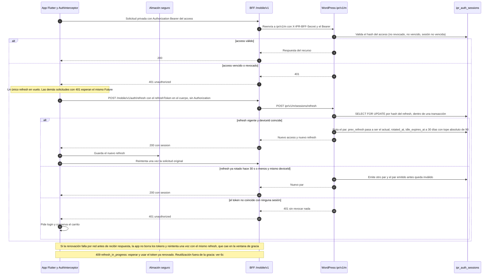

| Paso | Evidencia (documento y sección) |
|---|---|
| Validación del access en cada solicitud (revocación inmediata) | `AU` §3.5 (último párrafo), §3.6 |
| Un solo refresh en vuelo; reintento de la solicitud original una vez | `AA` §15.A paso 8 (AC-044-6); `FA` §7.2 (interceptor 2) |
| Refresh en el cuerpo, sin `Authorization` | `AC` EP-04 (cuerpo) |
| Algoritmo con `SELECT … FOR UPDATE`, rotación, ventana de gracia de 30 s, sin coincidencia → 401 sin revocar | `AU` §3.4 pasos 1 a 4 |
| Falla de red: no borrar tokens y reintentar con el mismo refresh (una vez) | `AU` §3.4 (último párrafo); `AA` §9.1 (fila `POST /auth/refresh`). `FA` §7.2 dice `expire()`: **IN-08** |
| 409 `refresh_in_progress` | `AA` §6.3 (tabla de códigos) |

### 6c. Reutilización de un refresh token detectada

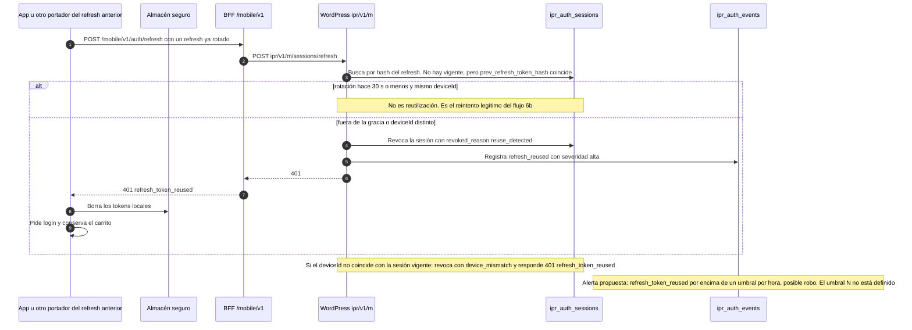

| Paso | Evidencia (documento y sección) |
|---|---|
| Rama de gracia frente a reutilización | `AU` §3.4 paso 3 |
| `reuse_detected`, auditoría de severidad alta, `401 refresh_token_reused` | `AU` §3.4 pasos 3 y 2 (device_mismatch); `AA` §6.3; `AA` §15.A paso 9 |
| La app borra tokens locales y pide login | `AA` §6.3 (fila `refresh_token_reused`, "La app debe") |
| Conserva el carrito | `FA` §6.1 (guardas de sesión: "El carrito no se toca"); RF-044 citado allí |
| Alerta por `refresh_token_reused` | `AA` §12 (fila "Alertas mínimas"). Valor de N: **DESCONOCIDO** |

### 6d. Cierre de sesión

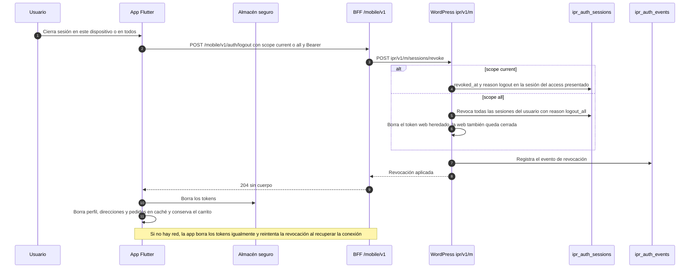

| Paso | Evidencia (documento y sección) |
|---|---|
| `POST /auth/logout` con `scope`, respuesta 204, cierre local aunque falle la red | `AC` EP-05 |
| `ipr/v1/m/sessions/revoke` | `AU` §9 (tabla de rutas) |
| `current` revoca la sesión del access; `all` revoca todas y borra `_ipr_auth_token_hash` | `AU` §3.5 (filas "Cerrar sesión" y "Cerrar todas"); `AU` §8.5 |
| Auditoría de revocaciones | `AU` §8.2 (`session_revoked`, `logout_all`) |
| Borrado local y carrito conservado | `AU` §5 (fila "Cierre de sesión"); `AA` §15.A paso 10. La conservación del carrito es **PROPUESTA** (AC-041-7 pendiente, DA-09) |

### 6e. Cambio de contraseña

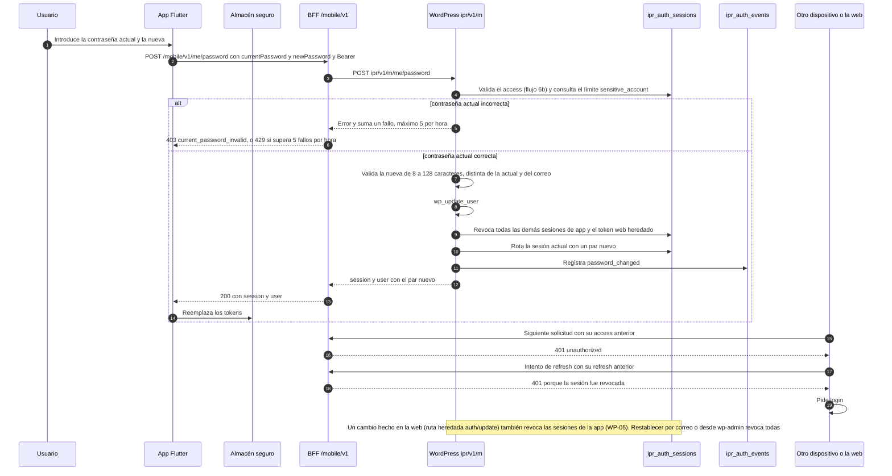

| Paso | Evidencia (documento y sección) |
|---|---|
| Pasos 1 a 7 del cambio de contraseña | `AU` §6 (columna "Cambio de contraseña") |
| `403 current_password_invalid`, 5 fallos por hora → `429` | `AA` §6.3; `AA` §10.2 (fila `/me/password`); `AU` §8.3 (`sensitive_account`) |
| Revocar las demás sesiones y el token web, rotar la actual | `AU` §3.5 (fila "Cambio de contraseña o correo"), §6 paso 5, §7 (fila "Cambio de contraseña en cualquiera") |
| Otro dispositivo recibe 401 al siguiente uso | `AU` §15 prueba 4 ("Las demás sesiones y la web reciben 401") |
| Cambio desde la web y restablecimiento | `AU` §6 (párrafo final); `AU` §3.5; `AA` §16.2 WP-05 |

---

## 7. Flujo de consulta de productos

### 7a. Listado con las tres capas de caché (app, Cloudflare, BFF)

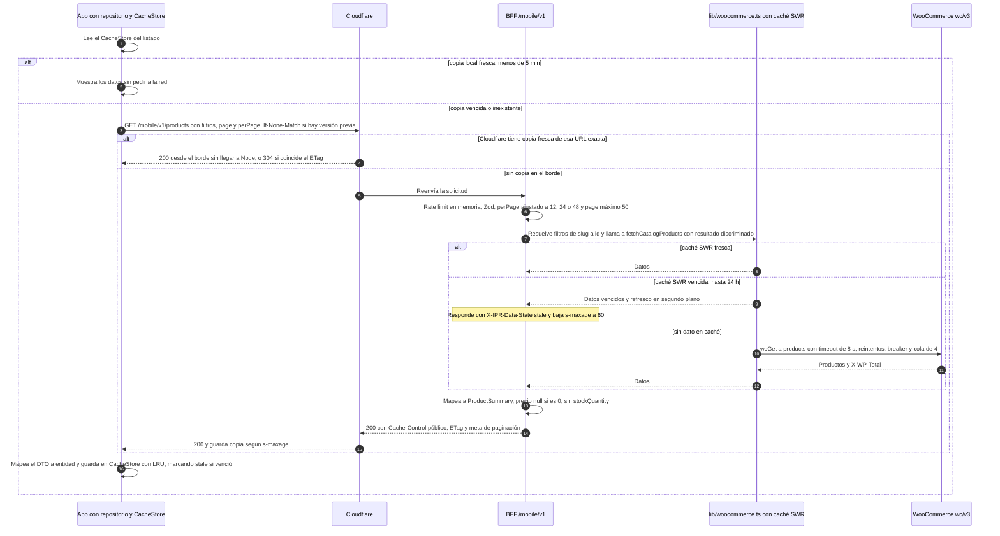

| Paso | Evidencia (documento y sección) |
|---|---|
| Caché local: listados frescos 5 min, obsoletos hasta 24 h, `CacheStore` LRU, patrón stale-while-revalidate | `FA` §7.4 (filas "Listados" y patrón) |
| `If-None-Match`, copia del borde, 304 | `AA` §15.B pasos 1, 2 y 7; `AA` §8.1 |
| Rate limit, Zod, `perPage` ∈ {12, 24, 48}, `page ≤ 50` | `AA` §15.B paso 3; `AA` §7 |
| Resolución de filtros y `fetchCatalogProducts` discriminado | `AA` §15.B pasos 4 y 5; `AA` §4 (fila `GET /products`) |
| SWR fresca / vencida (≤ 24 h, `X-IPR-Data-State: stale`) / sin dato → `wcGet` | `AA` §15.B paso 5; `AA` §6.3 (regla 404 vs 503) |
| `s-maxage` bajado a 60 en respuestas stale | `AA` §8.1 (reglas, último punto) |
| `wcGet`: timeout 8 s, reintentos, breaker, concurrencia 4 | `AA` §2 F-02 |
| `ProductSummary` con precio `null` si es 0, sin `stockQuantity` | `AA` §15.B paso 6; `AC` §1.5 |
| 200 con `Cache-Control` público, `ETag`, `meta` | `AA` §15.B paso 7; `AA` §8.1 (fila `GET /products`) |

### 7b. Ficha de producto: 404 frente a 503

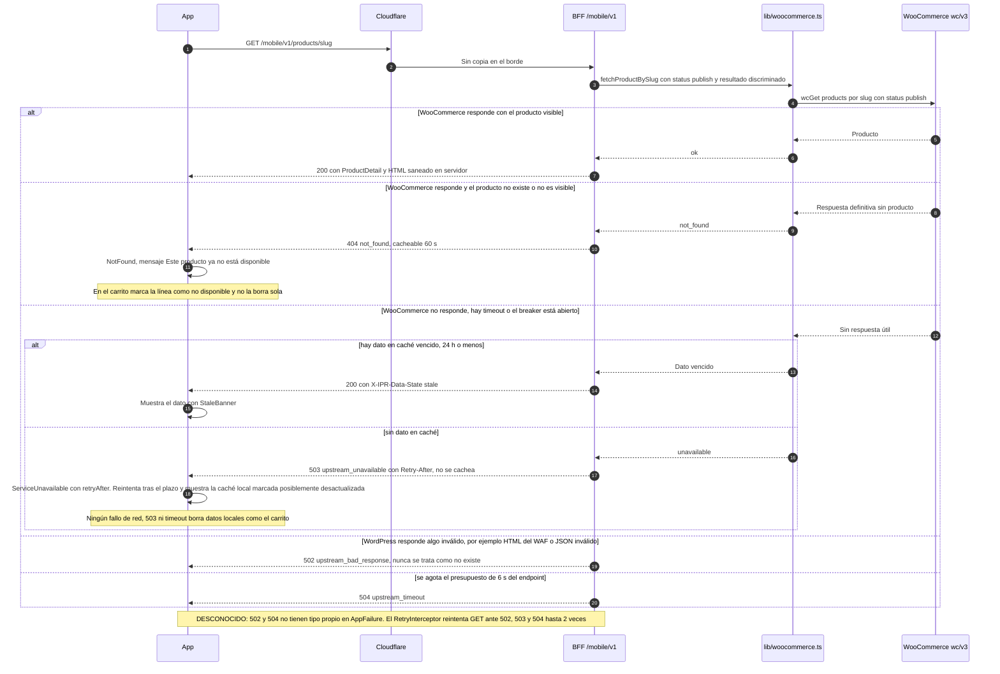

| Paso | Evidencia (documento y sección) |
|---|---|
| `fetchProductBySlug` con `status=publish` y variante discriminada | `AA` §4 (fila `GET /products/{slug}`); `AA` §16.1 FE-01, FE-02; `AA` §15.B paso 8 |
| `404` solo con respuesta definitiva de WooCommerce; cacheable 60 s | `AA` §6.3 (regla 404 vs 503); `AA` §8.1 (fila Errores) |
| `NotFound` y la línea del carrito marcada, no borrada | `FA` §7.3 (fila `NotFound`); `OV` §3 P4; `OV` §8 RA-05 |
| Dato vencido ≤ 24 h → `200` con `X-IPR-Data-State: stale` | `AA` §6.3 (último párrafo) |
| `503 upstream_unavailable` con `Retry-After`; `ServiceUnavailable(retryAfter)` | `AA` §6.3; `FA` §7.3 (fila `ServiceUnavailable`) |
| Ningún fallo borra datos locales | `FA` §7.3 ("Regla de oro (P4)") |
| `502 upstream_bad_response` y `504 upstream_timeout`; presupuesto de 6 s | `AA` §6.3; `AA` §9.1 (fila "BFF, presupuesto total") |
| Reintento de GET ante 502, 503, 504 (máximo 2) | `FA` §7.2 (fila 3). Falta mapeo en la taxonomía: **IN-12** |

### 7c. Búsqueda: índice en construcción frente a "sin resultados"

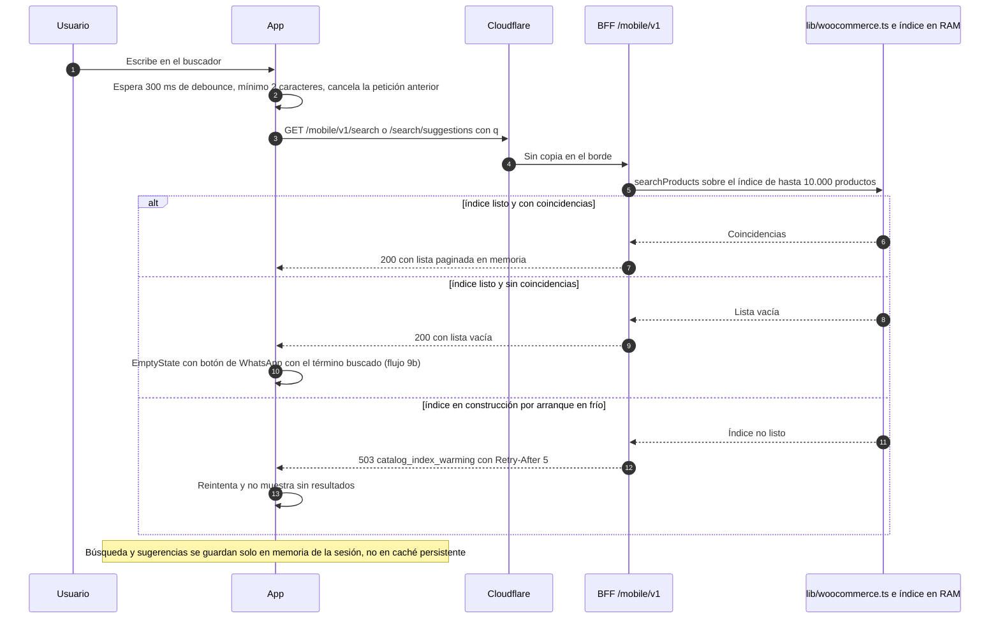

| Paso | Evidencia (documento y sección) |
|---|---|
| Debounce 300 ms, cancelación, sin caché persistente | `FA` §7.1 (fila Cancelación), §7.4 (fila "Búsqueda y sugerencias"); `OV` §8 RA-09 |
| Mínimo 2 caracteres | `AA` §10.2 (fila `/search/suggestions`); `AA` §14 (fila "CPU de búsqueda") |
| Índice en RAM de hasta 10.000 productos | `COD` §2 (viñeta "Carga a WooCommerce"); `AA` §14 |
| `200` vacío = "sin resultados"; `503 catalog_index_warming` con `Retry-After: 5` | `AA` §6.3 (fila `catalog_index_warming`); `AA` §14 (fila "Arranque en frío"); `OV` §7.1 N-06 |
| Estado vacío con botón de WhatsApp | RF-023; `FA` §10 (fila "Vacío") |

---

## 8. Flujo de carrito y checkout

### 8a. Carrito local y revalidación de precio y disponibilidad

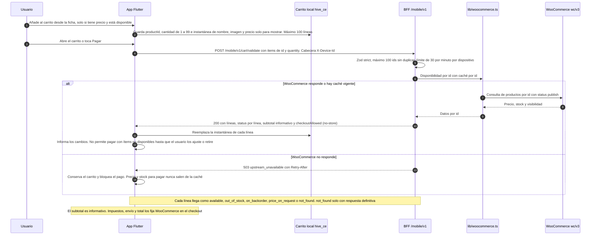

| Paso | Evidencia (documento y sección) |
|---|---|
| Carrito local persistente, 1–99 por producto, máximo 100 líneas, instantánea solo para mostrar | RF-049; `FA` §8 (fila Carrito), §11 (fila `Cart`/`CartLine`) |
| Solo se añade con precio y disponibilidad | RF-029; `FA` §11 (fila `StockStatus`) |
| `POST /cart/validate`, cuerpo, 503 bloquea el pago, `not_found` solo definitivo | `AC` EP-21 |
| Estados por línea | `AC` EP-21 (respuesta 200); `openapi.yaml` esquema `CartValidation` |
| Disponibilidad por id con caché por id (FE-08), tope de 100 ids | `AA` §4 (fila `POST /cart/validate`); `AA` §16.1 FE-08 |
| Límite 30 por minuto por dispositivo | `AA` §10.2 (fila `/cart/validate`) |
| Precio y stock para pagar nunca de caché de la app | `FA` §7.4 (fila "Precios/stock para pagar") |
| Subtotal informativo | RF-051; `AC` EP-21 (reglas) |

### 8b. Checkout: ticket, navegador seguro y Wompi

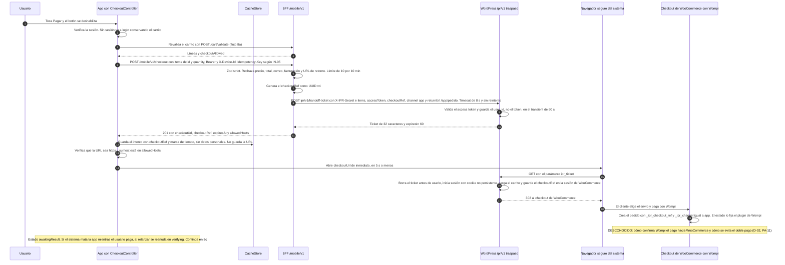

| Paso | Evidencia (documento y sección) |
|---|---|
| Revalidación antes de pagar y exigencia de sesión | `FA` §6.3 (estados `idle` y `revalidating`); RF-050, RF-052 |
| `POST /checkout`: cuerpo solo `items`; rechazo de otros campos; límite 10/10 min | `AC` EP-23 (cuerpo y reglas); `AA` §10.2 (fila `/checkout`) |
| `checkoutRef` generado por el BFF; token no viaja guardado; `returnUrl` fija | `AA` §13.1 (filas "Correlación", "Identidad en el ticket", "URL de retorno") |
| `handoff-ticket` con `X-IPR-Secret`, 8 s, sin reintento; ticket de 32 caracteres | `AA` §9.1 (fila `handoff-ticket`); `AC` EP-23 (reglas y validación `^[A-Za-z0-9]{32}$`) |
| Transient de 60 s con `user_id` | `AA` §13.1; `AA` §15.C (mensaje 7) |
| Respuesta 201 con `checkoutUrl`, `checkoutRef`, `allowedHosts` | `AC` EP-23 (respuesta 201) |
| Guardado del intento sin PII, no se guarda la URL | `FA` §8 (fila "Intento de checkout en curso"); `AC` EP-23 (reglas) |
| Verificación de host y apertura en 5 s | `AA` §13.1 (fila "Lista de hosts permitidos"); `FA` §6.3 (`openingBrowser`) |
| El navegador es el seguro del sistema; la implementación se decide en SPK-01 | `FA` §6.3 (nota); `AA` §13.1 (fila "Navegador"): **IN-04** |
| Ticket borrado antes de usarse, cookie no persistente, `checkoutRef` en sesión de WooCommerce | `AA` §2 F-08; `AA` §13.1 (fila "Cookie de WordPress"); `AA` §15.C |
| Pedido con `_ipr_checkout_ref` y `_ipr_channel` | `AA` §13.1; `AU` §8.5 |
| Reanudar en `verifying` tras matar la app | `FA` §6.3 (último punto de la tabla) |
| Confirmación de Wompi y doble pago: desconocidos | `AA` §15.C (mensaje "DESCONOCIDO: webhook"); `AA` §17.2 RA-07 |

### 8c. Retorno al app: verificación en servidor y deep link como acelerador

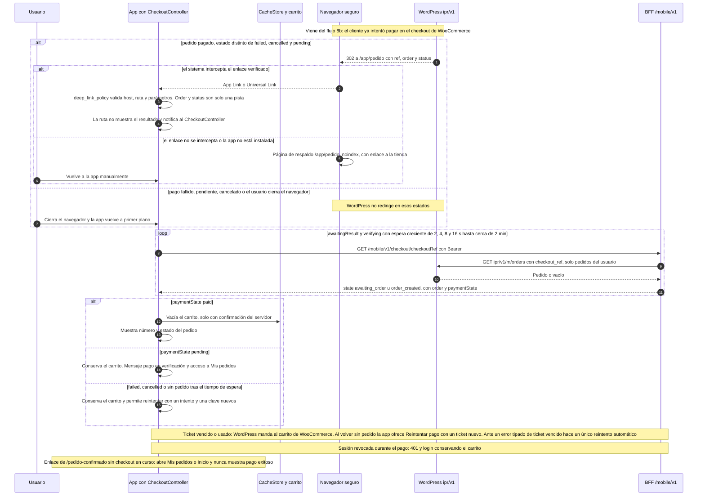

| Paso | Evidencia (documento y sección) |
|---|---|
| WordPress solo redirige si el pedido no es `failed`, `cancelled` ni `pending` | `AA` §2 F-10; `OV` §1 punto 4 |
| URL de retorno `/app/pedido?ref=&order=&status=` | `AA` §13.1 (fila "URL de retorno"), §15.C: **IN-01** |
| App Link / Universal Link: comportamiento tras una redirección dentro del navegador seguro no verificado | `AA` §13.3 (fila "Verificación"); `OV` §8 RA-01; SPK-01 en `FA` §19 |
| `deep_link_policy`: hosts y rutas listados, parámetros como pista; la ruta delega en el `CheckoutController` | `FA` §6.2 (filas "Política de entrada" y "`/pedido-confirmado` con la app en mitad del checkout") |
| Página de respaldo `/app/pedido` | `AA` §13.3 (fila "Página de respaldo") |
| Consulta al volver a primer plano o cerrar el navegador | `FA` §6.3 (estado `awaitingResult`); `OV` §9 ADR-008 |
| `GET /checkout/{checkoutRef}` con espera 2, 4, 8, 16 s hasta ~2 min; filtra pedidos del usuario | `AC` EP-24 (cliente y permisos); `AA` §15.C; `FA` §6.3 (`verifying`) |
| `paymentState`: `paid` vacía el carrito; `pending` conserva; `failed`, `cancelled`, `noOrder` permiten reintentar | `AA` §13.1 (fila "Vaciar carrito"), §13.2; `FA` §6.3 (estados `paid`, `pending`, `failed`) |
| Ticket vencido o usado, reintento | `AA` §15.C (párrafo "Pasos con errores"); `FA` §6.3 (estado `ticketExpired`); RNF-026 |
| Sesión revocada al pagar | `AA` §15.C (párrafo "Pasos con errores", AC-052-10) |
| `/pedido-confirmado` sin checkout en curso | `FA` §6.2 (fila correspondiente) |

### 8d. Máquina de estados del `CheckoutController`

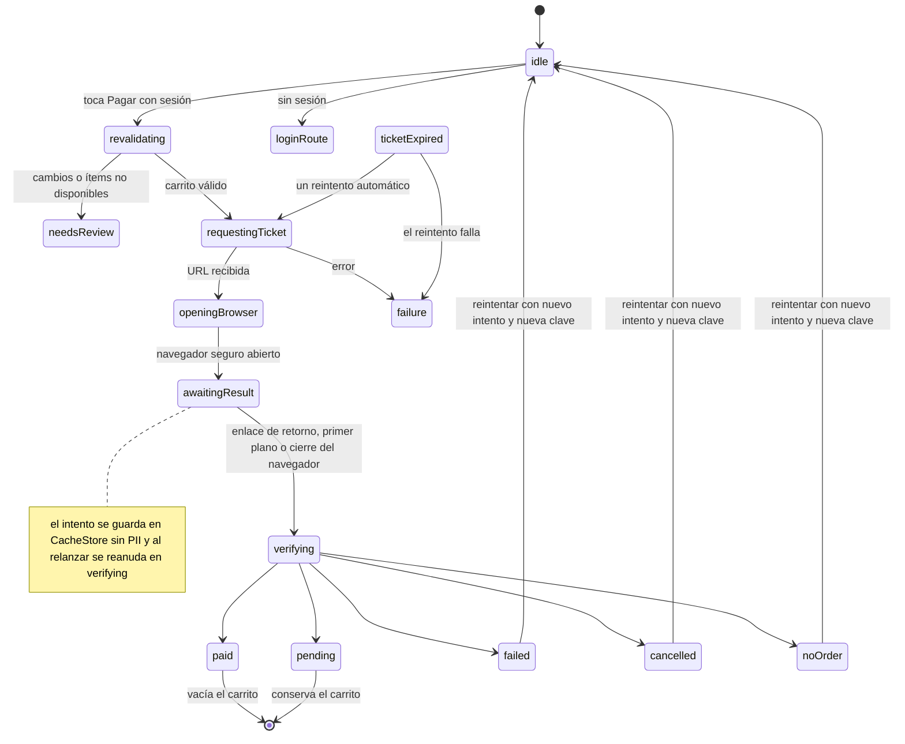

Evidencia: `FA` §6.3 (tabla de estados completa). **DESCONOCIDO:** de qué estado nace la transición a `ticketExpired`, cómo se sale de `needsReview` y qué ocurre tras `failure` (`FA` §6.3 no lo precisa). `AA` §13.2 añade `paymentState` `refunded` y `unknown` que la máquina de estados no recoge (**IN-13**).

---

## 9. Flujo de productos sin precio hacia WhatsApp

> **Alcance del MVP (ADR-002, Aprobada):** no hay cotización estructurada. Un producto sin precio muestra solo "Más información" y abre WhatsApp con el producto, como la web actual. **La cotización estructurada (RF-066, RF-067) es fase 2** y no se dibuja como flujo del sistema.

### 9a. Producto sin precio: "Más información" a WhatsApp

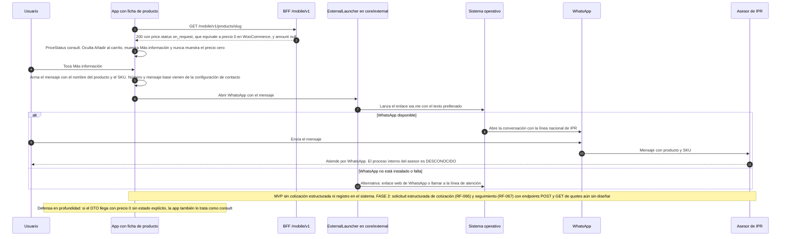

| Paso | Evidencia (documento y sección) |
|---|---|
| Producto sin precio: solo "Más información" → WhatsApp, sin cotización propia | ADR-002 (Decisión); RF-030, RF-062 |
| `price.status = on_request` ⇔ precio 0 en WooCommerce; `amount = null` | `AC` §1.5 (modelo `Price`); `AA` §6.1 (importes) |
| `PriceStatus.consult`, "nunca $0", defensa en profundidad | `FA` §11 (fila `PriceStatus`); `OV` §4 (fila "Si un producto se puede comprar") |
| Mensaje con nombre y SKU (como la web) | RF-062 |
| Número y mensaje base de la configuración de contacto | `AC` EP-01 (`contact.whatsapp`): ver **IN-10** |
| Lanzamiento por `ExternalLauncher` y esquema `wa.me` | `FA` §2.1 (`core/external`); `OV` §2.1 (fila WhatsApp/teléfono/mapas), principio P2 |
| Alternativa si WhatsApp no está instalado | RF-063 |
| Cotización estructurada y seguimiento: fase 2 | RF-066, RF-067; `AC` §5 (`POST /quotes`, `GET /quotes/{id}` "no diseñado"); ADR-002 (fase 2 candidata) |

**DESCONOCIDO (no dibujado):** medición agregada de toques en "Más información" (RF-065): depende de la herramienta de analítica, aún sin decidir (PA-08); cómo gestiona el asesor la conversación y si hay un CRM.

### 9b. Otros puntos de entrada a WhatsApp, teléfono y mapas

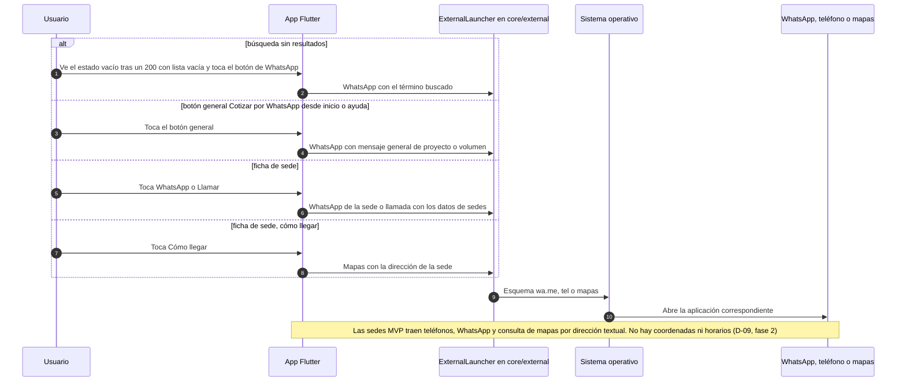

| Paso | Evidencia (documento y sección) |
|---|---|
| Búsqueda sin resultados con botón de WhatsApp y el término | RF-023; `FA` §10 (fila "Vacío") |
| Botón general "Cotizar por WhatsApp" desde inicio y ayuda | RF-064 |
| Ficha de sede: llamar y WhatsApp | RF-074; `AC` EP-22 (`phones`, `whatsapp`) |
| "Cómo llegar" abre mapas por dirección | RF-075; `AC` EP-22 (`mapsQuery`) |
| Sin coordenadas ni horarios en el MVP | `AC` EP-22 (reglas); RF-077 (fase 2) |

---

## 10. Integración con servicios externos

### 10a. Mapa de integraciones y mecanismo de cada una

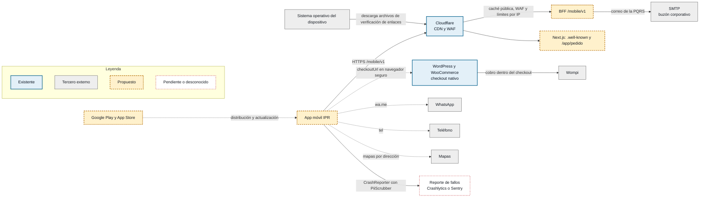

| Servicio | Quién integra y con qué mecanismo | Estado | Evidencia (documento y sección) |
|---|---|---|---|
| Wompi | WooCommerce dentro de su checkout nativo; la app **no** lo integra ni maneja tarjetas | Existente | `COD` §1 (Pasarela), §5.4; RF-053; ADR-001 (contexto) |
| WhatsApp, teléfono, mapas | La app por esquemas del SO (`wa.me`, `tel:`, mapas) a través de `ExternalLauncher` | Existente (terceros) | `OV` §2.1; RF-062, RF-074, RF-075; `FA` §2.1 |
| SMTP | El BFF envía el correo de la PQRS (código de `/api/pqrs` extraído a `lib/pqrs.ts`) | Existente (el endpoint móvil es propuesto) | `AA` §3.1, §9.1, §16.1 FE-16; `COD` §2 |
| Cloudflare | Delante del sitio, del BFF y de WordPress; reglas de caché y límites para la app son propuestas | Existente (reglas propuestas) | `INV` §2.1; `AA` §8.1, §10.1, §11 |
| Tiendas Google Play y App Store | Distribución y actualizaciones; el SO descarga los archivos `.well-known` del dominio | Propuesto | `FA` §16; `AA` §13.3; `AU` §12.2 |
| Reporte de fallos | La app, detrás de la interfaz `CrashReporter`; proveedor Crashlytics **o** Sentry según DN-02 | Pendiente (DN-02) | `OV` §9 ADR-010; `FA` §17.1 |

### 10b. Cloudflare: lectura pública cacheada, tráfico privado y riesgo de desafío

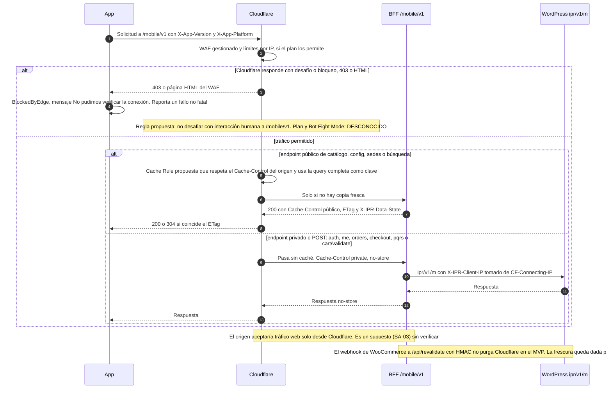

| Paso | Evidencia (documento y sección) |
|---|---|
| Cabeceras de la app aceptadas por el WAF | `OV` §7.2 T-08; `FA` §7.1 |
| `BlockedByEdge` y reporte no fatal | `FA` §7.3 (fila `BlockedByEdge`); `OV` §8 RA-06 |
| Desafíos interactivos no resolubles por la app; Bot Fight Mode desconocido | `AA` §11 (fila Cloudflare); `INV` §9 R-02 (citado en `AA` §3.2) |
| Cache Rule para los endpoints públicos; `Cache-Control` por endpoint | `AA` §8.1 (tabla y regla de Cloudflare) |
| Respuestas privadas `private, no-store` y POST sin caché | `AA` §8.1 (filas "Todo lo autenticado" y `POST /cart/validate`) |
| IP real por `CF-Connecting-IP`, reenviada en `X-IPR-Client-IP` | `AA` §10.3 |
| Origen solo desde Cloudflare | `AA` §17.1 SA-03 |
| Webhook de revalidación sin purga de Cloudflare | `AA` §8.1 (viñeta "No se purga Cloudflare"); `COD` §2 |

### 10c. Wompi y WooCommerce: lo que se sabe y lo que no

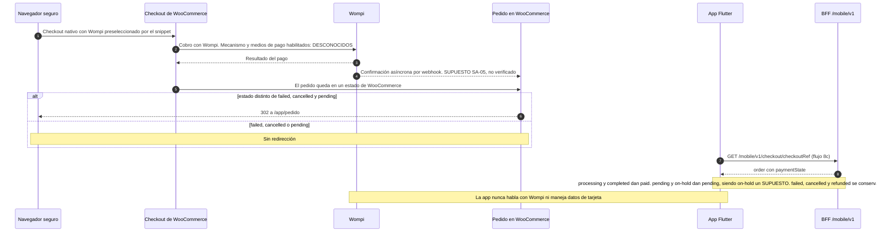

| Paso | Evidencia (documento y sección) |
|---|---|
| Wompi dentro del checkout nativo, preseleccionado por el snippet | `COD` §1 (fila "Pasarela de pago") |
| Medios de pago habilitados desconocidos | RF-053 |
| Confirmación por webhook: supuesto sin verificar; doble pago desconocido | `AA` §17.1 SA-05; `AA` §17.2 RA-07; D-02 y PA-11 (citados en `AA` §9.2 fila "Pago") |
| Redirección condicionada al estado | `AA` §2 F-10 |
| Mapeo de estados a `paymentState` | `AA` §13.2 (tabla) |
| La app no maneja datos de pago | RF-053; `OV` §1 punto 3 |

### 10d. Envío de una PQRS y correo SMTP

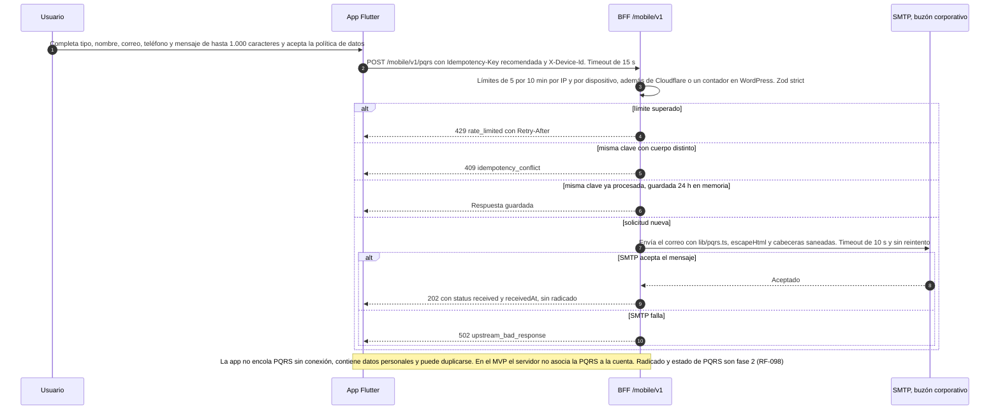

| Paso | Evidencia (documento y sección) |
|---|---|
| Cuerpo del formulario, `202 received`, errores, `Idempotency-Key` recomendada | `AC` EP-27 |
| Timeout de 15 s en el envío | `FA` §7.1 (fila "Timeout de envío (PQRS)", PROPUESTA) |
| Límite de 5 por 10 min por IP y dispositivo | `AA` §10.2 (fila `/pqrs`); `AC` §2 (EP-27) |
| Idempotencia de 24 h en memoria | `AA` §9.2 (fila `POST /pqrs`); `AC` §1.6 |
| SMTP con timeout de 10 s y 0 reintentos; fallo → 502 | `AA` §9.1 (fila BFF → SMTP) |
| `lib/pqrs.ts` compartido, `escapeHtml` | `AA` §16.1 FE-16; `AC` EP-27 (reglas) |
| La app no encola PQRS offline | `FA` §9 (fila "Login, registro, perfil, pedidos, PQRS") |

### 10e. Tiendas: versión mínima y archivos de verificación de enlaces

Actualización obligatoria o recomendada:

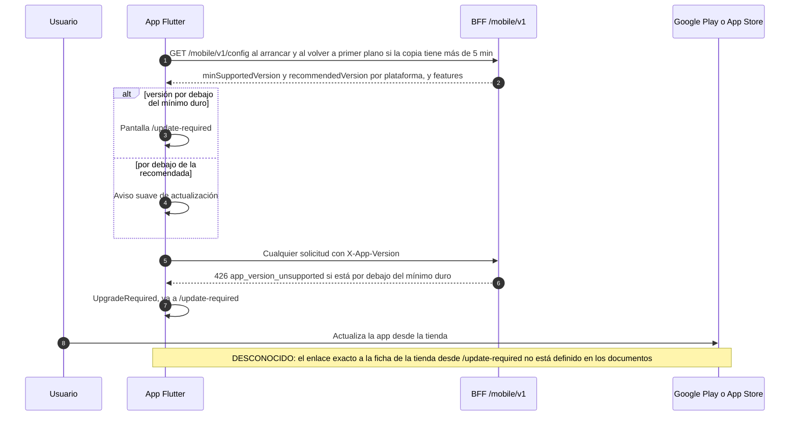

Publicación y verificación de enlaces:

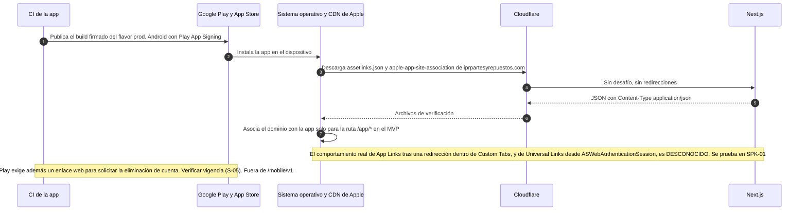

| Paso | Evidencia (documento y sección) |
|---|---|
| `GET /config` con versión mínima y recomendada, caché de 5 min | `AC` EP-01 (respuesta); `FA` §7.4 (fila "Configuración remota") |
| `426 app_version_unsupported` → `UpgradeRequired` → `/update-required` | `AA` §5 (fila "Versión de la app"), §6.3; `FA` §6.1 (fila `/update-required`), §7.3 (fila `UpgradeRequired`) |
| Build firmado desde CI del flavor `prod` hacia las tiendas | `FA` §16 (tabla de flavors y pipeline) |
| Play App Signing | `AA` §13.3 (fila `assetlinks.json`) |
| `.well-known` servido por Next sin redirecciones ni desafío; AASA con `/app/*` | `AA` §13.3 (filas de ambos archivos) |
| Alcance MVP solo `/app/*` (y fase 2 `/producto/*`) | `AA` §13.3 (fila "Alcance"): **IN-01** |
| Enlace de eliminación de cuenta exigido por Google Play | `AU` §12.2 (último párrafo) |

### 10f. Reporte de fallos sin datos personales

```mermaid
sequenceDiagram
  autonumber
  participant A as App Flutter
  participant EH as Manejadores globales de errores
  participant CR as CrashReporter en core/observability
  participant PS as PiiScrubber
  participant P as Proveedor Crashlytics o Sentry
  participant CI as CI de la app

  A->>EH: Excepción no controlada o error no fatal, por ejemplo BlockedByEdge o Contract
  EH->>CR: Entrega el error, FlutterError.onError o PlatformDispatcher.onError
  CR->>PS: Depura los datos personales antes de enviar
  PS-->>CR: Evento sin datos personales
  alt flavor staging o prod con proveedor
    CR->>P: Envía el evento. El SDK solo se llama a través de la interfaz de core
  else flavor dev
    Note over CR,P: Reporte desactivado o proyecto dev
  end
  EH->>A: En release muestra un estado genérico y nunca trazas
  CI->>P: Símbolos de la ofuscación de Dart archivados para simbolizar
  Note over CR,P: Proveedor pendiente de DN-02 con Jurídico y TI. La analítica de producto queda apagada hasta PA-08 y el consentimiento
```

| Paso | Evidencia (documento y sección) |
|---|---|
| `FlutterError.onError` y `PlatformDispatcher.instance.onError` → `CrashReporter` con depuración de PII; sin trazas al usuario | `FA` §10 (párrafo "Manejo global") |
| Interfaz `CrashReporter`, `AnalyticsSink` y `PiiScrubber` en `core/observability` | `FA` §2.1 (`core/observability`); `OV` §9 ADR-010 |
| Ninguna feature llama al SDK directamente | `FA` §3.1 D6 |
| Fallos no fatales de `BlockedByEdge` y `Contract` | `FA` §7.3 (columna "Acción en UI") |
| Proveedor por flavor: dev desactivado o proyecto dev; staging y prod con proyecto propio | `FA` §16 (tabla de flavors) |
| Ofuscación de Dart con símbolos archivados | `FA` §16 (viñeta del pipeline). La entrega de símbolos al proveedor: **DESCONOCIDO** |
| Proveedor pendiente; analítica apagada | `OV` §9 ADR-010; DN-02, PA-08 |

---

## Inconsistencias detectadas

| ID | Tema | Documentos en conflicto | Qué se dibujó |
|---|---|---|---|
| IN-01 | Ruta de retorno: `/pedido-confirmado` frente a `/app/pedido`, y alcance de los archivos de verificación (`/pedido-confirmado` frente a `/app/*`). | RF-055, `COD` §5.4, `OV` §2.2, `FA` §6.2 frente a `AA` §13.1, §13.3, §15.C y `AC` EP-23 | `/app/pedido` (documento de API, más específico). Ver `c4_diagrams.md`. |
| IN-02 | Mecanismo principal del retorno: App Links (RF-055, ADR-001 §4) frente a consulta al servidor (ADR-008, ADR-017, Propuestas). | RF-055; ADR-001 frente a `OV` §9 ADR-008 y `AA` §18 ADR-017 | Consulta al servidor como fuente de verdad; el enlace como acelerador (flujo 8c). |
| IN-04 | Navegador seguro en iOS: `AA` §13.1 prescribe `ASWebAuthenticationSession` con sesión efímera (con *callback* https desde iOS 17.4 y, en versiones previas, cierre manual y consulta); `OV` ADR-008 y `FA` §6.3 dejan la elección a SPK-01 entre `url_launcher` (`inAppBrowserView`) y `flutter_web_auth_2`. | `AA` §13.1 frente a `OV` §9 ADR-008, `FA` §6.3 | Participante genérico "Navegador seguro del sistema". |
| IN-05 | `Idempotency-Key` en `POST /checkout`: `OV` N-11 y `FA` §6.3 la dan por parte del contrato (clave generada una vez por intento); `AC` §1.1, EP-23 y `AA` §9.2 la declaran **opcional**. | `OV` §7.1 N-11, `FA` §6.3 frente a `AC` §1.1, `AA` §9.2 | Se rotula "según IN-05" en 8b. |
| IN-06 | `X-Device-Id` obligatoria en `/auth/*`, `/me*`, `/checkout*`, `/orders*`, `/pqrs` y `/cart/validate` (`AC` §1.1, `AU` §4) frente a la lista de cabeceras de `FA` §7.1, que no la incluye. | `AC` §1.1, `AU` §4 frente a `FA` §7.1 | Se dibuja con `X-Device-Id` (contrato). |
| IN-07 | Dónde vive el access token: en memoria (`FA` §8) o en Keystore/Keychain (`AU` §5, con permiso para mantenerlo en memoria). | `FA` §8 frente a `AU` §5 | Refresh y `deviceId` en almacén seguro; access "puede quedar solo en memoria". |
| IN-08 | Falla del refresh: `FA` §7.2 invoca `expire()`; `AU` §3.4 pide no borrar tokens ante fallo de red y reintentar con el mismo refresh. | `FA` §7.2 frente a `AU` §3.4, AC-044-7 | Distinción de `AU` en 6b (la app debe separar fallo de red de rechazo del servidor). |
| IN-09 | Timeout de respuesta App → BFF: 10 s en `FA` §7.1; 15 s en `AA` §9.1. | `FA` §7.1 frente a `AA` §9.1 | No se rotula en estos flujos (solo el de PQRS y el ticket, coincidentes). |
| IN-10 | Origen del número de WhatsApp: `config/<flavor>.json` con `supportWhatsApp` (`FA` §16) frente a `contact.whatsapp` remoto en `GET /config` (`AC` EP-01) y, por sede, en `GET /stores` (EP-22). | `FA` §16 frente a `AC` EP-01, EP-22 | "Configuración de contacto" (contrato remoto), por ser editable sin recompilar (RNF-029). |
| IN-12 | `AppFailure` no define `502` ni `504`; el BFF los emite (`upstream_bad_response`, `upstream_timeout`). | `AA` §6.3 frente a `FA` §7.2 y §7.3 | No se dibuja un mapeo no escrito: nota **DESCONOCIDO** en 7b. |
| IN-13 | `paymentState` incluye `refunded` y `unknown` (`AA` §13.2), pero la máquina de estados del checkout no los contempla (`FA` §6.3, solo `paid/pending/failed/cancelled/noOrder`). `FA` §11 indica que los estados desconocidos de `Order` se muestran como "En proceso". | `AA` §13.2 frente a `FA` §6.3 y §11 | 8d sigue a `FA` §6.3; la diferencia se anota bajo el diagrama. |
