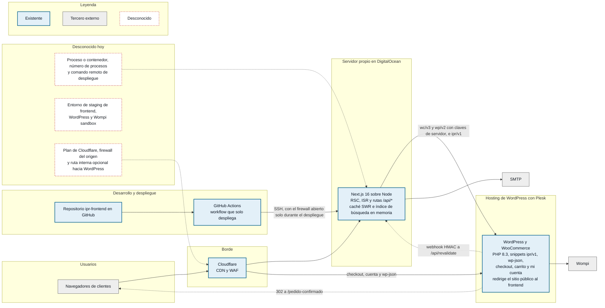
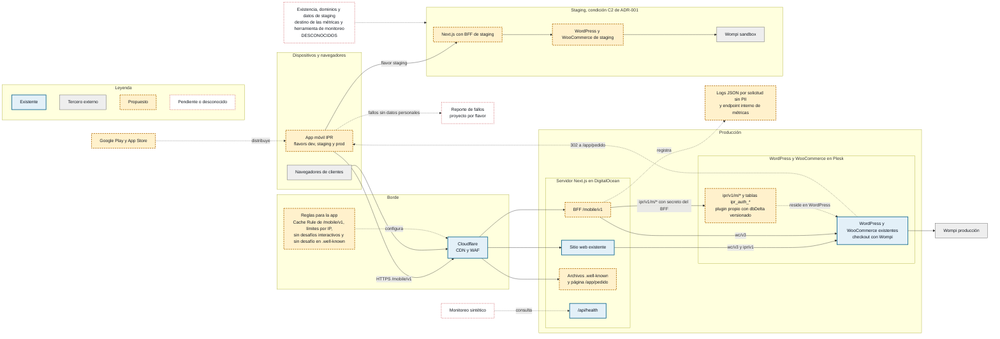
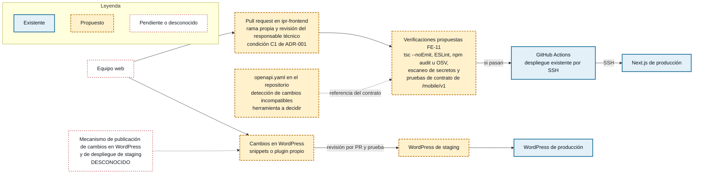
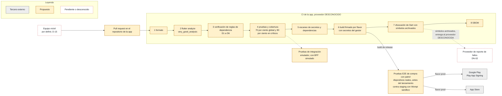
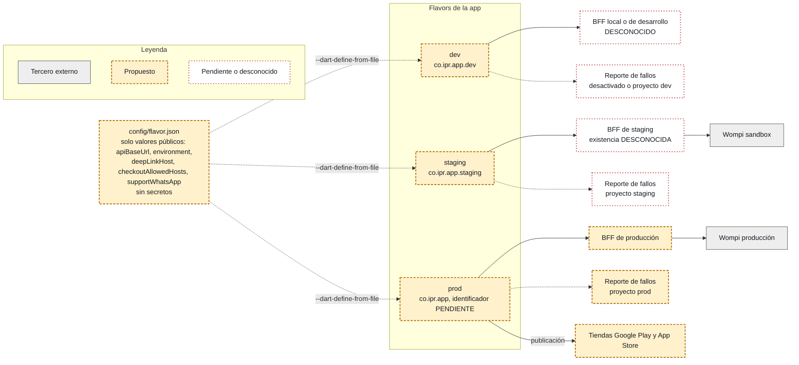

# Arquitectura de despliegue e infraestructura — Estado actual y estado propuesto

| | |
|---|---|
| **Proyecto** | App móvil Flutter (Android/iOS) de IPR Partes y Repuestos (Inverprimos S.A.S.) |
| **Fase** | Tercera entrega: Arquitectura. **No se programa nada.** |
| **Fecha** | 2026-11-18 |
| **Estado** | BORRADOR. Derivado solo de documentos de `docs/`. **No** incluye direcciones IP, nombres de servidores internos, secretos ni claves. |
| **Contenido** | Diagrama 12a (estado actual) · 12b (estado propuesto: infraestructura) · 12c (CI/CD del sitio, BFF y WordPress) · 12d (CI/CD de la app y distribución) · 12e (entornos y *flavors*) |
| **Relacionados** | [`c4_diagrams.md`](c4_diagrams.md) · [`component_diagrams.md`](component_diagrams.md) · [`data_flow.md`](data_flow.md) |

## 0. Convenciones

Siglas de fuentes: `OV` = `03_architecture/architecture_overview.md`, `FA` = `flutter_app_architecture.md`, `ADR` = `architecture_decisions.md`, `AA` = `05_api/api_architecture.md`, `AU` = `05_api/authentication.md`, `AC` = `05_api/api_contracts.md`, `COD` = `00_discovery/informe_codigo_frontend.md`, `INV` = `00_discovery/informe_investigacion.md`, `WCA` = `00_discovery/analisis_capa_woocommerce.md`.

Estilos (en todos los diagramas de este archivo):

| Estilo | Significado | Cómo se ve |
|---|---|---|
| **Existente** | Existe hoy (HECHO) | Relleno azul claro, borde sólido |
| **Tercero externo** | Servicio de terceros ya existente | Relleno gris |
| **Propuesto** | No existe todavía; viene de ADR-001/002 o de propuestas | Relleno ámbar, borde punteado |
| **Pendiente o desconocido** | Dato u decisión abierta, no se puede dibujar con certeza | Relleno blanco, borde rojo punteado |

```
classDef existente fill:#e3f0f8,stroke:#07628e,stroke-width:2px,color:#0a1320
classDef externo fill:#eeeeee,stroke:#555555,stroke-width:1px,color:#151a21
classDef propuesto fill:#fff1cc,stroke:#b36b00,stroke-width:2px,stroke-dasharray:5 3,color:#151a21
classDef pendiente fill:#ffffff,stroke:#c2373c,stroke-width:2px,stroke-dasharray:2 4,color:#151a21
```

---

## 12. Despliegue e infraestructura

### 12a. ESTADO ACTUAL

Lo que existe hoy y está documentado con evidencia en código o en encabezados observados.



**Lectura.**

- El frontend corre en un servidor propio en DigitalOcean; el despliegue lo hace GitHub Actions por SSH, abriendo el firewall solo durante el despliegue. WordPress mantiene su hosting (Plesk) (`COD` §2, viñeta "Hosting del frontend").
- El workflow **solo despliega**: no ejecuta `tsc`, lint, `npm audit` ni pruebas (`COD` §2; `AA` §2 F-16).
- WordPress redirige el sitio público al frontend; solo quedan en WordPress checkout, carrito, mi-cuenta/recuperar contraseña, `wp-json`, `wp-content`, `wc-api`, `wc-ajax` y `wp-admin` (`COD` §2, viñeta "WordPress como motor de compra").
- Next.js habla con WordPress solo desde el servidor (claves de WooCommerce y `X-IPR-Secret`) (`COD` §2).

| Elemento | Evidencia (documento y sección) |
|---|---|
| Cloudflare CDN y WAF | `INV` §2.1 (fila CDN/WAF); `COD` §2 (diagrama) |
| Next.js 16 sobre Node, RSC, ISR, rutas `/api/*` | `COD` §2 (diagrama); `INV` §2.1 |
| Caché SWR e índice de búsqueda en memoria | `COD` §2 (viñeta "Carga a WooCommerce"); `AA` §2 F-02 |
| Servidor propio en DigitalOcean | `COD` §2 (viñeta "Hosting del frontend"); `AA` §2 F-01 |
| GitHub Actions por SSH con firewall abierto solo durante el despliegue | `COD` §2; `AA` §2 F-01 (`deploy.yml`) y §14 (regla del puerto 22) |
| Workflow sin `tsc`, lint ni `npm audit` | `COD` §2 (última viñeta); `AA` §2 F-16 |
| WordPress con PHP 8.3 y Plesk | `INV` §2.1 (fila "Servidor WP"); `COD` §2 |
| Snippets `ipr/v1`, redirección del sitio público al frontend | `COD` §2 (viñeta "WordPress como motor de compra"); `COD` §5.1 |
| Wompi dentro del checkout de WooCommerce | `COD` §1 (fila Pasarela de pago) |
| SMTP (PQRS y newsletter) | `COD` §2 (diagrama, flecha a SMTP) |
| Webhook HMAC de WooCommerce a `/api/revalidate` | `COD` §2 (diagrama) y §4 |
| Redirección `302 a /pedido-confirmado` | `COD` §2 (diagrama) y §5.4 punto 4 |
| Cloudflare entre el navegador y WordPress | `INV` §2.1; ver **IN-11** |

**DESCONOCIDO (no dibujado):** número de procesos Node, si corre en contenedor y cuál es el comando remoto de despliegue (no está en el repositorio, `AA` §2 F-01; `WCA` §1 menciona un `HEALTHCHECK` de Docker en un comentario); existencia de staging (`COD` §8.2; ADR-001 C2); plan de Cloudflare y reglas existentes (`AA` §17.2 AP-08); si el origen solo acepta tráfico de Cloudflare (SA-03, el workflow solo muestra la regla del puerto 22); si la ruta interna opcional que evita Cloudflare (`WOOCOMMERCE_INTERNAL_URL`) está configurada en producción (`WCA` §1); versión y configuración de Wordfence (`AU` §13).

---

### 12b. ESTADO PROPUESTO — infraestructura

Lo nuevo (ámbar, borde punteado) se apoya en lo existente (azul). Producción cambia poco: rutas nuevas en el mismo proceso Next.js, rutas nuevas y tablas en WordPress, reglas de Cloudflare. **Staging pasa a ser condición** de la ADR-001 (C2), pero su existencia hoy es desconocida.



**Lectura.**

- **No se añaden** en el MVP: servicio BFF separado, API Gateway, Redis, GraphQL, JWT ni cola de mensajes (`AA` §3.3). Se reconsideran con los disparadores de `AA` §14 (p. ej. segundo proceso Node → Redis).
- Los archivos `.well-known` los sirve Next desde `public/.well-known/`, sin redirecciones ni desafíos de Cloudflare; el de Apple sin extensión exige un `Content-Type: application/json` configurado en `next.config.ts` (`AA` §13.3).
- La ruta de retorno `/app/pedido` también la sirve Next como página de respaldo `noindex` (`AA` §13.3).
- Las llamadas BFF → WordPress usan un secreto de servidor distinto del de *handoff*; ninguno aparece en este documento (`AA` §3.3 y ADR-014 en `AA` §18).
- Cloudflare: reglas para `/mobile/v1` con **Cache Rule** de catálogo, límites por IP y exclusión de desafíos interactivos, manteniendo el WAF gestionado (`AA` §8.1, §10.1, §11).
- El monitoreo sintético de `/api/health` existe como capacidad del endpoint; la herramienta que lo consulte es desconocida.

| Elemento | Estado | Evidencia (documento y sección) |
|---|---|---|
| App móvil con tres *flavors* | Propuesto | `FA` §16 (tabla de flavors); `OV` §9 ADR-009 |
| Reglas de Cloudflare para la app | Propuesto | ADR-001 condición C3; `AA` §8.1, §10.1, §11 |
| BFF `/mobile/v1` en el Next.js de producción | Propuesto | ADR-001 decisión 1; `AA` §3.1 |
| Archivos `.well-known` y `/app/pedido` | Propuesto | `AA` §13.3; `AA` §16.1 FE-10; `OV` §10 DA-03 |
| `/api/health` | Existente | `AC` Anexo A.2 (fila `GET /api/health`) |
| Monitoreo sintético | Propuesto (herramienta desconocida) | `AC` Anexo A.2 (RNF-102); `AA` §12 (fila Métricas: "DESCONOCIDO") |
| `ipr/v1/m/*` y tablas `ipr_auth_*` con plugin propio y `dbDelta` | Propuesto | `AU` §8 (introducción), §9; `AU` §16 RS-02 |
| Staging de frontend, WordPress y Wompi sandbox | Propuesto (existencia desconocida) | ADR-001 condición C2; `COD` §8.2; `FA` §16 (fila `staging`); `AC` cabecera ("Staging: DESCONOCIDO") |
| Logs JSON sin PII y endpoint interno de métricas | Propuesto | `AA` §12 (filas "Log por solicitud" y Métricas: "endpoint interno protegido + logs agregados") |
| Distribución por Google Play y App Store | Propuesto | `FA` §16 (flavor `prod`); `AU` §12.2 |
| Reporte de fallos con proyecto por flavor | Pendiente (DN-02) | `FA` §16 (columna "Reporte de fallos"); `OV` §9 ADR-010 |
| Redirección `302` de WordPress hacia la app | Propuesto | `AA` §13.1 y §13.3: **IN-01** |

**DESCONOCIDO (no dibujado):** dominios de staging y de sus archivos `.well-known` (`FA` §6.2: "DESCONOCIDO si existen dominios de staging"; `AA` §13.3 solo describe el dominio de producción); herramienta y destino de métricas (`AA` §12); número de procesos de producción tras añadir el BFF (SA-01); resultado de la prueba de carga (condición C4 de ADR-001; capacidad no declarada hasta entonces, `AA` §14).

---

### 12c. ESTADO PROPUESTO — CI/CD del sitio, el BFF y WordPress

Hoy el workflow solo despliega. La propuesta añade verificaciones previas y mantiene el despliegue por SSH existente **solo si las verificaciones pasan** (FE-11).



| Elemento | Estado | Evidencia (documento y sección) |
|---|---|---|
| Pull request con rama y revisión propias para `/mobile/v1` | Propuesto | ADR-001 (consecuencias y condición C1); `AA` §16 (introducción: "PR revisado por el responsable") |
| Verificaciones `tsc`, ESLint, `npm audit`, escaneo de secretos, pruebas de contrato | Propuesto | `AA` §16.1 FE-11; RNF-049, RNF-090 citados allí |
| Despliegue solo si pasan las verificaciones | Propuesto | `AA` §16.1 FE-11 ("mantener el despliegue solo si pasan") |
| `openapi.yaml` con detección de cambios incompatibles (herramienta a decidir) | Propuesto | `AA` §5 (fila "Contrato") |
| GitHub Actions por SSH | Existente | `COD` §2; `AA` §2 F-01 |
| Cambios de WordPress con revisión y entorno de staging | Propuesto | ADR-001 (costos, "Cambios en WordPress… requieren revisión y entorno de staging"); `AU` §16 RS-02 |
| Pruebas inexistentes hoy | Hecho | `AA` §2 F-16; `COD` §2 |

---

### 12d. ESTADO PROPUESTO — CI/CD de la app móvil y distribución

El proveedor de CI de la app **no está definido** en los documentos; el pipeline describe etapas, no una herramienta.



| Elemento | Evidencia (documento y sección) |
|---|---|
| Orden de las etapas 1 a 8 del pipeline | `FA` §16 (viñeta "Pipeline", RNF-087 y RNF-093) |
| `very_good_analysis` | `FA` §17.1 (fila `very_good_analysis`) |
| Verificación de reglas de dependencia D1 a D6 (script de CI) | `FA` §3.1 (columna "Cómo se verifica") |
| Umbrales de cobertura (≥ 70 % global y ≥ 90 % en módulos críticos) | `FA` §15 (último párrafo); ADR-012 en `OV` §9 |
| Integración con `integration_test` en emulador y BFF simulado | `FA` §15 (fila Integración) |
| E2E con `patrol` en dispositivos reales, pre-release, contra staging con Wompi sandbox | `FA` §15 (fila E2E); `OV` §9 ADR-012 (consecuencias). `patrol` condicionado a SPK-01 |
| Build firmado desde CI con secretos del gestor, ofuscación con símbolos archivados, SBOM | `FA` §16 (viñeta "Pipeline") |
| Distribución a Google Play (Play App Signing) y App Store para el flavor `prod` | `FA` §16 (fila `prod`, "Tiendas"); `AA` §13.3 (Play App Signing) |
| Equipo móvil por definir | `OV` §2.1 (fila "App móvil IPR": "por definir, D-15") |

**DESCONOCIDO (no dibujado):** proveedor y runners del CI de la app; herramienta de entrega a tiendas y canales de prueba interna; titular de las cuentas de tienda (D-14, `FA` §16 y DA-12); identificador definitivo de la app de producción (`co.ipr.app` es **PENDIENTE**: no se puede cambiar tras publicar).

---

### 12e. ESTADO PROPUESTO — entornos y *flavors*



**Lectura.** Los *flavors* se instalan lado a lado gracias a identificadores distintos; la app no contiene secretos (ADR-009 en `OV` §9). Los archivos `.well-known` de cada entorno dependen del dominio de ese entorno (`FA` §6.2). El BFF de producción se marca propuesto porque `/mobile/v1` no existe todavía; Wompi producción existe, pero no lo opera el proyecto.

| Elemento | Evidencia (documento y sección) |
|---|---|
| Tres *flavors* con identificadores propuestos | `FA` §16 (tabla); ADR-009 en `OV` §9 |
| Identificador de producción pendiente (D-14) | `FA` §16 (fila `prod`); `FA` §21 DA-12 |
| Configuración pública por `--dart-define-from-file`; campos permitidos y "ningún secreto" | `FA` §16 (viñeta "Configuración pública"); `OV` §9 ADR-009 |
| BFF por entorno: dev "Local o dev (DESCONOCIDO)", staging "existencia DESCONOCIDA" | `FA` §16 (columna BFF) |
| Wompi sandbox solo en staging | ADR-001 condición C2; `FA` §15 (fila E2E) |
| Reporte de fallos por flavor | `FA` §16 (columna "Reporte de fallos") |

---

## 12f. Resumen: existente frente a propuesto

| Capa | Existe hoy (HECHO) | Propuesto o por crear | Desconocido |
|---|---|---|---|
| Borde | Cloudflare CDN y WAF | Cache Rule de `/mobile/v1`, límites por IP, exclusión de desafíos, `.well-known` sin desafío | Plan contratado, reglas actuales, Bot Fight Mode |
| Servidor web | Next.js 16 en servidor propio (DigitalOcean), caché y breaker en memoria | BFF `/mobile/v1`, `.well-known`, página `/app/pedido`, endpoint de métricas, logs JSON | Procesos y réplicas, contenedor, comando de despliegue, firewall del origen |
| WordPress | WordPress + WooCommerce en Plesk, snippets `ipr/v1`, ticket de checkout, Wompi | `ipr/v1/m/*`, tablas `ipr_auth_*`, hooks, WP-Cron, ticket extendido | Versión de plugins, Wordfence, confirmación de pago por webhook |
| Entornos | Solo producción conocida | Staging con Wompi sandbox (condición C2), *flavors* dev, staging y prod | Existencia y dominios de staging |
| CI/CD | GitHub Actions que solo despliega por SSH | Verificaciones previas (FE-11); pipeline de la app con etapas 1 a 8 | Proveedor de CI de la app, herramienta de entrega a tiendas |
| Distribución | — | Google Play y App Store | Titular de cuentas, identificador definitivo |
| Observabilidad | `/api/health`, `getWcStats` en memoria | Logs JSON, métricas, alertas, reporte de fallos por interfaz | Destino de métricas, proveedor de fallos (DN-02) |

Evidencia de la tabla: `COD` §2; `INV` §2.1; `AA` §2, §3, §12, §14, §16; `AU` §8, §9; `FA` §15, §16; ADR-001 (condiciones C1 a C4).

---

## Inconsistencias detectadas

| ID | Tema | Documentos en conflicto | Qué se dibujó |
|---|---|---|---|
| IN-01 | **Ruta de retorno y alcance de `.well-known`:** `/pedido-confirmado` (RF-055, `COD` §5.4, `OV` §10 DA-03, `FA` §6.2) frente a `/app/pedido` y `/app/*` (`AA` §13.1 y §13.3, `AC` EP-23). | Ver `c4_diagrams.md` | `/app/pedido` y `/app/*`. Los archivos `.well-known` y la regla de Cloudflare deben coincidir con la ruta que se apruebe. |
| IN-11 | **Cloudflare delante de WordPress:** presente en `INV` §2.1 y `OV` §2.1; ausente en los diagramas de `COD` §2 y `AA` §3.1; `WCA` §1 menciona una ruta interna opcional que lo evita. | `INV`, `OV` frente a `COD`, `AA`, `WCA` | Cloudflare en el tramo navegador → WordPress (12a y 12b). El tramo Next.js → WordPress queda **desconocido** (pública o interna opcional). |
| IN-15 | **Redis:** ADR-001 (consecuencias) dice que la carga móvil "puede requerir almacén compartido (Redis)"; `AA` §3.3 y ADR-015 lo descartan en el MVP salvo condiciones. | ADR-001 frente a `AA` §3.3 y §14 | Sin Redis en el MVP (más específico y reciente); no se dibuja. |
| IN-16 | **Dominios por entorno:** `FA` §6.2 indica que dev y staging usan sus propios dominios y archivos `.well-known`; `AA` §13.3 describe solo el de producción. No es una contradicción sino una laguna. | `FA` §6.2 frente a `AA` §13.3 | Solo producción dibujada; staging marcado como **desconocido**. |
