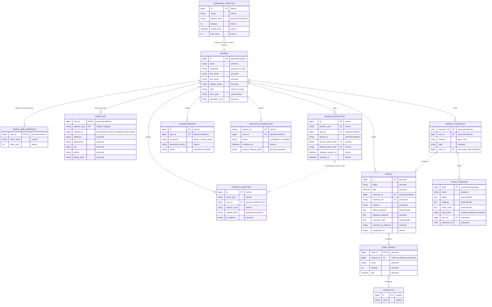
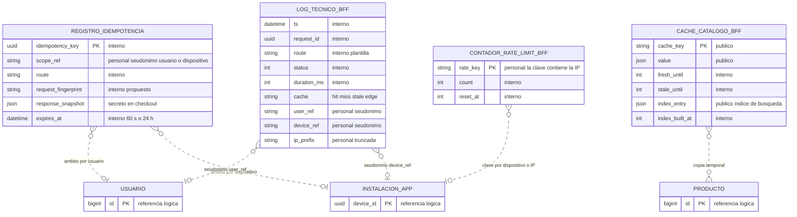
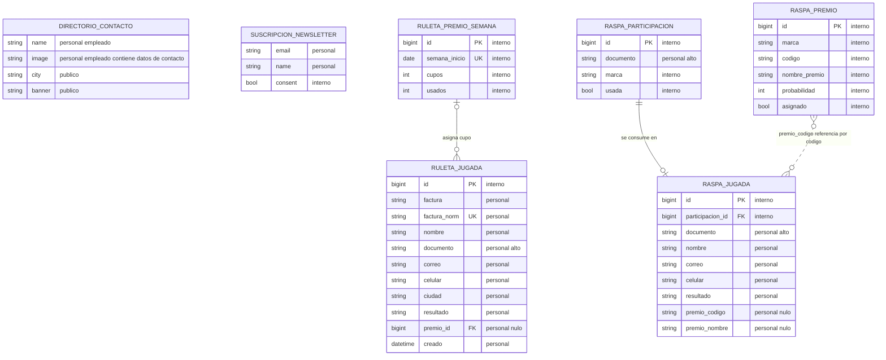

# Diagramas entidad-relación — App IPR (app Flutter + BFF `/mobile/v1` + WordPress/WooCommerce)

| | |
|---|---|
| **Proyecto** | App móvil Flutter de IPR Partes y Repuestos (Inverprimos S.A.S.) |
| **Fase** | Arquitectura (modelo de datos). **No se programa nada.** |
| **Fecha** | 2026-11-18 |
| **Estado** | BORRADOR. El diagrama 1 es el **diagrama obligatorio nº 11** (modelo conceptual). Los diagramas 2a, 2b, 3, 4 y 5 son parciales (uno por sistema, con WordPress/WooCommerce dividido en dos, y uno fuera del MVP) para mejorar la lectura. |
| **Relacionado** | [data_model.md](data_model.md) (sistemas de registro, ciclo de vida, reglas de integridad, inconsistencias) · [data_dictionary.md](data_dictionary.md) (todos los campos, clasificación y retención) |

## 0. Cómo leer los diagramas

- **Sintaxis conservadora de Mermaid** (`erDiagram`): identificadores en mayúsculas, sin espacios ni tildes, atributos en `snake_case` y comentarios entre comillas sin signos especiales. Las etiquetas descriptivas con tildes están en las **tablas** bajo cada diagrama.
- **Entidades EXISTENTES frente a PROPUESTAS:** Mermaid no permite colorear entidades de forma portable, así que cada bloque lleva un comentario `%% [EXISTENTE]`, `%% [PROPUESTA]` o `%% [MIXTA]` antes de la entidad, y cada diagrama trae una tabla con el estado. Un atributo de una entidad existente que es nuevo lleva el comentario `propuesto`.
- **Línea continua (`--`)** = relación con identidad (clave foránea real o lógica del sistema de registro). **Línea punteada (`..`)** = referencia **lógica** entre sistemas o por texto libre (sin clave foránea: WordPress no usa claves foráneas físicas, `authentication.md` §8).
- **Cardinalidades:** `||` exactamente uno · `|o` / `o|` cero o uno · `}o` / `o{` cero o muchos · `}|` / `|{` uno o muchos.
- Los diagramas muestran los **atributos clave** (identificadores, relaciones y los más relevantes por privacidad). La lista completa de campos (E01 a E41) está en el diccionario. En los comentarios de atributo: `personal`, `personal alto`, `secreto`, `interno`, `publico` (clasificación del diccionario, sin tildes en el diagrama).
- Identificadores de entidad = los del diccionario: E01 `USUARIO`, E02 `DIRECCION`, E03 `TOKEN_WEB_HEREDADO`, E04 `SESION_DISPOSITIVO`, E05 `EVENTO_AUDITORIA`, E06 `CONTADOR_THROTTLE`, E07 `CONSENTIMIENTO`, E08 `SOLICITUD_ELIMINACION`, E09 `PRODUCTO`, E10 `ATRIBUTO_PRODUCTO`, E11 `CATEGORIA`, E12 `MARCA`, E13 `ETIQUETA`, E14 `IMAGEN`, E15 `PEDIDO`, E16 `LINEA_PEDIDO`, E17 `INTENTO_CHECKOUT`, E18 `TICKET_HANDOFF`, E19 `SEDE`, E20 `TELEFONO_SEDE`, E21 `DIRECTORIO_CONTACTO`, E22 `CONFIG_REMOTA_APP`, E23 `DOCUMENTO_LEGAL`, E24 `PQRS`, E25 `SUSCRIPCION_NEWSLETTER`, E26 `RULETA_JUGADA`, E27 `RULETA_PREMIO_SEMANA`, E28 `RASPA_PARTICIPACION`, E29 `RASPA_PREMIO`, E30 `RASPA_JUGADA`, E31 `REGISTRO_IDEMPOTENCIA`, E32 `CONTADOR_RATE_LIMIT_BFF`, E33 `LOG_TECNICO_BFF`, E34 `CACHE_CATALOGO_BFF`, E35 `INSTALACION_APP`, E36 `TOKENS_LOCALES`, E37 `LINEA_CARRITO`, E38 `CACHE_LOCAL`, E39 `INTENTO_CHECKOUT_LOCAL`, E40 `PREFERENCIAS_LOCALES`, E41 `DATOS_EN_MEMORIA`.

---

## 1. Diagrama 1 — Modelo conceptual completo (diagrama obligatorio nº 11)

Reúne las entidades mínimas del modelo: usuario, dirección, sesión de dispositivo, producto, categoría, marca, imagen, pedido y línea, intento de checkout, sede, directorio de contacto (ver diagrama 5), PQRS, configuración remota, carrito local, caché local y tokens, más las entidades que las soportan. Las entidades de cada sistema se muestran en los diagramas parciales.

```mermaid
erDiagram
    %% ===== WordPress y WooCommerce: identidad y privacidad =====
    %% [EXISTENTE con metadatos propuestos]
    USUARIO {
        bigint id PK "personal indirecto"
        string email "personal"
        string first_name "personal"
        string last_name "personal"
        string display_name "personal"
        string username "personal no viaja"
        string roles "interno no viaja"
        string user_pass "secreto hash"
    }
    %% [EXISTENTE almacenamiento por verificar]
    DIRECCION {
        bigint user_id PK, FK "personal indirecto"
        string address_type PK "billing o shipping"
        string first_name "personal"
        string last_name "personal"
        string company "personal"
        string national_id "personal alto"
        string address1 "personal"
        string address2 "personal"
        string department "personal"
        string city "personal"
        string postcode "personal"
        string phone "personal"
    }
    %% [PROPUESTA]
    SESION_DISPOSITIVO {
        bigint id PK "interno"
        string session_uuid UK "interno"
        bigint user_id FK "personal indirecto"
        string device_id "personal indirecto"
        string client_type "interno"
        string access_token_hash UK "secreto"
        string refresh_token_hash UK "secreto"
        string prev_refresh_token_hash "secreto"
        datetime idle_expires_at "interno"
        datetime absolute_expires_at "interno"
        datetime revoked_at "interno"
        string revoked_reason "interno"
    }
    %% [PROPUESTA]
    CONSENTIMIENTO {
        bigint id PK "interno"
        bigint user_id FK "personal indirecto"
        string document "terms o privacy_policy"
        string document_version "interno"
        string action "accepted o revoked"
        datetime occurred_at "interno"
    }
    %% [PROPUESTA]
    EVENTO_AUDITORIA {
        bigint id PK "interno"
        datetime occurred_at "interno"
        string event_type "interno"
        string outcome "interno"
        bigint user_id FK "personal indirecto nulo"
        string session_uuid "interno"
        string subject_hash "personal seudonimo"
        binary ip_address "personal"
    }
    %% [PROPUESTA]
    SOLICITUD_ELIMINACION {
        string request_id PK "interno"
        bigint user_id FK "personal indirecto"
        string account_state "active pending_deletion deleted"
        datetime requested_at "interno"
        string status "scheduled o completed"
        datetime complete_by "interno"
    }
    %% ===== WooCommerce: compra =====
    %% [EXISTENTE con metadatos propuestos]
    PEDIDO {
        bigint id PK "personal"
        string order_number "personal"
        string status "personal"
        string payment_state "derivado propuesto"
        datetime created_at "personal"
        string currency "interno"
        decimal subtotal "personal"
        decimal shipping_total "personal"
        decimal discount_total "personal"
        decimal tax_total "personal"
        decimal total "personal"
        string payment_method_title "personal"
        bigint customer_id FK "personal indirecto"
        string checkout_ref UK "propuesto"
        string channel "propuesto"
        text billing_snapshot "personal alto"
        text customer_note "personal alto"
    }
    %% [EXISTENTE]
    LINEA_PEDIDO {
        bigint order_id PK, FK "personal"
        bigint product_id FK "nulo si se elimina el producto"
        string name "personal"
        string sku "personal"
        int quantity "personal"
        decimal total "personal"
    }
    %% [PROPUESTA sin tabla propia]
    INTENTO_CHECKOUT {
        uuid checkout_ref PK "personal indirecto"
        bigint user_id FK "personal indirecto"
        string channel "app o web"
        json items "id y quantity"
        datetime expires_at "interno"
        string state "awaiting_order u order_created"
        bigint order_id FK "nulo hasta crear el pedido"
    }
    %% [EXISTENTE con cambios propuestos]
    TICKET_HANDOFF {
        string ticket PK "secreto 60 segundos"
        int iat "interno"
        json items "id y quantity"
        bigint user_id FK "propuesto personal"
        uuid checkout_ref FK "propuesto"
        string auth_token "secreto existente se elimina"
        string return_url "interno"
    }
    %% ===== WooCommerce: catalogo =====
    %% [EXISTENTE con campo propuesto]
    PRODUCTO {
        bigint id PK "publico"
        string slug UK "publico"
        string name "publico"
        string sku "publico"
        decimal price "publico solo lo decide WooCommerce"
        decimal regular_price "publico"
        bool on_sale "publico"
        string stock_status "publico"
        int stock_quantity "interno no viaja"
        string status "interno"
        string catalog_visibility "propuesto interno"
    }
    %% [EXISTENTE]
    CATEGORIA {
        bigint id PK "publico"
        bigint parent_id FK "publico nulo"
        string slug UK "publico"
        string name "publico"
    }
    %% [EXISTENTE fuentes no alineadas]
    MARCA {
        bigint term_id PK "publico"
        string slug "publico nulo si es heuristica"
        string name "publico"
        string logo_url "publico"
        bool has_landing "publico"
    }
    %% [EXISTENTE]
    ETIQUETA {
        bigint id PK "publico"
        string slug "publico"
        string name "publico"
    }
    %% [EXISTENTE]
    ATRIBUTO_PRODUCTO {
        bigint product_id PK, FK "publico"
        string slug PK "publico"
        string name "publico"
        string options "publico lista"
    }
    %% [EXISTENTE con campos solo de contrato]
    IMAGEN {
        bigint product_id PK, FK "publico"
        int position PK "publico"
        string url "publico"
        string alt "propuesto desconocido"
        int width "propuesto desconocido"
        int height "propuesto desconocido"
    }
    %% ===== Contenido operativo =====
    %% [EXISTENTE archivo compilado, fuente propuesta en WordPress]
    SEDE {
        string slug PK "publico"
        string city "publico"
        string name "publico"
        string address "publico"
        string whatsapp "publico"
        string image_url "publico"
        bool upcoming "publico"
        string maps_query "derivado"
        string coordinates "fase 2 nulo"
        string opening_hours "fase 2 nulo"
    }
    %% [EXISTENTE columnas planas]
    TELEFONO_SEDE {
        string sede_slug PK, FK "publico"
        string phone_type PK "landline sales_parts sales_ac mobile"
        string display "publico confirmar D-09"
        string dial "publico confirmar D-09"
    }
    %% [PROPUESTA]
    CONFIG_REMOTA_APP {
        string min_version_android "interno"
        string min_version_ios "interno"
        bool feature_checkout "interno"
        bool feature_pqrs "interno"
        bool feature_btu "interno"
        string contact_whatsapp "publico"
        string sales_email "publico"
        string pqrs_email "publico"
        string allowed_hosts "publico lista"
        string return_path_prefix "publico"
    }
    %% [PROPUESTA registro versionado]
    DOCUMENTO_LEGAL {
        string document PK "terms o privacy_policy"
        string version "publico"
        string url "publico"
    }
    %% [EXISTENTE en la web solo por correo]
    PQRS {
        string type "interno"
        string name "personal"
        string email "personal"
        string phone "personal"
        string order_reference "personal"
        string message "personal alto"
        bool accepts_data_policy "propuesto no se persiste"
        datetime received_at "interno"
    }
    %% ===== App movil =====
    %% [PROPUESTA]
    INSTALACION_APP {
        uuid device_id PK "personal indirecto secure storage"
        string app_version "interno"
        string platform "android o ios"
    }
    %% [PROPUESTA]
    TOKENS_LOCALES {
        uuid session_id "interno"
        string access_token "secreto solo memoria"
        string refresh_token "secreto secure storage"
        datetime refresh_expires_at "interno"
    }
    %% [PROPUESTA]
    LINEA_CARRITO {
        bigint product_id PK, FK "publico referencia por id"
        int quantity "publico entre 1 y 99"
        string name_snapshot "solo visual"
        string image_snapshot "solo visual"
        int price_snapshot "solo visual nunca se envia"
    }
    %% [PROPUESTA]
    INTENTO_CHECKOUT_LOCAL {
        uuid attempt_id PK "personal indirecto"
        uuid idempotency_key "interno"
        datetime created_at "interno"
        string state "maquina de estados"
    }
    %% [PROPUESTA]
    CACHE_LOCAL {
        string cache_key PK "publico"
        json payload "publico sin PII"
        datetime fetched_at "interno"
        string etag "interno"
    }

    USUARIO ||--o{ DIRECCION : "tiene hasta dos"
    USUARIO ||--o{ SESION_DISPOSITIVO : "abre"
    USUARIO ||--o{ CONSENTIMIENTO : "otorga"
    USUARIO |o--o{ EVENTO_AUDITORIA : "genera"
    USUARIO ||--o| SOLICITUD_ELIMINACION : "solicita"
    USUARIO |o--o{ PEDIDO : "realiza"
    USUARIO ||--o{ INTENTO_CHECKOUT : "inicia"
    DOCUMENTO_LEGAL ||--o{ CONSENTIMIENTO : "version aceptada"
    CONFIG_REMOTA_APP ||--|{ DOCUMENTO_LEGAL : "publica"
    PEDIDO ||--|{ LINEA_PEDIDO : "contiene"
    LINEA_PEDIDO }o--o| PRODUCTO : "referencia"
    INTENTO_CHECKOUT ||--o| PEDIDO : "resulta en"
    INTENTO_CHECKOUT ||--o| TICKET_HANDOFF : "emite"
    PRODUCTO }o--o{ CATEGORIA : "se clasifica en"
    CATEGORIA |o--o{ CATEGORIA : "es padre de"
    PRODUCTO }o--o| MARCA : "pertenece a"
    PRODUCTO ||--o{ IMAGEN : "tiene"
    PRODUCTO ||--o{ ATRIBUTO_PRODUCTO : "describe"
    PRODUCTO }o--o{ ETIQUETA : "se etiqueta con"
    SEDE ||--o{ TELEFONO_SEDE : "tiene"
    INSTALACION_APP |o..o{ SESION_DISPOSITIVO : "identifica por device_id"
    INSTALACION_APP ||--o| TOKENS_LOCALES : "custodia"
    INSTALACION_APP ||--o{ LINEA_CARRITO : "guarda"
    INSTALACION_APP ||--o| INTENTO_CHECKOUT_LOCAL : "mantiene"
    INSTALACION_APP ||--o{ CACHE_LOCAL : "almacena"
    LINEA_CARRITO }o..|| PRODUCTO : "referencia por id"
    INTENTO_CHECKOUT_LOCAL |o..o| INTENTO_CHECKOUT : "correlaciona por checkout_ref"
    PQRS }o..o| PEDIDO : "cita en texto libre"
```

### 1.1 Estado y sistema de registro de las entidades del diagrama 1

| Entidad | Sistema de registro | Estado | Notas |
|---|---|---|---|
| `USUARIO` | WordPress | EXISTENTE (metadatos de cuenta PROPUESTOS en `SOLICITUD_ELIMINACION`) | La app solo recibe una lista blanca (sin `roles` ni `username`). |
| `DIRECCION` | WordPress | EXISTENTE (formato de almacenamiento por verificar, INC-05) | Una de facturación y una de envío por usuario en el MVP; la cédula/NIT no se persiste hoy en el perfil. |
| `SESION_DISPOSITIVO` | WordPress (`ipr_auth_sessions`) | PROPUESTA (esquema `authentication.md` §8.1 sin cambios) | Subconjunto de columnas en el diagrama; las 19 están en el diccionario (E04). |
| `CONSENTIMIENTO` | WordPress (`ipr_consents`) | PROPUESTA | `user_id` obligatorio: no cubre visitantes (DM-04). |
| `EVENTO_AUDITORIA` | WordPress (`ipr_auth_events`) | PROPUESTA | Retención 90 días. |
| `SOLICITUD_ELIMINACION` | WordPress (metadatos + solicitud de privacidad) | PROPUESTA | Plazos y registro mínimo: D-12. |
| `PEDIDO` | WooCommerce | EXISTENTE (`checkout_ref`, `channel`, `payment_state` PROPUESTOS) | Fuente de verdad del precio y del estado del pago. |
| `LINEA_PEDIDO` | WooCommerce | EXISTENTE | `product_id` puede ser nulo. |
| `INTENTO_CHECKOUT` | BFF genera / WordPress guarda | PROPUESTA | Sin tabla propia: vive en el pedido (`checkout_ref`) y en la sesión de WooCommerce. |
| `TICKET_HANDOFF` | WordPress (*transient* de 60 s) | EXISTENTE (cambios PROPUESTOS) | Hoy guarda el token; se propone guardar `user_id`. |
| `PRODUCTO`, `CATEGORIA`, `MARCA`, `ETIQUETA`, `ATRIBUTO_PRODUCTO`, `IMAGEN` | WooCommerce | EXISTENTE (campos de contrato sin origen hoy marcados `propuesto`) | `stock_quantity` nunca viaja. |
| `SEDE`, `TELEFONO_SEDE` | Hoy `sedes-data.ts`; PROPUESTO WordPress | EXISTENTE → PROPUESTA | Sin coordenadas ni horarios (D-09). |
| `CONFIG_REMOTA_APP`, `DOCUMENTO_LEGAL` | PROPUESTO WordPress | PROPUESTA | Respaldo empaquetado en la app. |
| `PQRS` | Buzón corporativo | EXISTENTE (web); contrato PROPUESTO | No se persiste en base de datos. |
| `INSTALACION_APP`, `TOKENS_LOCALES`, `LINEA_CARRITO`, `INTENTO_CHECKOUT_LOCAL`, `CACHE_LOCAL` | App | PROPUESTA | Sin PII salvo tokens y `device_id` (secure storage). |

**Cardinalidades que merecen explicación**

| Relación | Lectura | Fuente |
|---|---|---|
| `USUARIO` (1) a `DIRECCION` (0..2) | Hasta dos direcciones por usuario (`billing` y `shipping`) en el MVP. | RF-106 |
| `USUARIO` (0..1) a `PEDIDO` (0..N) | `customer_id` puede quedar en `0` tras anonimizar o para pedidos de invitado. | `AUTH` §12.2 (SUPUESTO sobre WooCommerce) |
| `INTENTO_CHECKOUT` (1) a `PEDIDO` (0..1) | Un intento produce **como máximo** un pedido. Reintentos y doble pedido: DESCONOCIDOS (PA-11). | `APIC` EP-24 |
| `LINEA_PEDIDO` (0..N) a `PRODUCTO` (0..1) | Una línea referencia un producto que puede haber sido eliminado (`product_id` nulo). | `OAS` OrderDetail.items |
| `PRODUCTO` (0..N) a `MARCA` (0..1) | La marca puede no resolverse; la resolución es heurística hoy (AP-05). | `WCA` §6 |
| `INSTALACION_APP` (0..1) a `SESION_DISPOSITIVO` (0..N), lógica | Relación **lógica** por `device_id` entre la app y WordPress; una instalación tiene una sesión activa por usuario. | `AUTH` §3.1, §8.1 |
| `PQRS` (0..N) a `PEDIDO` (0..1), lógica | Referencia en texto libre; no es clave foránea. | `PQ:33` |

---

## 2. Diagrama 2a — WordPress / WooCommerce: identidad, seguridad y compra

| Entidad | Sistema físico | Estado | Retención (códigos del diccionario) |
|---|---|---|---|
| `USUARIO`, `DIRECCION`, `TOKEN_WEB_HEREDADO` | `users`, `usermeta` | EXISTENTE | `RET-01` |
| `SESION_DISPOSITIVO` | `{prefix}ipr_auth_sessions` | PROPUESTA | `RET-03` (30 días tras revocar o vencer) |
| `EVENTO_AUDITORIA` | `{prefix}ipr_auth_events` | PROPUESTA | `RET-04` (90 días; evento de eliminación: D-12) |
| `CONTADOR_THROTTLE` | `{prefix}ipr_auth_throttle` | PROPUESTA | `RET-05` (24 h) |
| `CONSENTIMIENTO` | `{prefix}ipr_consents` | PROPUESTA | `RET-06` (D-12) |
| `SOLICITUD_ELIMINACION` | metadatos de usuario + solicitud de privacidad de WP | PROPUESTA | `RET-15` (D-12) |
| `PEDIDO`, `LINEA_PEDIDO` | WooCommerce | EXISTENTE (metadatos PROPUESTOS) | `RET-02` (D-12) |
| `INTENTO_CHECKOUT` | sin tabla (sesión de WooCommerce + meta del pedido) | PROPUESTA | `RET-02` / `RET-08` |
| `TICKET_HANDOFF` | *transient* `ipr_handoff_<ticket>` | EXISTENTE (cambios PROPUESTOS) | `RET-08` (60 s) |

---

## 3. Diagrama 2b — WordPress / WooCommerce: catálogo y contenido operativo

```mermaid
erDiagram
    %% [EXISTENTE con campo propuesto]
    PRODUCTO {
        bigint id PK "publico el codigo lo trata como string"
        string slug UK "publico"
        string name "publico"
        string sku "publico puede venir vacio"
        decimal price "publico cero significa sin precio"
        decimal regular_price "publico"
        decimal sale_price "publico no se mapea hoy"
        bool on_sale "publico"
        string stock_status "publico"
        int stock_quantity "interno no viaja"
        text short_description "publico html crudo"
        text description "publico html crudo se sanea en servidor"
        string status "interno solo publish es visible"
        string catalog_visibility "propuesto interno"
    }
    %% [EXISTENTE]
    CATEGORIA {
        bigint id PK "publico"
        bigint parent_id FK "publico nulo"
        string slug UK "publico"
        string name "publico"
    }
    %% [EXISTENTE cuatro fuentes no alineadas]
    MARCA {
        bigint term_id PK "publico"
        string slug "publico nulo si es heuristica"
        string name "publico"
        string logo_url "publico ruta relativa hoy"
        bool has_landing "publico"
    }
    %% [EXISTENTE]
    ETIQUETA {
        bigint id PK "publico"
        string slug "publico liquidacion"
        string name "publico"
    }
    %% [EXISTENTE]
    ATRIBUTO_PRODUCTO {
        bigint product_id PK, FK "publico"
        string slug PK "publico pa_"
        string name "publico"
        string options "publico lista"
    }
    %% [EXISTENTE con campos solo de contrato]
    IMAGEN {
        bigint product_id PK, FK "publico"
        int position PK "publico"
        string url "publico original sin miniaturas"
        string alt "propuesto desconocido"
        int width "propuesto desconocido"
        int height "propuesto desconocido"
    }
    %% [EXISTENTE archivo compilado, fuente propuesta en WordPress]
    SEDE {
        string slug PK "publico"
        string city "publico"
        string name "publico"
        string address "publico"
        string whatsapp "publico"
        string image_url "publico"
        bool upcoming "publico"
        string maps_query "derivado"
    }
    %% [EXISTENTE columnas planas]
    TELEFONO_SEDE {
        string sede_slug PK, FK "publico"
        string phone_type PK "landline sales_parts sales_ac mobile"
        string display "publico confirmar D-09"
        string dial "publico confirmar D-09"
    }
    %% [PROPUESTA]
    CONFIG_REMOTA_APP {
        string min_version_android "interno"
        string min_version_ios "interno"
        bool feature_checkout "interno"
        bool feature_pqrs "interno"
        bool feature_btu "interno"
        string contact_whatsapp "publico"
        string contact_phone "publico"
        string sales_email "publico"
        string pqrs_email "publico"
        string account_deletion_notice "publico D-12"
        string allowed_hosts "publico lista"
        string return_path_prefix "publico"
    }
    %% [PROPUESTA registro versionado]
    DOCUMENTO_LEGAL {
        string document PK "terms o privacy_policy"
        string version "publico"
        string url "publico"
    }

    PRODUCTO }o--o{ CATEGORIA : "se clasifica en"
    CATEGORIA |o--o{ CATEGORIA : "es padre de"
    PRODUCTO }o--o| MARCA : "pertenece a"
    PRODUCTO }o--o{ ETIQUETA : "se etiqueta con"
    PRODUCTO ||--o{ ATRIBUTO_PRODUCTO : "describe"
    PRODUCTO ||--o{ IMAGEN : "tiene"
    SEDE ||--o{ TELEFONO_SEDE : "tiene"
    CONFIG_REMOTA_APP ||--|{ DOCUMENTO_LEGAL : "publica"
```

| Entidad | Fuente de verdad | Estado | Observaciones de calidad |
|---|---|---|---|
| `PRODUCTO` | WooCommerce `wc/v3/products` | EXISTENTE | `price = 0` se interpreta como "sin precio"; `catalog_visibility` no se filtra hoy (FE-01); SKU puede venir vacío (RNF-110). |
| `CATEGORIA` | WooCommerce | EXISTENTE | Hay categorías basura (`-`, slugs numéricos, `uncategorized`) que el DTO debe excluir. |
| `MARCA` | Taxonomía `product_brand` + registros del sitio | EXISTENTE | Cuatro fuentes no alineadas; resolución heurística (AP-05). |
| `ETIQUETA` | WooCommerce | EXISTENTE | `liquidacion` define EP-20. |
| `ATRIBUTO_PRODUCTO` | WooCommerce (`pa_*`) | EXISTENTE | Términos con slugs inconsistentes (`12-0-hp` frente a `120hp`). |
| `IMAGEN` | Medios de WordPress | EXISTENTE | Solo la URL original se lee hoy; `alt`, `width`, `height` sin origen (DN-03). |
| `SEDE`, `TELEFONO_SEDE` | Hoy `sedes-data.ts` | EXISTENTE → PROPUESTA | 32 entradas; confirmar canales corporativos (D-09). |
| `CONFIG_REMOTA_APP`, `DOCUMENTO_LEGAL` | PROPUESTO WordPress (`ipr_mobile_config`) | PROPUESTA | Respaldo empaquetado en la app; textos legales: D-12. |

---

## 4. Diagrama 3 — BFF Next.js `/mobile/v1` (estado efímero, sin persistencia de datos personales)

Las entidades del BFF viven en la memoria del proceso o en los logs. Las referencias a usuario, dispositivo y producto son **lógicas** (punteadas): el BFF no tiene tablas ni claves foráneas.

| Entidad | Naturaleza | Estado | Retención |
|---|---|---|---|
| `REGISTRO_IDEMPOTENCIA` | `Map` en memoria; 60 s en `/checkout` (incluye `checkoutUrl` con ticket) y 24 h en `/pqrs` | PROPUESTA | `RET-08` |
| `CONTADOR_RATE_LIMIT_BFF` | `Map` en memoria; hoy se vacía entero al superar 5.000 claves | EXISTENTE / PROPUESTA | `RET-08` |
| `LOG_TECNICO_BFF` | Una línea JSON por solicitud; nunca tokens, correo, cédula ni IP completa | PROPUESTA | `RET-07` (≤ 90 días) |
| `CACHE_CATALOGO_BFF` | Cachés SWR e índice de hasta 10.000 productos | EXISTENTE | `RET-08` |

---

## 5. Diagrama 4 — App móvil Flutter (almacenamiento local)

La app **no tiene base de datos de negocio**: solo secure storage (tokens y `device_id`), dos cajas Hive sin PII (`cart`, `cache`), preferencias y memoria. Perfil, direcciones y pedidos viven **solo en memoria**.

```mermaid
erDiagram
    %% [PROPUESTA secure storage]
    INSTALACION_APP {
        uuid device_id PK "personal indirecto"
        string app_version "interno"
        string platform "android o ios"
    }
    %% [PROPUESTA memoria y secure storage]
    TOKENS_LOCALES {
        uuid session_id "interno"
        string access_token "secreto solo memoria"
        int access_token_expires_in "interno"
        string refresh_token "secreto Keystore o Keychain"
        datetime refresh_token_expires_at "interno"
    }
    %% [PROPUESTA Hive cart]
    LINEA_CARRITO {
        bigint product_id PK "publico"
        int quantity "publico 1 a 99"
        string name_snapshot "solo visual"
        string image_snapshot "solo visual"
        int price_snapshot "solo visual nunca se envia"
    }
    %% [PROPUESTA Hive cache]
    CACHE_LOCAL {
        string cache_key PK "publico"
        json payload "publico sin PII"
        datetime fetched_at "interno"
        string etag "interno"
    }
    %% [PROPUESTA Hive cache]
    INTENTO_CHECKOUT_LOCAL {
        uuid attempt_id PK "personal indirecto igual a checkout_ref"
        uuid idempotency_key "interno"
        datetime created_at "interno"
        string state "maquina de estados"
    }
    %% [PROPUESTA shared_preferences]
    PREFERENCIAS_LOCALES {
        bool notice_seen "interno"
        string last_tab "interno"
        bool first_run_marker "interno"
    }
    %% [PROPUESTA solo memoria]
    DATOS_EN_MEMORIA {
        json profile "personal"
        json addresses "personal alto"
        json orders "personal"
    }
    PRODUCTO {
        bigint id PK "referencia logica al catalogo"
    }
    INTENTO_CHECKOUT {
        uuid checkout_ref PK "referencia logica al servidor"
    }
    SESION_DISPOSITIVO {
        string session_uuid PK "referencia logica al servidor"
    }

    INSTALACION_APP ||--o| TOKENS_LOCALES : "custodia en secure storage"
    INSTALACION_APP ||--o{ LINEA_CARRITO : "guarda en Hive cart"
    INSTALACION_APP ||--o{ CACHE_LOCAL : "almacena en Hive cache"
    INSTALACION_APP ||--o| INTENTO_CHECKOUT_LOCAL : "mantiene mientras paga"
    INSTALACION_APP ||--o| PREFERENCIAS_LOCALES : "tiene"
    INSTALACION_APP ||--o| DATOS_EN_MEMORIA : "mantiene con sesion activa"
    LINEA_CARRITO }o..|| PRODUCTO : "referencia por id"
    INTENTO_CHECKOUT_LOCAL |o..o| INTENTO_CHECKOUT : "correlaciona por checkout_ref"
    TOKENS_LOCALES }o..|| SESION_DISPOSITIVO : "corresponde a session_id"
```

| Almacén | Entidades | Protección | Al cerrar sesión | Al eliminar la cuenta |
|---|---|---|---|---|
| Keystore / Keychain | `INSTALACION_APP.device_id`, `TOKENS_LOCALES.refresh_token` | Cifrado del SO; excluido de copias | Se borra el refresh; `device_id` se conserva | Se borran; `device_id` se regenera |
| Memoria | `TOKENS_LOCALES.access_token`, `DATOS_EN_MEMORIA` | RAM | Se borra | Se borra |
| Hive `cart` | `LINEA_CARRITO` | Sin PII | Se conserva (PROPUESTA, DN-10) | Se conserva |
| Hive `cache` | `CACHE_LOCAL`, `INTENTO_CHECKOUT_LOCAL` | Sin PII | Se conserva (el intento se borra) | Se conserva (el intento se borra) |
| `shared_preferences` | `PREFERENCIAS_LOCALES` | Sin PII | Se conserva | Se borra |

---

## 6. Diagrama 5 — Fuera del MVP: directorio, boletín y campañas (datos personales ya existentes en el ecosistema)

Estas entidades **no viajan a la app** (RF-101 a RF-103, RNF-065). Se dibujan para dejar visible dónde hay datos personales fuera del alcance del MVP. Retención de todas: **DESCONOCIDA** (`RET-12`, `RET-13`, D-12).

| Entidad | Dónde vive | Estado | Observación |
|---|---|---|---|
| `DIRECTORIO_CONTACTO` | `contacto-data.ts` + imágenes en `/public/directorio` | EXISTENTE | Datos de empleados; contenido de las imágenes DESCONOCIDO. La app usa solo canales corporativos (RF-095). |
| `SUSCRIPCION_NEWSLETTER` | Buzón de correo (sin base de datos) | EXISTENTE | Fase 2 (RF-101). |
| `RULETA_JUGADA`, `RULETA_PREMIO_SEMANA` | Tablas de WordPress del snippet de la ruleta | EXISTENTE | Documento, correo y celular sin retención definida. |
| `RASPA_PARTICIPACION`, `RASPA_PREMIO`, `RASPA_JUGADA` | Tablas de WordPress del snippet de raspa (solo con `IPR_RASPA_SAMSUNG_GUARDAR` activo) | EXISTENTE | Usa reCAPTCHA de Google. |

---

## 7. Verificación de consistencia entre diagramas y diccionario

| Verificación | Resultado |
|---|---|
| Todas las entidades de los diagramas están en el diccionario (E01 a E41) y cada entidad del diccionario aparece en al menos un diagrama (E03, E06, E21, E25 a E34, E40 y E41 solo en diagramas parciales) | Sí; el carrito local se modela como el conjunto de `LINEA_CARRITO` (E37). |
| Los atributos de los diagramas son un subconjunto de los del diccionario | Sí; los campos agrupados del diccionario (p. ej. `contact.phone.display`/`.dial`) se resumen en un atributo por tema. |
| El esquema de `SESION_DISPOSITIVO`, `EVENTO_AUDITORIA`, `CONTADOR_THROTTLE` y `CONSENTIMIENTO` coincide con `authentication.md` §8 | Sí (columnas completas solo en el diccionario). |
| Ningún atributo contiene datos personales reales | Sí: solo nombres y clasificación. |
| Identificadores y comentarios sin tildes ni signos especiales (compatibilidad de Mermaid) | Sí. |
