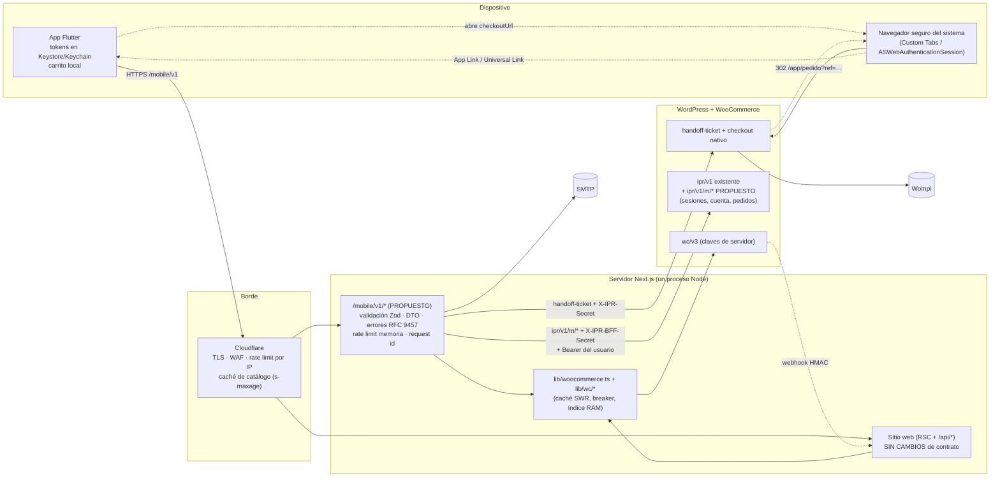

# Arquitectura de la API móvil `/mobile/v1` (BFF) — App IPR

| | |
|---|---|
| **Proyecto** | App móvil Flutter de IPR Partes y Repuestos (Inverprimos S.A.S.) |
| **Fase** | Tercera entrega — Arquitectura (lado servidor). **No se programa nada.** |
| **Fecha** | 2026-11-18 |
| **Estado** | BORRADOR para revisión del responsable técnico de `ipr-frontend` y de WordPress (condición C1 de ADR-001). |
| **Autor (rol)** | Arquitectura de Backend/API y Ciberseguridad |
| **Documentos hermanos** | [authentication.md](authentication.md) · [api_contracts.md](api_contracts.md) · [openapi.yaml](openapi.yaml) |
| **Base** | [ADR-001 y ADR-002 (aprobadas)](../03_architecture/architecture_decisions.md) · [informe_codigo_frontend.md](../00_discovery/informe_codigo_frontend.md) (prevalece) · [analisis_capa_woocommerce.md](../00_discovery/analisis_capa_woocommerce.md) · [functional_requirements.md](../02_requirements/functional_requirements.md) · [non_functional_requirements.md](../02_requirements/non_functional_requirements.md) · [decisiones_pendientes.md](../project/decisiones_pendientes.md) |
| **Fuera de este documento** | Arquitectura del cliente Flutter (`03_architecture/architecture_overview.md`, `flutter_app_architecture.md`, en elaboración por otro arquitecto). Aquí solo se fija lo que el cliente **debe** cumplir para que el contrato funcione. |

## 0. Convenciones

| Etiqueta | Significado |
|---|---|
| **HECHO** | Comprobado en código o documento, con cita `archivo:línea`. Rutas de `ipr-frontend` abreviadas: `wc.ts` = `src/lib/woocommerce.ts`; `client.ts` = `src/lib/wc/client.ts`; `auth-rest.php` = `wp-snippets/ipr-auth-rest.php`; `handoff.php` = `wp-snippets/ipr-cart-handoff.php`. Las citas a `wc.ts`/`client.ts` provienen del análisis de la Entrega 1.2 y se re-verificaron por muestreo (`wc.ts:497-502`, `wc.ts:1110-1135`). |
| **SUPUESTO** | Premisa razonable no verificada; se indica cómo validarla. |
| **PROPUESTA** | Diseño recomendado en este documento. **Nada de `/mobile/v1` existe hoy.** |
| **DECISIÓN PENDIENTE** | Requiere aprobación humana (ID `D-xx`, `DN-xx`, `PA-xx` o `AP-xx` nuevo de este documento). |
| **RIESGO** | Identificado con `RA-xx` (riesgo de API). |
| **DESCONOCIDO** | Sin evidencia; se dice cómo obtenerla. |

No se leyó el archivo `.env`. Ningún valor de este documento es un secreto real; los nombres de variables nuevas (`IPR_BFF_SECRET`, etc.) son propuestas.

---

## 1. Resumen ejecutivo

1. **Topología mínima, sin piezas nuevas de infraestructura en el MVP:** App → Cloudflare → Next.js (`/mobile/v1`, mismo proceso que la web) → WooCommerce `wc/v3` (catálogo, con la capa existente) y `ipr/v1` (cuenta, pedidos, checkout). No se añade API Gateway, servicio separado, GraphQL ni Redis: no aportan con un solo proceso Node y un volumen desconocido (ver §14, criterios para añadirlos).
2. **Catálogo público y cacheable; cuenta privada y nunca cacheada.** Los endpoints públicos no personalizan nada (no hay B2B, ADR-002), así que Cloudflare puede absorber la lectura con `s-maxage` y `ETag`. Todo lo autenticado va con `Cache-Control: private, no-store`.
3. **Sesiones por dispositivo con tokens opacos validados en WordPress** (access 15 min + refresh rotativo con detección de reutilización). Se descarta JWT: todos los endpoints autenticados ya necesitan llamar a WordPress, así que validar allí no añade saltos y permite revocación inmediata (ADR-013 propuesta, detalle en [authentication.md](authentication.md)).
4. **Errores RFC 9457 con códigos estables**, y semántica estricta: `404` solo si el recurso no existe de verdad; `503` si WooCommerce no está disponible o el índice se está construyendo; `502`/`504` para respuestas inválidas o tiempo agotado aguas arriba. Hoy la capa de datos convierte fallos en "vacío" o `null` (`wc.ts:497-502`, `wc.ts:1133-1135`): **hay que corregirlo antes de construir el BFF**.
5. **Checkout:** la app solo envía `{id, quantity}`; el BFF pide el ticket de un solo uso a WordPress y devuelve la URL más un `checkoutRef`. **La fuente de verdad del resultado es la consulta `GET /mobile/v1/checkout/{checkoutRef}`**, no el deep link; App Links/Universal Links sobre una ruta dedicada `/app/*` solo aceleran el regreso (ADR-017 propuesta).
6. **Rate limiting en tres capas sin Redis:** Cloudflare (por IP, en el borde), BFF en memoria (lecturas, por IP y por dispositivo) y WordPress en base de datos (autenticación por cuenta y por IP: compartido y persistente). Redis solo si hay más de un proceso (ADR-015 propuesta).
7. **Cambios previos obligatorios (P0):** corregir SEC-07 (ficha sin `status=publish`, `wc.ts:1117-1121`), filtrar `catalog_visibility`, errores discriminados, DTO móvil sin `stockQuantity` ni HTML sin sanear, token solo por cabecera, sesiones por dispositivo, rate limit en auth, cola acotada en `wcGet` y pruebas de contrato en CI (§16).

---

## 2. Hechos del sistema actual que condicionan el diseño

| # | HECHO | Evidencia | Consecuencia para `/mobile/v1` |
|---|---|---|---|
| F-01 | El frontend es Next.js en un servidor propio (DigitalOcean), desplegado por SSH; el comando remoto no está en el repositorio. | `.github/workflows/deploy.yml:93-106` | Número de procesos y memoria: **DESCONOCIDO** (pregunta al equipo web; métrica MED-04). |
| F-02 | Toda lectura de WooCommerce pasa por `wcGet`: timeout 8 s, 2 reintentos, breaker (5 fallos → 30 s), concurrencia 4 por proceso con cola **sin tope**. | `client.ts:48-58`, `214-228`, `348-381` | El BFF hereda la protección, pero también la cola sin límite (RA-03). |
| F-03 | Las funciones de alto nivel tragan los errores: listado → vacío; ficha → `null`. | `wc.ts:497-502`, `wc.ts:1133-1135` | Imposible distinguir 404 de 503 sin cambio (RA-02). |
| F-04 | La ficha por slug **no** filtra `status=publish` (SEC-07 abierto); ninguna consulta filtra `catalog_visibility`. | `wc.ts:1117-1121`; análisis 1.2 §4.2 | Fuga de borradores/privados por API JSON (RA-01). |
| F-05 | El modelo de ficha incluye `stockQuantity` exacto y HTML crudo de WordPress. | `wc.ts:1075-1076`, `1083` | Hace falta DTO por lista blanca y saneado en servidor. |
| F-06 | `ipr/v1` emite **un solo token por usuario** (sobrescribe el hash), 30 días fijos, sin refresh; acepta el token por query string, cuerpo o cabecera. | `auth-rest.php:37`, `45-50`, `53-68` | Bloquea multi-dispositivo (H-01) y viola RNF-041 (H-03). |
| F-07 | Todas las rutas `ipr/v1` usan `permission_callback => '__return_true'` y validan dentro del handler. | `auth-rest.php:372-411`; `handoff.php:254` | Frágil ante handlers nuevos (H-05). |
| F-08 | El ticket de checkout es de un solo uso (se borra antes de usarse), 60 s, máx. 100 líneas, cantidad 1–99; la URL de retorno se valida contra una lista cerrada de hosts. | `handoff.php:92-98`, `122-149`, `386-397` | Se reutiliza tal cual; solo se extiende (canal app, `checkoutRef`). |
| F-09 | El token de sesión del usuario viaja a WordPress dentro del payload del ticket y se **guarda en el transient** 60 s; al consumir el ticket se inicia sesión con cookie **persistente** (`remember = true`). | `handoff.php:229-231`, `235`, `271` | En la app, los Custom Tabs comparten cookies con Chrome: la sesión de WordPress quedaría abierta en el navegador del sistema (RA-09). |
| F-10 | Tras pagar, WordPress solo redirige al frontend si el pedido **no** está `failed`, `cancelled` ni `pending`. | `handoff.php:464-466` | Para fallidos/pendientes no hay regreso automático: la app debe consultar el estado (ADR-017). |
| F-11 | El limitador de frecuencia es un `Map` en memoria que **se vacía entero** al superar 5.000 claves, y toma la IP del **primer** valor de `X-Forwarded-For`. | `src/lib/rate-limit.ts:16-17`, `33-39`, `55-58` | Con claves por dispositivo, un atacante puede llenar el mapa y reiniciar todos los contadores; la IP es falsificable si el cliente envía `X-Forwarded-For` (RA-05). |
| F-12 | Las llamadas del servidor a `ipr/v1` (`auth.ts`) no tienen timeout; el checkout sí (8 s). | `src/lib/auth.ts:71-76`; `src/app/api/checkout/route.ts:50`, `130` | El BFF debe imponer timeout en todas las llamadas a WordPress. |
| F-13 | El webhook de revalidación acepta el secreto por `?secret=`. | `src/app/api/revalidate/route.ts:80-82` | Mismo patrón que H-03 (secreto en logs). |
| F-14 | La CSP y cabeceras de seguridad se aplican a todas las rutas; no hay `Cache-Control` para rutas JSON. | `next.config.ts:24-43`, `337-384` | Las rutas `/mobile/v1` fijan su propio `Cache-Control` en el handler. |
| F-15 | Hay un *rewrite* que expone `/wp-json/ipr/v1/raspa-samsung/*` bajo el dominio del frontend. | `next.config.ts:321-335` | Superficie de `ipr/v1` accesible por el dominio principal: inventariar (API9). |
| F-16 | No hay pruebas automáticas ni `tsc`/lint/`npm audit` en CI. | `ipr-frontend/CLAUDE.md:35`; `deploy.yml` completo | RNF-049/090 obligan a añadirlos para `/mobile/v1`. |
| F-17 | No hay `middleware.ts`/`proxy.ts` en `src/`. | Listado de `src/` | Cabeceras comunes y request id se hacen en un *wrapper* de handlers (`lib/mobile/http.ts`), no en middleware. |

---

## 3. Arquitectura de comunicación

### 3.1 Diagrama



### 3.2 Responsabilidades por capa

| Capa | Hace | No hace | Estado |
|---|---|---|---|
| **App** | Llama solo a `/mobile/v1` (AC-SEC-2); guarda tokens en almacén seguro; carrito local; abre el checkout en navegador seguro; valida el host de `checkoutUrl` contra `allowedHosts`; consulta el estado del pedido por `checkoutRef`. | Calcular precios/impuestos/envío como autoridad; llamar a `wc/v3`, `wp/v2`, `/api/*` o a Wompi. | PROPUESTO (lado cliente lo detalla el arquitecto Flutter). |
| **Cloudflare** | TLS, WAF, rate limit por IP (si el plan lo permite), caché de respuestas públicas de catálogo según `Cache-Control` del origen. | Desafíos interactivos en `/mobile/v1` (una app no puede resolverlos, R-02). | Existe (HECHO, INV §2.1); reglas para `/mobile/v1`: PROPUESTO. Plan contratado: **DESCONOCIDO**. |
| **BFF `/mobile/v1`** | Validar entrada (Zod, `strict`), aplicar rate limit en memoria, mapear a DTO móvil por lista blanca, sanear HTML, poner cabeceras de caché/ETag, traducir errores a RFC 9457, propagar `X-Request-Id`, registrar sin PII, pedir el ticket de checkout con el secreto de servidor. | Guardar sesiones o tokens; validar contraseñas; decidir precios; persistir datos personales. | PROPUESTO. |
| **Capa de datos existente** (`lib/woocommerce.ts`, `lib/wc/*`) | Acceso a `wc/v3` con caché SWR, deduplicación, breaker e índice de búsqueda. | Conocer al usuario (no usa cookies, HECHO análisis 1.2 §2). | EXISTE; requiere cambios P0 (§16). |
| **`ipr/v1` (WordPress)** | Identidad y credenciales; sesiones por dispositivo; anti fuerza bruta por cuenta; perfil, direcciones, pedidos con control de propiedad; ticket de checkout; eliminación de cuenta; auditoría. | Servir catálogo a la app. | Parcial EXISTE (`auth-rest.php`, `handoff.php`); `ipr/v1/m/*`: PROPUESTO. |
| **WooCommerce + Wompi** | Precio, impuestos, envío, stock y cobro definitivos; creación del pedido. | — | EXISTE (HECHO). Confirmación de pago por webhook de Wompi: **DESCONOCIDO** (D-02). |

### 3.3 Qué NO se añade (proporcionalidad)

| Elemento | Decisión | Por qué | Cuándo reconsiderarlo |
|---|---|---|---|
| API Gateway (Kong, AWS API GW, etc.) | No | Cloudflare ya da TLS, WAF y límites por IP; el BFF hace validación y versionado. Un gateway más sería otro salto, otro costo y otro punto de fallo sin consumidores múltiples. | Si aparecen varios consumidores externos (p. ej. B2B con claves de API, fase 2+). |
| Servicio BFF separado | No (ADR-001) | Duplicaría caché e índice. | Si la prueba de carga (C4) muestra degradación de la web > 10 % (RNF-015). |
| Redis | No en MVP (condicional) | Con un proceso, los contadores críticos (auth) viven en WordPress (BD compartida y persistente). | Si hay > 1 proceso Node o si el piloto exige idempotencia/límites que sobrevivan a reinicios en el BFF (DN-09). |
| JWT | No | Ver ADR-013: no ahorra llamadas y complica revocación y rotación de claves. | Si el BFF necesitara autenticar sin llamar a WordPress (no es el caso del MVP). |
| GraphQL | No | Contrato pequeño y estable; REST + OpenAPI es más simple de cachear en Cloudflare y de probar. | — |
| Cola de mensajes | No | No hay procesos asíncronos de alto volumen en el MVP; la eliminación de cuenta usa WP-Cron. | Push y cotizaciones (fase 2). |

---

## 4. Qué se reutiliza de `lib/woocommerce.ts` y `lib/wc/*`

| Endpoint `/mobile/v1` (PROPUESTO) | Función existente | Archivo:línea | Cambio necesario antes de usarla | Prioridad |
|---|---|---|---|---|
| `GET /products` | `fetchCatalogProducts` | `wc.ts:411-503` | Variante con resultado discriminado (`ok`/`unavailable`) sin cambiar la firma actual (`CLAUDE.md:124`); filtrar `catalog_visibility`; `perPage` fijo 12/24/48. | P0 |
| `GET /products/{slug}` | `fetchProductBySlug` + `normalizeProductDetail` | `wc.ts:1104-1136`, `1042-1086` | **`status: "publish"`** (SEC-07, `wc.ts:1117-1121`); excluir `catalog_visibility = hidden` y productos con contraseña; variante discriminada (`ok`/`not_found`/`unavailable`). | P0 |
| `POST /cart/validate` | `fetchProductsByIds` | `wc.ts:521-561` | Nueva función de disponibilidad con caché **por id** (la caché `by-ids` tiene 50 claves y combinaría mal carritos distintos, `wc.ts:513-519`). | P0 |
| `GET /categories` | `getCategories` + `buildCategoryTree` | `meta.ts:239-246`; `wc.ts:103-132` | Mapeador a DTO sin URLs web (`wc.ts:96-101`); excluir categorías basura (como hace la ficha, `wc.ts:1049-1055`) y `uncategorized`. | P0 |
| `GET /search` | `searchProducts` | `wc.ts:1035-1040` | Señal de "índice en construcción" en lugar de vacío (`wc.ts:982-983`); paginar en memoria como `/buscar` (`buscar/page.tsx:24`, `95-114`). | P0 |
| `GET /search/suggestions` | `searchProducts(q, 6)` | `src/app/api/search/suggestions/route.ts:37` | DTO propio (sin `formattedPrice`). | P0 |
| `GET /brands` | carga privada de marcas | `meta.ts:166-168` | Exportar `getBrands()`; decidir la fuente canónica (AP-05). | P1 |
| `GET /liquidaciones` | `fetchLiquidationProducts` + `discountPercent` | `liquidaciones.ts:30-50`; `liquidaciones-shared.ts:24-35` | Tope de `page` (hoy no lo hay en la ruta web, `liquidaciones/productos/route.ts:33`). | P1 |
| `GET /filters` | `getContextualDimensions`, `validateFilters` | `filter-context.ts:325-341`; `meta.ts:307-324` | DTO propio; las opciones salen de menús estáticos (`filter-context.ts:252-253`), sin conteo: aceptable para el MVP (RF-014 Should). | P1 |
| Todas | `WcError`, `wcCircuitOpen`, `Resolution` | `client.ts:71-81`, `136-139`; `meta.ts:192-195` | Base para mapear 503/502/504 (§6). | P0 |
| Todas | `getWcStats` | `metrics.ts:130-139` | Dimensión `origin=mobile` (C4 de ADR-001). | P1 |
| Todas | `sanitizeHtml` | `src/lib/security/sanitize.ts:185-238` | Aplicarlo **en el servidor** con un perfil móvil (sin `iframe`, ADR-019); batería de pruebas XSS. | P0 |
| — (no se reutiliza) | `formatCOP`, `MenuItem`, migas con URL web | `utils/price.ts:8-10`; `wc.ts:96-101`; `catalog-meta.ts:112-127` | La app formatea con su configuración regional; las URLs web no son contrato. | — |

**Regla de implementación (PROPUESTA):** las rutas `/mobile/v1` no importan `next/headers` ni `cookies()`; solo importan `lib/*` y `lib/mobile/*`. Así el BFF **ignora** la cookie `ipr_session` y no hay riesgo de CSRF (una petición cruzada no puede añadir `Authorization`).

### 4.1 Organización propuesta del código en `ipr-frontend`

| Ruta (PROPUESTA) | Contenido |
|---|---|
| `src/app/mobile/v1/**/route.ts` | Handlers finos: validar → llamar a `lib` → mapear → responder. `export const runtime = "nodejs"` (la capa usa `node:http`, `client.ts:1-2`). |
| `src/lib/mobile/http.ts` | *Wrapper* `mobileHandler()` común: request id, cabeceras de la app, versión mínima (`426`), rate limit, captura de errores → RFC 9457, log estructurado, `Cache-Control`/`ETag`. |
| `src/lib/mobile/errors.ts` | Catálogo de códigos (§6.3) y constructor de *problem details*. |
| `src/lib/mobile/dto.ts` | `toMobileProductSummary`, `toMobileProductDetail`, `toMobileCategoryTree`, `toMobileOrder`, `toMobileUser` (listas blancas). |
| `src/lib/mobile/schemas.ts` | Esquemas Zod de entrada (reutilizan `checkout-schema.ts:47-104` y `searchSchema.ts:24-36`). |
| `src/lib/mobile/ipr-client.ts` | Cliente hacia `ipr/v1/m/*` con timeout, `X-IPR-BFF-Secret`, `X-IPR-Request-Id`, `X-IPR-Client-IP`. Reemplaza el patrón sin timeout de `auth.ts:71-76`. |
| `src/lib/mobile/rate-limit.ts` | Limitador con LRU acotado por clase de clave (corrige `rate-limit.ts:33-39`). |
| `tests/mobile/**` | Pruebas de contrato contra `openapi.yaml` (RNF-090). |

---

## 5. Versionamiento y compatibilidad

| Aspecto | PROPUESTA | Justificación |
|---|---|---|
| Esquema | Versión mayor en la URI: `/mobile/v1`. | Visible en logs y reglas de Cloudflare; ADR-001 decisión 5. |
| Cambios compatibles en `v1` | Añadir campos opcionales en respuestas, endpoints nuevos, valores de enum **solo** si el campo está documentado como "abierto" (`x-extensible-enum`). La app debe ignorar campos desconocidos (RNF-085). | Evita romper apps instaladas. |
| Cambios incompatibles | Nueva versión `/mobile/v2`; `v1` se mantiene ≥ 12 meses (DN-14) y se anuncia con cabeceras `Deprecation` y `Sunset` (RFC 9745 / RFC 8594) y `Link: <…>; rel="deprecation"`. | Estándar, detectable por la app. |
| Versión de la app | Cabeceras obligatorias `X-App-Version` y `X-App-Platform`. `GET /config` publica `minSupportedVersion` (aviso suave) y el BFF responde `426` con `code: app_version_unsupported` por debajo del mínimo duro. | RNF-029 (interruptor remoto y versión mínima). |
| Contrato | `openapi.yaml` en el repositorio `ipr-frontend` (copia de este), verificado en CI con detección de cambios incompatibles (p. ej. `oasdiff`, a decidir) y pruebas de contrato. | RNF-085, RNF-090, RNF-096. |
| `ipr/v1` | Las rutas existentes no cambian de forma (la web depende de ellas, `auth.ts:108-166`); las nuevas van bajo `ipr/v1/m/*`. | No romper la web; separar la superficie móvil. |

---

## 6. Formato de respuestas y errores

### 6.1 Envoltura de éxito

| Caso | Forma | Ejemplo |
|---|---|---|
| Recurso único | `{ "data": { … } }` | `GET /products/{slug}` |
| Lista paginada | `{ "data": [ … ], "meta": { "page", "perPage", "total", "totalPages", "hasMore" } }` | `GET /products` |
| Aceptado asíncrono | `202 { "data": { "status": "…" } }` | `POST /pqrs`, `POST /me/deletion` |

Fechas en ISO 8601 con zona (`2026-11-18T10:15:00-05:00`). Importes: número en COP con IVA incluido, `null` cuando el producto no tiene precio (nunca `0` ni `"$ 0"`, RF-012). Identificadores de WooCommerce: enteros.

### 6.2 Errores: RFC 9457 (`application/problem+json`)

```json
{
  "type": "https://iprpartesyrepuestos.com/mobile/v1/problems/upstream-unavailable",
  "title": "Servicio temporalmente no disponible",
  "status": 503,
  "detail": "No pudimos consultar la tienda. Intenta de nuevo en unos segundos.",
  "instance": "/mobile/v1/products/valvula-xyz",
  "code": "upstream_unavailable",
  "requestId": "6f1c2a7e-0b7d-4c43-9d0e-5f3c1f6f2a11",
  "retryAfter": 30
}
```

- `code` es el campo que la app usa para decidir (estable, en inglés `snake_case`); `detail` está en español de Colombia y es apto para mostrar, pero la app puede usar sus propios textos (RNF-027).
- Errores de validación: se usa `400` (no `422`) con `code: validation_failed` y `errors: [{ "field": "items[3].quantity", "code": "too_big", "message": "La cantidad máxima es 99." }]` (coherente con la web, que responde 400, `checkout/route.ts:101-108`).
- Nunca se incluyen trazas, mensajes de WordPress sin filtrar ni nombres de servidores (patrón ya usado en `checkout/route.ts:60-83`).

### 6.3 Catálogo de códigos y semántica HTTP

| HTTP | `code` | Cuándo | La app debe |
|---|---|---|---|
| 400 | `validation_failed` | Parámetros o cuerpo inválidos; campos no permitidos (esquemas `strict`). | Mostrar error; no reintentar. |
| 400 | `token_in_url_forbidden` | Llega `token`, `access_token` o `refresh_token` en la query. | Error de programación: corregir. |
| 401 | `unauthorized` | Falta token, inválido, expirado o revocado (mensaje único, AC-044-8). | Intentar **un** refresh; si falla, pedir login conservando el carrito. |
| 401 | `invalid_credentials` | Login fallido, o cuenta con rol no permitido (AC-048-1). | Mensaje genérico. |
| 401 | `refresh_token_reused` | Refresh ya rotado presentado fuera de la ventana de gracia: se revoca la sesión. | Borrar tokens locales y pedir login. |
| 403 | `current_password_invalid` | Contraseña actual incorrecta en cambio de correo/contraseña/eliminación. | Mensaje en el campo. |
| 403 | `account_locked` | Cuenta en eliminación o bloqueada por administración. | Mensaje genérico de cuenta no disponible. |
| 404 | `not_found` | El recurso **no existe o no es visible para este usuario** (producto no publicado, pedido de otro usuario, ruta inexistente). **Solo** con respuesta definitiva de WooCommerce/WordPress. | Puede retirar el producto del carrito. |
| 409 | `email_in_use` | Registro o cambio de correo a uno existente. | Mensaje. (Revela existencia de cuenta: riesgo aceptado RA-11.) |
| 409 | `refresh_in_progress` | Dos refresh concurrentes de la misma sesión (fuera de la ventana de gracia de reintento). | Esperar y usar el token ya renovado. |
| 409 | `idempotency_conflict` | Misma `Idempotency-Key` con cuerpo distinto. | Error de programación. |
| 413 | `payload_too_large` | Cuerpo > 32 KB. | — |
| 415 | `unsupported_media_type` | Cuerpo que no es `application/json`. | — |
| 426 | `app_version_unsupported` | `X-App-Version` por debajo del mínimo duro. | Pantalla de actualización obligatoria. |
| 429 | `rate_limited` | Límite superado; `Retry-After` obligatorio. | Esperar `Retry-After`; no reintentar antes. |
| 500 | `internal_error` | Error no controlado del BFF. | Reintentar más tarde. |
| 502 | `upstream_bad_response` | WordPress/WooCommerce respondió con algo inesperado (HTML de WAF, JSON inválido, 5xx no transitorio). | Reintentar con espera. **Nunca** tratar como "no existe". |
| 503 | `upstream_unavailable` | Breaker abierto, WordPress inaccesible sin dato en caché, cola de `wcGet` saturada (RNF-018). `Retry-After` obligatorio. | Reintentar con espera; mostrar "datos no disponibles". |
| 503 | `catalog_index_warming` | Búsqueda/sugerencias sin índice listo (arranque en frío, `wc.ts:982-983`). `Retry-After: 5`. | Reintentar; no mostrar "sin resultados". |
| 503 | `feature_disabled` | Función apagada por configuración remota (p. ej. checkout). | Mensaje de mantenimiento. |
| 504 | `upstream_timeout` | Se agotó el presupuesto de tiempo del endpoint esperando a WordPress. | Reintentar (si es GET). |

**Regla 404 vs 503 (PROPUESTA, cierra RB-02 del análisis 1.2):** el BFF solo devuelve `404` cuando la capa de datos responde `not_found` explícito (consulta exitosa a WooCommerce con `status=publish` que no devolvió el producto). Cualquier `unavailable`, `WcError` o `circuitOpen` se traduce a `503`/`502`/`504`, y si hay dato en caché vencido (≤ 24 h, `wc.ts:385`, `1091`) se sirve `200` con la cabecera `X-IPR-Data-State: stale` (RNF-022).

---

## 7. Paginación, filtrado y orden

| Tema | PROPUESTA | Evidencia / motivo |
|---|---|---|
| Estilo | **Offset**: `page` (1..50) + `perPage` ∈ {12, 24, 48} (otros valores se ajustan al permitido inmediatamente superior). Pedidos: `perPage` ∈ {10, 20}. | WooCommerce pagina por offset; la web usa los mismos tamaños (`marcas/[slug]/productos/route.ts:39-45`) y así se **comparten claves de caché** (`listings` tiene 400 claves, `wc.ts:382-390`). Cursor no aporta con 885–10.000 productos. |
| Tope de página | `page ≤ 50` en catálogo (≈ 2.400 productos a 48/página); `fetchCatalogProducts` corta en 200 (`wc.ts:424`). | Evita recorridos masivos (scraping) y claves de caché inútiles. |
| Metadatos | `meta.total`, `meta.totalPages`, `meta.hasMore`. | La web ya usa `total` (`X-WP-Total`) y `hasMore` (`liquidaciones/productos/route.ts:46-52`). |
| Búsqueda | Paginación en memoria sobre hasta 5.000 coincidencias del índice, como `/buscar`. | `buscar/page.tsx:24`, `95-114` (análisis 1.2 §3.5). |
| Filtros de listado | `category` (un slug), `brand` (hasta 5 slugs separados por coma), `tag` (hasta 5), `onSale=true`, `attr[<pa_slug>]=<term>[,<term>]` (hasta 5 atributos). Un filtro inexistente → `400 validation_failed`; si no se puede comprobar (meta caída) → `503`. | `fetchCatalogProducts` (`wc.ts:411-503`) y `validateFilters` (`meta.ts:307-324`) ya distinguen `invalid`/`unavailable`. Solo una categoría por consulta (`wc.ts:448`). |
| Orden | `sort` ∈ `latest` (defecto), `popularity`, `price-asc`, `price-desc`, `name`. | `catalog-sort.ts:6-19`. |
| Productos sin precio al ordenar por precio | WooCommerce los pondrá **primero** en `price-asc` (INFERENCIA, análisis 1.2 §6). **DECISIÓN PENDIENTE AP-06:** aceptarlo o excluirlos del orden por precio. | No se puede reordenar entre páginas en el BFF sin cargar todo. |
| Canonicalización | La app envía los parámetros en orden alfabético y sin valores vacíos (mejora el acierto de caché en Cloudflare). El BFF no depende de ello. | Cloudflare usa la query completa como clave. |

---

## 8. Caché, `Cache-Control` y `ETag`

### 8.1 Política por endpoint (PROPUESTA)

| Endpoint | `Cache-Control` | Caché en Cloudflare | `ETag` / 304 | Frescura máxima esperada |
|---|---|---|---|---|
| `GET /config` | `public, max-age=60, s-maxage=60, stale-if-error=86400` | Sí | Sí | ≈ 1–2 min (RNF-029 ≤ 5 min) |
| `GET /categories`, `GET /brands`, `GET /filters` | `public, max-age=300, s-maxage=3600, stale-while-revalidate=86400, stale-if-error=604800` | Sí | Sí | ≈ 1 h (meta cambia poco; `meta.ts:70` usa 7 días de stale) |
| `GET /products`, `GET /liquidaciones` | `public, max-age=60, s-maxage=300, stale-while-revalidate=300, stale-if-error=86400` | Sí | Sí | ≤ 10 min (RNF-111): 5 min SWR interno + 5 min borde |
| `GET /products/{slug}` | igual que listados | Sí | Sí | ≤ 10 min |
| `GET /search` | `public, max-age=60, s-maxage=120` | Sí | Sí | índice cada 5 min (`wc.ts:694`) |
| `GET /search/suggestions` | `public, max-age=30, s-maxage=60` | Sí | No (respuesta pequeña) | ≈ 1–6 min |
| `GET /stores` | `public, max-age=3600, s-maxage=3600, stale-if-error=604800` | Sí | Sí | 1 h |
| `POST /cart/validate` | `no-store` | No | No | En vivo contra caché interna ≤ 5 min; el checkout de WooCommerce revalida siempre (F-08). |
| Todo lo autenticado (`/me*`, `/orders*`, `/checkout*`, `/auth/*`) y `POST /pqrs` | `private, no-store` | **Nunca** | No | — |
| Errores `4xx/5xx` | `no-store` (salvo `404` de producto: `public, max-age=60, s-maxage=60`) | Solo 404 de producto, 60 s | No | Evita "agujeros" de caché largos. |

**Reglas:**
- Las respuestas públicas **no dependen** de `Authorization`, cookies ni cabeceras de la app; el BFF las ignora en esos endpoints para que sean cacheables y para garantizar el mismo precio para todos (AC-SEC-7, ADR-002). `Vary: Accept-Encoding` únicamente.
- `ETag` débil (`W/"<hash corto del cuerpo>"`); con `If-None-Match` coincidente → `304` sin cuerpo. Ahorra datos móviles (RNF-011) con un costo de CPU bajo (hash de JSON pequeño).
- Cloudflare **no** cachea JSON por defecto: hace falta una *Cache Rule* para `/mobile/v1/(config|categories|brands|filters|products|liquidaciones|search|stores)` que respete el `Cache-Control` del origen y use la query completa como clave (PROPUESTO; requiere C3 de ADR-001).
- **No** se purga Cloudflare desde el webhook en el MVP: los TTL de borde son cortos y la frescura queda dentro de RNF-111. Si el negocio exige menos de 10 min (PA-04), se añade purga por prefijo desde `/api/revalidate` (requiere token de API de Cloudflare: decisión de TI).
- Cabecera `X-IPR-Data-State: fresh | stale` cuando la capa SWR sirve un dato vencido (RNF-022). Cloudflare no cachea respuestas `stale` del origen más de 60 s (el handler baja `s-maxage` a 60 en ese caso).

### 8.2 Caché en la app (para el arquitecto Flutter)
La app puede cachear respuestas públicas según `Cache-Control`/`ETag` (DN-10). **Nunca** persiste respuestas `private, no-store` con PII (RNF-062).

---

## 9. Tiempos de espera, reintentos e idempotencia

### 9.1 Presupuestos de tiempo (PROPUESTA)

| Tramo | Timeout | Reintentos | Notas |
|---|---|---|---|
| App → BFF (lectura) | conexión 10 s, respuesta 15 s | GET: hasta 2 con *backoff* exponencial y *jitter*; respetar `Retry-After` | RNF-021. |
| App → BFF (`POST /checkout`) | 20 s | **0 automáticos**; un toque = una solicitud (AC-052-6) | RNF-021, RNF-013. |
| App → BFF (`POST /auth/refresh`) | 15 s | 1, solo ante error de red **antes** de recibir respuesta y con el **mismo** refresh token (cubierto por la ventana de gracia, [authentication.md](authentication.md) §3.4) | — |
| BFF, presupuesto total por endpoint de catálogo | 6 s (`deadline`) | Los reintentos de `wcGet` solo dentro del presupuesto | Hoy el peor caso es ≈ 25 s + cola (análisis 1.2 §5.1). Requiere parámetro `deadlineMs` en `wcGet` (FE-06). |
| BFF → cola de `wcGet` | espera máx. 3 s → `503 upstream_unavailable` | — | RNF-018; hoy la cola no tiene tope (`client.ts:214-228`). |
| BFF → `ipr/v1/m/*` (GET) | 8 s | 1 reintento ante error de conexión o 502/503 | Igual que el checkout web (`checkout/route.ts:50`). |
| BFF → `ipr/v1/m/*` (POST: login, registro, refresh, cambios, eliminación) | 8 s | **0** | No idempotentes. Si se agota → `504 upstream_timeout`; la app **no** reintenta automáticamente login/registro. |
| BFF → `handoff-ticket` | 8 s | 0 | Un ticket perdido caduca solo en 60 s (inocuo). |
| BFF → SMTP (PQRS) | 10 s | 0 | Fallo → `502 upstream_bad_response`. |

### 9.2 Idempotencia por operación

| Operación | ¿Idempotente? | Mecanismo |
|---|---|---|
| Todos los `GET`, `POST /cart/validate` | Sí (sin efectos) | — |
| `PUT /me/addresses/{type}`, `PATCH /me` | Sí (mismo resultado) | — |
| `POST /auth/login`, `/auth/register` | No | Sin reintento automático; un registro duplicado devuelve `409 email_in_use`. |
| `POST /auth/refresh` | No (rota) | Ventana de gracia de reintento de 30 s para el mismo dispositivo ([authentication.md](authentication.md) §3.4). |
| `POST /checkout` | No (crea ticket), pero **inocuo**: el ticket no cobra ni crea pedido (`handoff.php:42-43`). | `Idempotency-Key` **opcional**: el BFF devuelve la misma respuesta durante 60 s para (usuario, clave). Memoria del proceso (aceptable: un ticket perdido caduca). |
| `POST /pqrs` | No (envía correo) | `Idempotency-Key` **recomendada**; el BFF guarda (dispositivo, clave) 24 h en memoria. Riesgo residual: un reinicio permite un duplicado (impacto bajo). |
| `POST /me/deletion` | Sí por diseño | Si ya hay una solicitud pendiente, WordPress devuelve `202` con la misma `requestId`. |
| Pago | Responsabilidad de WooCommerce/Wompi | Doble pago y pedidos `pending` duplicados: **DESCONOCIDO** (D-02, PA-11). Prueba obligatoria en staging (RNF-024). |

---

## 10. Rate limiting

### 10.1 Diseño en tres capas (ADR-015 propuesta)

| Capa | Clave | Almacén | Qué protege | Por qué ahí |
|---|---|---|---|---|
| **Cloudflare** | IP | Borde (compartido) | Volumen bruto sobre `/mobile/v1/*`; `POST /mobile/v1/pqrs` y `/auth/*` (si el plan lo permite). | Corta antes de consumir CPU del único proceso Node. Plan y número de reglas: **DESCONOCIDO** (AP-08). |
| **BFF (memoria)** | IP real (`CF-Connecting-IP`) y `X-Device-Id` | `Map` LRU por clase, acotado | Lecturas de catálogo, búsqueda y sugerencias; `POST /checkout`; `POST /cart/validate`. | Barato; perder contadores al reiniciar es aceptable para lecturas. |
| **WordPress (BD)** | Cuenta (hash del login normalizado) e IP | Tabla `wp_ipr_auth_throttle` ([authentication.md](authentication.md) §8.3) | Login, registro, recuperación, refresh, cambios sensibles, eliminación. | Es la autoridad de las cuentas, es compartido entre procesos y sobrevive a reinicios (AC-045-4, NL-05). |

### 10.2 Límites iniciales (PROPUESTA, a calibrar con MED-10 y el piloto)

| Grupo | Por IP | Por dispositivo | Por cuenta / usuario |
|---|---|---|---|
| Catálogo (`/products*`, `/categories`, `/brands`, `/filters`, `/liquidaciones`, `/stores`, `/config`) | 300/min (Cloudflare) + 120/min (BFF) | 120/min | — |
| `/search` | 60/min | 30/min | — |
| `/search/suggestions` | 120/min | 60/min (la app aplica *debounce* ≥ 300 ms y mínimo 2 caracteres) | — |
| `/cart/validate` | 60/min | 30/min | — |
| `/auth/login` | 20 fallos/15 min (WP) | — | 5 fallos/15 min → bloqueo progresivo 1, 5, 15, 60 min (WP) |
| `/auth/register` | 5/h (WP) | 3/h | — |
| `/auth/password/forgot` | 10/h (WP) | — | 3/h por correo (respuesta siempre `202`) |
| `/auth/refresh` | — | — | 30/h por sesión (uso normal ≈ 4/h) |
| `/me/email`, `/me/password`, `/me/deletion` | — | — | 5 fallos de contraseña/h → `429` |
| `/checkout` | — | 10/10 min | 10/10 min |
| `/pqrs` | 5/10 min (Cloudflare o, si no hay regla, contador en WordPress) + 5/10 min (BFF) | 5/10 min | — |

`429` siempre con `Retry-After` en segundos y `code: rate_limited`. Los mensajes de login/recuperación no revelan si la cuenta existe (AC-045-5).

### 10.3 IP del cliente (corrección necesaria)
`clientIp()` usa el **primer** valor de `X-Forwarded-For` (`rate-limit.ts:55-58`). Detrás de Cloudflare ese primer valor puede venir del propio cliente (falsificable). **PROPUESTA:** usar `CF-Connecting-IP` y aceptar tráfico en 80/443 **solo** desde rangos de Cloudflare (o *Authenticated Origin Pulls*). Si el firewall del origen está cerrado así: **DESCONOCIDO** (pregunta a TI; el workflow solo muestra la regla del puerto 22, `deploy.yml:39-63`). El BFF reenvía la IP a WordPress en `X-IPR-Client-IP`, cabecera que WordPress **solo** acepta junto con un `X-IPR-BFF-Secret` válido.

### 10.4 `X-Device-Id` no es un control de seguridad
Es un UUID v4 generado por la app en la instalación (ver [authentication.md](authentication.md) §4). Sirve para sesiones por dispositivo y para repartir límites, pero un atacante puede rotarlo: por eso los límites por IP y por cuenta son los que protegen; los de dispositivo evitan que un usuario legítimo detrás de una IP compartida (NAT de operador móvil) agote el cupo de otros.

---

## 11. Seguridad transversal del BFF (resumen; detalle en [authentication.md](authentication.md) §14)

| Control | PROPUESTA | Requisito |
|---|---|---|
| Token solo por cabecera | `Authorization: Bearer`. Cualquier `token`/`access_token`/`refresh_token` en la query → `400 token_in_url_forbidden`; el refresh token va en el **cuerpo** de `POST /auth/refresh` (nunca en URL). | RNF-041, AC-044-2 |
| Cookies | Ignoradas en `/mobile/v1` (no se importa `next/headers`). | Elimina CSRF |
| CORS | **Sin** cabeceras `Access-Control-Allow-*` en `/mobile/v1`: un navegador en otro origen no puede leer las respuestas. | API8 |
| Validación | Zod `strict()` en todos los cuerpos y parámetros; tamaño máx. de cuerpo 32 KB; `Content-Type: application/json` obligatorio. | RNF-044, mass assignment |
| DTO por lista blanca | Nunca se reenvía el objeto de WooCommerce/WordPress; sin `stockQuantity`, `roles`, `username`, metadatos crudos. | API3, RNF-043 |
| HTML | Saneado en servidor con perfil móvil (ADR-019). | RF-027, RNF-109 |
| Secretos | `HANDOFF_SECRET`, `IPR_BFF_SECRET`, claves de WooCommerce y SMTP solo en el servidor; nunca en respuestas ni logs. | RNF-036 |
| Cabeceras | Las de `next.config.ts:337-384` ya aplican (HSTS, `nosniff`); añadir `Cache-Control` explícito en cada handler. | — |
| Cloudflare | Regla para que `/mobile/v1/*` **no** reciba desafíos interactivos (una app no los resuelve) manteniendo WAF gestionado y límites por IP. Si el plan tiene *Bot Fight Mode* no omitible por ruta, el riesgo R-02 sigue abierto: **DESCONOCIDO**, probar en staging (MED-15). Atestación de app (Play Integrity / App Attest) queda para fase 2 (AP-09). | RNF-032, R-02 |
| Inventario | `robots.txt`: `Disallow: /mobile/`; documentar el *rewrite* `raspa-samsung` (`next.config.ts:321-335`) como superficie de `ipr/v1` expuesta en el dominio principal. | API9 |

---

## 12. Observabilidad

| Elemento | PROPUESTA |
|---|---|
| Request id | La app envía `X-Request-Id` (UUID v4) opcional; si falta o no es UUID, el BFF genera uno. Se devuelve siempre en la respuesta y en `requestId` de los errores, y se propaga a WordPress como `X-IPR-Request-Id` para correlacionar (RNF-099). |
| Log por solicitud (JSON, una línea) | `ts`, `level`, `requestId`, `route` (**plantilla**, p. ej. `/mobile/v1/products/:slug`), `method`, `status`, `durationMs`, `cache` (`hit`/`miss`/`stale`/`edge`), `upstreamCalls`, `upstreamMs`, `rateLimited`, `appVersion`, `platform`, `userRef` = HMAC-SHA256(`user_id`) truncado a 16 hex, `deviceRef` = HMAC(`device_id`) truncado, `ipPrefix` (/24 IPv4, /48 IPv6). |
| Nunca se registra | `Authorization`, tokens, tickets, `checkoutUrl`, contraseñas, cuerpos de `/auth/*`, `/me/*` y `/pqrs`, correo, teléfono, cédula/NIT, direcciones, IP completa (solo en la auditoría de WordPress con retención limitada), el texto de búsqueda completo (se registra longitud y si fue por SKU). Prueba con valores canario (RNF-047, NL-08). |
| Métricas | Por endpoint: p50/p95/p99, tasa de error por `code`, aciertos de caché (borde y SWR), estado del breaker, espera en cola de `wcGet`, rechazos por rate limit, antigüedad y tamaño del índice, latencia de `ipr/v1` por ruta. Base: `getWcStats` (`metrics.ts:130-139`) con dimensión `origin=web|mobile` (C4). Destino de métricas/panel: **DESCONOCIDO** (no hay herramienta en el repo); propuesta mínima: endpoint interno protegido + logs agregados. |
| Auditoría | En WordPress (tabla `wp_ipr_auth_events`, [authentication.md](authentication.md) §8.2): login ok/fallo, refresh reutilizado, revocaciones, cambios de correo/contraseña, solicitud de eliminación, emisión de ticket (RNF-105). |
| Alertas mínimas | Breaker abierto > 60 s; 5xx > 2 % en 5 min; p95 > 2× objetivo 10 min; `refresh_token_reused` > N/h (posible robo); picos de `invalid_credentials` (fuerza bruta); índice con antigüedad > 15 min (RNF-101). |
| Retención | Logs técnicos ≤ 90 días (RNF-063, DN-08 pendiente). |

---

## 13. Checkout: ruteo seguro con ticket y retorno a la app

### 13.1 Decisiones (ADR-017 propuesta)

| Tema | PROPUESTA | Justificación |
|---|---|---|
| Qué envía la app | Solo `items[{id, quantity}]` (1–100 líneas, cantidad 1–99) y `Authorization`. **Sin** facturación, correo ni URL de retorno. | Al iniciar sesión en WordPress con el usuario, WooCommerce prellena desde la cuenta (RF-054); menos datos personales en tránsito; AC-052-2/14. |
| Identidad en el ticket | El BFF envía el **access token** a `handoff-ticket`; WordPress lo valida al emitir el ticket y guarda en el transient el **`user_id`**, no el token. | Hoy se guarda el token en el transient (`handoff.php:229-231`, `235`). |
| Correlación | El BFF genera `checkoutRef` (UUID v4) y lo pasa en el ticket; WordPress lo guarda en la sesión de WooCommerce y, al crear el pedido, en el meta `_ipr_checkout_ref` (+ `_ipr_channel = app`). | Permite saber qué pedido salió de qué intento, incluso si el pago falla o el usuario cierra el navegador (AC-055-3). |
| URL de retorno | Fijada por el servidor: `https://iprpartesyrepuestos.com/app/pedido` (+ `?ref=&order=&status=` que añade WordPress). Host dentro de la lista cerrada existente (`handoff.php:122-128`); ruta **dedicada** para no capturar con App Links la navegación web normal (`/pedido-confirmado` sigue siendo de la web, `checkout/route.ts:111`). | Evita redirección abierta (SEC-01 corregido) y conflictos con la web. |
| Navegador | Android: Custom Tabs. iOS: `ASWebAuthenticationSession` con sesión **efímera** (con *callback* https en iOS ≥ 17.4; en versiones anteriores, cierre manual + consulta). Nunca WebView propio. | RF-052, RNF-045(d). La sesión efímera evita dejar la cookie de WordPress en Safari. Detalle de implementación: arquitecto Flutter. |
| Cookie de WordPress | Para `channel = app`, `wp_set_auth_cookie($user_id, false)` (cookie de sesión, no persistente). | Hoy `remember = true` (`handoff.php:271`); los Custom Tabs comparten cookies con Chrome (RA-09). |
| Lista de hosts permitidos | `GET /config` y la respuesta de `POST /checkout` devuelven `allowedHosts` (dominio de WordPress y del frontend). La app no abre una `checkoutUrl` fuera de la lista (AC-052-13). | Defensa en profundidad. |
| Fuente de verdad del resultado | `GET /mobile/v1/checkout/{checkoutRef}` (autenticado) → WordPress busca el pedido del **usuario autenticado** con ese `_ipr_checkout_ref`. El deep link solo dispara esta consulta; sus parámetros nunca se creen (AC-055-4, AC-056-1/6). | Robusto si el App Link falla, si el pago queda pendiente o fallido (WordPress no redirige en esos casos, `handoff.php:464-466`). |
| Vaciar carrito | Solo cuando `paymentState = paid`. | RF-057. |

### 13.2 Mapeo de estados WooCommerce → `paymentState`

| Estado WooCommerce (HECHO, `auth-rest.php:137-145`) | `paymentState` | SUPUESTO / pendiente |
|---|---|---|
| `processing`, `completed` | `paid` | — |
| `pending` | `pending` | — |
| `on-hold` | `pending` | SUPUESTO: en Wompi suele indicar confirmación asíncrona (p. ej. PSE). Confirmar con PA-12. |
| `failed` | `failed` | — |
| `cancelled` | `cancelled` | — |
| `refunded` | `refunded` | — |
| otros (estados de plugins) | `unknown` (se muestra `statusLabel`) | AC-056-8. |

### 13.3 App Links / Universal Links (PROPUESTO)

| Artefacto | Detalle |
|---|---|
| `https://iprpartesyrepuestos.com/.well-known/assetlinks.json` | Paquete Android + huellas SHA-256 del certificado de firma (Play App Signing). Servido por Next desde `public/.well-known/`, `Content-Type: application/json`, sin redirecciones, sin desafío de Cloudflare. |
| `https://iprpartesyrepuestos.com/.well-known/apple-app-site-association` | `applinks` con `appIDs` y `components: [{ "/": "/app/*" }]`. Sin extensión: requiere regla en `headers()` de `next.config.ts` para `Content-Type: application/json`. El CDN de Apple lo descarga: Cloudflare no debe desafiarlo. |
| Página de respaldo `/app/pedido` (Next, `noindex`) | Si la app no está instalada o el enlace no se intercepta: "Recibimos tu pedido. Abre la app IPR para ver el estado", con enlace a la tienda. No muestra datos del pedido (no hay sesión web garantizada). |
| Alcance | Solo `/app/*` (y en fase 2 `/producto/*`, RF-036). |
| Verificación | Comportamiento real de App Links al venir de una **redirección** dentro de Custom Tabs y de Universal Links desde `ASWebAuthenticationSession`: **DESCONOCIDO**, probar en staging en las versiones mínimas (RNF-046). Por eso el diseño no depende de ellos. |

### 13.4 Secuencia

Ver flujo C en §15.

---

## 14. Capacidad (proceso Node único, índice en RAM)

| Tema | HECHO / DESCONOCIDO | PROPUESTA |
|---|---|---|
| Procesos | Número de procesos/réplicas: **DESCONOCIDO** (F-01). | Supuesto de diseño: **1 proceso**. Todo lo que dependa de memoria compartida se declara como tal. |
| Concurrencia hacia WooCommerce | 4 por proceso, cola sin tope; el timeout empieza después de la cola (`client.ts:48`, `214-228`, `294` vs `310`). | Cola acotada: espera máx. 3 s → `503`; prioridad baja a la reconstrucción del índice (FE-06). |
| Índice de búsqueda | Hasta 10.000 productos (`wc.ts:686`, `695`, `790`); variables de módulo, no `globalThis` (`wc.ts:726-731`): posible duplicación por instancia de módulo (DESCONOCIDO). | Verificar en staging con log de identidad; si se duplica, moverlo a `globalThis` (FE-07). Alertar si `totalPages > 100`. |
| Arranque en frío | El índice puede no estar listo: hoy devuelve vacío tras 4 s (`wc.ts:706`, `982-983`). | `503 catalog_index_warming` + `Retry-After: 5` (nunca 200 vacío, RNF-023). |
| Absorción de lectura | — | Cloudflare cachea catálogo (§8): la mayoría de lecturas móviles repetidas no llegan a Node. Tamaños de página iguales a la web para compartir caché SWR. |
| CPU de búsqueda | Cada consulta recorre el índice, y otra vez con tolerancia a errata si no hubo resultados (`wc.ts:988-999`). | *Debounce* en la app, mínimo 2 caracteres, caché de 60 s en borde para sugerencias, límite por dispositivo. Medir (MED-17). |
| Llamadas autenticadas | Cada una llega a WordPress (PHP). Latencia: **DESCONOCIDA** (MED-03, MED-16). | Búsqueda de sesión por hash con índice único (no `usermeta`, H-07). `last_used_at` se escribe como máx. cada 5 min. |
| Perfil de carga | **DESCONOCIDO** (DN-07, MED-01). | No se declara capacidad hasta la prueba de carga (RNF-014). |

**Disparadores para escalar (en orden):**
1. p95 de catálogo con fallo de caché > 2,5 s o cola de `wcGet` > 1 s p95 → revisar reglas de caché de Cloudflare y TTL.
2. CPU p95 > 70 % o *event loop lag* p99 > 100 ms (RNF-016) → segundo proceso Node **y entonces** Redis para rate limit/idempotencia del BFF e índice compartido o reconstruido por un solo proceso.
3. Degradación de la web > 10 % por tráfico móvil (RNF-015) → separar el BFF (alternativa descartada en ADR-001, se reabre).

---

## 15. Flujos paso a paso

### A. Autenticación (login, uso, renovación, cierre)

1. La app genera en la primera ejecución un `deviceId` (UUID v4) y lo guarda en almacenamiento seguro.
2. `POST /mobile/v1/auth/login` con `{login, password}` y cabeceras `X-Device-Id`, `X-App-Version`, `X-App-Platform`.
3. El BFF valida (Zod), aplica límite por IP/dispositivo en memoria y llama a `POST ipr/v1/m/sessions` con `X-IPR-BFF-Secret`, `X-IPR-Client-IP`, `X-IPR-Request-Id`.
4. WordPress: comprueba el limitador por cuenta/IP (`wp_ipr_auth_throttle`); valida con `wp_authenticate` (respeta Wordfence); rechaza roles no permitidos con el mismo mensaje genérico (RF-048, PA-03); revoca la sesión previa del **mismo** `deviceId`; crea la fila en `wp_ipr_auth_sessions` con hashes SHA-256 de access y refresh; registra el evento; devuelve tokens en claro una sola vez.
5. El BFF mapea a `{ data: { session, user } }` (sin `roles` ni `username`) con `Cache-Control: no-store`.
6. La app guarda access y refresh en Keystore/Keychain; nunca en preferencias ni logs.
7. Uso: cada solicitud privada lleva `Authorization: Bearer <access>`; el BFF la reenvía a `ipr/v1/m/*`, cuyo `permission_callback` valida secreto del BFF + access token (hash, no revocado, no expirado) y fija el usuario actual.
8. Al recibir `401 unauthorized`, la app hace **un único** `POST /auth/refresh` (aunque haya varias solicitudes en vuelo, AC-044-6). WordPress rota: nuevo access + nuevo refresh; el refresh anterior queda como "previo" con ventana de gracia de 30 s para el mismo dispositivo.
9. Si se presenta un refresh ya rotado fuera de la gracia → `401 refresh_token_reused`, se revoca la sesión (familia) y se audita.
10. Cierre: `POST /auth/logout` con `scope = current | all` → revocación en servidor; la app borra tokens y datos personales locales y conserva el carrito (RNF-062, AC-041-7 pendiente).

### B. Consulta de productos (listado y ficha)

1. La app pide `GET /mobile/v1/products?category=compresores&sort=latest&page=1&perPage=24` con `If-None-Match` si tiene versión previa.
2. Cloudflare: si hay copia fresca para esa URL exacta → responde desde el borde (no llega a Node).
3. BFF: rate limit en memoria; Zod; `perPage` ajustado a {12, 24, 48}; `page ≤ 50`.
4. Resolución de filtros con `meta` (slug → id): `invalid` → `400`; `unavailable` → `503` con `Retry-After`.
5. `fetchCatalogProducts` (variante discriminada): caché SWR fresca → dato; vencida → dato + refresco en segundo plano (`X-IPR-Data-State: stale`); sin dato y WooCommerce caído → `503`/`504` (nunca lista vacía).
6. Mapeo a `MobileProductSummary` (precio `null` si es 0, `availability`, `purchasable`, sin `stockQuantity`).
7. Respuesta `200` con `Cache-Control` público, `ETag` y `meta` de paginación; `304` si el `ETag` coincide.
8. Ficha `GET /products/{slug}`: misma cadena con `fetchProductBySlug` corregida (`status=publish`, sin ocultos ni con contraseña) y HTML saneado en servidor; `404` solo si WooCommerce respondió y el producto no es visible.

### C. Carrito → checkout → retorno del pago

```mermaid
sequenceDiagram
  autonumber
  participant A as App
  participant B as BFF /mobile/v1
  participant W as WordPress ipr/v1
  participant N as Navegador seguro
  participant WC as Checkout WooCommerce + Wompi
  A->>B: POST /cart/validate {items}
  B-->>A: líneas con precio vigente, availability, checkoutAllowed
  A->>B: POST /checkout {items} + Bearer (+ Idempotency-Key)
  B->>W: POST handoff-ticket (X-IPR-Secret) {items, accessToken, checkoutRef, channel:app, returnUrl:/app/pedido}
  W->>W: valida access token → guarda user_id (no el token) en transient 60 s
  W-->>B: {ticket, expiresIn:60}
  B-->>A: 201 {checkoutUrl, checkoutRef, expiresAt, allowedHosts}
  A->>A: verifica host ∈ allowedHosts; guarda checkoutRef (no la URL)
  A->>N: abre checkoutUrl (≤ 5 s, RNF-013)
  N->>W: GET /?ipr_ticket=… (borra el ticket antes de usarlo)
  W->>W: login con cookie de sesión no persistente; carrito; guarda checkoutRef en sesión WC
  W-->>N: 302 /checkout/
  N->>WC: cliente elige envío y paga con Wompi
  WC->>W: crea pedido (_ipr_checkout_ref, _ipr_channel=app); estado según Wompi (DESCONOCIDO: webhook)
  alt pedido pagado (no failed/cancelled/pending)
    W-->>N: 302 https://iprpartesyrepuestos.com/app/pedido?ref=…&order=…&status=…
    N-->>A: App Link / Universal Link (si funciona)
  else fallido, pendiente o usuario cierra el navegador
    N-->>A: el usuario vuelve a la app
  end
  A->>B: GET /checkout/{checkoutRef} + Bearer (con backoff hasta ~2 min)
  B->>W: GET ipr/v1/m/orders?checkout_ref=… (solo pedidos del usuario)
  W-->>B: pedido o vacío
  B-->>A: {state: awaiting_order | order_created, order, paymentState}
  A->>A: vacía el carrito solo si paymentState = paid
```

Pasos con errores: ticket caducado o ya usado → WordPress manda al carrito de WooCommerce (`handoff.php:381-397`); la app, al volver sin pedido, ofrece "Reintentar pago" que pide un ticket nuevo (RNF-026). Sesión revocada al pagar → `401` y login conservando el carrito (AC-052-10).

### D. Eliminación de cuenta

1. Mi cuenta → "Eliminar cuenta": la app muestra qué se elimina y qué se conserva (texto de `GET /config` → `legal.accountDeletionNotice`, **pendiente de D-12**).
2. El usuario confirma y escribe su contraseña actual (AC-110-3).
3. `POST /mobile/v1/me/deletion` con `{currentPassword, confirm: true}` + `Authorization` + `Idempotency-Key`.
4. BFF: rate limit; reenvía a `POST ipr/v1/m/me/deletion`. **No hay id de cuenta en la solicitud**: se elimina la del token (AC-110-13).
5. WordPress: verifica contraseña (límite de intentos); comprueba reglas sobre pedidos en curso (**pendiente PA-09**); marca la cuenta `pending_deletion` (bloquea login: mismo mensaje genérico, AC-110-5); **revoca todas** las sesiones (app y token web heredado); crea la solicitud en el sistema de privacidad de WordPress (`wp_create_user_request(..., 'remove_personal_data')`) para trazabilidad; registra evento de auditoría mínimo; programa la anonimización (WP-Cron) inmediata o tras el periodo que defina Jurídico (≤ 15 días hábiles, RNF-058); envía correo de confirmación.
6. Respuesta `202 {requestId, status: "scheduled", completeBy}`. La app borra tokens y datos personales locales y vuelve a modo visitante.
7. Trabajo programado: borra/anonimiza datos de perfil, direcciones y metadatos; borra sesiones y contadores; **conserva** los pedidos y sus datos fiscales si la ley lo exige, desvinculados o anonimizados según política (detalle y tabla en [authentication.md](authentication.md) §12). Correo reutilizable para un registro nuevo: pendiente (AC-110-6).

---

## 16. Cambios requeridos, ordenados por prioridad

Prioridad: **P0** = bloquea el MVP (criterios NL-xx) · **P1** = necesario antes del piloto · **P2** = mejora posterior. Esfuerzo: S/M/L como en el análisis 1.2. Todo es PROPUESTO y requiere PR revisado por el responsable del repositorio (C1, RNF-095).

### 16.1 `ipr-frontend` (Next.js)

| ID | Prior. | Cambio | Evidencia | Esfuerzo | Requisito |
|---|---|---|---|---|---|
| FE-01 | P0 | Ficha: añadir `status=publish`; excluir `catalog_visibility = hidden` (y `search` en búsqueda) y productos con contraseña; aplicar el mismo filtro de visibilidad a listados, búsqueda e índice. Beneficia a la web (SEC-07). | `wc.ts:1117-1121`; análisis 1.2 §4.2 | S | RNF-112, NL-13 |
| FE-02 | P0 | Variantes con resultado discriminado (`ok`/`not_found`/`unavailable`) de `fetchCatalogProducts`, `fetchProductBySlug`, `searchProducts` y de la nueva función de disponibilidad, **sin cambiar las firmas actuales**. | `wc.ts:497-502`, `1133-1135`, `982-983`; `CLAUDE.md:124` | M | RNF-022, RNF-023 |
| FE-03 | P0 | `lib/mobile/dto.ts`: DTO por lista blanca; **sin `stockQuantity` exacto**; sin `formattedPrice`; precio `null` si es 0; `sanitizeHtml` en servidor con perfil móvil; descripción corta como texto plano. Revisar también que la web no serialice `stockQuantity` en el payload RSC (`ProductBuyBox.tsx:1`, `27`). | `wc.ts:1075-1076`, `1083` | S | RF-012, RF-027, API3 |
| FE-04 | P0 | Rutas `src/app/mobile/v1/**` + `lib/mobile/{http,errors,schemas,ipr-client}.ts`: RFC 9457, Zod `strict`, request id, logs sin PII, `Cache-Control`/`ETag`, `426` por versión, rechazo de tokens en query. | — | M-L | RNF-041, 044, 047, 099 |
| FE-05 | P0 | Rate limit: LRU acotado por clase en lugar de `clear()`; IP desde `CF-Connecting-IP`; límites por dispositivo. | `rate-limit.ts:33-39`, `55-58` | S | RNF-042, API4 |
| FE-06 | P0 | `wcGet`: tope de cola y espera máx. 3 s → `503`; parámetro `deadlineMs`; prioridad baja al índice. | `client.ts:214-228`, `294`, `310` | M | RNF-018 |
| FE-07 | P0 | Índice: señal de "en construcción" (no vacío); verificar identidad del módulo y, si se duplica, moverlo a `globalThis`; alerta si `totalPages > 100`. | `wc.ts:706`, `726-731`, `790` | S-M | RNF-023 |
| FE-08 | P0 | Función de disponibilidad por ids con caché por id (para `POST /cart/validate`) y tope de 100 ids. | `wc.ts:513-561` | S-M | RF-050, AC-050-10 |
| FE-09 | P0 | Checkout móvil: `POST /mobile/v1/checkout` (reutiliza `checkoutPayloadSchema.items`, `checkout-schema.ts:77-93`), envía access token + `checkoutRef` + `channel: app`; `GET /mobile/v1/checkout/{ref}`. | `checkout/route.ts:85-166` | M | RF-052–057 |
| FE-10 | P0 | `.well-known/assetlinks.json` y `apple-app-site-association` (con `Content-Type` correcto en `next.config.ts`), página `/app/pedido` (`noindex`), `robots.txt` con `Disallow: /mobile/`. | `next.config.ts:337-401` | S | RF-055, RNF-046 |
| FE-11 | P0 | CI: `tsc --noEmit`, ESLint, `npm audit`/OSV, escaneo de secretos y pruebas de contrato de `/mobile/v1` contra `openapi.yaml` (y mantener el despliegue solo si pasan). | `deploy.yml` (solo despliega); `CLAUDE.md:35` | M | RNF-049, 088, 090, NL-01 |
| FE-12 | P1 | `metrics.ts` con dimensión `origin=mobile`; panel mínimo. | `metrics.ts:54-84`, `130-139` | S | C4, RNF-100 |
| FE-13 | P1 | `/api/revalidate`: eliminar `?secret=` (solo HMAC o cabecera). | `revalidate/route.ts:80-82` | S | H-10 |
| FE-14 | P1 | Exportar `getBrands()` y endpoint de marcas; logos a URL absoluta. | `meta.ts:166-168`; `brands.ts:137-141` | S-M | RF-016 |
| FE-15 | P1 | `GET /mobile/v1/stores` y `GET /mobile/v1/config` con fuente en WordPress (ADR-018) y respaldo empaquetado. | `src/lib/sedes-data.ts`; `src/lib/contact-links.ts` | M | RF-076, RNF-029 |
| FE-16 | P1 | Extraer el envío de PQRS a `lib/pqrs.ts` (lo comparten `/api/pqrs` y `/mobile/v1/pqrs`). | `pqrs/route.ts:22-129` | S | RF-096 |
| FE-17 | P1 | `auth.ts`: añadir timeout a las llamadas a `ipr/v1` (la web también lo necesita). | `auth.ts:71-76` | S | RNF-021 |
| FE-18 | P2 | Migrar la sesión web a la tabla de sesiones (tipo `web`) para cerrar H-01 también en la web. | `session.ts`; `auth-rest.php:45-50` | M | RNF-039 |

### 16.2 WordPress (`ipr/v1`, snippets o plugin)

| ID | Prior. | Cambio | Evidencia | Esfuerzo | Requisito |
|---|---|---|---|---|---|
| WP-01 | P0 | Tabla `wp_ipr_auth_sessions` + rutas `ipr/v1/m/sessions*` (login, refresh rotativo con detección de reutilización, revocación por dispositivo y global). Esquema en [authentication.md](authentication.md) §8. | `auth-rest.php:45-50`, `73-102` | L | RF-041/043/044, RNF-039/040 |
| WP-02 | P0 | `permission_callback` real para `ipr/v1/m/*`: secreto del BFF (`X-IPR-BFF-Secret`, `hash_equals`) + validación de access token que fija el usuario actual. | `auth-rest.php:372-411` (`__return_true`) | M | RNF-043, H-05 |
| WP-03 | P0 | Anti fuerza bruta por cuenta e IP en BD (`wp_ipr_auth_throttle`) para login, registro, recuperación, refresh y cambios sensibles; respuestas uniformes. | H-04; `auth-rest.php:158-178` | M | RF-045, RNF-042 |
| WP-04 | P0 | Token **solo** por `Authorization` en todas las rutas (quitar query y cuerpo de `ipr_auth_extract_token`). La web ya envía la cabecera (`auth.ts:67`). | `auth-rest.php:53-68` | S | RNF-041, H-03 |
| WP-05 | P0 | Revocación global ante cambio de contraseña/correo (también en `/auth/update` heredado), restablecimiento (`after_password_reset`), cambio de contraseña desde wp-admin (`profile_update`) y `delete_user`. | `auth-rest.php:330-332` | S-M | RNF-040 |
| WP-06 | P0 | `handoff-ticket`: aceptar access token de sesión móvil, guardar `user_id` (no el token), `checkoutRef`, `channel`; cookie no persistente para `app`; guardar `_ipr_checkout_ref` y `_ipr_channel` en el pedido (`woocommerce_checkout_order_created`). | `handoff.php:229-235`, `263-273`, `441-483` | M | RF-052, 055, 056 |
| WP-07 | P0 | `ipr/v1/m/orders` paginado y `ipr/v1/m/orders/{id}` con control de propiedad (`customer_id` = usuario; si no → 404) y filtro `checkout_ref`. | `auth-rest.php:241-243` (`limit -1`) | M | RF-107, 108, API1 |
| WP-08 | P0 | `ipr/v1/m/me*`: perfil, nombres, correo, contraseña y direcciones con **lista blanca** de campos y sin `roles`/`username` en la respuesta. | `auth-rest.php:104-120`, `274-368` | M | RF-104–106, API3 |
| WP-09 | P0 | Eliminación de cuenta: `ipr/v1/m/me/deletion` + trabajo de anonimización; integración con las herramientas de privacidad de WordPress/WooCommerce. | H-08 | M-L | RF-110, RNF-058 |
| WP-10 | P0 | Recuperación de contraseña por API (`ipr/v1/m/password/forgot` → `retrieve_password()`), respuesta uniforme. | H-08; RF-042 | S | RF-042 |
| WP-11 | P0 | Registro móvil con aceptación de términos/política registrada (versión, fecha, canal) y rol `customer`. | `auth-rest.php:180-213` | S-M | RF-039, RNF-056 |
| WP-12 | P0 | Tabla de auditoría `wp_ipr_auth_events` y limpieza programada (sesiones vencidas, eventos > retención). | — | S-M | RNF-105 |
| WP-13 | P1 | Fuente de sedes administrable (tipo de contenido `ipr_sede` o equivalente) + `ipr/v1/m/stores`; opción `ipr_mobile_config` + `ipr/v1/m/config`. | `src/lib/sedes-data.ts` (archivo compilado) | M | RF-076, RNF-029 |
| WP-14 | P1 | Sustituir `__return_true` en las rutas heredadas por callbacks reales. | `auth-rest.php:372-411`; `handoff.php:254` | S | H-05 |
| WP-15 | P1 | Paginar el `/orders` heredado (hoy sin límite). | `auth-rest.php:242` | S | API4 |
| WP-16 | P2 | Rotación de secretos con dos valores válidos (actual/siguiente) para `IPR_BFF_SECRET` y `IPR_HANDOFF_SECRET`. | `handoff.php:64-71` | S | RNF-096 |

---

## 17. Hechos, supuestos, riesgos y decisiones pendientes

### 17.1 Supuestos

| ID | Supuesto | Cómo validarlo |
|---|---|---|
| SA-01 | Producción corre **un** proceso Node. | Pregunta al equipo web; métricas del servidor (MED-04). |
| SA-02 | WordPress tiene base MySQL/MariaDB con InnoDB y permite crear tablas propias (`dbDelta`). | Revisión del hosting (Plesk). |
| SA-03 | El origen solo acepta tráfico web desde Cloudflare. | Revisión del firewall (solo se conoce la regla del puerto 22). |
| SA-04 | El plan de Cloudflare permite reglas de caché y de rate limiting por ruta. | Panel de Cloudflare (C3). |
| SA-05 | El plugin de Wompi actualiza el estado del pedido por webhook sin intervención del navegador. | Staging con Wompi sandbox (D-02, MED-14). |
| SA-06 | `on-hold` equivale a "pago pendiente de confirmación". | PA-12. |
| SA-07 | El número de pedido de WooCommerce coincide con el id (no hay plugin de numeración). El contrato expone ambos para no depender de ello. | Revisión de plugins. |

### 17.2 Riesgos de API

| ID | Riesgo | Prob. / Impacto | Mitigación |
|---|---|---|---|
| RA-01 | Exposición de borradores/ocultos por la ficha (SEC-07). | Alta / Media-Alta | FE-01 + prueba de contrato. |
| RA-02 | "Vacío" o "404" ante caídas (borrado indebido del carrito en la app). | Alta / Alta | FE-02; semántica §6.3. |
| RA-03 | Cola de `wcGet` sin tope: latencia ilimitada y web+app degradadas juntas. | Media / Alta | FE-06; caché en borde. |
| RA-04 | El retorno por App Links/Universal Links no se dispara tras redirecciones. | Media / Media | ADR-017: consulta por `checkoutRef` como verdad. |
| RA-05 | Rate limit evadible (IP falsificable, mapa que se vacía). | Media / Alta | FE-05; SA-03. |
| RA-06 | Bot Fight Mode u otras protecciones de Cloudflare bloquean la app. | Media / Alta | Reglas por ruta; MED-15; atestación en fase 2. |
| RA-07 | Doble pago / pedidos `pending` duplicados por reintentos. | DESCONOCIDA / Alta | D-02, PA-11, RNF-024 en staging. |
| RA-08 | Despliegue acoplado web+BFF sin pruebas. | Alta / Media | FE-11. |
| RA-09 | Cookie de WordPress persistente en el navegador del sistema tras pagar desde la app. | Alta / Media | Cookie no persistente (WP-06) y sesión efímera en iOS. |
| RA-10 | El ticket de checkout viaja en query string y queda en logs de acceso de WordPress/Cloudflare; quien lo use en < 60 s inicia sesión como el usuario. | Baja / Alta | Un solo uso + 60 s (existente); no registrar query de `?ipr_ticket=` en logs (configuración de hosting: DESCONOCIDO). |
| RA-11 | El registro revela si un correo existe (`409 email_in_use`). | Media / Baja | Rate limit de registro; verificación de correo en fase 2 (RF-046). |
| RA-12 | Imágenes a tamaño original (consumo de datos). | Alta / Media | DN-03 pendiente (§17.3). |

### 17.3 Decisiones pendientes que requieren aprobación humana

| ID | Decisión | Recomendación | Quién |
|---|---|---|---|
| AP-01 | Aprobar ADR-013 a ADR-022 (abajo). | Aprobar. | Responsable técnico web + seguridad |
| AP-02 | Vida de tokens: access 15 min; refresh 30 días de inactividad y 90 días absolutos; máx. 10 sesiones por usuario (DN-04). | Aprobar. | TI + seguridad |
| AP-03 | Roles bloqueados en la app (PA-03). | Solo `customer` y `subscriber` pueden iniciar sesión. | Equipo web |
| AP-04 | `onbackorder`: ¿comprable en la app? (PA-12). | No en MVP (igual que la web hoy). | Comercial |
| AP-05 | Fuente canónica de marcas: taxonomía `product_brand`, registro de landings o alias. | Taxonomía, con logos del registro. | Catálogo + equipo web |
| AP-06 | Orden por precio con productos sin precio. | Aceptar comportamiento de WooCommerce en MVP; documentarlo. | Producto |
| AP-07 | Fuente administrable de sedes y configuración remota (ADR-018). | WordPress. | Operaciones + equipo web |
| AP-08 | Plan de Cloudflare: reglas de caché y rate limit para `/mobile/v1`. | Verificar y configurar en staging. | TI |
| AP-09 | Atestación de app (Play Integrity / App Attest). | Fase 2. | Seguridad |
| AP-10 | Representación de la descripción (ADR-019): HTML saneado sin `iframe`. | Aprobar. | Producto + Flutter |
| D-02, PA-11, PA-12 | Confirmación de pago, doble pago, estados. | Pruebas en staging. | Equipo web + Finanzas |
| D-12, PA-09, DN-08 | Qué se borra y qué se retiene al eliminar la cuenta; plazos. | Ver [authentication.md](authentication.md) §12. | Jurídico + Finanzas |
| DN-03 | Variantes de imagen para móvil. | Opciones en api_contracts.md §6 (`ImageRef`). | TI web |

---

## 18. ADR propuestas (estado: **Propuesta**; no se editó `architecture_decisions.md`)

### ADR-013 — Sesiones por dispositivo con tokens opacos validados en WordPress
- **Contexto:** H-01/H-02 (`auth-rest.php:37`, `45-50`); todos los endpoints autenticados del MVP necesitan datos de WordPress (perfil, pedidos, ticket).
- **Decisión:** access token opaco de 15 min y refresh token opaco rotativo, ambos de 256 bits aleatorios, almacenados como SHA-256 en `wp_ipr_auth_sessions`; validación en `ipr/v1/m/*`. El BFF no valida firmas.
- **Alternativas:** JWT firmado (validación local en el BFF, pero revocación tardía, gestión de claves y ningún ahorro real de llamadas); mantener el token único de 30 días (incumple RF-043/044).
- **Consecuencias:** (+) revocación inmediata, sin criptografía de firma, una sola fuente de verdad. (−) Cada llamada autenticada consulta la tabla (índice único: O(1)); requiere crear tabla en WordPress.

### ADR-014 — Superficie móvil de WordPress solo accesible por el BFF
- **Decisión:** las rutas `ipr/v1/m/*` exigen `X-IPR-BFF-Secret` (secreto distinto de `HANDOFF_SECRET`) además del token del usuario; WordPress solo confía en `X-IPR-Client-IP` con ese secreto.
- **Alternativas:** rutas públicas con solo token (permitiría saltarse los límites y la validación del BFF).
- **Consecuencias:** (+) un solo punto de entrada controlado; (−) un secreto más que custodiar y rotar (WP-16).

### ADR-015 — Rate limiting en tres capas sin Redis en el MVP
- **Decisión:** Cloudflare por IP; BFF en memoria (LRU) para lecturas; WordPress en BD para autenticación y cuenta. Redis solo si hay más de un proceso o lo exige el piloto.
- **Alternativas:** Redis desde el inicio (infraestructura nueva sin necesidad demostrada); todo en memoria (incumple RNF-017 y NL-05 para auth).
- **Consecuencias:** cumple AC-045-4 para auth; los límites de lectura se pierden al reiniciar (aceptado).

### ADR-016 — Errores RFC 9457 con códigos estables y semántica 404/502/503/504
- **Decisión:** §6. `404` solo con respuesta definitiva; caídas → `503` + `Retry-After`; dato vencido → `200` + `X-IPR-Data-State: stale`.
- **Consecuencias:** requiere FE-02 en la capa compartida.

### ADR-017 — Resultado del pago por consulta con `checkoutRef`; deep links como acelerador
- **Decisión:** §13. Ruta dedicada `/app/*` para App Links/Universal Links; la app siempre confirma con `GET /checkout/{checkoutRef}`.
- **Alternativas:** depender solo del deep link (falla en pagos pendientes/fallidos y en redirecciones no interceptadas); esquema personalizado (`ipr://`, interceptable por otra app, RNF-046).
- **Consecuencias:** requiere WP-06 (meta en el pedido) y FE-09/FE-10.

### ADR-018 — Sedes y configuración remota administrables en WordPress
- **Decisión:** WordPress como fuente (tipo de contenido de sedes y opción de configuración), expuesta por `ipr/v1/m/*` y cacheada en el BFF (1 h sedes, 60 s config) con respaldo empaquetado de `sedes-data.ts`.
- **Alternativas:** JSON en el repositorio (requiere despliegue: incumple "sin recompilar" de RF-076 y el ≤ 5 min de RNF-029); hoja de cálculo externa (otra dependencia y otro tratamiento de datos).
- **Estado del dato:** coordenadas y horarios no existen (D-09).

### ADR-019 — Descripción de producto como HTML saneado en servidor, sin contenido activo
- **Decisión:** el BFF entrega `descriptionHtml` pasado por `sanitizeHtml` con un perfil móvil (sin `iframe`, sin `style`; los vídeos se convierten en enlaces) y `shortDescription` como texto plano; la app lo pinta con un renderizador nativo sin JavaScript (no WebView con JS).
- **Alternativas:** texto plano (pierde tablas y listas técnicas); WebView (más superficie, RNF-052).

### ADR-020 — Paginación por offset con tamaños fijos
- **Decisión:** §7 (`page` ≤ 50, `perPage` ∈ {12, 24, 48}).
- **Motivo:** comparte claves de caché con la web y con Cloudflare; el volumen no justifica cursores.

### ADR-021 — Recuperación de contraseña: solicitud por API, restablecimiento en WordPress
- **Decisión:** `POST /auth/password/forgot` (respuesta `202` uniforme) dispara el correo estándar de WordPress; el enlace abre la página de restablecimiento de WordPress (que ya existe, `ipr-front-redirect.php` la deja accesible) en el navegador; al restablecer, se revocan todas las sesiones (WP-05).
- **Alternativas:** flujo completo por API con código (más superficie y más trabajo); solo abrir la página web de WordPress (sin rate limit propio ni mensaje uniforme controlado).

### ADR-022 — Eliminación de cuenta en dos tiempos: revocación inmediata y anonimización programada
- **Decisión:** §15.D; retención según D-12.
- **Motivo:** cumple la exigencia de eliminación desde la app (S-05) sin perder obligaciones contables, y deja trazabilidad en las herramientas de privacidad de WordPress.
