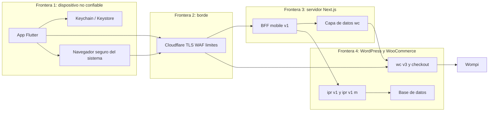

# Arquitectura de seguridad — App móvil IPR (Flutter) + BFF `/mobile/v1` + WordPress/WooCommerce

| | |
|---|---|
| **Proyecto** | App móvil Flutter (Android/iOS) de IPR Partes y Repuestos (Inverprimos S.A.S.), con compra por Wompi dentro del checkout de WooCommerce |
| **Fase** | SEGURIDAD (diseño). **No se programa nada.** Ningún control de este documento está implementado en la app ni en `/mobile/v1` (ninguno de los dos existe). |
| **Fecha** | 2026-11-18 |
| **Estado** | BORRADOR para revisión de Seguridad, TI y el responsable técnico de `ipr-frontend`/WordPress. **No se afirma cumplimiento de ninguna norma**: todo cumplimiento queda condicionado a las pruebas de [security_testing.md](security_testing.md), cuyo estado actual es "NO EJECUTADO". |
| **Revisión** | 2026-11-18: aplicadas las correcciones de [security_review.md](security_review.md) que afectan a este documento (C-02 en §5.4; C-03 en SUP-SEC-04 y §8.9; alias y citas de C-15; mapeos de §11). Ver "Historial de cambios". |
| **Documentos hermanos** | [threat_model.md](threat_model.md) (amenazas TM-xxx) · [security_controls.md](security_controls.md) (controles SC-xxx, cambios obligatorios y criterios de no-lanzamiento) · [security_testing.md](security_testing.md) (pruebas ST-xxx) |
| **Decisiones vigentes que no se reabren** | ADR-001 (BFF `/mobile/v1` en el Next.js + ampliación de `ipr/v1`) y ADR-002 (MVP con compra completa, sin B2B, cotización por WhatsApp), ambas **Aprobadas** (`03_architecture/architecture_decisions.md`). Las ADR-003 a ADR-022 son **Propuestas**. |

## 0. Convenciones

| Etiqueta | Significado |
|---|---|
| **HECHO** | Verificado en el código de `ipr-frontend` (solo lectura) con cita `archivo:línea`, o en un documento del proyecto con cita de sección. |
| **SUPUESTO** | Premisa adoptada para poder diseñar; se indica cómo validarla. Los supuestos derivados de las inconsistencias IN-xx se numeran **SUP-SEC-xx** (§3). |
| **PROPUESTA** | Diseño recomendado aquí; requiere aprobación. |
| **PENDIENTE** | Decisión humana abierta (D-xx, DN-xx, PA-xx, AP-xx, DA-xx). |
| **RIESGO** | Remite a una amenaza TM-xxx de [threat_model.md](threat_model.md). |
| **DESCONOCIDO** | Sin evidencia; se indica cómo obtenerla. |

Abreviaturas de fuentes: `COD` = `00_discovery/informe_codigo_frontend.md` (prevalece sobre `INV`) · `INV` = `00_discovery/informe_investigacion.md` · `WCA` = `00_discovery/analisis_capa_woocommerce.md` · `OV` = `03_architecture/architecture_overview.md` · `FA` = `03_architecture/flutter_app_architecture.md` · `DF` = `03_architecture/data_flow.md` · `DEP` = `03_architecture/deployment_architecture.md` · `AA` = `05_api/api_architecture.md` · `AU` = `05_api/authentication.md` · `AC` = `05_api/api_contracts.md` · `RNF`/`RF`/`ACC` = `02_requirements/{non_functional_requirements,functional_requirements,acceptance_criteria}.md` · `DP` = `project/decisiones_pendientes.md`.
Rutas de código (solo lectura, `C:\Users\empr16\ipr-frontend`): `auth-rest.php` = `wp-snippets/ipr-auth-rest.php`; `handoff.php` = `wp-snippets/ipr-cart-handoff.php`; `redirect.php` = `wp-snippets/ipr-front-redirect.php`; `ruleta.php` = `wp-snippets/ipr-ruleta-midea.php`; `raspa.php` = `wp-snippets/ipr-raspa-y-gana-samsung.php`; `wc.ts` / `woocommerce.ts` = `src/lib/woocommerce.ts`; `client.ts` = `src/lib/wc/client.ts`; `ProductTabs.tsx` = `src/components/product/detail/ProductTabs.tsx` (alias añadidos el 2026-11-18, C-15).
**Vigencia de las citas:** `next.config.ts`, `src/lib/woocommerce.ts` y `src/lib/wc/client.ts` tienen fecha de modificación 2026-11-18, posterior a la redacción inicial del diseño; las citas de líneas de esos archivos se re-verificaron ese día en los cuatro documentos de `06_security` (las de `client.ts` no cambiaron). Ante una nueva modificación del código, las citas deben volver a comprobarse.

**Lo que NO se hizo, a propósito:** no se abrió ningún archivo `.env`; no se ejecutó ningún escáner, `npm audit`, prueba ni petición contra sitios de producción; no se modificó nada en `ipr-frontend`. No se reproducen secretos, valores de configuración sensibles ni datos personales de empleados. La dirección IP del servidor de origen aparece escrita en un archivo del repositorio (ver §6.3); **no se copia aquí**.

---

## 1. Resumen ejecutivo

1. **El dispositivo es territorio no confiable y la app no decide nada comercial.** Precio, impuestos, envío, stock, visibilidad y estado del pago los decide el servidor (HECHO para la web: `src/app/api/checkout/route.ts:101-128` solo reenvía `items`, `email` y `billing`; `handoff.php:152-173` reduce el carrito a `{id, quantity}` acotados y WooCommerce recalcula). La app solo puede pedir; nunca afirmar.
2. **La superficie nueva más sensible no es la app sino lo que se construye detrás:** sesiones por dispositivo en WordPress, `/mobile/v1` en el mismo proceso Node que la web, y el retorno del pago. Las amenazas de mayor riesgo **ya existen hoy en la web** (fuerza bruta sin límite en autenticación, rutas `ipr/v1` públicas en WordPress, dependencias con CVE no verificadas) y la app las hereda o amplifica si no se corrigen antes (ver [threat_model.md](threat_model.md) §5).
3. **Hallazgos nuevos verificables en el código** que los documentos previos no recogían, y que este documento incorpora:
   - **H-SEC-01 (escalada):** el traspaso al checkout inicia sesión en WordPress con cookie **persistente** para **cualquier** usuario cuyo token sea válido, sin comprobar el rol (`handoff.php:263-272`), y el login de `ipr/v1` no filtra roles (`auth-rest.php:158-178`). Un token `ipr/v1` de una cuenta administrativa se convierte así en una sesión de WordPress (y por tanto de `wp-admin`) a través de `/api/checkout` (`src/app/api/checkout/route.ts:127`). RF-048 solo contempla bloquear el login en la app; el bloqueo debe extenderse al *handoff* (TM-010).
   - **H-SEC-02 (abuso de recursos):** `POST /api/checkout` no tiene límite de frecuencia y funciona sin sesión (`checkout/route.ts:85-166`, `authToken` opcional en `:127`); cada llamada crea un *transient* en WordPress (`handoff.php:234-235`) (TM-029).
   - **H-SEC-03 (exposición del origen):** el flujo de despliegue contiene en claro la IP del servidor de origen (`.github/workflows/deploy.yml:31`, `:77`) y comprueba el sitio conectándose al puerto 443 del origen directamente (`deploy.yml:108-114`) desde un *runner* cuya IP solo se autorizó para el puerto 22 (`deploy.yml:60-61`). **INFERENCIA:** si ese paso funciona, el origen acepta HTTPS desde IP que no son de Cloudflare, lo que permitiría evadir el WAF y los límites del borde (SA-03 de `AA` §17.1 sigue sin verificar) (TM-052).
   - **H-SEC-04 (secreto reutilizado):** `/api/revalidate` usa el **mismo** `REVALIDATE_SECRET` como clave HMAC del webhook y como secreto en claro por cabecera o `?secret=` (`src/app/api/revalidate/route.ts:70`, `79-92`), y acepta `GET` (`:146-148`). Una filtración del secreto en un log permite además falsificar firmas HMAC (TM-053).
   - **H-SEC-05 (campañas):** `POST ipr/v1/ruleta/jugar` es público, sin captcha ni límite de frecuencia (solo *honeypot*, `ruleta.php:230-234`, `326-330`), y el único control de "un intento por factura" es la unicidad de un número de factura de texto libre (`ruleta.php:22`, `204`, `241-249`) (TM-055).
4. **Postura propuesta:** MASVS v2 perfil **L1** completo para la app, con **refuerzos L2 selectivos** en almacenamiento de credenciales, autenticación de operaciones sensibles y privacidad (§11.2); OWASP API Security Top 10 (2023) como lista de control obligatoria para `/mobile/v1` e `ipr/v1/m/*` (§11.3); ASVS como referencia de verificación del servidor (§11.4).
5. **Certificate pinning:** se **valida** la propuesta de ADR-011 de no adoptarlo en el MVP, **con condiciones**: aceptación formal del riesgo (DA-15), controles compensatorios (monitoreo de Certificate Transparency, rotación de tokens, TLS estricto) y criterios explícitos para reabrir (§7).
6. **Inconsistencias de arquitectura:** 13 de las IN-xx afectan a la seguridad. No se resuelven aquí; se marca la opción más segura como SUPUESTO (§3). **IN-14 no aparece** en ninguno de los cuatro documentos de diagramas (se listan IN-01 a IN-13, IN-15 e IN-16).
7. **Revisión independiente (2026-11-18):** [security_review.md](security_review.md) encontró 16 amenazas nuevas (ahora TM-063 a TM-078) y huecos en controles P0. Lo más importante: SC-004/SC-005 no cubrían "Mi cuenta" de WooCommerce, `lost-password`, `wp-login.php` ni XML-RPC (`redirect.php:21-27`, `58-61`), y no estaba definida la IP del cliente que ve WordPress detrás de Cloudflare (ahora SC-076 y SC-077); el *handoff* aplica el ticket a la sesión de WordPress que ya tenga el navegador (`handoff.php:264`) y una cookie "no persistente" no basta en Android (C-03 en SC-022). Se proponen además claves `wc/v3` de solo lectura (SC-073) y 2FA obligatoria en cuentas privilegiadas (SC-074), **ambas PROPUESTAS pendientes de aprobación humana**.

---

## 2. Principios de seguridad

| # | Principio | Cómo se aplica en este sistema | Evidencia / requisito |
|---|---|---|---|
| PS-1 | **Secure by Design / by Default** | Las rutas nuevas nacen con autenticación, validación estricta y `no-store` por defecto; lo público es la excepción declarada. Ninguna ruta `ipr/v1/m/*` usa `__return_true` (`AU` §9). | RNF-043, RNF-044; H-05 (`auth-rest.php:372-411`) |
| PS-2 | **Mínimo privilegio** | La app no tiene claves de servidor; el BFF solo tiene lo que necesita (lectura `wc/v3`, secreto de *handoff*, secreto BFF); las rutas `ipr/v1/m/*` solo aceptan llamadas del BFF (ADR-014 propuesta); los roles administrativos no pueden usar la API de clientes (RF-048) ni el *handoff* (H-SEC-01). La app solicita cero permisos de sistema en el MVP (AC-SEC-10). | ADR-001; `AU` §3.7; ACC AC-SEC-10 |
| PS-3 | **Defensa en profundidad** | Cada control crítico tiene al menos dos capas independientes (tabla siguiente). | §4 |
| PS-4 | **El servidor es la autoridad** | Precio, stock, visibilidad, estado del pago y autorización se deciden en servidor; los parámetros del enlace de retorno son una pista. | `OV` §3 P1, §4; RNF-045 |
| PS-5 | **Fallar cerrado y honesto** | Ante duda de autorización → 401/404; ante fallo aguas arriba → 503/502/504, nunca datos parciales ni "vacío"; ningún error borra datos locales. | `AA` §6.3; `FA` §7.3 |
| PS-6 | **Minimización de datos** | DTO por lista blanca; sin PII en caché persistente; `deviceId` aleatorio, sin identificadores de hardware; logs con identificadores pseudonimizados. | RNF-060, RNF-062; `AU` §4; `AA` §12 |
| PS-7 | **Sin secretos en el cliente ni en el repositorio** | Configuración pública por *flavor*; secretos de servidor solo en el gestor de secretos y en el servidor. | RNF-036; ADR-009 (propuesta); `.gitignore:33-35` (HECHO: excluye `.env*` salvo `.env.example`) |
| PS-8 | **Proporcionalidad** | Controles RESILIENCE (anti-manipulación, root) y *pinning* fuera del MVP con aceptación escrita del riesgo; se priorizan los controles de servidor, donde reside el valor. | RNF-038, RNF-054; ADR-011 (propuesta) |
| PS-9 | **Verificabilidad** | Cada control tiene una prueba ST-xxx y un criterio de cierre; nada se declara cumplido sin evidencia. | RNF-033; [security_testing.md](security_testing.md) |

### Capas de defensa para los controles críticos

| Objetivo | Capa 1 | Capa 2 | Capa 3 |
|---|---|---|---|
| Frenar fuerza bruta y *credential stuffing* | Cloudflare: límite por IP en `/mobile/v1/auth/*`, `/wp-json/ipr/v1/auth/*`, `wp-login.php` y "Mi cuenta"; `xmlrpc.php` **bloqueado** (SC-005, SC-076) | WordPress: contadores persistentes por cuenta e IP en el filtro `authenticate` (todas las vías), con la IP real del cliente (SC-004, SC-077) | Auditoría + alerta de picos de `invalid_credentials` (SC-046) |
| Integridad del precio | App envía solo `{id, quantity}` (SC-020) | BFF: Zod `strict` rechaza `price`, `total` (SC-015) | WooCommerce recalcula precio, impuestos y stock en el checkout (HECHO) |
| Integridad del resultado del pago | Parámetros del deep link solo como pista (SC-025) | Consulta autenticada `GET /checkout/{checkoutRef}` (SC-025) | Estado fijado por el plugin de Wompi en WooCommerce; verificación de su webhook (SC-028, PENDIENTE D-02) |
| Autorización por objeto | `/me*` sin id en la ruta (SC-014) | `customer_id` = usuario autenticado en WordPress, si no 404 (SC-014) | Pruebas BOLA con dos cuentas en CI de contrato (ST-050..053) |
| Confidencialidad de tokens | Solo cabecera `Authorization` (SC-003) | Almacenamiento en Keychain/Keystore, access en memoria (SC-030) | Vida corta + rotación + detección de reutilización (SC-001, SC-002) |

---

## 3. Inconsistencias de arquitectura que afectan a la seguridad (IN-xx)

> **No se resuelven aquí.** Otro agente las resolverá. Para poder diseñar, se adopta como **SUPUESTO** la opción más segura. Si la resolución final elige otra, el control y la prueba asociados deben revisarse.

| IN | Tema | ¿Afecta a seguridad? | Opción más segura (SUPUESTO adoptado) | Por qué es más segura | Controles / pruebas afectados |
|---|---|---|---|---|---|
| IN-01 | Ruta de retorno del pago `/pedido-confirmado` frente a `/app/pedido` y alcance de `.well-known` (`/pedido-confirmado` frente a `/app/*`) | **Sí** | **SUP-SEC-01:** ruta dedicada `https://iprpartesyrepuestos.com/app/pedido`; `assetlinks.json`/`apple-app-site-association` declaran **solo** `/app/*` | Un alcance mínimo evita que la app capture navegación web normal (y que una app maliciosa con la misma ruta interfiera); separa la superficie móvil de la web, cuya `/pedido-confirmado` sigue siendo de la web (`checkout/route.ts:111`). La URL sigue fijada por servidor y validada contra la lista cerrada de `handoff.php:122-149`. | SC-026, SC-025; ST-125, ST-126 |
| IN-02 | Mecanismo principal del retorno: App Links (RF-055, ADR-001 §4) frente a consulta al servidor (ADR-008/ADR-017) | **Sí** | **SUP-SEC-02:** la **consulta autenticada al servidor** es la única fuente de verdad; el enlace verificado solo dispara la consulta | Los parámetros `order`/`status` de la URL son manipulables (RNF-045e) y WordPress no redirige en `failed/cancelled/pending` (`handoff.php:462-466`); confiar en el enlace permitiría mostrar "pagado" sin pago (TM-025). | SC-025; ST-082, ST-083 |
| IN-03 | Estado de N-11/N-12 (pendiente en `OV`, definido como EP-23/EP-24 en `AC`) y ADR duplicada (ADR-008 en `OV` = ADR-017 en `AA`) | **Sí (gobierno)** | **SUP-SEC-03:** EP-23 y EP-24 tal como están en `AC` §3 son la base de diseño; la numeración de ADR se unifica al aprobarlas | Sin EP-24 no existe verificación autenticada del pago; la doble numeración dificulta la trazabilidad control → decisión. | SC-025, SC-014; ST-052 |
| IN-04 | Navegador seguro en iOS: `ASWebAuthenticationSession` efímera (`AA` §13.1) frente a elección abierta en SPK-01 (`url_launcher` `inAppBrowserView` / `flutter_web_auth_2`) | **Sí** | **SUP-SEC-04:** iOS: `ASWebAuthenticationSession` con sesión **efímera** (`prefersEphemeralWebBrowserSession`); Android: Custom Tabs + cookie de WordPress **no persistente** para `channel = app` (WP-06) **y cierre de la sesión de WordPress en el servidor** al llegar a "pedido recibido" y al caducar, más cierre de una sesión ajena antes de iniciar la del token (C-03, añadido el 2026-11-18); nunca WebView propio | La sesión efímera no deja la cookie de WordPress en el almacén persistente del navegador; hoy el *handoff* crea cookie persistente (`handoff.php:271`) y los Custom Tabs comparten cookies con Chrome (RA-09 de `AA`). **Revisión 2026-11-18:** en Android una cookie de sesión sobrevive mientras vive el proceso de Chrome (INFERENCIA), por eso la opción "más segura" de Android solo lo es con el cierre en servidor; iOS sigue siendo la opción más segura con reservas (flujos PSE/Nequi dentro de `ASWebAuthenticationSession`: NO VERIFICADO). En iOS < 17.4 sin *callback* https, el retorno es manual y la consulta al servidor (SUP-SEC-02) cubre el caso. | SC-022, SC-024; ST-084, ST-085, ST-161 |
| IN-05 | `Idempotency-Key` en `POST /checkout`: obligatoria (`OV` N-11, `FA` §6.3) frente a opcional (`AC` §1.1, `AA` §9.2) | **Sí** | **SUP-SEC-05:** **obligatoria** en `POST /checkout` y `POST /me/deletion`; recomendada → **obligatoria** también en `POST /pqrs` desde la app | Elimina emisiones duplicadas por reintentos, doble toque y reanudación tras muerte del proceso; facilita la correlación de intentos en la investigación de doble cobro (TM-027). El costo es bajo (la app ya genera la clave, `FA` §6.3). No sustituye el control anti-duplicados de WooCommerce/Wompi (D-02). | SC-027; ST-086, ST-087 |
| IN-06 | `X-Device-Id` obligatoria según el contrato (`AC` §1.1, `AU` §4) pero ausente de la lista de cabeceras de la app (`FA` §7.1) | **Sí** | **SUP-SEC-06:** la app **envía** `X-Device-Id` en todas las solicitudes a `/mobile/v1` (obligatoria donde el contrato lo exige) | El refresh compara `X-Device-Id` con la sesión y revoca con `device_mismatch` (`AU` §3.4 paso 2); sin la cabecera se pierde esa defensa y los límites por dispositivo. Recordatorio: **no es un secreto ni prueba identidad** (`AA` §10.4). | SC-001, SC-002, SC-006; ST-036 |
| IN-07 | Dónde vive el access token: memoria (`FA` §8) frente a Keystore/Keychain (`AU` §5, que admite memoria; `AA` §15.A paso 6 dice "access y refresh en Keystore/Keychain") | **Sí** | **SUP-SEC-07:** access token **solo en memoria**; refresh token y `deviceId` en Keychain (`kSecAttrAccessibleAfterFirstUnlockThisDeviceOnly`) / Keystore | Reduce la credencial en reposo a una sola (el refresh, rotativo y detectable si se reutiliza). El access de 15 min se recupera con un refresh al arrancar. Si SPK-03 demuestra que hace falta persistirlo, se guarda en el mismo almacén seguro, nunca en otro. | SC-030; ST-100, ST-101 |
| IN-08 | Qué hace la app si falla el refresh: `expire()` (`FA` §7.2) frente a "no borrar tokens ante fallo de red y reintentar una vez con el mismo refresh" (`AU` §3.4, AC-044-7) | **Sí** | **SUP-SEC-08:** se adopta `AU` §3.4 **con restricciones**: solo ante error de red **antes** de recibir respuesta, **un** reintento con el **mismo** refresh dentro de 30 s y mismo `deviceId`; cualquier respuesta 401 (`unauthorized`, `refresh_token_reused`) → borrar tokens locales, intento de revocación *best effort* y login | Borrar los tokens ante un fallo de red tras una rotación que el servidor sí aplicó deja una sesión válida en servidor cuyo nuevo refresh nadie posee hasta su vencimiento de inactividad; el reintento dentro de la gracia cierra esa ventana y conserva la detección de reutilización. El riesgo de la gracia (RS-01) se trata en TM-007. | SC-002; ST-034, ST-035 |
| IN-09 | Timeout de respuesta App → BFF (10 s frente a 15 s) | No (disponibilidad) | — | — | — |
| IN-10 | Origen del número de WhatsApp: empaquetado (`FA` §16) frente a configuración remota (`AC` EP-01, EP-22) | **Sí** | **SUP-SEC-10:** configuración remota (`GET /config`, `GET /stores`) **con controles de integridad**: edición restringida y auditada en WordPress, validación de formato y lista de números permitidos en el BFF, número nacional empaquetado como respaldo y para comparar | Un número de WhatsApp alterado en una fuente editable desvía a los clientes a terceros (fraude por pago "por WhatsApp", TM-040). Lo empaquetado es más difícil de alterar pero no se puede corregir sin publicar; la opción remota con validación da integridad y capacidad de respuesta. | SC-043, SC-044; ST-141 |
| IN-11 | Cloudflare delante de WordPress (presente en `INV`/`OV`, ausente en `COD`/`AA`; ruta interna opcional que lo evita, `WCA` §1) | **Sí** | **SUP-SEC-11:** Cloudflare **delante** de WordPress para todo el tráfico de navegador (checkout, `wp-login.php`, `xmlrpc.php`, `/wp-json/`), con origen de WordPress y de Next.js restringido a rangos de Cloudflare; el tramo BFF → WordPress por ruta interna **solo** con TLS y autenticación (secreto BFF) | Sin el borde, los límites por IP y el WAF no protegen `wp-login.php`, `xmlrpc.php` ni `ipr/v1/auth/*`, que `redirect.php:26`, `:58` deja accesibles (TM-002). Con el borde, WordPress debe restaurar la IP real **solo** desde rangos de Cloudflare (SC-077, TM-065) y ninguna regla del WAF debe permitir tráfico por User-Agent (TM-068). | SC-005, SC-010, SC-053, SC-059, SC-077; ST-150, ST-151, ST-164 |
| IN-12 | `AppFailure` sin tipo para 502/504 | No (robustez) | — | — | — |
| IN-13 | `paymentState` `refunded`/`unknown` no contemplados en la máquina de estados (`FA` §6.3) | **Sí (integridad de checkout, bajo)** | **SUP-SEC-13:** todo estado distinto de `paid` (incluidos `refunded` y `unknown`) se trata como **no pagado**: no se vacía el carrito, no se muestra "pago exitoso", se muestra `statusLabel` del servidor | Evita que un estado nuevo o inesperado de un plugin se interprete como éxito (TM-025). | SC-025; ST-083 |
| IN-15 | Redis: "puede requerir" (ADR-001) frente a descartado en MVP salvo condiciones (`AA` §3.3, ADR-015) | **Sí** | **SUP-SEC-15:** sin Redis **solo** si se verifica un único proceso Node (SA-01); los contadores de autenticación viven en la BD de WordPress (persistentes y compartidos); si hay más de un proceso, Redis (u otro almacén compartido) pasa a P0 para límites e idempotencia del BFF | Ningún contador de seguridad crítico (auth, PQRS) puede depender de memoria de proceso (RNF-017, RF-097, NL-05). | SC-004, SC-006, SC-056; ST-042, ST-062 |
| IN-16 | Dominios y `.well-known` por entorno (laguna: solo producción descrita) | **Sí** | **SUP-SEC-16:** dominios separados por entorno, `.well-known` propios, y `deep_link_policy` que acepta **solo** el host del *flavor*; staging no indexable y con acceso restringido | Evita que una app de staging opere sobre producción, que la app de producción acepte enlaces de staging y que staging (con datos de prueba) sea atacable públicamente. | SC-067, SC-026; ST-127 |
| IN-14 | — | — | **No existe** en `c4_diagrams.md`, `component_diagrams.md`, `data_flow.md` ni `deployment_architecture.md` (búsqueda de `IN-14` sin resultados). Se informa para que quien las resuelva confirme si es una numeración omitida. | — | — |

**Resumen:** afectan a la seguridad **13**: IN-01, IN-02, IN-03, IN-04, IN-05, IN-06, IN-07, IN-08, IN-10, IN-11, IN-13, IN-15, IN-16. No afectan: IN-09, IN-12.

---

## 4. Fronteras de confianza y activos

### 4.1 Diagrama de fronteras (Mermaid, **no validado**)

### 4.2 Activos

| ID | Activo | Clasificación | Dónde vive | Quién debe poder leerlo |
|---|---|---|---|---|
| A-01 | Contraseñas de clientes | Secreto (credencial) | Solo en tránsito (app → BFF → WordPress) y como hash de WordPress | Nadie en claro; WordPress verifica |
| A-02 | Access token (`ipra_…`, 15 min, propuesto) | Secreto de sesión | Memoria de la app (SUP-SEC-07); hash SHA-256 en `ipr_auth_sessions` | App del usuario; WordPress compara hash |
| A-03 | Refresh token (`iprr_…`, rotativo, propuesto) | Secreto de sesión de mayor valor | Keychain/Keystore; hash en `ipr_auth_sessions` | Igual |
| A-04 | Token web heredado (40 caracteres, 30 días) | Secreto de sesión | Cookie `httpOnly` (`src/lib/session.ts:13-22`); hash en `usermeta` (`auth-rest.php:45-50`) | Navegador del usuario; WordPress |
| A-05 | Ticket de checkout (32 caracteres, 60 s, un uso) | Secreto efímero (equivale a iniciar sesión en WordPress) | URL `?ipr_ticket=` y *transient* (`handoff.php:234-235`) | Navegador del usuario durante ≤ 60 s |
| A-06 | Datos personales de clientes (nombre, correo, teléfono, cédula/NIT, direcciones) | PII (Ley 1581) | WordPress (`usermeta`, pedidos); memoria de la app | Titular; personal autorizado de IPR |
| A-07 | Pedidos (productos, importes, estado) | Confidencial / contable | WooCommerce | Titular; IPR |
| A-08 | Claves de WooCommerce (`ck_`/`cs_`) | Secreto de servidor (acceso administrativo a datos de la tienda) | Entorno del servidor Next.js | Solo el proceso del servidor |
| A-09 | `HANDOFF_SECRET` / `IPR_HANDOFF_SECRET` | Secreto de servidor | Entorno Next.js; `wp-config.php` **o** opción `ipr_handoff_secret` de la BD (`handoff.php:64-70`) | Solo servidores |
| A-10 | `IPR_BFF_SECRET` (propuesto) | Secreto de servidor | Entorno Next.js; `wp-config.php` | Solo servidores |
| A-11 | `REVALIDATE_SECRET`, credenciales SMTP, token de DigitalOcean, clave SSH de despliegue | Secretos de operación | Entorno del servidor / secretos de GitHub (`deploy.yml:23`, `46`, `67-68`) | Solo CI y servidor |
| A-12 | Claves de firma de la app (upload key, certificados Apple), cuentas de tienda | Secreto de distribución | Gestor de secretos (propuesto, RNF-055) | Custodios designados |
| A-13 | Integridad del catálogo (precio, visibilidad, stock) | Integridad comercial | WooCommerce; cachés del BFF y de Cloudflare | Lectura pública solo de lo publicado |
| A-14 | Configuración remota (versión mínima, interruptores, contacto, `allowedHosts`) | Integridad | WordPress (propuesto, ADR-018) → BFF → app | Lectura pública; edición restringida |
| A-15 | Disponibilidad del proceso Node compartido web + BFF | Disponibilidad | Servidor DigitalOcean | — |
| A-16 | Datos de campañas (documento, celular, factura) | PII | Tablas de los snippets (`ruleta.php:119-130`) | Personal autorizado |
| A-17 | Registros de auditoría y logs técnicos | Confidencial (PII indirecta) | WordPress (`ipr_auth_events`, propuesta); logs del BFF | Seguridad / TI |

---

## 5. Arquitectura de seguridad por capa

### 5.1 Dispositivo y app (Flutter)

| Tema | Diseño de seguridad (PROPUESTA) | Estado | Evidencia / requisito |
|---|---|---|---|
| Alcance de red | La app **solo** llama a `/mobile/v1` del host del *flavor*; además abre `tel:`, `wa.me`, mapas y la `checkoutUrl` en el navegador seguro. Sin llamadas a `wc/v3`, `wp/v2`, `/api/*`, Wompi. | PROPUESTO | ACC AC-SEC-2; ADR-001 §3 |
| Credenciales en reposo | Refresh + `deviceId` en Keychain/Keystore; access en memoria (SUP-SEC-07); limpieza del Keychain en primer arranque tras reinstalar. | PROPUESTO | RNF-034; `FA` §8; `AU` §4 |
| Datos locales | `hive_ce` solo para carrito (sin PII) y caché pública; perfil, direcciones y pedidos solo en memoria; preferencias no sensibles en `shared_preferences`. | PROPUESTO | RNF-062; `FA` §8 |
| Copias de seguridad | `android:allowBackup="false"` o `dataExtractionRules` que excluyan cajas y secure storage; iOS sin elementos sincronizables con iCloud. | PROPUESTO | RNF-035 |
| Pantallas sensibles | Ocultar contenido en el selector de apps y bloquear capturas en login, cuenta, direcciones, pedidos, checkout y eliminación de cuenta (§8.6). | PROPUESTO | RNF-035 (Should) |
| Contenido del servidor | Descripción HTML renderizada con widget nativo **sin JavaScript** (sin WebView), tras saneado en servidor; enlaces solo `https` a hosts de lista cerrada. | PROPUESTO | ADR-019; RNF-052; ACC AC-SEC-12 |
| Lanzamientos externos | `ExternalLauncher` con lista cerrada de esquemas (`https`, `tel`, `wa.me`/`whatsapp`, mapas) y validación del número de WhatsApp. | PROPUESTO | RNF-052; SUP-SEC-10 |
| Deep links | Solo App Links/Universal Links verificados para `/app/*` (SUP-SEC-01); `deep_link_policy` con lista cerrada; sin esquemas propios. | PROPUESTO | RNF-046 |
| Build de release | No depurable, sin banners/menús de desarrollo, sin `DebugLogInterceptor`, ofuscación Dart con símbolos archivados, firmado en CI. | PROPUESTO | RNF-051; `FA` §7.2, §16 |
| Permisos | Ninguno en el MVP más allá de Internet (ubicación, contactos, cámara, micrófono, notificaciones: fase 2). | PROPUESTO | ACC AC-SEC-10; RNF-060 |
| Integridad de la plataforma | **No** se detecta root/jailbreak ni se aplica anti-manipulación en el MVP (§10). | PROPUESTO (riesgo aceptado pendiente DA-15) | RNF-054; ADR-011 |

### 5.2 Red y borde (TLS, Cloudflare)

| Tema | Diseño | Estado | Evidencia |
|---|---|---|---|
| TLS app → borde | Solo HTTPS, TLS ≥ 1.2 (1.3 preferido); Android `networkSecurityConfig` sin `cleartextTrafficPermitted` y sin `user` en `trust-anchors` de release; iOS ATS sin excepciones. | PROPUESTO | RNF-037; ACC AC-SEC-3 |
| HSTS del dominio | Existe para el sitio web: `max-age=63072000; includeSubDomains; preload` en producción. | **HECHO** | `next.config.ts:690-698` (re-verificado 2026-11-18) |
| Versión mínima de TLS en Cloudflare | DESCONOCIDA → MED-15. | DESCONOCIDO | RNF-037 |
| WAF | WAF gestionado activo para `/mobile/v1`, sin desafíos interactivos en `/mobile/v1/*` ni en `/.well-known/*` (una app no los resuelve), con límites por IP. | Cloudflare EXISTE (`INV` §2.1); reglas PROPUESTAS | `AA` §11; RNF-032 |
| Caché en el borde | *Cache Rule* solo para los endpoints públicos listados en `AA` §8.1; todo lo autenticado con `private, no-store` y sin caché; las respuestas públicas no dependen de `Authorization` (precio idéntico para todos, AC-SEC-7). | PROPUESTO | `AA` §8.1 |
| Origen | Next.js y WordPress aceptan 80/443 **solo** desde Cloudflare (o *Authenticated Origin Pulls*); el BFF toma la IP de `CF-Connecting-IP`. Estado real: **DESCONOCIDO** (SA-03) con indicio en contra (H-SEC-03). | PROPUESTO | `AA` §10.3; `deploy.yml:108-114` |
| Tramo BFF → WordPress | Siempre TLS y secreto BFF; si se usa `WOOCOMMERCE_INTERNAL_URL` (ruta interna que evita Cloudflare, `WCA` §1), verificar que sea TLS o red privada. Configuración real: DESCONOCIDA. | PROPUESTO / DESCONOCIDO | `WCA` §2 |
| *Certificate pinning* | No en el MVP (§7). | PROPUESTO (validado con condiciones) | ADR-011; RNF-038 |

### 5.3 BFF `/mobile/v1` (Next.js)

| Tema | Diseño | Estado | Evidencia |
|---|---|---|---|
| Aislamiento de la web | Rutas en `src/app/mobile/v1/**`, sin importar `next/headers`/`cookies()` (inmune a CSRF por cookie); sin cabeceras CORS. | PROPUESTO | `AA` §4, §11 |
| Validación | Zod `strict` en cuerpos y parámetros; cuerpo ≤ 32 KB; `Content-Type: application/json`; `page ≤ 50`, `perPage` ∈ {12,24,48}; `q` ≤ 120; carrito ≤ 100 líneas, cantidad 1–99, ids sin duplicar. | PROPUESTO | `AA` §7, §11; `AC` §3 |
| Salida | DTO por lista blanca; sin `stockQuantity`, `roles`, `username`, metadatos crudos, notas internas, IP; HTML saneado en servidor. | PROPUESTO | `AA` §4, §11; ADR-019 |
| Errores | RFC 9457 con `code` estable; sin trazas, nombres de servidor ni mensajes crudos de WordPress (patrón ya usado en `checkout/route.ts:60-83`). | PROPUESTO (patrón HECHO en la web) | `AA` §6 |
| Tokens en URL | `token`, `access_token`, `refresh_token` en query → `400 token_in_url_forbidden`. | PROPUESTO | `AA` §11 |
| Rate limiting | Memoria LRU acotada por clase (sin `clear()` global), IP de `CF-Connecting-IP` (**fiable solo con el origen restringido a Cloudflare, CH-11**; C-09), límites por dispositivo; los de autenticación viven en WordPress. Hoy: `Map` que se vacía entero al superar 5.000 claves e IP desde el primer `X-Forwarded-For` (HECHO, `src/lib/rate-limit.ts:33-39`, `55-58`). | PROPUESTO (corrige un HECHO) | `AA` §10; FE-05 |
| Protección de capacidad | Cola de `wcGet` con tope y espera máxima de 3 s → 503; presupuesto de 6 s por endpoint. Hoy la cola no tiene tope (`WCA` §5.1, `client.ts:214-228`). | PROPUESTO | FE-06; RNF-018 |
| Secretos | `HANDOFF_SECRET`, `IPR_BFF_SECRET`, claves WooCommerce y SMTP solo en el entorno del servidor, nunca en respuestas ni logs. | PROPUESTO (HECHO: hoy `HANDOFF_SECRET` solo se usa en servidor, `checkout/route.ts:34`, `119`) | RNF-036 |
| Timeouts hacia WordPress | Todas las llamadas con timeout (hoy `src/lib/auth.ts:71-76` no lo tiene; el checkout sí, `checkout/route.ts:50`, `130`). | PROPUESTO | FE-17 |
| Observabilidad | Logs JSON por solicitud con `userRef`/`deviceRef` HMAC, `ipPrefix`, sin cuerpos de `/auth/*`, `/me/*`, `/pqrs`. | PROPUESTO | `AA` §12 |

### 5.4 WordPress / WooCommerce (`ipr/v1`, `ipr/v1/m/*`, checkout)

| Tema | Diseño | Estado | Evidencia |
|---|---|---|---|
| Rutas nuevas | `ipr/v1/m/*` con `permission_callback` real: secreto BFF (`hash_equals`) + validación del access token; ninguna con `__return_true`. | PROPUESTO | `AU` §3.6, §9 |
| Rutas heredadas | Hoy todas las rutas `ipr/v1` (auth, pedidos, handoff, ruleta, raspa) usan `__return_true` y validan dentro del handler. Reemplazo por callbacks reales: WP-14 (P1). | HECHO (problema) | `auth-rest.php:372-411`; `handoff.php:254`; `ruleta.php:324`, `329`; `raspa.php:525`, `530` |
| Sesiones | Tabla `ipr_auth_sessions` con hashes SHA-256 de tokens de 256 bits, rotación con `SELECT … FOR UPDATE`, detección de reutilización, tope de 10 sesiones, vida absoluta 90 días. | PROPUESTO (valores PENDIENTES AP-02/DN-04) | `AU` §3, §8.1 |
| Anti fuerza bruta | `ipr_auth_throttle` persistente por cuenta e IP; respuestas uniformes. **Enganchado al filtro `authenticate`** para cubrir todas las vías (REST vía `wp_signon`, `wp-login.php`, "Mi cuenta" de WooCommerce, XML-RPC); `lost-password` con límite y mensaje uniforme; `xmlrpc.php` bloqueado (C-01; SC-004, SC-076). Hoy: delegado en Wordfence con configuración DESCONOCIDA (`auth-rest.php:26-27`; `AU` §13); esas vías siguen accesibles (`redirect.php:21-27`, `58-61`, `98-105`). | PROPUESTO | `AU` §13; TM-066 |
| IP del cliente (C-02) | **PROPUESTA:** WordPress usa como IP del cliente (a) `X-IPR-Client-IP` **solo** si la petición trae un secreto BFF válido (SC-009); (b) si no, `CF-Connecting-IP` **solo** si la conexión llega desde los rangos publicados de Cloudflare (lista mantenida); (c) si no, `REMOTE_ADDR`. Nunca `X-Forwarded-For` sin validar. La misma IP alimenta SC-004, SC-076 y la auditoría. Sin esto, contar por IP bloquea en masa (IP de Cloudflare) o se evade (cabecera falsificada). | PROPUESTO; configuración actual DESCONOCIDA | SC-077; TM-065; CR-035, CR-075 |
| Roles | Denegar emisión y validación a usuarios con `edit_posts` o `manage_woocommerce` (RF-048) **y** denegar el inicio de sesión por *handoff* a esos usuarios (H-SEC-01, nuevo). | PROPUESTO | `AU` §3.7; `handoff.php:263-272` |
| Ticket de checkout | Un uso, 60 s, borrado antes de usar, alfabeto y longitud estrictos (HECHO, `handoff.php:92`, `380-397`); para `channel = app`: guardar `user_id` y no el token (hoy se guarda el token, `handoff.php:229-231`), ticket sin facturación ni identificación (CR-012), cookie no persistente (hoy `remember = true`, `handoff.php:271`), cierre de la sesión de WordPress en el servidor al volver o caducar, y cierre de la sesión de otro usuario antes de iniciar la del token (hoy `handoff.php:264` reutiliza la sesión existente) (C-03). | Mixto | WP-06; SC-022 |
| URL de retorno | Lista cerrada de hosts (HECHO, `handoff.php:122-149`; ampliable con el filtro `ipr_cart_return_hosts`, `handoff.php:127`). Observación: el esquema `http` también se admite (`handoff.php:141`); el dominio tiene HSTS con `preload` (`next.config.ts:696`, re-verificado 2026-11-18), lo que reduce el riesgo; se propone admitir solo `https` en producción. | HECHO + PROPUESTA menor | — |
| Auditoría | `ipr_auth_events` con eventos de login, refresh reutilizado, revocaciones, cambios sensibles, eliminación y emisión de ticket. Hoy no hay auditoría propia. | PROPUESTO | `AU` §8.2; RNF-105 |
| Secreto de *handoff* | Preferir `wp-config.php` (constante) a la opción de BD `ipr_handoff_secret` (`handoff.php:69`): la opción queda en copias de la BD y es legible por cualquier código con acceso a opciones. | PROPUESTA | — |

### 5.5 Pasarela (Wompi dentro de WooCommerce)

| Tema | Diseño | Estado | Evidencia |
|---|---|---|---|
| Alcance PCI | La app y el BFF **nunca** ven datos de tarjeta: el pago ocurre en el checkout nativo de WooCommerce con Wompi preseleccionado (`handoff.php:358-367`) dentro del navegador seguro. | HECHO (web) / PROPUESTO (app) | `COD` §1; RF-053 |
| Confirmación del pago | Cómo confirma Wompi hacia WooCommerce (webhook firmado, consulta) y cómo se evitan cobros duplicados: **DESCONOCIDO** (D-02, PA-11, SA-05). Requisito de seguridad: verificar que el plugin valida la firma del evento y que el estado del pedido no depende del navegador. | DESCONOCIDO | `AA` §17.1 SA-05; TM-030 |
| Tokenización de medios de pago | Si Wompi/WooCommerce guarda tokens de pago del cliente: DESCONOCIDO (`AU` §12.2). | DESCONOCIDO | — |
| Fuente de verdad para la app | `paymentState` derivado del estado del pedido en WooCommerce, consultado por `checkoutRef` (SUP-SEC-02, SUP-SEC-13). | PROPUESTO | `AA` §13.2 |

---

## 6. Gestión de sesiones y tokens

### 6.1 Ciclo de vida (PROPUESTA basada en `AU` §3; valores PENDIENTES AP-02/DN-04)

| Etapa | Regla de seguridad | Control |
|---|---|---|
| Emisión | Tokens opacos de 256 bits (`random_bytes`), con prefijo detectable (`ipra_`, `iprr_`); en BD solo SHA-256; comparación con `hash_equals`. Respuesta `no-store`, sin `roles`/`username`. | SC-001 |
| Transporte | Solo `Authorization: Bearer` (access) y cuerpo de `POST /auth/refresh` (refresh); nunca URL. Hoy `ipr/v1` acepta query, cuerpo y cabecera (`auth-rest.php:53-68`). | SC-003 |
| Uso | Cada solicitud privada valida el access contra la tabla (revocación inmediata). | SC-001, SC-008 |
| Renovación | Un único refresh en vuelo; rotación; reutilización fuera de 30 s o con `deviceId` distinto → revocación de la sesión y auditoría de severidad alta. Fallo de red: SUP-SEC-08. | SC-002 |
| Revocación | Logout del dispositivo y "cerrar todas" (también cierra la web); cambio de contraseña/correo, restablecimiento, cambio desde `wp-admin`, `delete_user`, eliminación de cuenta y cambio a rol administrativo revocan. | SC-012 |
| Expiración | Access 15 min; refresh 30 días de inactividad; absoluta 90 días; limpieza diaria. | SC-001 |
| Convivencia con la web | La web mantiene su token heredado (sin cambios de contrato); almacenes distintos, sin cierres mutuos (corrige H-01 para la app). Migración de la web: FE-18 (P2). | SC-001 |
| Dispositivo | `deviceId` UUID v4 aleatorio, regenerado al reinstalar; no es secreto; sirve para ligar refresh y repartir límites. | SC-001, SC-032 |

### 6.2 Estado actual de la sesión web (HECHO, para el modelo de amenazas)

| Hecho | Evidencia | Amenaza |
|---|---|---|
| Un solo token por usuario: el login sobrescribe el hash | `auth-rest.php:45-50` | TM-005 |
| Vida fija de 30 días, sin refresh | `auth-rest.php:37`; `src/lib/session.ts:4` | TM-005 |
| Token aceptado por query, cuerpo o cabecera | `auth-rest.php:53-68` | TM-004 |
| Cookie web `httpOnly`, `sameSite=lax`, `secure` en producción | `src/lib/session.ts:13-22` | Control existente (TM-011) |
| Perfil completo persistido en `localStorage` (`ipr-auth`) | `src/store/useAuthStore.ts:32-49` | TM-062 (web) |
| Cambio de correo/contraseña exige contraseña actual y rota el token | `auth-rest.php:313-332` | Control existente (TM-033) |

---

## 7. TLS y evaluación de *certificate pinning* (ADR-011)

### 7.1 Qué protegería el *pinning* y qué no

| Escenario de ataque | ¿Lo evita TLS estándar bien configurado? | ¿Lo evitaría el *pinning*? |
|---|---|---|
| Red pública hostil sin acceso al dispositivo (Wi-Fi falsa) | **Sí** (validación de cadena y nombre) | Sí (redundante) |
| CA de usuario instalada en Android (proxy corporativo, malware que convence al usuario) | **Sí** en apps que no confían en CA de usuario (comportamiento por defecto de Android para apps modernas; se fija explícitamente en `networkSecurityConfig`) | Sí (redundante) |
| CA de usuario con confianza total habilitada manualmente en iOS (perfil instalado + "confianza total" en Ajustes, o MDM) | **No**: iOS confía en ella y ATS no permite excluirla sin *pinning* | Sí |
| CA pública comprometida o emisión indebida para el dominio | No | Sí |
| Dispositivo con root/jailbreak controlado por el atacante (Frida, parcheo) | No | **No** (el *pinning* se desactiva trivialmente en un dispositivo controlado) |
| Robo del refresh token desde el dispositivo | No aplica | No aplica |

### 7.2 Costos y riesgos operativos del *pinning* con Cloudflare

| Factor | Análisis |
|---|---|
| Rotación de certificados de borde | Con certificados gestionados por Cloudflare (Universal/Advanced), el certificado de hoja, su clave y, potencialmente, la CA emisora cambian sin intervención de IPR. Un *pin* de hoja o de CA puede quedar obsoleto sin aviso (ADR-011, alternativas descartadas). |
| Propiedad de la clave | Solo un certificado **personalizado** cargado en Cloudflare (con clave controlada por IPR) permitiría fijar la clave pública propia con rotación planificada. Plan contratado y disponibilidad: **DESCONOCIDO** (AP-08). |
| Recuperación | Un *pin* erróneo deja **todas** las instalaciones sin servicio; la configuración remota (`GET /config`) no sirve de interruptor porque viaja por el mismo canal fijado. La única salida es publicar una versión nueva y esperar adopción (días en Android, revisión en iOS). |
| Mantenimiento | Exige conjunto de *pins* con clave de respaldo, fecha de expiración, pruebas de rotación en staging (RNF-038) y propiedad clara del certificado; el equipo móvil aún no existe (D-15). |
| Paquete evaluado | `http_certificate_pinning` 3.0.2 con adopción baja (`FA` §17.2); alternativa nativa (Android `pin-set` con `expiration`, iOS `NSPinnedDomains` desde iOS 14). |

### 7.3 Veredicto

**Se VALIDA la propuesta de ADR-011 (no adoptar *pinning* en el MVP), con condiciones.** Argumentos:

1. **El valor protegido en tránsito es acotado por diseño:** access de 15 min, refresh rotativo con detección de reutilización (TM-006/TM-007), sin datos de tarjeta en la app, precio decidido por el servidor. Un MITM exitoso obtendría PII y sesiones de **un** usuario, no secretos de servidor.
2. **Los escenarios que solo el *pinning* cubre** (CA pública comprometida; CA de usuario con confianza total en iOS) tienen **probabilidad baja** y requieren, en el segundo caso, acción del propio usuario o un MDM.
3. **El riesgo operativo es alto y concreto:** apagón total ante una rotación de Cloudflare sin clave propia ni mecanismo de recuperación remota.
4. **El *pinning* no protege del escenario más probable contra una app** (dispositivo controlado por el atacante), que se trata en el servidor.

**Condiciones obligatorias (SC-037):**
- C-P1: aceptación formal y por escrito del riesgo residual (DA-15 / NL-C7) por Seguridad y Gerencia.
- C-P2: controles compensatorios activos antes del lanzamiento: TLS estricto (SC-036), monitoreo de Certificate Transparency del dominio y alertas de certificados por vencer (SC-065, RNF-101), rotación y detección de reutilización de tokens (SC-001/002), HSTS ya existente.
- C-P3: criterios de **reapertura**: (a) se dispone de certificado personalizado con clave controlada y plan de rotación con clave de respaldo; (b) aparece un requisito contractual o regulatorio; (c) el modelo de amenazas detecta abuso por MITM; (d) se habilitan funciones de mayor valor en la app (B2B con cupo, pagos en la app).
- C-P4: si se reabre: fijar **SPKI** (no certificado) de la clave propia **y** de una clave de respaldo no desplegada, con **fecha de expiración** del conjunto, prueba de rotación en staging y procedimiento de recuperación documentado (versión forzada + ventana de expiración).

Sobre la **detección de root/jailbreak** (también en ADR-011): se valida no adoptarla en el MVP (§10), porque la app no guarda nada que no esté ya protegido por el almacén del sistema y el servidor es la autoridad.

---

## 8. Temas transversales

### 8.1 Deep links (App Links / Universal Links) y su secuestro

| Riesgo | Diseño | Control |
|---|---|---|
| Otra app registra el mismo esquema y recibe el retorno | Prohibidos los esquemas propios (`ipr://`) para el retorno; WordPress además los rechaza (`handoff.php:141`) | SC-026 |
| Enlace no verificado (Android sin `autoVerify` correcto, AASA mal servido) abre un selector de apps | `assetlinks.json` con huellas de Play App Signing; AASA con `Content-Type: application/json`, sin redirecciones ni desafío de Cloudflare; verificación en staging por versión mínima | SC-026, SC-053 |
| Parámetros falsificados (`status=completed`) | Los parámetros son pista; el resultado sale de EP-24 (SUP-SEC-02) | SC-025 |
| Captura excesiva de rutas | Alcance solo `/app/*` (SUP-SEC-01); nunca comodines globales | SC-026 |
| Enlace que ordena acciones (navegar a pantallas con efectos) | `deep_link_policy`: lista cerrada de rutas sin efectos; un enlace nunca ejecuta compras, cambios de cuenta ni pagos | SC-026 |
| Enlace de staging en app de producción y viceversa | Host por *flavor* (SUP-SEC-16) | SC-067 |
| Datos sensibles en el enlace | El retorno lleva solo `ref`, `order`, `status`; nunca tokens ni PII | SC-025 |

### 8.2 Manejo de archivos

| Tema | Diseño |
|---|---|
| Subida de archivos | **No hay** en el MVP (PQRS sin adjuntos, RF-098 fase 2). Si llegan adjuntos: lista de tipos, tamaño máximo, verificación de tipo real, análisis antimalware, almacenamiento fuera de la raíz web, URLs firmadas de vida corta. |
| Descarga y caché de imágenes | `cached_network_image` con caché en el sandbox de la app, tope de tamaño y solo hosts de lista cerrada (host del *flavor* y hosts de medios declarados, dominios de IPR, coherente con la CSP de la web `next.config.ts:30`). Sin PII. Control y prueba: SC-043, ST-171, ST-115 (TM-075, añadido el 2026-11-18). |
| Exportar/compartir | Sin exportación de datos desde la app en el MVP; el derecho de acceso se atiende por el canal de derechos del titular (RF-111). |
| Archivos temporales | Ninguno con PII; el intento de checkout en curso guarda solo `checkoutRef` y marca de tiempo (`FA` §8). |
| `.well-known` | Servidos como estáticos por Next (`public/.well-known/`), sin datos sensibles (solo identificadores de app y huellas públicas). |

### 8.3 Capturas de pantalla, selector de apps y portapapeles

| Pantalla | Android | iOS | Prioridad |
|---|---|---|---|
| Login, registro, cambio de contraseña, eliminación de cuenta | `FLAG_SECURE` mientras está visible | Vista de privacidad al pasar a segundo plano | Should (RNF-035) |
| Perfil, direcciones, pedidos, resultado del pago | `FLAG_SECURE` o difuminado en `onPause` (decisión de UX: impide capturas legítimas de soporte) | Vista de privacidad | Should |
| Catálogo, ficha, carrito | Sin restricción (datos públicos) | Sin restricción | — |
| Portapapeles | Nunca se copian tokens ni la `checkoutUrl`; los campos de contraseña permiten **pegar** (gestores de contraseñas, RNF-073) | Igual | Must (RNF-035) |

### 8.4 Logs y telemetría sin PII

| Origen | Regla | Evidencia del estado actual |
|---|---|---|
| App (release) | Sin logs de depuración; `PiiScrubber` antes del reporte de fallos; nunca cuerpos, cabeceras `Authorization`, URLs de checkout, correos, teléfonos, cédula/NIT, direcciones. | `FA` §7.2 (interceptor 5 solo dev/staging), §10 |
| BFF | Log JSON con identificadores HMAC y prefijo de IP; lista de "nunca se registra" de `AA` §12. | La web actual registra objetos de error completos: `console.error("[PQRS] Email send failed:", err)` (`pqrs/route.ts:118`) y `console.error("[auth] Error de red…", error)` (`auth.ts:95`); contenido real DESCONOCIDO → verificar con valores canario (ST-108). |
| WordPress | Auditoría sin contraseñas, tokens ni correos en claro (`subject_hash` HMAC). Configurar el servidor para **no registrar la query** de `?ipr_ticket=` (RA-10 de `AA`; configuración de hosting DESCONOCIDA). | `AU` §8.2 |
| Proveedor de fallos | Elección PENDIENTE (DN-02); transferencia internacional a evaluar por Jurídico (RNF-061). | ADR-010 (propuesta) |
| Verificación | Valores canario en todos los flujos; 0 apariciones (RNF-047, NL-08). | ST-108, ST-109 |

### 8.5 Dependencias y cadena de suministro (pub.dev, npm, WordPress)

| Ecosistema | Estado | Controles |
|---|---|---|
| npm (`ipr-frontend`) | Auditoría interna oct-2026: 17 CVE (2 críticas); **estado actual no verificado**; `package.json` fija `next 16.3.4` y `nodemailer ^10.0.3` (HECHO, `package.json:16-17`). **`npm audit` del frontend NO ha sido ejecutado** por este trabajo. Existe `package-lock.json` (HECHO). CI sin `npm audit` (`deploy.yml` completo). | SCA bloqueante en CI (SC-048), revisión por PR (SC-050), SBOM (SC-051) |
| pub.dev (app) | Dependencias propuestas con publicadores verificados en su mayoría (`FA` §17.1); `hive_ce` es *fork* comunitario y `dio` publicador no-Google. | `pubspec.lock` versionado, Flutter fijado, OSV-Scanner, revisión mensual (RNF-094), interfaces de `core` para sustituir paquetes (D6) |
| WordPress | Versiones de WordPress, WooCommerce, plugin de Wompi, Wordfence, Code Snippets, WP-Optimize, WPDM: **DESCONOCIDAS** (`INV` §2.1, §4.2). Los snippets se instalan copiando código en wp-admin (`auth-rest.php:6-9`): no hay control de versiones desplegado verificable. | Inventario y actualización de plugins (SC-048), despliegue de snippets como `mu-plugin` versionado con revisión (RS-02 de `AU`) |
| CI/CD | El workflow web solo despliega (sin `tsc`, lint, auditoría ni pruebas) y usa acciones de terceros por *tag* (`digitalocean/action-doctl@v2`, `deploy.yml:44`). | Gates FE-11 (SC-050); fijar acciones por SHA (PROPUESTA) |

### 8.6 Protección contra ingeniería inversa (proporcional)

| Medida | Decisión MVP | Motivo |
|---|---|---|
| No poner secretos en el binario | **Obligatoria** | Es la única defensa real: todo lo que está en el binario se extrae (ADR-001, alternativas descartadas). |
| Ofuscación de Dart (`--obfuscate --split-debug-info`) | **Sí** (Should en RNF-051) | Encarece el análisis y reduce metadatos; costo bajo; símbolos archivados para simbolizar fallos. |
| R8/ProGuard en la capa nativa Android | Sí (configuración por defecto de *release*) | Costo bajo. |
| Detección de root/jailbreak, anti-depuración, anti-hooking | **No** | MASVS-RESILIENCE fuera de L1 (RNF-054); el servidor no confía en el cliente; se evitan falsos positivos en dispositivos de clientes. |
| Atestación de app (Play Integrity / App Attest) | **Fase 2** (AP-09) | Útil contra abuso automatizado de la API (scraping, registro masivo, TM-016/TM-056) más que contra ingeniería inversa. |
| Presencia en tiendas oficiales y firma | **Sí** | Reduce clones reempaquetados (TM-043); Play App Signing. |

### 8.7 Integridad de precio e inventario: la app nunca decide

| Dato | Autoridad | Qué hace la app | Qué hace el BFF | Evidencia |
|---|---|---|---|---|
| Precio unitario y total | WooCommerce | Muestra; subtotal "informativo"; nunca envía precios | Rechaza cualquier campo de precio (`strict`); entrega `price.status` explícito | `AC` EP-21, EP-23; `checkout-schema.ts` (`AA` §4.1) |
| Precio 0 / sin precio | WooCommerce | "Más información" → WhatsApp; nunca "$0"; nunca comprable | `price.status = on_request`, `amount = null` | `WCA` §6; RF-012 |
| Stock | WooCommerce | Estado (en stock/agotado/bajo pedido); sin cantidades | Sin `stockQuantity` | `WCA` §4.1 |
| Cantidades | App propone 1–99 / ≤ 100 líneas | Valida localmente como comodidad | Valida; WordPress vuelve a acotar | `handoff.php:152-173` (HECHO) |
| Visibilidad | WooCommerce | Muestra lo recibido | `status=publish`, sin ocultos ni con contraseña (corrige SEC-07, `woocommerce.ts:1112-1116`, re-verificado 2026-11-18); parámetros hacia `wc/v3` fijados en servidor (SC-073) | FE-01 |
| Precio por rol (B2B) | Fuera del MVP | Sin concepto de rol | Respuestas públicas idénticas para todos (AC-SEC-7) | ADR-002 |

### 8.8 Gestión de secretos y firmas (nunca en el repositorio)

| Secreto | Dónde debe vivir | Rotación | Estado observado |
|---|---|---|---|
| Claves WooCommerce, `HANDOFF_SECRET`, `REVALIDATE_SECRET`, SMTP | Variables de entorno del servidor, provistas desde un gestor de secretos | Anual o ante incidente; procedimiento documentado (RNF-096) | `.env*` excluido de Git (`.gitignore:33-35`); solo `.env.example` versionado (HECHO, `git ls-files`). Historial de Git **no escaneado** (ST-020). |
| `IPR_HANDOFF_SECRET`, `IPR_BFF_SECRET` en WordPress | Constantes en `wp-config.php` (no en la BD) | Doble valor durante la rotación (WP-16) | El *handoff* admite la opción de BD como alternativa (`handoff.php:69`) |
| `REVALIDATE_SECRET` | Separar en dos: secreto HMAC del webhook y (si se mantiene) secreto de pruebas distinto, solo por cabecera | Ante cualquier exposición en logs | Hoy uno solo para ambos usos y aceptado por `?secret=` (H-SEC-04) |
| Token de DigitalOcean, clave SSH de despliegue | Secretos de GitHub con alcance mínimo; entorno protegido con aprobación | Periódica | Usados en `deploy.yml:46`, `67`; alcance del token "escritura sobre firewalls" (comentario `deploy.yml:41-42`) |
| Clave de subida Android, certificados y perfiles de Apple | Gestor de secretos con ≥ 2 custodios, 2FA; Play App Signing | Según tienda | DESCONOCIDO (D-14) |
| Configuración de la app | `config/<flavor>.json` **solo valores públicos** | — | PROPUESTO (ADR-009) |

### 8.9 Seguridad del checkout (resumen)

| Paso | Riesgo | Control | Estado |
|---|---|---|---|
| Revalidar carrito | Comprar con precio viejo | `POST /cart/validate` en vivo; `no-store`; WooCommerce recalcula | PROPUESTO |
| Pedir ticket | Doble emisión, abuso | Sesión obligatoria, `Idempotency-Key` obligatoria (SUP-SEC-05), 10/10 min, sin reintento automático; el almacén de idempotencia no guarda el ticket (TM-078) | PROPUESTO |
| Emitir ticket | Token en BD temporal | Guardar `user_id` (WP-06); `checkoutRef` UUID generado por el BFF | PROPUESTO |
| Abrir URL | Phishing / redirección / consumo prematuro | `https` + host en la intersección de `allowedHosts` y la lista del *flavor* (CR-016); navegador seguro; ≤ 5 s; no guardar ni registrar la URL; sin precarga (TM-074) | PROPUESTO |
| Consumir ticket | Reutilización | Un uso, borrado antes de usar; vida 60 s (la tolerancia de 30 s solo afecta a la comprobación de `iat`, CR-011) | **HECHO** (`handoff.php:92`, `98`, `235`, `380-397`) |
| Sesión WordPress | Cookie persistente / escalada administrativa / sesión ajena / fijación | Cookie no persistente para `app` **y cierre de la sesión en el servidor al volver o caducar**; cerrar la sesión de otro usuario antes de iniciar la del token; aviso "Estás comprando como <cuenta>"; denegar roles administrativos en el *handoff* (C-03; TM-012, TM-063, TM-064) | PROPUESTO (H-SEC-01) |
| Pago | Datos de tarjeta | Solo en Wompi | HECHO (web) |
| Confirmación | Pago no auténtico | Verificación del webhook del plugin | DESCONOCIDO (D-02) |
| Retorno | Falsificación del resultado | EP-24 autenticado; parámetros como pista; `refunded`/`unknown` ≠ pagado | PROPUESTO |
| Doble pago | Cobros duplicados | Idempotencia + prueba de 100 interrupciones por plataforma con Wompi sandbox (RNF-024) | PENDIENTE (D-02, PA-11) |
| Vaciar carrito | Pérdida del carrito sin pago | Solo con `paymentState = paid` | PROPUESTO |

---

## 9. Seguridad de flujos de negocio (resumen; detalle en el modelo de amenazas)

| Flujo | Abuso posible | Controles principales |
|---|---|---|
| Catálogo | Scraping de precios, enumeración de slugs, agotamiento de CPU | Paginación acotada, `perPage` fijo, límites CF+BFF, caché de borde (SC-005, SC-006, SC-055) |
| Autenticación | *Credential stuffing*, enumeración, bloqueo de cuentas ajenas | Límites persistentes por cuenta e IP, respuestas uniformes, bloqueo progresivo con techo (SC-004, SC-007) |
| Registro | Cuentas falsas masivas | Límites por IP/dispositivo; verificación de correo en fase 2 (SC-068, PENDIENTE DN-12) |
| Checkout | Inundación de tickets, doble cobro | Sesión, límites, idempotencia (SC-027, SC-029) |
| PQRS | Spam al buzón, suplantación | Límite compartido (RF-097), Zod, `escapeHtml`, idempotencia (SC-056) |
| WhatsApp | Desvío a número fraudulento | Integridad de la configuración (SC-043, SC-044) |
| Campañas (ruleta/raspa) | Facturas inventadas, consumo de cupos, recolección de PII | Fuera del MVP (RF-103 Won't); si se integran, SC-062 |

---

## 10. Decisiones de RESILIENCE y aceptación de riesgo

| Decisión | Propuesta | Riesgo residual | Quién acepta |
|---|---|---|---|
| Sin *certificate pinning* | Validada con condiciones (§7.3) | TM-044 Bajo | Seguridad + Gerencia (DA-15) |
| Sin detección de root/jailbreak ni anti-manipulación | Validada | TM-043 Bajo; TM-006 Medio | Seguridad + Gerencia (DA-15) |
| Sin atestación en el MVP | Aceptada para MVP (AP-09 fase 2) | TM-016, TM-056 Medio | Seguridad + Producto |
| Sin verificación de correo en el MVP | PENDIENTE DN-12 (RF-046 fase 2) | TM-003, TM-056 Medio | Producto + Seguridad |

---

## 11. Mapeo a estándares

> **Aviso:** el mapeo indica **qué control se diseñó** para cada requisito del estándar. **No declara cumplimiento.** El cumplimiento solo podrá afirmarse con las pruebas ST-xxx ejecutadas y aprobadas.

### 11.1 Nota sobre la versión de MASVS

En MASVS v2 los niveles L1/L2/R dejaron de formar parte del estándar y se trasladaron a los **perfiles de prueba MAS** (MAS Testing Profiles) del proyecto MASTG; MASVS v2.1 añadió la categoría PRIVACY. RNF-033 usa la nomenclatura "L1"; aquí se interpreta como el **perfil MAS-L1**. **Verificar la versión vigente de MASVS/MASTG y de los perfiles antes de cerrar la lista de verificación** (RNF §0.2 "STD: re-verificar").

### 11.2 OWASP MASVS v2 — controles y nivel objetivo

**Objetivo propuesto:** **L1 en todas las categorías aplicables**, con **refuerzos de nivel L2 selectivos** en: STORAGE-1 (credenciales solo en almacén respaldado por hardware y "solo este dispositivo"), AUTH-1/AUTH-3 (sesiones por dispositivo con rotación y detección de reutilización; reautenticación en operaciones sensibles), PLATFORM-3 (protección de pantallas sensibles) y PRIVACY-1/3/4. **Fuera del MVP:** NETWORK-2 (*pinning*) y RESILIENCE-1..4, con aceptación escrita (DA-15).

| Control MASVS v2 | Nivel objetivo | Diseño (este documento) | Controles SC | Pruebas ST |
|---|---|---|---|---|
| MASVS-STORAGE-1 Almacenamiento seguro de datos sensibles | L1 + refuerzo L2 | Refresh/`deviceId` en Keychain/Keystore "solo este dispositivo"; access en memoria; sin PII en Hive/preferencias | SC-030, SC-034 | ST-100, ST-101, ST-102 |
| MASVS-STORAGE-2 Prevención de fugas | L1 | Backups excluidos; logs sin PII; capturas/selector; portapapeles; limpieza al cerrar sesión/eliminar | SC-031, SC-033, SC-035, SC-045 | ST-103..ST-109 |
| MASVS-CRYPTO-1 Criptografía robusta y actual | L1 | La app **no implementa criptografía propia**: delega en TLS del sistema y en el almacén seguro; `deviceId` con `Random.secure`/UUID v4 | SC-030, SC-036 | ST-110 |
| MASVS-CRYPTO-2 Gestión de claves | L1 | Claves gestionadas por Keystore/Keychain; sin claves embebidas | SC-030, SC-038 | ST-022, ST-101 |
| MASVS-AUTH-1 Protocolos de autenticación y autorización seguros | L1 + refuerzo L2 | Sesiones opacas validadas en servidor, rotación, reutilización, revocación; autorización solo en servidor; la sesión de WordPress creada por el *handoff* no persiste ni se aplica a otra cuenta | SC-001..SC-004, SC-008, SC-014, SC-022, SC-076, SC-077 | ST-030..ST-053, ST-084, ST-161, ST-163, ST-164 |
| MASVS-AUTH-2 Autenticación local | N/A en MVP | Sin biometría (`local_auth` no adoptado, `FA` §17.2) | — | — |
| MASVS-AUTH-3 Operaciones sensibles con autenticación adicional | L1 + refuerzo L2 | `currentPassword` para correo, contraseña y eliminación; límites de 5 fallos/h | SC-013 | ST-037, ST-056 |
| MASVS-NETWORK-1 Tráfico seguro | L1 | TLS ≥ 1.2, sin claro, sin CA de usuario (Android), ATS | SC-036 | ST-111..ST-115 |
| MASVS-NETWORK-2 *Identity pinning* | **Fuera del MVP** | §7 | SC-037 | ST-116 (verifica la aceptación y los compensatorios) |
| MASVS-PLATFORM-1 IPC seguro | L1 | Componentes no exportados salvo el *activity* de enlaces; *intents* y esquemas de lista cerrada | SC-042, SC-043 | ST-120, ST-122 |
| MASVS-PLATFORM-2 WebViews seguras | L1 | Ningún WebView **usado** para el checkout ni para HTML en el MVP; actividades WebView de dependencias de terceros no exportadas ni alcanzables; checkout en navegador del sistema | SC-019, SC-024 | ST-121 |
| MASVS-PLATFORM-3 Interfaz segura | L1 + refuerzo L2 | Protección de pantallas sensibles; sin datos en notificaciones (no hay push) | SC-035 | ST-104 |
| MASVS-CODE-1 Plataforma actualizada | L1 | Versiones mínimas Android/iOS (DN-01) y `targetSdk` vigente | SC-052 | ST-129 |
| MASVS-CODE-2 Mecanismo de actualización forzada | L1 | `426 app_version_unsupported` + `/update-required` | SC-052 | ST-128 |
| MASVS-CODE-3 Componentes sin vulnerabilidades conocidas | L1 | SCA bloqueante en CI | SC-048, SC-051 | ST-010..ST-015 |
| MASVS-CODE-4 Validación de entradas no confiables | L1 | Mapeadores tolerantes; HTML saneado en servidor y renderizado sin JS; `deep_link_policy` | SC-018, SC-019, SC-026 | ST-067, ST-124 |
| MASVS-RESILIENCE-1..4 | **Fuera del MVP** | §8.6, §10 | SC-041 (ofuscación como medida mínima), SC-064 (fase 2) | ST-123 (solo verifica ofuscación y no-depurable) |
| MASVS-PRIVACY-1 Minimización de acceso a datos y recursos | L1 + refuerzo | Cero permisos; DTO mínimo; `deviceId` sin hardware | SC-016, SC-042 | ST-130 |
| MASVS-PRIVACY-2 Prevención de identificación | L1 | Sin IDFA/Android ID; identificadores pseudonimizados en logs | SC-045 | ST-131 |
| MASVS-PRIVACY-3 Transparencia | L1 + refuerzo | Fichas de privacidad de tiendas = tráfico real; inventario de SDK | SC-058 | ST-132 |
| MASVS-PRIVACY-4 Control del usuario | L1 + refuerzo | Eliminación de cuenta en app; consentimiento registrado; canal de derechos | SC-057, SC-058 | ST-133, ST-134 |

### 11.3 OWASP API Security Top 10 (2023)

| Riesgo | Superficie | Controles SC | Amenazas TM | Pruebas ST |
|---|---|---|---|---|
| API1 BOLA | `/orders/{id}`, `/checkout/{ref}`, `/me*`, eliminación | SC-014 | TM-028 | ST-050..ST-053 |
| API2 Autenticación rota | Login, refresh, tokens, *handoff*; vías de WordPress ("Mi cuenta", `lost-password`, `wp-login.php`, XML-RPC); oráculo de `auth/update` | SC-001..SC-004, SC-007, SC-011, SC-013, SC-022, SC-075, SC-076, SC-077 | TM-001, TM-002, TM-004..TM-010, TM-065, TM-066, TM-069, TM-072 | ST-030..ST-045, ST-161, ST-163, ST-164, ST-167, ST-168 |
| API3 Autorización a nivel de propiedad | Perfil, productos, pedidos; *mass assignment*; parámetros hacia `wc/v3` | SC-015, SC-016, SC-017, SC-073 | TM-014, TM-015, TM-031, TM-032, TM-067 | ST-054..ST-057, ST-064..ST-066, ST-165 |
| API4 Consumo de recursos sin restricción | Catálogo, búsqueda, tickets, cuerpos, pedidos sin paginar (`auth-rest.php:242`), rotura de caché, costo de SMTP | SC-005, SC-006, SC-029, SC-055, SC-056, SC-073 | TM-017, TM-018, TM-029, TM-036, TM-070 | ST-060..ST-063, ST-070, ST-143, ST-169 |
| API5 Autorización a nivel de función | `ipr/v1/m/*`, *handoff* (incluida la sesión ajena), `/api/revalidate`, roles administrativos | SC-008, SC-009, SC-011, SC-022, SC-060 | TM-010, TM-053, TM-059, TM-063 | ST-044, ST-045, ST-058, ST-075, ST-161 |
| API6 Flujos de negocio sensibles | Registro, PQRS, tickets (incluida la fijación del checkout), scraping, ruleta | SC-005, SC-022, SC-056, SC-062, SC-064 | TM-016, TM-036, TM-055, TM-056, TM-057, TM-064 | ST-140..ST-145, ST-162 |
| API7 SSRF | Ninguna URL de salida viene del cliente; `returnUrl` fijada por servidor (`checkout/route.ts:111`) y validada (`handoff.php:131-149`); los *rewrites* de Next hacia WordPress usan un destino fijo (`next.config.ts:637-651`) | SC-015 | — (sin amenaza activa; revisión de código) | ST-005 |
| API8 Configuración insegura | Cabeceras, CORS, secretos en URL, caché, errores, origen expuesto, excepción del WAF por User-Agent, `curl -k` en CI, `Set-Cookie` de WordPress | SC-005, SC-036, SC-050, SC-053, SC-054, SC-060, SC-070, SC-073 | TM-020, TM-052, TM-053, TM-067, TM-068, TM-076, TM-077 | ST-006, ST-071..ST-074, ST-150, ST-151, ST-172 |
| API9 Inventario inadecuado | `ipr/v1` heredado, *rewrite* `raspa-samsung` (`next.config.ts:637-651`, re-verificado 2026-11-18), ruleta, `/api/health` con versión (`src/app/api/health/route.ts:16`), XML-RPC | SC-061, SC-076 | TM-054, TM-066 | ST-152, ST-163 |
| API10 Consumo inseguro de APIs | Respuestas de WooCommerce/WordPress, webhook de Wompi | SC-015 (validación de respuestas), SC-028 | TM-030, TM-021 | ST-076, ST-089 |

### 11.4 OWASP ASVS (referencia para el servidor)

Se toma **ASVS 5.0** como referencia de verificación del BFF y de `ipr/v1/m/*` (nivel objetivo propuesto: **2** para autenticación, sesiones, autorización y protección de datos; **1** para el resto). **Verificar la numeración vigente** antes de usarla como lista formal; aquí se citan los capítulos por nombre.

| Capítulo ASVS (por nombre) | Aplicación | Controles SC |
|---|---|---|
| Validación y lógica de negocio | Zod `strict`, límites, flujos de negocio con límites (checkout, PQRS) | SC-015, SC-027, SC-029, SC-056 |
| Servicios web y API | RFC 9457, `Content-Type`, sin CORS, métodos permitidos | SC-015, SC-070 |
| Autenticación | Anti fuerza bruta en todas las vías, mensajes uniformes, contraseñas 8–128 y lista de contraseñas comunes, reautenticación, 2FA de cuentas privilegiadas | SC-004, SC-007, SC-013, SC-074, SC-075, SC-076 |
| Gestión de sesiones | Tokens opacos, rotación, revocación, vencimientos | SC-001, SC-002, SC-012 |
| Autorización | BOLA, función, roles | SC-008, SC-011, SC-014 |
| Comunicaciones seguras | TLS en todos los tramos, incluido BFF → WordPress | SC-036, SC-059 |
| Configuración | Secretos fuera del código, cabeceras, dependencias | SC-038, SC-039, SC-048 |
| Protección de datos | Minimización, `no-store`, retención | SC-016, SC-054, SC-071 |
| Registro de seguridad y manejo de errores | Auditoría, logs sin PII, errores sin detalles | SC-045, SC-046 |
| Codificación y saneamiento | Saneado HTML en servidor; `escapeHtml` en correos | SC-018, SC-056 |

---

## 12. Hechos, supuestos, propuestas, pendientes y riesgos de este documento

| Tipo | Contenido |
|---|---|
| **Hechos** | §1 punto 3 (H-SEC-01..05), §5 (filas marcadas HECHO), §6.2, §8.5, §8.8 (columna "Estado observado"); todos con cita `archivo:línea`. |
| **Supuestos** | SUP-SEC-01..16 (§3); SA-01 (un proceso Node), SA-03 (origen solo desde Cloudflare: con indicio en contra), SA-05 (webhook de Wompi). |
| **Propuestas** | Todo el diseño de §2, §5, §6.1, §7.3, §8 y el mapeo de §11. |
| **Decisiones pendientes** | DA-15 (aceptación de riesgos de RESILIENCE/*pinning*), AP-02/DN-04 (vidas de token), AP-03/PA-03 (roles), DN-12 (verificación de correo), D-02/PA-11 (doble pago), D-12 (retención y eliminación), DN-02 (proveedor de fallos), AP-08 (plan de Cloudflare), AP-09 (atestación), D-14 (cuentas y firmas), DN-13 (pentest); **nuevas (2026-11-18):** aprobación de SC-073 (claves `wc/v3` de solo lectura) y SC-074 (2FA obligatoria en cuentas privilegiadas), dependencias de XML-RPC antes de bloquearlo (SC-076), si la web exige sesión para el *handoff* (TM-064, CR-013). |
| **Riesgos** | Ver [threat_model.md](threat_model.md): 78 amenazas (16 de riesgo actual Alto); resumen en su §5. |

---

## Historial de cambios

| Fecha | Cambio | Motivo |
|---|---|---|
| 2026-11-18 | Versión inicial. | Fase de diseño de seguridad. |
| 2026-11-18 | §5.4: nueva fila "IP del cliente" y anti fuerza bruta en el filtro `authenticate` (todas las vías, XML-RPC bloqueado); §2 capa de fuerza bruta actualizada. | [security_review.md](security_review.md) C-01, C-02 (NT-03, NT-04). |
| 2026-11-18 | SUP-SEC-04 (Android: cierre de la sesión en el servidor), §5.4 "Ticket de checkout" y §8.9 "Sesión WordPress": cierre de sesión al volver o caducar y cierre de una sesión ajena; §8.9 "Consumir ticket": vida real de 60 s. | C-03 (R-04, NT-01, NT-02); §1 cita #18; CR-010, CR-011, CR-012. |
| 2026-11-18 | §5.3: `CF-Connecting-IP` solo fiable con CH-11; SUP-SEC-11: IP real y WAF sin excepciones por User-Agent. | C-09 (R-03); NT-06; CR-035, CR-075. |
| 2026-11-18 | §0: alias `wc.ts`, `client.ts`, `ProductTabs.tsx` y nota de vigencia de citas; citas de `next.config.ts` (HSTS `690-698`/`696`, *rewrites* `637-651`) y `woocommerce.ts` (`1112-1116`) re-verificadas porque esos archivos cambiaron el 2026-11-18. | C-15; §1 citas #11, #15, #35. |
| 2026-11-18 | §1 punto 7 (resumen de la revisión); §8.2 imágenes con SC-043/ST-171; §11.2 AUTH-1 y PLATFORM-2; §11.3 API2..API9 con las amenazas, controles y pruebas nuevos; §11.4 autenticación; §12 decisiones pendientes y 78 amenazas. | [security_review.md](security_review.md) §4; trazabilidad con TM-063..TM-078, SC-073..SC-077, ST-161..ST-174. |

*Fin del documento.*
