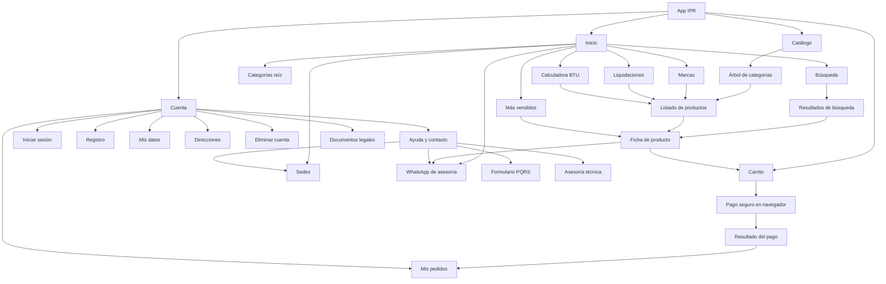

# Navegación y arquitectura de información — App móvil IPR

| | |
|---|---|
| **Proyecto** | App móvil Flutter de IPR Partes y Repuestos (Inverprimos S.A.S.) |
| **Fase** | UX/UI. No se programa. Especificación verificable. |
| **Fecha** | 2026-11-18 |
| **Estado** | BORRADOR para aprobación. La estructura de pestañas es **hipótesis a validar con usuarios** (VAL-01) antes de fijarse. |
| **Documentos hermanos** | [design_system.md](design_system.md) (convenciones, registro APR/VAL en §17) · [user_flows.md](user_flows.md) · [accessibility.md](accessibility.md) |
| **Fuentes** | [Requisitos funcionales](../02_requirements/functional_requirements.md) (solo RF del MVP "sí") · [Historias](../02_requirements/user_stories.md) · [Criterios de aceptación](../02_requirements/acceptance_criteria.md) · [Arquitectura Flutter §6](../03_architecture/flutter_app_architecture.md) · [Flujo de datos §8](../03_architecture/data_flow.md) · [Resolución de inconsistencias](../project/resolucion_inconsistencias.md) · [Decisiones pendientes §E](../project/decisiones_pendientes.md) |

Etiquetas: **[HECHO]**, **[SUPUESTO]**, **[PROPUESTA]**, **[PENDIENTE]**; `SUP-Hnn` = supuesto basado en la recomendación H-nn **no aprobada** (ver design_system.md §0.2).

---

## 1. Resumen de decisiones de navegación

| # | Decisión | Estado |
|---|---|---|
| N1 | **Barra inferior de 4 destinos:** Inicio, Catálogo, Carrito, Cuenta. | **PROPUESTA**, a validar (VAL-01, APR-06) |
| N2 | **Favoritos no entra:** todo el módulo H es fase 2 (RF-068 a RF-070) o descartado (RF-071). Se reserva un quinto lugar de la barra para Favoritos o para Sedes. | **PROPUESTA** coherente con ADR-002 |
| N3 | **Buscar no es pestaña:** es un campo visible en Inicio y un ícono en la barra superior de las demás raíces. | PROPUESTA (VAL-03) |
| N4 | **Ayuda y contacto** (WhatsApp, PQRS, teléfono, correo, sedes) es una acción de la barra superior en la **misma posición** en todas las pantallas raíz (WCAG 3.2.6, RNF-077). | PROPUESTA |
| N5 | **Sedes** se alcanza desde Inicio y desde Ayuda y contacto (≤ 2 toques); es el principal candidato a quinta pestaña si VAL-01 lo exige. | PROPUESTA (VAL-01, VAL-14) |
| N6 | **Sin onboarding:** el usuario aterriza en Inicio sin login ni carrusel de bienvenida (RF-037, AC-037-1). | PROPUESTA (VAL-02) |
| N7 | El resultado del pago **siempre se consulta al servidor**; el enlace de retorno solo acelera. | `SUP-H02` (CR-001 a CR-003 no aprobadas) |
| N8 | Una pila de navegación **independiente por pestaña**, conservada al cambiar de pestaña. | **[HECHO]** en arquitectura (FA §6.1, `StatefulShellRoute.indexedStack`) |

---

## 2. Arquitectura de información

### 2.1 Mapa del sitio (MVP)

Acceso superior (todas las raíces): **Buscar** (excepto Inicio) · **Ayuda** · **Carrito** (con insignia).

### 2.2 Jerarquía de contenido por destino

| Destino | Nivel 1 | Nivel 2 | Nivel 3 |
|---|---|---|---|
| **Inicio** (PT-01) | Buscador, WhatsApp, 8 categorías raíz, más vendidos, accesos (Marcas, Liquidaciones, Calculadora BTU, Sedes) | Listado, Búsqueda, Marcas, Sedes, Calculadora | Ficha de producto, Ficha de sede |
| **Catálogo** (PT-02) | Categorías raíz y subcategorías (misma pantalla, nivel a nivel) | Listado de productos (PT-03) con filtros y orden | Ficha de producto (PT-08), Galería (PT-09) |
| **Carrito** (PT-10) | Líneas, resumen informativo, "Pagar" | Pago en curso (PT-11), Resultado (PT-12) | Mis pedidos (PT-22), Detalle (PT-23) |
| **Cuenta** (PT-13) | Visitante: acceso/registro + Ayuda, Sedes, Asesoría técnica, Legales. Cliente: Mis datos, Pedidos, Direcciones, Seguridad, Ayuda… | Formularios de perfil, Pedidos, PQRS, Documentos legales | Detalle de pedido, Documento legal |

---

## 3. Barra de navegación inferior: evaluación y recomendación

### 3.1 Qué dicen los requisitos sobre cada destino candidato

| Candidato | Evidencia en el MVP | ¿Destino de nivel superior? |
|---|---|---|
| **Inicio** | Módulo A (RF-001 a RF-007, RF-009): 3 Must, 5 Should | **Sí** (puerta de entrada y contenedor de accesos) |
| **Catálogo** | Módulo B: 5 Must (RF-010 a RF-012, RF-013, RF-019) | **Sí** |
| **Carrito** | Módulo F: RF-049 a RF-051 (Must); es el origen del pago | **Sí**, con insignia del número de productos |
| **Cuenta** | Módulo E y N: inicio de sesión, perfil, pedidos, eliminación de cuenta (9 + 4 Must); además la **única** vía "menú" donde AC-099-2 exige legales y AC-094-1 exige WhatsApp | **Sí** |
| **Búsqueda** | RF-020, RF-022 (Must); la web usa "buscar por marca o referencia" como acción principal | **No como pestaña**: se inicia desde cualquier pantalla; vive en Inicio (campo, RF-001) y como ícono en las demás raíces |
| **Favoritos** | RF-068 a RF-070 Could/fase 2; RF-071 Won't (todo el módulo H fuera del MVP; la web no los tiene, INV F13) | **No** |
| **Sedes** | RF-072 a RF-075 (3 Must, 1 Should); uso real desconocido | **Duda**: ver opciones |
| **Ayuda y contacto** | RF-094 (Must), RF-095, RF-064, RF-096 (Must) | **No pestaña**: acción de barra superior consistente (3.2.6) |
| **Notificaciones** | Módulo L fuera del MVP | **No** |

### 3.2 Opciones evaluadas

| Criterio | **A. 4 destinos**: Inicio · Catálogo · Carrito · Cuenta | **B. 5 destinos**: Inicio · Catálogo · **Sedes** · Carrito · Cuenta | **C. 4 destinos**: Inicio · **Buscar** · Carrito · Cuenta |
|---|---|---|---|
| Cubre todos los Must del MVP | Sí (Sedes y Ayuda a ≤ 2 toques) | Sí | Sí (Catálogo desde Inicio) |
| Acceso directo a Sedes | Indirecto (Inicio / Ayuda) | **Directo** | Indirecto |
| Acceso directo a Catálogo | Directo | Directo | Indirecto: añade un toque a "explorar por categorías" |
| Acceso directo a Buscar | Campo en Inicio + ícono | Campo en Inicio + ícono | **Directo** |
| Ancho por destino a 320 dp | **80 dp** | 64 dp | 80 dp |
| Ajuste de etiquetas con texto ampliado | Mejor (aún requiere excepción, design_system §10.7) | **Peor** (64 dp) | Mejor |
| Coherencia con la arquitectura propuesta | FA §6.1 lista `/branches` como "pestaña Sedes" (5 destinos): **difiere**; el enrutador no cambia (cada destino es una rama de `StatefulShellRoute`) | **Coincide** | Difiere |
| Lugar libre para fase 2 (Favoritos) | **Sí** (quinto destino) | No (queda sin lugar) | Sí |
| Riesgo principal | Sedes escondida para quien llega a mostrador con urgencia | Barra apretada y sin lugar para Favoritos | Se esconde la exploración por categorías |

### 3.3 Recomendación [PROPUESTA] (VAL-01, APR-06)

**Opción A.** Razones, en orden de peso:

1. **Foco en la tarea principal y en la compra.** Los cuatro destinos cubren buscar/explorar (Inicio, Catálogo), comprar (Carrito) y gestionar (Cuenta). Sedes y Ayuda siguen a ≤ 2 toques.
2. **Mejor ajuste con texto ampliado.** 80 dp por destino a 320 dp frente a 64 dp (requisito de texto hasta 200 %, RNF-068).
3. **Deja espacio para fase 2.** El quinto lugar queda libre para Favoritos (RF-068 a RF-070) o Sedes sin rediseñar.
4. **La atención real ocurre por WhatsApp y teléfono** (INV §7): se resuelve con la acción **Ayuda** persistente en la barra superior, no gastando una pestaña.

**Lo que esta recomendación no sabe:** la frecuencia real de uso de Sedes, Catálogo y Buscar. La web no tiene analítica de terceros (INV §2.1) y no hay investigación de usuarios (perfiles). La opción A es una **hipótesis**.

### 3.4 Qué debe probarse con usuarios antes de fijarla (VAL-01)

| Prueba | Método | Participantes (a reclutar con IPR) | Tareas |
|---|---|---|---|
| Árbol de navegación (*tree test*) de A frente a B | Texto sin diseño visual, medir éxito y rutas directas | Técnicos HVAC-R, compradores de talleres y empresas (**perfil real DESCONOCIDO**, a definir con IPR) | "Encuentra la sede más cercana", "Habla con un asesor", "Mira el estado de tu último pedido", "Encuentra la válvula con referencia X", "Calcula el equipo para un local" |
| Primer clic (*first-click*) | Maqueta de baja fidelidad de Inicio con la barra de A y de B | Los mismos | Las mismas tareas |
| Clasificación de tarjetas (*card sorting*) | Abierta con las funciones del MVP | Los mismos | Agrupar y nombrar funciones |
| Etiquetas | "Cuenta" frente a "Perfil"/"Mi cuenta"; "Catálogo" frente a "Productos" | Los mismos | Comprensión |

**Criterio de decisión:** el equipo fija antes de la prueba el umbral de éxito y de acierto al primer clic (no se inventa aquí). Si "Sedes" se busca primero en la barra en más tareas que en Inicio/Ayuda, se pasa a la opción B (APR-06) y se revisa la excepción de escala de texto (APR-12).

---

## 4. Patrones de navegación globales

| Patrón | Especificación | RF / referencia |
|---|---|---|
| **Barra superior raíz** | Título o logotipo (Inicio), **Buscar** (ícono; en Inicio es el campo visible), **Ayuda** (ícono con etiqueta accesible "Ayuda y contacto"), **Carrito** (con insignia, solo fuera de la pestaña Carrito). Posición fija entre pantallas. | RF-001, RF-094, RNF-077 |
| **Buscador en Inicio** | Campo visible **sin desplazamiento** (AC-001-1) que abre la pantalla de búsqueda con el teclado visible (AC-001-2). | RF-001 |
| **WhatsApp en Inicio** | Botón visible **sin desplazamiento** (AC-005-1), justo bajo el buscador. A escala de texto alta puede salir de la primera pantalla (excepción justificada por WCAG 1.4.4). | RF-005 |
| **Pestaña Cuenta según sesión** | Sin sesión: tarjeta "Inicia sesión o regístrate" + lista de ayuda. Con sesión: nombre, accesos a datos, pedidos, direcciones, seguridad, ayuda. La **misma ruta** `/account` cambia de contenido (FA §6.1). | RF-037, RF-040, N |
| **Nuevo toque en la pestaña activa** | Vuelve a la raíz de esa pestaña; si ya está en la raíz, desplaza al inicio. | PROPUESTA |
| **Insignia de Carrito** | Número de productos; se anuncia al añadir ("Carrito: 3 productos"). | RF-049 |
| **Barra inferior en flujos** | Se oculta en pago, resultado de pago y formularios largos (registro, PQRS, direcciones, eliminar cuenta). | design_system §10.7 |
| **Conservación de estado** | Filtros, orden y posición de desplazamiento del listado se conservan al ir a la ficha y volver (AC-010-2). | RF-010, RF-013 |

---

## 5. Roles y sesión en la navegación

| Situación | Comportamiento | RF / AC |
|---|---|---|
| Visitante abre rutas públicas | Todo el catálogo, búsqueda, ficha, sedes, ayuda, legales, calculadora **sin sesión** | RF-037; AC-037-1 |
| Visitante intenta pagar, ver pedidos, perfil o eliminar cuenta | Guarda de ruta: va a `/login?from=<ruta>`; tras iniciar sesión **vuelve a `from`** (lista cerrada de rutas internas, nunca una URL externa); **el carrito local se conserva** | AC-037-3, AC-052-1, AC-107-5; FA §6.1 |
| Sesión expirada o revocada durante el uso | Se intenta refrescar sin interrumpir; si falla, pantalla de inicio de sesión con el mensaje "Tu sesión terminó. Inicia sesión de nuevo." y **carrito intacto**; al autenticarse regresa a la pantalla de origen | AC-044-5, AC-043-4, AC-044-11 |
| Cierre de sesión | Revoca en el servidor; vuelve a Inicio como visitante. **Carrito: se conserva** | AC-041-1; `SUP-H07` (H-07 no aprobada; AC-041-7 sigue [A VALIDAR]) |
| Eliminación de cuenta | Revoca todas las sesiones, borra datos locales y vuelve a Inicio como visitante. **Carrito: se borra** | AC-110-4; `SUP-H07` (CR-040: FA §8 dice que se conserva; sin resolver) |
| Usuario con rol administrativo | Mismo mensaje genérico de credenciales incorrectas | AC-048-1; `SUP-H09` |
| "Cerrar sesión en todos los dispositivos" | Ítem en Cuenta, sección Seguridad, **solo esta acción** (la lista de dispositivos es fase 2, RF-112) | `SUP-H05` (H-05 no aprobada) |
| Sin invitado | "Pagar" siempre exige sesión | S-02; `SUP-H10` |

---

## 6. Jerarquía de pantallas (inventario)

**38 entradas: 33 pantallas completas y 5 superficies modales** (hoja inferior, galería o diálogo). Dos son condicionales (`PT-16`, `PT-37`). Rutas: las de FA §6.1 [HECHO]; las marcadas ⁺ son **propuestas nuevas de UX** que deben agregarse a `routes.dart`.

| ID | Pantalla | Módulo | Ruta | Pestaña | Sesión | Tipo | RF principales | AC clave |
|---|---|---|---|---|---|---|---|---|
| PT-00 | Arranque (*splash* del sistema) | — | — | — | No | Sistema | RNF-001 | — |
| PT-01 | Inicio | A | `/` | Inicio | No | Raíz | RF-001 a RF-007, RF-009 | AC-001-1, AC-005-1, AC-002-1 |
| PT-02 | Catálogo (árbol de categorías) | B | `/catalog` | Catálogo | No | Raíz | RF-010 | AC-010-1, AC-010-3 |
| PT-03 | Listado de productos (categoría, marca, liquidaciones, desde calculadora) | B | `/catalog/list?…`, `/catalog/brands/:slug`, `/catalog/sale` | Catálogo | No | Pantalla | RF-011 a RF-015, RF-018, RF-089 | AC-011-1 a 011-8, AC-013-3 |
| PT-04 | Filtros y orden | B | (hoja) | — | No | **Hoja** | RF-013 a RF-015 | AC-013-5, AC-014-2, AC-015-1 |
| PT-05 | Directorio de marcas | B | `/catalog/brands` | Catálogo | No | Pantalla | RF-016 | AC-016-1 |
| PT-06 | Búsqueda (campo y sugerencias) | C | `/search`⁺ | (desde cualquiera) | No | Pantalla | RF-020, RF-021 | AC-020-3, AC-021-2 |
| PT-07 | Resultados de búsqueda (incluye vacío con WhatsApp) | C | `/search?q=` | — | No | Pantalla | RF-020, RF-022, RF-023 | AC-022-1, AC-023-1 a 023-5 |
| PT-08 | Ficha de producto (con precio, sin precio, agotado, bajo pedido) | D | `/product/:slug` | (según origen) | No | Pantalla | RF-026 a RF-032, RF-062 | AC-026-1, AC-030-1, AC-031-1 |
| PT-09 | Galería a pantalla completa | D | `/product/:slug/gallery`⁺ | — | No | **Modal** | RF-026 | AC-026-2 |
| PT-10 | Carrito (incluye revisión de cambios) | F | `/cart` | Carrito | No (pagar exige sesión) | Raíz | RF-049 a RF-051 | AC-049-6, AC-050-3, AC-051-2 |
| PT-11 | Pago en curso (preparación, navegador seguro, verificación) | F | `/checkout` | — | **Sí** | Flujo | RF-052, RF-053, RF-058 | AC-052-6, AC-052-8, AC-058-1 |
| PT-12 | Resultado del pago (pagado, pendiente, fallido, cancelado) | F | `/checkout/result` | — | **Sí** | Flujo | RF-055 a RF-057 | AC-056-1 a 056-9 |
| PT-13 | Cuenta (acceso/menú) | E, N, M | `/account` | Cuenta | No | Raíz | RF-037, RF-094, RF-099 | AC-094-1, AC-099-2 |
| PT-14 | Iniciar sesión | E | `/login` | — | No | Pantalla | RF-040, RF-042, RF-045 | AC-040-1 a 040-8 |
| PT-15 | Registro | E | `/register` | — | No | Pantalla | RF-038, RF-039, RF-099 | AC-038-1 a 038-8, AC-039-1 a 039-7 |
| PT-16 | "Revisa tu correo" (**condicional**: `SUP-H03`) | E | `/register/check-email`⁺ | — | No | Pantalla | RF-045, RF-046 (fase 2 si H-03 no se aprueba) | AC-038-5 |
| PT-17 | Recuperar contraseña | E | `/password-recovery` | — | No | Pantalla o navegador seguro | RF-042, RF-045 | AC-042-1 a 042-8 |
| PT-18 | Mis datos | N | `/account/profile` | Cuenta | **Sí** | Pantalla | RF-104 | AC-104-1 a 104-10 |
| PT-19 | Cambiar contraseña | N | `/account/password`⁺ | Cuenta | **Sí** | Pantalla | RF-105 | AC-105-1 a 105-10 |
| PT-20 | Direcciones (facturación y envío) | N | `/account/addresses` | Cuenta | **Sí** | Pantalla | RF-106 | AC-106-1 a 106-8 |
| PT-21 | Selector de departamento y ciudad | N | (hoja) | — | **Sí** | **Hoja** | RF-106 | AC-106-3 |
| PT-22 | Mis pedidos | N | `/orders` | Cuenta | **Sí** | Pantalla | RF-107 | AC-107-1 a 107-9 |
| PT-23 | Detalle del pedido | N | `/orders/:number` | Cuenta | **Sí** | Pantalla | RF-108 | AC-108-1 a 108-6 |
| PT-24 | Eliminar cuenta (información, contraseña, diálogo) | N | `/account/delete` | Cuenta | **Sí** | Pantalla + **diálogo** | RF-110 | AC-110-1 a 110-16 |
| PT-25 | Derechos sobre mis datos | N | `/account/rights`⁺ | Cuenta | **Sí** | Pantalla | RF-111 | AC-111-1 a 111-5 |
| PT-26 | Sedes por ciudad | I | `/branches` | (desde Inicio/Ayuda) | No | Pantalla | RF-072 | AC-072-1 a 072-6 |
| PT-27 | Ficha de sede | I | `/branches/:slug` | — | No | Pantalla | RF-073 a RF-075 | AC-073-1, AC-074-1/-2, AC-075-1 |
| PT-28 | Ayuda y contacto | M | `/support` | (desde Cuenta/barra) | No | Pantalla | RF-094, RF-095, RF-064 | AC-095-1 a 095-4, AC-064-1 |
| PT-29 | Contacto alternativo ("WhatsApp no disponible") | G | (hoja) | — | No | **Hoja** | RF-063 | AC-063-1 a 063-3 |
| PT-30 | Asesoría técnica | J | `/support/engineering` | — | No | Pantalla | RF-079, RF-080 | AC-079-1, AC-080-1 |
| PT-31 | Formulario PQRS | M | `/support/pqrs` | — | No | Pantalla | RF-096 | AC-096-1 a 096-12 |
| PT-32 | PQRS enviada | M | `/support/pqrs/sent`⁺ | — | No | Pantalla | RF-096 | AC-096-4 |
| PT-33 | Documentos legales (lista) | M | `/support/legal` | — | No | Pantalla | RF-099 | AC-099-2 |
| PT-34 | Documento legal (navegador seguro o visor sin scripts) | M | `/support/legal/:doc`⁺ | — | No | Pantalla externa | RF-099 | AC-099-3, AC-099-7 |
| PT-35 | Calculadora BTU (formulario y resultado) | K | `/tools/btu` | — | No | Pantalla | RF-085 a RF-089 | AC-085-1, AC-087-1, AC-088-1 |
| PT-36 | Actualización requerida | — | `/update-required` | — | No | Bloqueante | RNF-029 | — |
| PT-37 | Consentimiento de analítica (**condicional**: PA-08 / D-12) | M | (hoja) | — | No | **Hoja** | RF-065 | AC-065-3 |

**Módulos sin pantalla en el MVP:** **H Favoritos** (RF-068 a RF-070, fase 2; RF-071 Won't) y **L Notificaciones** (RF-090 a RF-093, fase 2; RF-092 Won't). No se diseñan, no se reservan permisos (AC-SEC-10).

**Superficies modales (5):** PT-04, PT-09, PT-21, PT-29, PT-37 (+ el diálogo de confirmación dentro de PT-24).

---

## 7. Pantallas por módulo A–N

| Módulo | Pantallas | RF del MVP cubiertos | Observaciones |
|---|---|---|---|
| **A. Inicio** | PT-01 | RF-001 a RF-007, RF-009 | RF-008 (contenido institucional) es fase 2: no se diseña |
| **B. Catálogo** | PT-02, PT-03, PT-04, PT-05 | RF-010 a RF-016, RF-018, RF-019 | RF-017 (landings editoriales) fase 2. RF-019 (frescura) es de backend: la UI muestra `StaleBanner` |
| **C. Búsqueda** | PT-06, PT-07 | RF-020 a RF-023 | RF-024, RF-025 fase 2 |
| **D. Detalle de producto** | PT-08, PT-09 | RF-026 a RF-032 | RF-033 a RF-036 fase 2 (compartir, relacionados, fichas, enlaces web) |
| **E. Usuarios y autenticación** | PT-13 (acceso), PT-14, PT-15, PT-16⁽ᶜ⁾, PT-17 | RF-037 a RF-045, RF-048 | RF-041, RF-043, RF-044, RF-045, RF-048 son de comportamiento (sin pantalla propia); RF-046, RF-047 fase 2 |
| **F. Carrito y compras** | PT-10, PT-11, PT-12 | RF-049 a RF-058 | RF-050 se resuelve dentro de PT-10; RF-059 a RF-061 fase 2/no |
| **G. Cotizaciones (WhatsApp)** | PT-29; botones de WhatsApp en PT-01, PT-08, PT-07, PT-28 | RF-062 a RF-065 | RF-065 (medición) no tiene pantalla salvo PT-37 condicional; RF-066, RF-067 fase 2 |
| **H. Favoritos** | — | ninguno (fase 2) | Quinto lugar de la barra reservado |
| **I. Sedes** | PT-26, PT-27 | RF-072 a RF-076 | RF-076 (fuente de datos) es backend; RF-077, RF-078 fase 2 (sin mapa en el MVP) |
| **J. Asesoría técnica** | PT-30 | RF-079, RF-080 | RF-081 a RF-084 fase 2 |
| **K. Calculadora BTU** | PT-35 | RF-085 a RF-089 | **Condicionada a D-08**: sin validación de Ingeniería el módulo sale del MVP y se oculta el acceso (AC-006-2) |
| **L. Notificaciones** | — | ninguno (fase 2) | No se solicita permiso de notificaciones |
| **M. Atención al cliente** | PT-28, PT-31, PT-32, PT-33, PT-34, PT-37⁽ᶜ⁾ | RF-094 a RF-097, RF-099 | RF-097 es backend; RF-098, RF-100 a RF-103 fase 2/no |
| **N. Perfil y cuenta** | PT-13 (autenticado), PT-18 a PT-25 | RF-104 a RF-108, RF-110, RF-111 | RF-109, RF-112, RF-113 fase 2 |

⁽ᶜ⁾ condicional.

---

## 8. Deep links y App Links (retorno del pago)

### 8.1 Qué está decidido y qué no

| Aspecto | Contenido | Estado |
|---|---|---|
| Enlaces entrantes del MVP | **Solo el retorno del pago.** Producto (`/producto/{slug}`) es fase 2 (RF-036). No hay otros enlaces entrantes. | **[HECHO]** (FA §6.2, RF-055, RF-036) |
| Ruta del enlace de retorno | RF-055 y FA §6.2: `/pedido-confirmado`. El revisor recomienda `/app/pedido?ref=&order=&status=` con `.well-known` limitado a `/app/*`, para que la web nunca se abra por error en la app. | `SUP-H02` (CR-001; **no aprobada**). El diseño de pantallas **no cambia** con la ruta; cambia solo la política de entrada. |
| Fuente de verdad del resultado | La consulta autenticada al servidor (`GET /mobile/v1/checkout/{checkoutRef}`). Los parámetros `order` y `status` son **pista**, nunca prueba (AC-055-4, AC-056-6). | `SUP-H02` (CR-002) |
| Archivos de verificación | `assetlinks.json` y `apple-app-site-association` en el dominio de la tienda | **[PENDIENTE]** alojamiento (COD §8.3, ADR-001 C1/C2) |
| iOS | El *callback* https de `ASWebAuthenticationSession` exige iOS 17.4; antes, el usuario cierra el navegador y la app consulta | **[HECHO]** FA §1, ADR-008; CR-004 sin aprobar |

### 8.2 Comportamiento de la app ante cada entrada

| Caso | Qué ve el usuario | Pila resultante | AC |
|---|---|---|---|
| **Enlace de retorno con pago en curso** (app en segundo plano) | La app vuelve a primer plano en PT-11 "Confirmando tu pago…" y pasa a PT-12 con el resultado **del servidor** | PT-10 → PT-12 | AC-055-1, AC-056-1 |
| **Enlace de retorno con la app cerrada** (arranque en frío) | Abre directamente PT-12 (tras la verificación) | **Inicio → PT-12** (atrás lleva a Inicio) | AC-055-7 |
| **Sin sesión al recibir el enlace** | Pide iniciar sesión; tras autenticarse muestra el resultado | Login → PT-12 | AC-055-6 |
| **Enlace sin pago en curso** (enlace antiguo) | Abre **Mis pedidos** (con sesión) o Inicio; **nunca** muestra "pago exitoso" | PT-22 o PT-01 | FA §6.2 |
| **Enlace con parámetros manipulados** (`status=completed` falso, pedido ajeno) | Muestra el estado real del servidor ("pendiente") o un error genérico sin revelar si el pedido existe | PT-12 | AC-055-4, AC-055-5, AC-056-6 |
| **Enlace no reconocido** (host o ruta fuera de la lista cerrada) | Inicio | PT-01 | FA §6.2 (política de entrada) |
| **El enlace no abre la app** (no verificado, iOS < 17.4, navegador sin soporte) | El usuario cierra el navegador seguro y vuelve; **al pasar a primer plano** la app consulta el estado | PT-11 → PT-12 | AC-055-3 |
| **La app fue cerrada por el sistema durante el pago** | Al relanzar, reanuda la verificación (intento guardado sin datos personales) | Inicio → PT-12 | FA §6.3; AC-057-8 |

### 8.3 Otros lanzadores externos (no son deep links de entrada)

| Acción | Destino | Si falla | RF / AC |
|---|---|---|---|
| WhatsApp (línea nacional o de sede) con mensaje prellenado | Aplicación WhatsApp | Hoja PT-29: abrir `wa.me` en el navegador o **llamar** (marcador sin marcar automáticamente) | RF-062, RF-063, RF-074; AC-063-1 a 063-5 |
| Llamar | Marcador del sistema | Mensaje claro en dispositivos sin telefonía (AC-063-5) | RF-074, RF-080 |
| Correo | Cliente de correo (`mailto:`) | Mensaje y opción de copiar la dirección (AC-080-3) | RF-095 |
| Cómo llegar | App de mapas o mapa en el navegador | Mapa web (AC-075-3) | RF-075 |
| Pago y recuperación de contraseña (si es vía WordPress) | **Navegador seguro** del sistema, nunca un WebView propio | Navegador predeterminado si no hay Custom Tabs (RNF-086) | RF-052, AC-042-3, AC-052-3 |
| Documentos legales | Navegador seguro o visor sin JavaScript | Error con "Reintentar" (AC-099-5) | RF-099; AC-099-7 |

---

## 9. Comportamiento del botón Atrás

Aplica al botón/gesto atrás de Android y al gesto de borde de iOS; la flecha de la barra superior hace lo mismo. Con Android 14+ se declara compatibilidad con el gesto de atrás predictivo.

| Contexto | Atrás hace | Notas |
|---|---|---|
| Pantalla interior de una pestaña | Sube un nivel dentro de la pila de esa pestaña | Conserva posición de desplazamiento y filtros (AC-010-2) |
| **Raíz de una pestaña distinta de Inicio** | Cambia a **Inicio** | PROPUESTA |
| **Raíz de Inicio** | Cierra la app (comportamiento del sistema) | — |
| Catálogo: nivel de categoría n | Nivel n − 1 | AC-010-2 |
| Resultados de búsqueda | Vuelve al campo de búsqueda con el término | PROPUESTA |
| Campo de búsqueda | Vuelve a la pantalla de origen | — |
| Ficha de producto | Vuelve al listado/resultados/Inicio de origen con su estado | — |
| Hoja inferior (filtros, contacto, ubicación) y galería | Cierra la superficie sin aplicar cambios pendientes | En filtros con cambios sin aplicar: se descartan sin confirmación (se muestran de nuevo en la siguiente apertura) |
| Diálogo | Equivale a "Cancelar" | — |
| **Formulario con cambios sin guardar** (registro, direcciones, datos, PQRS, eliminar cuenta) | Si hay datos escritos: diálogo "¿Descartar los cambios?" (Cancelar con foco inicial). Si no: sale | PQRS no persiste datos personales (AC-096-12) |
| **Login abierto por una guarda** | Vuelve a la pantalla de origen **sin sesión**, carrito intacto | AC-037-3 |
| Tras iniciar sesión con éxito | El inicio de sesión se **reemplaza** en la pila; atrás no vuelve a él | — |
| **Pago en curso (PT-11), antes de abrir el navegador** | Sin flecha de atrás; botón visible "Cancelar" (cancela la petición pendiente; el carrito no cambia) | AC-052-6, AC-058-9 |
| **Pago en curso, esperando al usuario** (navegador abierto) | Atrás → Carrito, con un aviso de **pago pendiente de verificar**; al volver a primer plano la app consulta el estado | AC-057-6, AC-057-8 |
| **Resultado del pago (PT-12)** pagado | Atrás → Inicio (el carrito ya está vacío) | AC-055-7 |
| Resultado fallido, cancelado o sin pedido | Atrás → Carrito (conservado) | AC-057-2 |
| Resultado pendiente | Atrás → Carrito (conservado); acceso a Mis pedidos | AC-057-3 |
| Eliminar cuenta (paso de contraseña) | Vuelve al paso de información; nada se envía | AC-110-11 |
| Actualización requerida (PT-36) | Sin atrás (bloqueante); solo "Actualizar" | RNF-029 |
| Navegador seguro | El usuario lo cierra con su control del sistema; la app reanuda | RF-055 |

---

## 10. Guardas, errores y estados globales de navegación

| Situación | Dónde se muestra | Comportamiento |
|---|---|---|
| Sin conexión | Banner no bloqueante en la pantalla y `ErrorState` en pantallas sin caché | Carrito visible sin red; "Pagar" informa que requiere conexión sin abrir el navegador (AC-009-6, AC-052-8) |
| Servidor no disponible (503) | `ErrorState` con "Reintentar"; caché marcada "puede no estar actualizada" | AC-009-2 |
| Producto eliminado (404) | PT-08 "Este producto ya no está disponible." con "Volver" | AC-026-6 |
| Versión obsoleta | PT-36 | RNF-029 |
| Límite de intentos (429) | En la pantalla del formulario; el botón se deshabilita con tiempo restante | AC-045-1, AC-096-6 |
| Pago pendiente reciente | Banner en PT-10 antes de generar otro ticket | AC-057-6 (**[A VALIDAR]** PA-11) |

---

## 11. Pendientes y validaciones de esta pieza

| Tema | Tipo | Ref. |
|---|---|---|
| Quinta pestaña (Sedes o Favoritos) y etiquetas de la barra | **VAL-01**, APR-06 | §3 |
| Excepción de escala de texto de las etiquetas de la barra | APR-12 | design_system §10.7 |
| Ruta de retorno `/pedido-confirmado` o `/app/pedido`; mecanismo principal del retorno | `SUP-H02`, H-02 | §8 |
| Rutas nuevas ⁺ a incorporar en `routes.dart` y `deep_link_policy.dart` | Cambio en arquitectura | §6 |
| Carrito al cerrar sesión y al eliminar cuenta | `SUP-H07`, CR-040 | §5 |
| Lugar del buscador y comportamiento de "Atrás" desde resultados | VAL-03 | §4, §9 |
| Comportamiento de PT-16 | `SUP-H03`, VAL-08 | §6 |
| Existencia del módulo K | D-08, APR-07 | §7 |
| Funcionamiento real de App Links tras la redirección dentro del navegador seguro | SPK-01 (no verificado) | §8 |
