# Flujos de usuario y wireframes — App móvil IPR

| | |
|---|---|
| **Proyecto** | App móvil Flutter de IPR Partes y Repuestos (Inverprimos S.A.S.) |
| **Fase** | UX/UI. No se programa ni se generan imágenes. Los *wireframes* son de texto/tablas (baja fidelidad). |
| **Fecha** | 2026-11-18 |
| **Estado** | BORRADOR para aprobación y pruebas con usuarios. |
| **Documentos hermanos** | [design_system.md](design_system.md) (convenciones y registro APR/VAL en §17) · [navigation.md](navigation.md) (identificadores `PT-xx`) · [accessibility.md](accessibility.md) |
| **Fuentes** | [RF](../02_requirements/functional_requirements.md) (solo MVP "sí") · [Historias](../02_requirements/user_stories.md) · [AC](../02_requirements/acceptance_criteria.md) · [Flujo de datos §6 a §9](../03_architecture/data_flow.md) · [Arquitectura Flutter §6, §10](../03_architecture/flutter_app_architecture.md) · [Resolución de inconsistencias](../project/resolucion_inconsistencias.md) · [Decisiones pendientes §E](../project/decisiones_pendientes.md) |

---

## 0. Cómo leer este documento

- **Etiquetas:** **[HECHO]** (documentado/comprobado), **[SUPUESTO]**, **[PROPUESTA]** (decisión de diseño), **[PENDIENTE]**. `SUP-Hnn` = supuesto basado en la recomendación **H-nn no aprobada** (design_system.md §0.2). `APR-nn` / `VAL-nn` = aprobación / validación con usuarios (registro en design_system.md §17). Un criterio de aceptación marcado **[A VALIDAR]** en la fuente se arrastra aquí como pendiente: la pantalla se diseña, pero el comportamiento no puede darse por cerrado.
- **Diagramas:** Mermaid `flowchart` conservador (identificadores simples, etiquetas entre comillas, sin subgrafos), validados con `mermaid.parse()` (ver §19).
- **Wireframes:** cuadros de texto de ancho de teléfono (≈ 360 dp). `[ Botón ]` = botón; `( )` = opción; `[x]` = marcada; `...` = contenido omitido. No fijan estilo visual: eso es el [Design System](design_system.md).
- **Textos de interfaz:** español de Colombia, tuteo (**[PENDIENTE]** APR-04, VAL-10). Son borradores, salvo los textos legales que fija Jurídico (APR-08).
- **Regla transversal:** toda pantalla de contenido remoto cumple AC-009-1 a AC-009-7 (error ≠ vacío, reintentar, carrito intacto, no perder páginas ya cargadas).

### Índice de flujos

| Flujo | Tema | Pantallas (`PT-xx`) | RF principales |
|---|---|---|---|
| F01 | Primer arranque y ¿onboarding? | PT-00, PT-01, PT-36, PT-37 | RF-037, RNF-001 |
| F02 | Inicio | PT-01 | RF-001 a RF-007, RF-009 |
| F03 | Búsqueda por nombre y por SKU | PT-06, PT-07 | RF-020 a RF-023 |
| F04 | Catálogo, marcas, liquidaciones y filtros | PT-02, PT-03, PT-04, PT-05 | RF-010 a RF-016, RF-018 |
| F05 | Detalle de producto (con precio, sin precio, agotado, bajo pedido) | PT-08, PT-09, PT-29 | RF-026 a RF-032, RF-062, RF-063 |
| F06 | Registro | PT-15, PT-16, PT-34 | RF-038, RF-039, RF-045, RF-099 |
| F07 | Inicio de sesión | PT-14 | RF-040, RF-045, RF-048 |
| F08 | Recuperación de contraseña | PT-17 | RF-042, RF-045 |
| F09 | Carrito | PT-10 | RF-049 a RF-051 |
| F10 | Checkout, retorno y resultado | PT-10, PT-11, PT-12 | RF-050, RF-052 a RF-058 |
| F11 | Pedidos y detalle | PT-22, PT-23 | RF-107, RF-108 |
| F12 | Perfil, contraseña y direcciones | PT-13, PT-18 a PT-21 | RF-104 a RF-106 |
| F13 | Eliminación de cuenta (y derechos del titular) | PT-24, PT-25 | RF-110, RF-111 |
| F14 | Calculadora BTU | PT-35 | RF-085 a RF-089 |
| F15 | Sedes | PT-26, PT-27 | RF-072 a RF-075 |
| F16 | Ayuda, WhatsApp, asesoría técnica y PQRS | PT-28 a PT-34 | RF-062 a RF-065, RF-079, RF-080, RF-094 a RF-096, RF-099 |
| F17 | Errores de red y sesión expirada | transversal | RF-009, RF-044, RF-045, RNF-020 a RNF-027 |

**17 flujos** cubren las 38 entradas de `PT-xx`.

---

## F01. Primer arranque y ¿hace falta onboarding?

**Cubre:** RF-037; AC-037-1, AC-037-2; RNF-001, RNF-029; AC-SEC-10; RF-065 (condicional).

### Decisión de diseño [PROPUESTA] (VAL-02)

**No hace falta un onboarding de varias pantallas.** Razones:

1. RF-037 y AC-037-1 exigen que una instalación nueva llegue **al inicio sin login**, con catálogo, búsqueda, fichas, sedes y contacto abiertos.
2. La propuesta de valor es inmediata (buscar una referencia); la web de IPR tampoco tiene guía de bienvenida.
3. El MVP **no pide permisos** al arrancar: ni ubicación, ni contactos, ni cámara, ni micrófono, ni notificaciones (AC-SEC-10). Un carrusel de bienvenida tendría que explicar algo que no se pide.
4. Las explicaciones necesarias se dan **en contexto**: "IVA incluido" junto al precio, "el pago se abre en tu navegador seguro" bajo el botón "Pagar", el aviso de estimación junto al resultado BTU.

**Lo que sí puede aparecer (condicional):** una hoja de **consentimiento de analítica** (PT-37), **solo si** Jurídico determina que RF-065 (medición agregada de "Más información") exige consentimiento previo (PA-08, D-12, AC-065-3). Sin esa decisión no se muestra y no se envía ningún evento.

**Qué debe probarse (VAL-02):** que personas nuevas, sin guía, entienden en el primer minuto dónde buscar por referencia, cómo hablar con un asesor y que el catálogo se ve sin cuenta.

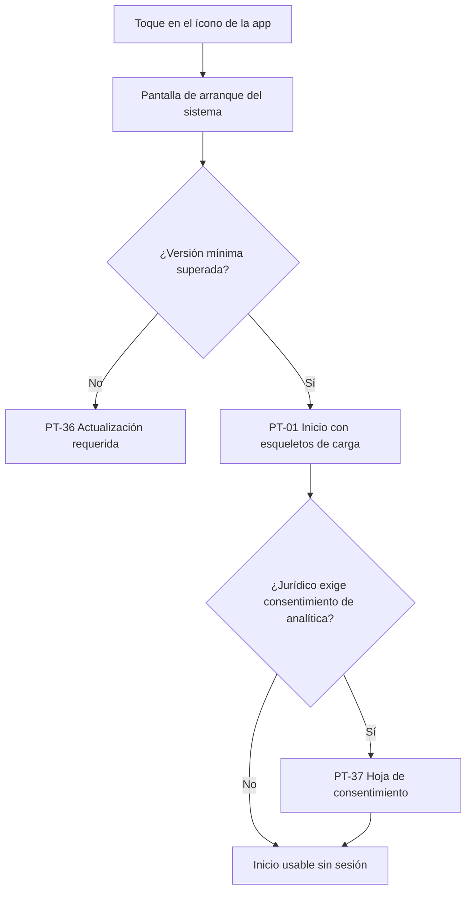

| Paso | Qué ve el usuario | Estado en caso de falla |
|---|---|---|
| Arranque | Pantalla de arranque del sistema (logotipo sobre blanco, **sin** animación larga) | — |
| Configuración remota (versión mínima) | Nada visible si todo está bien | Si falla la consulta, se usa el último valor conocido y se continúa (no se bloquea el arranque) |
| Inicio | Esqueletos por sección en ≤ 100 ms (RNF-003); contenido en caché si existe | `ErrorState` por bloque, el resto sigue operativo (AC-003-4) |
| Consentimiento (si aplica) | Hoja con el texto de Jurídico, "Aceptar" y "Ahora no" con el **mismo peso visual**; "Ahora no" no bloquea nada | WhatsApp y "Más información" funcionan igual (AC-065-3) |

**Wireframe PT-37 (condicional):**

```
+------------------------------------+
|  Ayúdanos a mejorar la app         |
|  [Texto de Jurídico: qué se mide,  |
|   que no incluye datos personales  |
|   y cómo retirarlo]  [Ver política]|
|                                    |
|  [ Aceptar ]    [ Ahora no ]       |
+------------------------------------+
```

---

## F02. Inicio

**Cubre:** RF-001 a RF-007, RF-009; AC-001-1 a 001-3, AC-002-1 a 002-4, AC-003-1 a 003-5, AC-004-1/-2, AC-005-1 a 005-4, AC-006-1/-2, AC-007-1/-2, AC-009-1 a 009-7.

**Estructura (de arriba abajo) [PROPUESTA]:** barra superior (logotipo, Ayuda, Carrito) → **buscador** (visible sin desplazar, AC-001-1) → **WhatsApp de asesoría** (visible sin desplazar, AC-005-1) → **8 categorías raíz** → **más vendidos** → **accesos** (Marcas, Liquidaciones, Calculadora BTU *si D-08 cerrada*, Sedes).

```
+------------------------------------+
| [IPR logo]        (Ayuda) (Carrito2)|
| +--------------------------------+ |
| | (lupa) Buscar por nombre, marca| |
| |        o referencia (SKU)      | |
| +--------------------------------+ |
| [ (chat) Hablar con un asesor    ] |
|                                    |
| Categorías                         |
| [Aire         ] [Refrigeración  ]  |
| [acondicionado] [                ] |
| [Eléctricos   ] [Materiales y   ]  |
| [             ] [consumibles    ]  |
|  ... (8 en total)                  |
|                                    |
| Más vendidos                       |
| [Tarjeta][Tarjeta]  ->             |
|                                    |
| ¿Necesitas cotizar un proyecto o   |
| un volumen? [Cotizar por WhatsApp] |
|                                    |
| [Marcas] [Liquidaciones] [Sedes]   |
| [Calculadora BTU]*                 |
+------------------------------------+
| Inicio | Catálogo | Carrito | Cuenta|
+------------------------------------+
* Solo si D-08 está cerrada (AC-006-2).
```

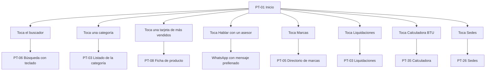

| Estado | Comportamiento | AC |
|---|---|---|
| Cargando | Esqueleto de la cuadrícula de categorías y de las tarjetas; el buscador y WhatsApp **ya son operativos** (no dependen de la red del catálogo) | RNF-003 |
| Datos | Categorías = las que devuelve el servidor (a la fecha 8); número de accesos = número devuelto | AC-002-1 |
| Falla solo "más vendidos" | Ese bloque muestra error con "Reintentar"; el resto sigue operativo | AC-003-4 |
| Sin conexión / error de servidor | Mensaje no técnico + "Reintentar"; carrito intacto; con caché: contenido guardado + `StaleBanner` | AC-009-1 a 009-4 |
| Tarjeta sin precio o agotada | "Más información" sin cifra / "Agotado"; sin acción de compra desde la tarjeta | AC-003-2, AC-003-3 |
| Sin WhatsApp instalado | Hoja PT-29 (llamar o abrir `wa.me`) | AC-005-3 |
| Calculadora | El acceso **no aparece** mientras D-08 esté abierta | AC-006-2 |
| "Más vendidos" | Criterio de selección y cantidad **[PENDIENTE]** PA-05: la app muestra lo que entrega el servidor | AC-003-1 |

**Decisiones [PROPUESTA]:** Inicio tiene **dos** botones de WhatsApp con funciones distintas, para no mezclar objetivos: **"Hablar con un asesor"** (RF-005, asesoría general, visible sin desplazar, mensaje institucional de AC-005-2) y, más abajo, un bloque **"¿Necesitas cotizar un proyecto o un volumen?" con el botón "Cotizar por WhatsApp"** (RF-064, AC-064-1; mensaje de cotización **[A VALIDAR]** AC-064-2, APR-04). La pantalla Ayuda y contacto (F16) repite "Cotizar por WhatsApp" (AC-064-1). Ambos botones usan el mismo estilo y la misma ubicación relativa en cada pantalla (WCAG 3.2.6).

---

## F03. Búsqueda por nombre y por SKU

**Cubre:** RF-020 a RF-023; AC-020-1 a 020-7, AC-021-1 a 021-5, AC-022-1 a 022-5, AC-023-1 a 023-6, AC-009-7.

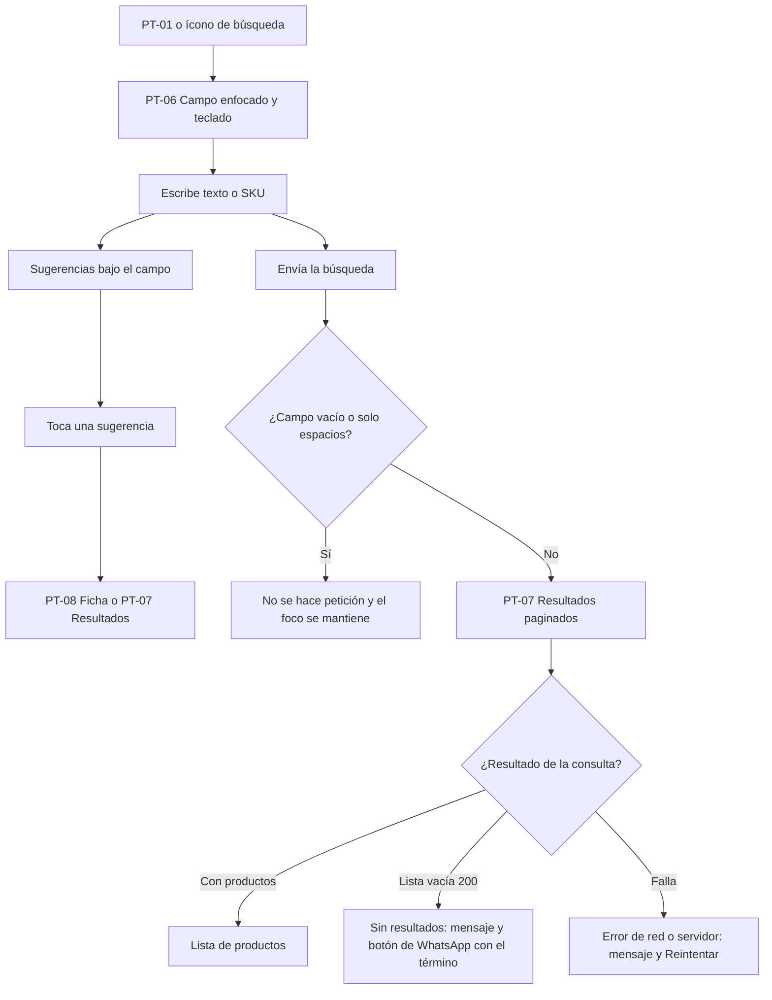

**Wireframes**

```
PT-06 Búsqueda                        PT-07 Resultados (con datos)
+------------------------------+      +------------------------------+
| (<) [ válvula 1/4        (x)]|      | (<) “500-0144”      (Carrito)|
|------------------------------|      | [Filtros]  [Ordenar]   24    |
| Sugerencias                  |      |  resultados                  |
|  Válvula solenoide 1/4       |      | [Tarjeta: SKU 500-0144 ...]  |
|  Válvula de servicio ...     |      | [Tarjeta]  [Tarjeta] ...     |
|  Ver todos los resultados    |      +------------------------------+
|  para “válvula 1/4”          |
+------------------------------+

PT-07 Sin resultados (200 con lista vacía)       PT-07 Error (red o servidor)
+------------------------------+                +------------------------------+
| (<) “xyz 123”                |                | (<) “válvula”                |
|        [ilustración]         |                |         (!)                  |
|  No encontramos “xyz 123”    |                |  No tienes conexión.         |
|  Revisa la ortografía o ...  |                |  Revisa tu internet.         |
|  [ Escribir por WhatsApp ]   |                |  [ Reintentar ]              |
|  [ Buscar de nuevo ]         |                |  (NO se muestra “sin         |
+------------------------------+                |   resultados”)               |
                                                +------------------------------+
```

| Aspecto | Diseño | AC / estado |
|---|---|---|
| Campo | Etiqueta accesible "Buscar productos"; ejemplo de *placeholder* "Ej.: 500-0144" nunca como única instrucción; botón "Borrar texto" 48 dp | AC-001-1 |
| Búsqueda vacía | No se emite petición; el foco permanece en el campo | AC-020-3 |
| **SKU exacto** | El producto aparece en la **primera posición**; se normaliza mayúsculas/minúsculas y espacios al inicio y al final | AC-022-1, AC-022-2 (**[A VALIDAR]** RF-022: "primeras posiciones" sin cuantificar; ranking real DESCONOCIDO, verificar en staging) |
| SKU con guiones/espacios distintos al registrado | Comportamiento determinista y documentado | AC-022-3 **[A VALIDAR]** → VAL-03 |
| Tildes ("válvula"/"valvula") | Equivalencia documentada | AC-020-5 **[A VALIDAR]** |
| Sugerencias | Se actualizan al escribir (debounce 300 ms, FA §7.1); solo se muestran las del último término; si fallan, la búsqueda por texto sigue funcionando sin error bloqueante | AC-021-1 a 021-5; mínimo de caracteres **[A VALIDAR]** |
| Tocar una sugerencia | **[PROPUESTA]** producto → ficha; "Ver todos los resultados" → PT-07 | AC-021-3 **[A VALIDAR]** (destino no definido) |
| Caracteres especiales | Se codifican; nunca se interpretan como marcado en la pantalla de resultados | AC-020-4 |
| Sin resultados | Mensaje + botón **"Escribir por WhatsApp"** con el término buscado (codificado) | RF-023; AC-023-1 a 023-4 (texto del mensaje **[A VALIDAR]**) |
| Error ≠ vacío | Si falla la red o el servidor **no** se muestra "sin resultados" ni WhatsApp con el término | AC-023-5, AC-009-7 |
| Sin sesión | Todo funciona sin autenticación | AC-020-7, AC-023-6 |
| Filtros y orden sobre resultados | **Fase 2** (RF-024): no se diseñan en PT-07 | Alcance |

**VAL-03:** formato de referencia que escriben los técnicos (guiones, espacios, mayúsculas) con SKU reales; ubicación del buscador.

---

## F04. Catálogo, marcas, liquidaciones y filtros

**Cubre:** RF-010 a RF-016, RF-018, RF-019; AC-010-1 a 010-6, AC-011-1 a 011-8, AC-012-1 a 012-5, AC-013-1 a 013-6, AC-014-1 a 014-4, AC-015-1 a 015-4, AC-016-1 a 016-5, AC-018-1 a 018-6.

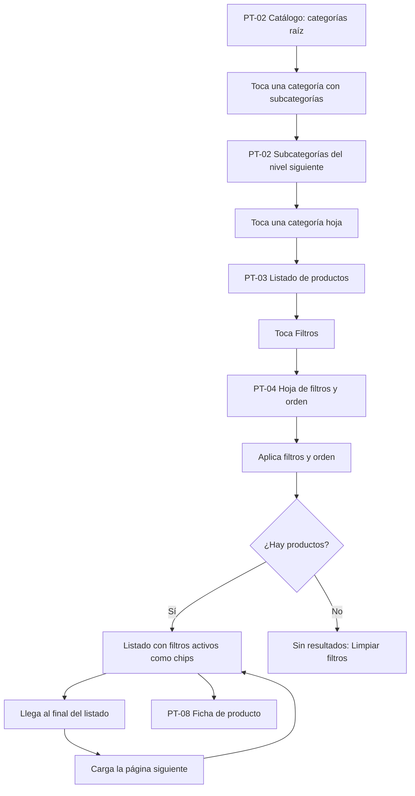

**Wireframes**

```
PT-02 Catálogo                        PT-03 Listado
+------------------------------+      +------------------------------+
| Catálogo   (Buscar)(Ayuda)(C)|      | (<) Aire acondicionado   (C) |
|------------------------------|      | [Filtros (2)] [Ordenar: ...] |
| Aire acondicionado        >  |      | [Marca: X (x)] [BTU: 12.000(x)]
| Refrigeración             >  |      |  [Limpiar filtros]    37 res.|
| Eléctricos                >  |      | +-----------+ +-----------+  |
| Materiales y consumibles  >  |      | |   [img]   | |   [img]   |  |
| Herramientas              >  |      | | Marca     | | Marca     |  |
| Tableros y controles      >  |      | | Nombre... | | Nombre... |  |
| Ventilación               >  |      | | SKU 500-..| | SKU 501-..|  |
| Refrigerantes             >  |      | | $ 1.234.567| | Más       |  |
| Marcas  ·  Liquidaciones     |      | | IVA incl. | | información|  |
+------------------------------+      | | (En stock)| | (Agotado) |  |
                                      | +-----------+ +-----------+  |
                                      | ... carga progresiva ...     |
                                      +------------------------------+

PT-04 Filtros y orden (hoja inferior)
+------------------------------------+
| Filtros                  [ Cerrar ]|
| Ordenar por                        |
|  ( ) Opción 1 del servidor         |
|  ( ) Opción 2 del servidor         |
| Marca                              |
|  [ ] Marca A   [ ] Marca B ...     |
| Categoría                          |
| Capacidad BTU  (solo si existe)    |
|  [ ] 9.000  [ ] 12.000 ...         |
|------------------------------------|
| [ Limpiar ]       [ Ver 37 ]       |
+------------------------------------+
```

| Aspecto | Diseño | AC / estado |
|---|---|---|
| Navegación por categorías | Una pantalla por nivel (misma `PT-02`); título = nombre de la categoría tocada; atrás sube un nivel y conserva el desplazamiento | AC-010-1, AC-010-2, AC-002-2 |
| Categorización | La app muestra la jerarquía del catálogo sin reordenar ni reclasificar | AC-010-5 **[A VALIDAR]** D-10 |
| Listado | Carga progresiva: una sola solicitud al llegar al final, sin repetir IDs; al terminar se indica "Llegaste al final"; falla de una página: reintento en el pie **sin borrar lo ya cargado** | AC-011-2/-3/-6/-8, AC-009-5 (tamaño de página **[A VALIDAR]**) |
| Tarjeta | Imagen, marca, nombre, SKU, precio con "IVA incluido", insignia de stock; sin precio = "Más información" (nunca "$0"); marcador si no hay imagen; nombre recortado sin desbordar a 360 dp | AC-011-1, AC-011-4, AC-011-7, AC-012-1 a 012-5 |
| Filtros | Marca y categoría (Must); atributos técnicos (Should) **solo los que entregue el servidor**; sección de atributos omitida si no hay | RF-013, RF-014; AC-013-1/-2, AC-014-1 a 014-4 (**[A VALIDAR]** D-10: lista de atributos) |
| Filtros activos | Visibles como chips, cada uno quitable; "Limpiar filtros" | AC-013-3 |
| Sin resultados con filtros | Mensaje + "Limpiar filtros" (acción única) | AC-013-4 |
| Falla al aplicar filtro | Se conserva el listado y los filtros previos; error visible; no se muestra "sin resultados" | AC-013-5, AC-009-7 |
| Paginación con filtros | Las páginas siguientes respetan filtros y orden | AC-013-6, AC-015-3 |
| Orden | Opciones **que entrega el servidor**; al cambiar, vuelve a la primera página; el orden queda indicado en el chip. Posición de productos sin precio al ordenar por precio **[A VALIDAR]** | AC-015-1 a 015-4 |
| Marcas | PT-05: lista de marcas devueltas (~27) con búsqueda interna dentro de cada marca; marca sin productos: mensaje | RF-016; AC-016-1 a 016-5 |
| Liquidaciones | PT-03 con precio regular **tachado** + precio especial + insignia "Oferta" (dos valores distinguibles por forma además de color); vacío: "No hay liquidaciones vigentes" | RF-018; AC-018-1 a 018-6 |
| Frescura | Datos obsoletos con `StaleBanner`; plazo de actualización **[PENDIENTE]** PA-04 | RF-019 |
| Desde la calculadora | Llega a PT-03 con el filtro de capacidad aplicado, visible y quitable | AC-089-1, AC-089-2 |

**VAL-04:** hoja inferior frente a pantalla completa para filtros; atributos que realmente usan los técnicos.

---

## F05. Detalle de producto

**Cubre:** RF-026 a RF-032, RF-062, RF-063, RF-029, RF-049; AC-026-1 a 026-7, AC-027-1 a 027-6, AC-028-1 a 028-3, AC-029-1 a 029-8, AC-030-1 a 030-5, AC-031-1 a 031-5, AC-032-1 a 032-3, AC-062-1 a 062-6, AC-063-1 a 063-5.

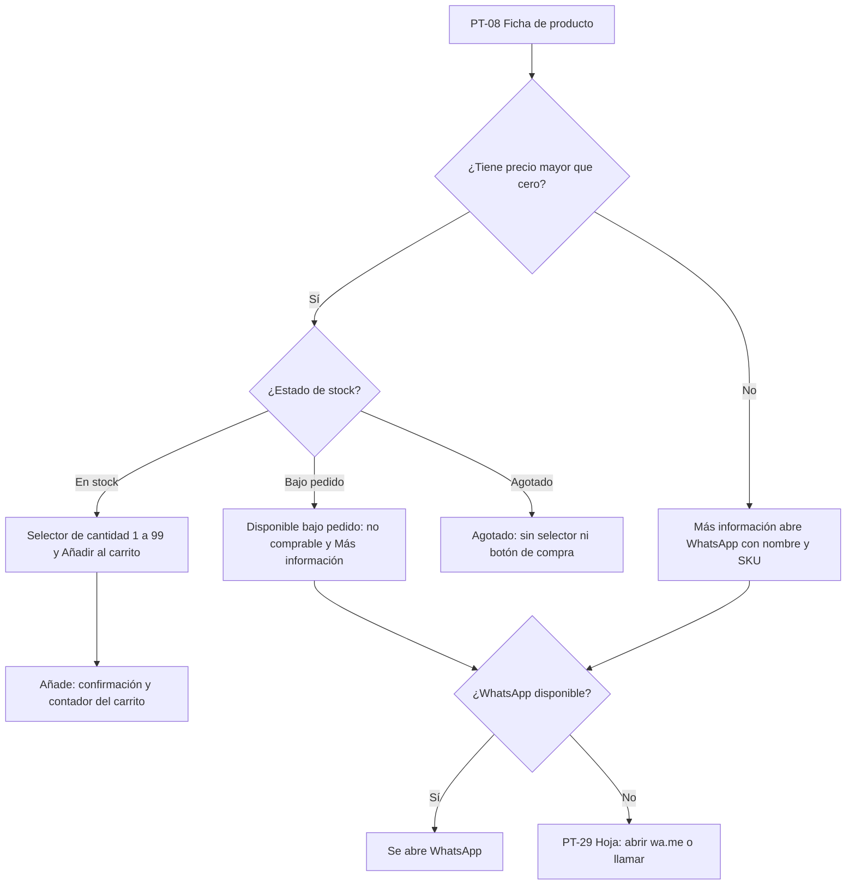

**Wireframes (tres variantes de la misma pantalla PT-08)**

```
A. Con precio y en stock             B. Sin precio                  C. Agotado
+--------------------------+   +--------------------------+   +--------------------------+
| (<)              (Carrito)|   | (<)              (Carrito)|   | (<)              (Carrito)|
| [  galería  < 1 de 4 >  ] |   | [  galería  < 1 de 2 >  ] |   | [  galería  < 1 de 3 >  ] |
| MARCA                     |   | MARCA                     |   | MARCA                     |
| Nombre del producto       |   | Nombre del producto       |   | Nombre del producto       |
| SKU 500-0144              |   | SKU 500-0145              |   | SKU 500-0146              |
| $ 1.234.567               |   | (sin cifra de precio)     |   | $ 1.234.567               |
| IVA incluido · por unidad |   | (En stock)                |   | (Agotado)                 |
| (En stock)                |   |                           |   |                           |
| Cantidad [-] 1 [+]        |   | [ Más información ]       |   | [Añadir al carrito] (no   |
| [ Añadir al carrito ]     |   |   (abre WhatsApp)         |   |   disponible)            |
| Envío a todo Colombia:    |   |                           |   | Este producto está        |
|  valor según transportadora|  | Descripción corta ...     |   | agotado. [Más información]|
| Garantía: ...             |   | Descripción / Atributos   |   | Descripción / Atributos   |
| Descripción corta ...     |   +--------------------------+   +--------------------------+
| Descripción / Atributos   |
+--------------------------+
```

| Aspecto | Diseño | AC / estado |
|---|---|---|
| Galería | Imágenes hasta 4 (muestra revisada); deslizar **y** botones "anterior/siguiente"; indicador textual "Imagen 2 de 4"; sin autoavance; toque abre pantalla completa (PT-09) con cierre explícito; sin imagen: marcador | AC-026-2, AC-026-3; RNF-072 |
| Datos | Nombre, marca, SKU (mono), precio "IVA incluido" por unidad tal como llega del servidor (sin cálculo de IVA en el cliente) | AC-026-1, AC-026-5 |
| Stock | Solo "En stock" o "Agotado"; **sin cantidades ni stock por sede** | AC-026-4 (S-01; D-05 abierta) |
| Con precio y en stock | Selector 1–99 (valor inicial 1; fuera de rango se corrige al límite con mensaje) + "Añadir al carrito"; confirmación visible (snackbar "Producto añadido" + "Ver carrito") y contador actualizado | AC-029-1 a 029-4 |
| Producto ya en el carrito | **[PROPUESTA]** se suma a la cantidad existente con tope 99, informando si se limitó (no se crean líneas duplicadas) | AC-029-5 **[A VALIDAR]** (sumar o reemplazar) |
| Carrito lleno (100 líneas) | No se añade; mensaje del límite | AC-029-6, AC-049-3 |
| Visitante | Puede añadir sin iniciar sesión (el login se exige solo al pagar) | AC-029-7 |
| **Sin precio** | Sin cifra, sin selector, sin "Añadir"; botón **"Más información"** → WhatsApp con nombre y SKU (SKU ausente: solo el nombre, sin "undefined") | RF-030, RF-062; AC-030-1 a 030-5, AC-062-1, AC-062-5 (texto del mensaje **[A VALIDAR]** D-04) |
| **Agotado** | "Agotado" y sin acción de compra (botón ausente o deshabilitado con explicación) | RF-031; AC-031-1, AC-031-2 |
| **Bajo pedido** (`onbackorder`) | Insignia "Disponible bajo pedido"; **no comprable**; ofrece "Más información" | `SUP-H06` (H-06 no aprobada; AC-031-4 **[A VALIDAR]** PA-12) → VAL-13 |
| Avisos de envío y garantía | En fichas con precio: "Valor según transportadora" (texto aprobado por IPR) y garantía (texto literal de Jurídico). **[PROPUESTA]** se omiten en fichas sin precio | AC-032-1, AC-032-2 (**[A VALIDAR]** D-12), AC-032-3 (**[A VALIDAR]**) |
| Descripción | Texto saneado (sin scripts ni contenido activo); formato básico legible; secciones vacías omitidas; descripción corta y larga separadas | AC-027-1 a 027-6 (**[A VALIDAR]** SEC-04) |
| Atributos | Pares nombre-valor como texto; sección omitida si no hay | AC-028-1 a 028-3 (**[A VALIDAR]** D-10) |
| Producto no disponible (404) | "Este producto ya no está disponible." + "Volver" | AC-026-6 |
| Error de red | `ErrorState` con "Reintentar" | AC-026-7 |
| WhatsApp falla | PT-29: **abrir `wa.me`** o **llamar** (el marcador no marca solo) | RF-063; AC-063-1 a 063-5 |

**VAL-06, VAL-13:** comprensión de "Más información" sin precio y de "Disponible bajo pedido".

---

## F06. Registro

**Cubre:** RF-038, RF-039, RF-045, RF-099; AC-038-1 a 038-8, AC-039-1 a 039-7, AC-099-1, AC-099-5, AC-045-1 a 045-8.

> **Dependencia:** AC-038-4 y AC-038-5 siguen **[A VALIDAR]** (inicio de sesión automático tras registrar; mensaje con correo ya registrado). Este diseño asume **`SUP-H03`** (H-03 **no aprobada**): respuesta **uniforme** al registrar + verificación de correo en el MVP. Si H-03 se rechaza, se usa el camino alterno marcado abajo.

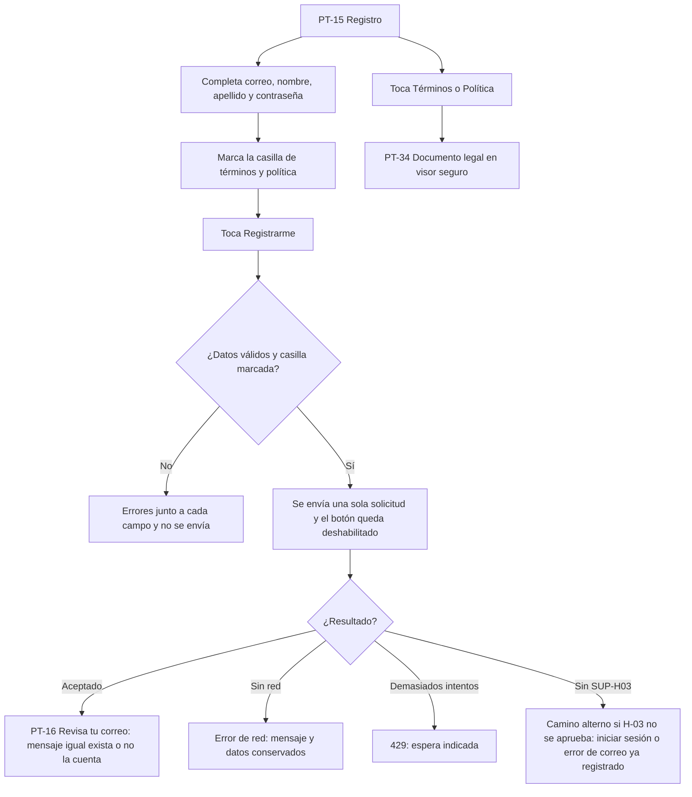

```
PT-15 Registro                         PT-16 Revisa tu correo (SUP-H03)
+------------------------------+      +------------------------------+
| (<) Crear cuenta             |      |          [ilustración]       |
| Correo electrónico           |      |  Revisa tu correo            |
| [ nombre@correo.com        ] |      |  Si los datos son válidos, te|
| Nombre                       |      |  enviamos un enlace para     |
| [                          ] |      |  confirmar tu cuenta.        |
| Apellido                     |      |  [ Abrir mi correo ]         |
| [                          ] |      |  [ Ir a iniciar sesión ]     |
| Contraseña (mínimo 8)        |      +------------------------------+
| [ ********          ] (ojo)  |
| [ ] Acepto los Términos y la |
|     Política de datos        |
|     (enlaces subrayados)     |
| [ Registrarme ]              |
| ¿Ya tienes cuenta? Inicia... |
+------------------------------+
```

| Aspecto | Diseño | AC / estado |
|---|---|---|
| Campos | Correo, nombre, apellido, contraseña (enmascarada, con "Mostrar contraseña"); etiquetas visibles; `autofillHints`; pegado y gestores permitidos | AC-038-1; RNF-073 |
| Validación | Contraseña de 7 caracteres se rechaza, de 8 se acepta; correo inválido o campo vacío: error **en el campo** con cómo corregirlo y sin enviar | AC-038-2, AC-038-3 |
| Aceptación | Casilla **sin marcar por defecto**, con enlaces visibles a términos y política; sin marcarla no se envía y se explica por qué | AC-039-1, AC-039-2 |
| Documentos legales | Se abren en visor seguro/navegador del sistema (sin WebView con acceso a la app). Si no cargan: error con "Reintentar" y **no se acepta un documento que no se pudo ver** (**[A VALIDAR]** D-12: si se permite aceptar sin abrirlo) | AC-099-1, AC-099-7, AC-039-5 |
| Doble toque | Una sola solicitud; botón en carga | AC-038-6 |
| Sin red | Mensaje de falta de conexión; correo, nombre y apellido conservan lo escrito | AC-038-7 |
| Resultado | Respuesta uniforme (no revela si la cuenta existe) → PT-16 | AC-038-5, RF-045; **`SUP-H03`** → VAL-08 |
| Tras registrar | Inicio de sesión automático o pedirlo: **[A VALIDAR]** | AC-038-4 |
| Límite de intentos | Mensaje de espera, botón deshabilitado, sin revelar la existencia de la cuenta | AC-045-1, AC-045-7 |
| Privacidad | La contraseña no se registra en logs ni en almacenamiento | AC-038-8 |
| Versión de términos y registro del consentimiento | Lo define Jurídico | AC-039-3, AC-039-7 **[A VALIDAR]** D-12, PA-10, APR-08 |

---

## F07. Inicio de sesión

**Cubre:** RF-040, RF-041, RF-043, RF-044, RF-045, RF-048; AC-040-1 a 040-9, AC-045-1 a 045-8, AC-048-1, AC-037-3, AC-041-1, AC-044-5.

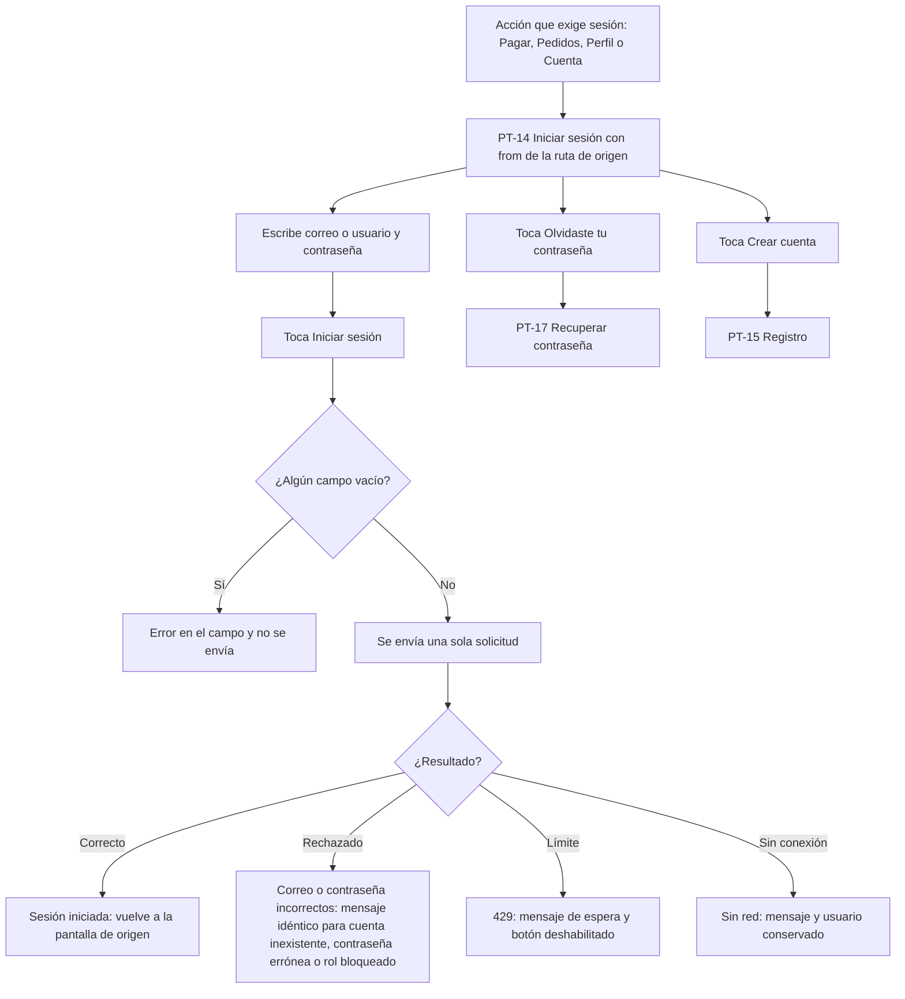

```
PT-14 Iniciar sesión
+------------------------------+
| (<) Iniciar sesión           |
| [Aviso si viene de una       |
|  sesión terminada: “Tu sesión|
|  terminó. Inicia sesión de   |
|  nuevo. Tu carrito sigue     |
|  igual.”]                    |
| Correo o usuario             |
| [                          ] |
| Contraseña                   |
| [ ********          ] (ojo)  |
| [ Iniciar sesión ]           |
| ¿Olvidaste tu contraseña?    |
| ¿No tienes cuenta? Regístrate|
| Términos · Política de datos |
+------------------------------+
```

| Aspecto | Diseño | AC / estado |
|---|---|---|
| Punto de entrada | Guarda de ruta con `from` (lista cerrada de rutas internas, nunca URLs externas); tras iniciar sesión **vuelve a la pantalla desde la que salió**, el inicio de sesión se reemplaza en la pila | AC-040-1; FA §6.1 |
| Campos | Usuario o correo; contraseña enmascarada con "Mostrar/Ocultar" (se vuelve a enmascarar en segundo plano); `autofillHints` | AC-040-8; RNF-073 |
| Validación | Campo vacío: error en el campo, sin petición | AC-040-3 |
| Doble toque | Una sola petición | AC-040-4 |
| Error de credenciales | **Un solo mensaje** "Correo o contraseña incorrectos." para usuario inexistente, contraseña errónea y rol administrativo bloqueado | AC-040-2, AC-048-1 (`SUP-H09`) |
| Límite de intentos | "Demasiados intentos. Espera {tiempo}…"; botón deshabilitado con el tiempo restante; no indica si la cuenta existe | AC-045-1, AC-045-7 (umbrales **[A VALIDAR]** R-02) |
| Sin red | Mensaje de falta de conexión; el usuario se conserva (la contraseña puede limpiarse) | AC-040-5 |
| Sesión terminada | Aviso superior con el carrito intacto | AC-044-5 |
| Seguridad | La contraseña no se guarda ni se registra; los tokens van a Keystore/Keychain | AC-040-6, AC-040-7 |

---

## F08. Recuperación de contraseña

**Cubre:** RF-042, RF-045; AC-042-1 a 042-8, AC-045-3.

> **Dependencia:** el mecanismo (formulario en la app o navegador seguro hacia la página `lost-password` de WordPress) lo define arquitectura (ADR-001 §2, AC-042-2 **[A VALIDAR]**). Se diseñan **ambos** caminos; la pantalla de confirmación es la misma.

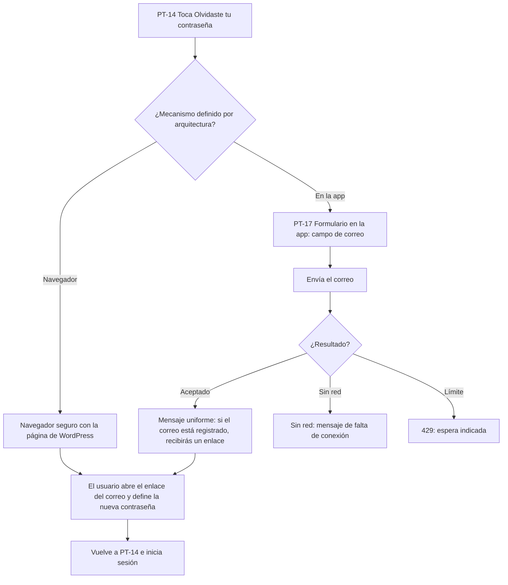

```
PT-17 Recuperar contraseña (camino en la app)
+------------------------------+
| (<) Recuperar contraseña     |
| Escribe el correo de tu      |
| cuenta y te enviaremos un    |
| enlace.                      |
| Correo electrónico           |
| [                          ] |
| [ Enviar enlace ]            |
+------------------------------+
Tras enviar (siempre igual):
| Revisa tu correo. Si está    |
| registrado, te enviamos un   |
| enlace para crear una nueva  |
| contraseña. [ Volver a iniciar sesión ] |
```

| Aspecto | Diseño | AC / estado |
|---|---|---|
| Acceso | Enlace "¿Olvidaste tu contraseña?" visible en la pantalla de inicio de sesión | AC-042-1 |
| Respuesta | **Idéntica** (mensaje, código y pantalla) para correo registrado y no registrado | AC-042-4, AC-045-5 |
| Navegador seguro | Si es vía WordPress, se abre en Custom Tabs / ASWebAuthenticationSession (o el navegador del sistema), **nunca en un WebView propio** | AC-042-3 |
| Límite de intentos | Mensaje de espera | AC-042-5 (**[A VALIDAR]** umbral) |
| Sin red | Mensaje de falta de conexión | AC-042-8 |
| Efecto en otras sesiones al restablecer | Se revocan las demás sesiones (CR-026 recomienda; AC-042-6 sigue **[A VALIDAR]**); la pantalla no promete nada hasta decidirlo | AC-042-6 |
| Vigencia del enlace | Definida por WordPress; el diseño no la anuncia | AC-042-7 **[A VALIDAR]** |

---

## F09. Carrito

**Cubre:** RF-049, RF-050, RF-051, RF-012, RF-031; AC-049-1 a 049-9, AC-050-1 a 050-10, AC-051-1 a 051-5, AC-030-4, AC-031-3, AC-018-5, AC-009-4, AC-009-6.

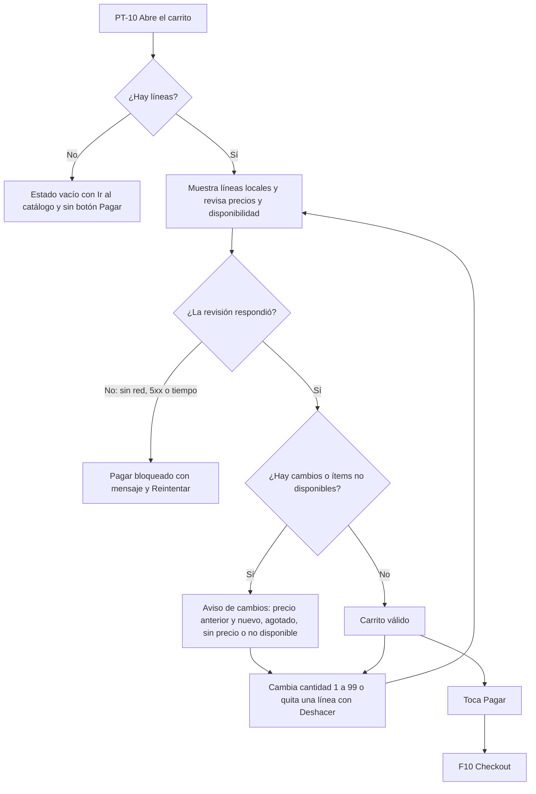

```
PT-10 Carrito (con cambios detectados)
+------------------------------------+
| Carrito                (Ayuda)     |
| [!] Revisamos tu carrito:          |
|  · Producto A: el precio cambió    |
|    de $ 100.000 a $ 105.000        |
|  · Producto C: ahora está agotado  |
|------------------------------------|
| [img] Producto A                   |
|       SKU 500-0144                 |
|       $ 105.000   IVA incluido     |
|       Cantidad [-] 2 [+]  [Quitar] |
| [img] Producto C   (Agotado)       |
|       Quítalo para continuar       |
|                       [Quitar]     |
| [img] Producto D   Más información |
|       (sin precio, no se puede     |
|        pagar)  [Quitar] [WhatsApp] |
|------------------------------------|
| Subtotal informativo (IVA incluido)|
|                          $ 210.000 |
| Impuestos, envío y total final se  |
| confirman al pagar.                |
| Pagarás en un navegador seguro.    |
| [ Pagar ]  <- deshabilitado        |
| Quita los productos agotados o sin |
| precio para continuar.             |
+------------------------------------+
```

| Aspecto | Diseño | AC / estado |
|---|---|---|
| Líneas | Nombre, SKU, precio, cantidad (selector 1–99), "Quitar"; cantidad no baja de 1 ni sube de 99; quitar solo con la acción explícita | AC-049-1, AC-049-2 |
| Quitar | Sin diálogo; snackbar "Producto quitado" + **"Deshacer"** | AC-049-5 |
| Persistencia | El carrito sobrevive a cerrar la app, sin sesión y sin red | AC-049-4, AC-049-8 |
| Límite | 100 líneas: mensaje al intentar la 101 | AC-049-3 |
| Vacío | "Tu carrito está vacío" + "Ir al catálogo"; **no** hay "Pagar" | AC-049-6 |
| Revisión al abrir | Indicador "Revisando precios y disponibilidad…"; el servidor es la autoridad (el precio guardado solo se muestra, nunca se usa para cobrar) | AC-050-1, AC-050-8 |
| Precio cambió | La línea muestra precio anterior y nuevo con aviso visible. ¿Debe confirmarlo el usuario antes de pagar? | AC-050-2 **[A VALIDAR]** |
| Agotado | Línea marcada "Agotado"; "Pagar" deshabilitado mientras exista | AC-050-3, AC-050-4, AC-031-3 |
| Pasó a "sin precio" | Línea sin cifra, no pagable, con "Más información" (WhatsApp); bloquea el pago hasta quitarla | AC-050-5, AC-030-4 |
| Despublicado (404) | Se trata como no disponible, igual que agotado | AC-050-6 |
| La revisión falla | "Pagar" bloqueado con mensaje y "Reintentar" (nunca se paga con datos sin verificar); el carrito se conserva | AC-050-7, AC-009-4 |
| Sin red | El carrito se ve; "Pagar" informa que requiere conexión sin abrir el navegador | AC-009-6, AC-052-8 |
| Resumen | **"Subtotal informativo"** con "IVA incluido"; aviso: impuestos, envío (que el cliente elige en el checkout según transportadora) y total final se confirman al pagar; **no** hay cifra rotulada "Total a pagar" ni envío calculado; ítems sin precio no suman ni muestran "$0" | AC-051-1 a 051-3 |
| Visitante | Ve el carrito completo; el login se pide solo al pagar | AC-051-5, AC-052-1 |
| Botón "Pagar" deshabilitado | Siempre con la **razón visible** debajo | design_system §10.1 |
| Aviso del pago | Línea fija bajo el botón: "Pagarás en un navegador seguro." (no es un diálogo: no gasta la vigencia del ticket de 60 s) | RF-052 |
| Pago pendiente de un intento reciente | Banner "Tienes un pago en verificación" antes de generar otro ticket | AC-057-6 **[A VALIDAR]** PA-11 |

---

## F10. Checkout: apertura del navegador seguro, retorno y resultado

**Cubre:** RF-050 a RF-058; AC-050-1 a 050-10, AC-052-1 a 052-16, AC-053-1 a 053-6, AC-054-1 a 054-5, AC-055-1 a 055-7, AC-056-1 a 056-10, AC-057-1 a 057-9, AC-058-1 a 058-9.

> **Supuestos de este flujo (no aprobados):** `SUP-H02` (retorno por `/app/pedido`, consulta al servidor como única verdad; sondeo 2, 4, 8 y 16 s y luego cada 15 s hasta 120 s, CR-006), `SUP-H10` (sin compra de invitado), `SUP-H06` (bajo pedido no comprable). **DESCONOCIDO:** cómo confirma Wompi el pago a WooCommerce y cómo se evita el doble pago (D-02, PA-11, AC-057-5/-6 **[A VALIDAR]**). Los estados reales de WooCommerce y los medios de pago (PA-12) tampoco están confirmados: las pantallas muestran la **etiqueta que entrega el servidor** cuando el estado no está mapeado (AC-056-8).

### F10.1 Camino principal

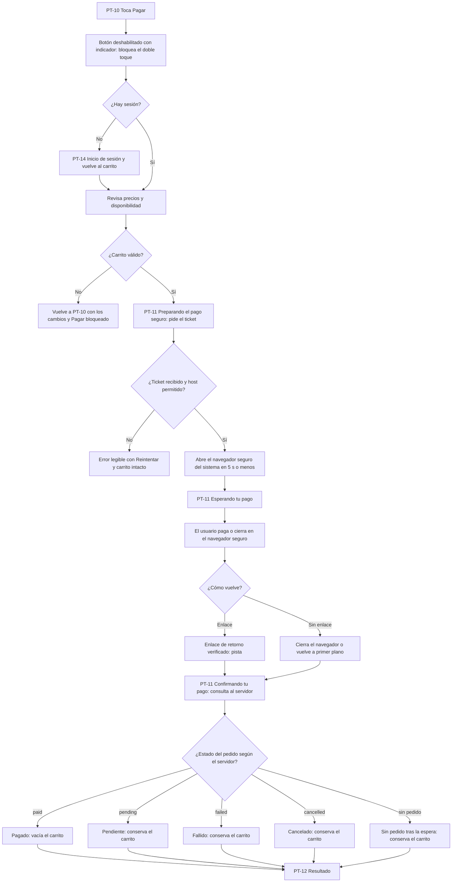

### F10.2 Estados del pago, qué ve el usuario y qué pasa con el carrito

| Estado (FA §6.3) | Pantalla y texto (borrador) | Carrito | Acciones | AC |
|---|---|---|---|---|
| `idle` → toque en "Pagar" | Botón deshabilitado con indicador "Procesando"; **una sola** petición aunque se toque dos veces | Intacto | — | AC-052-6, AC-057-7 |
| `revalidating` | "Revisando precios y disponibilidad…" | Intacto | — | AC-050-1 |
| `needsReview` | Vuelve a PT-10 con la lista de cambios; sin ticket solicitado | Intacto | Ajustar o quitar | AC-052-7, AC-050-3 |
| `requestingTicket` | PT-11: "Preparando el pago seguro…"; **no hay reintento automático del POST**; tiempo máximo en pantalla acotado (límite exacto **[A VALIDAR]**) | Intacto | "Cancelar" | AC-052-16 |
| `ticketExpired` | Un reintento automático invisible; si falla: error con "Reintentar" | Intacto | Reintentar | AC-058-4; RNF-026 |
| `failure` (400 carrito inválido, tienda no disponible, ticket inválido, host no permitido) | "No pudimos abrir el pago. Tu carrito sigue igual." + causa en lenguaje claro ("El carrito no es válido" / "No se pudo conectar con la tienda, inténtalo de nuevo"); **sin** códigos, HTML ni nombres de configuración | Intacto | **Reintentar** (una petición a la vez) | AC-058-1 a 058-9 |
| `openingBrowser` | PT-11: "Abriendo el pago seguro…" (≤ 5 s tras recibir el ticket) | Intacto | — | RNF-013 |
| `awaitingResult` | PT-11: "Completa tu pago en el navegador. Cuando termines, vuelve a la app." con **"Abrir de nuevo el pago"** (genera un ticket nuevo) y "Ya pagué, verificar" | Intacto | Reabrir, verificar, Volver al carrito | AC-055-3 |
| `verifying` | PT-11: "Confirmando tu pago…" con indicador y `liveRegion` | Intacto | "Ver mis pedidos" tras 120 s | AC-056-1 |
| `paid` | PT-12 **Pago confirmado** + número de pedido | **Se vacía** (solo con confirmación del servidor) | Ver pedido · Seguir comprando | AC-056-2, AC-057-1 |
| `pending` | PT-12 **Tu pago está en verificación** (no se presenta como pagado) | **Se conserva** hasta confirmar | Ver mis pedidos · Volver al inicio | AC-056-5, AC-057-3 (**[A VALIDAR]** PA-11) |
| `failed` | PT-12 **El pago no se completó** | **Se conserva** | **Reintentar pago** (nuevo intento) · Ver carrito | AC-056-3, AC-057-2 |
| `cancelled` | PT-12 **Cancelaste el pago** | **Se conserva** | Reintentar pago · Seguir comprando | AC-056-4, AC-057-2 |
| `noOrder` | PT-12 **No encontramos un pedido para este pago** | **Se conserva** | Reintentar pago · Ver mis pedidos | AC-057-8 |
| Servidor no responde al consultar | PT-12 "No pudimos confirmar el estado de tu pedido todavía." con "Reintentar" — **no afirma éxito ni fallo** | Intacto | Reintentar · Ver mis pedidos | AC-056-7 |
| `refunded` / `unknown` (CR-007) | Etiqueta (`statusLabel`) del servidor; **todo lo distinto de `paid` cuenta como no pagado** | Intacto | Ver pedido | AC-056-8 (**[A VALIDAR]** PA-12) |

### F10.3 Wireframes

```
PT-11 Pago en curso                      PT-11 Esperando al usuario
+------------------------------+        +------------------------------+
| Pago seguro      [ Cancelar ]|        | Pago seguro                  |
|                              |        |  [ícono: candado]            |
|        (cargando)            |        | Completa tu pago en el       |
|  Preparando el pago seguro…  |        | navegador. Cuando termines,  |
|                              |        | vuelve a la app.             |
|  Tu carrito no cambia.       |        | [ Ya pagué, verificar ]      |
+------------------------------+        | [ Abrir de nuevo el pago ]   |
                                        | [ Volver al carrito ]        |
                                        +------------------------------+

PT-12 Resultado: Pagado                  PT-12 Resultado: Pendiente
+------------------------------+        +------------------------------+
|        [ícono éxito]         |        |        [ícono reloj]         |
|  Pago confirmado             |        |  Tu pago está en verificación|
|  Tu pedido n.º 12345 quedó   |        |  Aún no recibimos la         |
|  registrado.                 |        |  confirmación. Tu carrito no |
|  [ Ver pedido ]              |        |  se vaciará hasta confirmarlo|
|  [ Seguir comprando ]        |        |  [ Ver mis pedidos ]         |
+------------------------------+        |  [ Volver al inicio ]        |
                                        +------------------------------+
PT-12 Resultado: Fallido / Cancelado
+------------------------------+
|        [ícono alerta]        |
|  El pago no se completó  /   |
|  Cancelaste el pago          |
|  Tu carrito sigue igual.     |
|  [ Reintentar pago ]         |
|  [ Ver carrito ]             |
+------------------------------+
```

### F10.4 Casos especiales

| Caso | Diseño | AC / estado |
|---|---|---|
| **Doble toque en "Pagar"** o toque antes de abrir el navegador | Botón deshabilitado con indicador desde el primer toque; se emite exactamente **una** petición y no más de un ticket por intención | AC-052-6, AC-057-7 |
| **Doble toque en "Reintentar pago"** tras fallo | Cada reintento = un nuevo intento con clave nueva; las pulsaciones durante la petición se ignoran | AC-058-7 |
| **Pedido pendiente reciente** del mismo carrito | Aviso "Tienes un pago en verificación" antes de generar otro ticket (bloquear, advertir o permitir: decisión pendiente) | AC-057-6 **[A VALIDAR]** PA-11, D-02 |
| **Sin sesión al pagar** | Va a inicio de sesión y regresa al carrito con las mismas líneas | AC-052-1, AC-044-11 |
| **Sesión revocada o expirada al pagar** | 401: no se genera ticket; pide iniciar sesión conservando el carrito | AC-052-9, AC-052-10 |
| **Sin red al pagar** | "Para pagar necesitas conexión." sin abrir el navegador | AC-052-8 |
| **Ticket de un solo uso (≈ 60 s)** | Vencido o ya usado: al volver sin pedido, "Reintentar pago" genera ticket nuevo | AC-052-4, AC-058-4 |
| **Host de la URL no permitido** | No se abre; error genérico | AC-052-13 (**[A VALIDAR]** lista de dominios) |
| **App cerrada por el sistema durante el pago** | Al relanzar reanuda en "Confirmando tu pago…" | AC-057-8 |
| **Pago exitoso sin red en la app** | Al recuperar red consulta y vacía el carrito solo tras confirmar | AC-057-4 |
| **Enlace de retorno falsificado o de otro usuario** | El estado lo fija el servidor; error genérico sin revelar si el pedido existe | AC-055-4, AC-055-5, AC-056-6 |
| **Un ítem se agotó entre la revisión y el pago** | WooCommerce muestra su carrito; al volver sin pedido: "Reintentar pago" o ajustar el carrito. Comportamiento exacto **[A VALIDAR]** | AC-058-8 |
| **Datos de pago** | La app **no** captura ni muestra campos de tarjeta; el navegador seguro muestra la dirección del dominio de la tienda | AC-053-1, AC-053-5 |
| **Prellenado** | El correo y los datos de facturación de la cuenta se usan en el checkout; lo faltante se completa allí | RF-054; AC-054-1 a 054-5 |
| **Accesibilidad del checkout externo** | Fuera del control de la app: se prueba con lector de pantalla y zoom 200 % y los hallazgos se reportan al equipo web | RNF-077 |

**VAL-07:** comprensión del cambio al navegador seguro, del estado "pendiente" y de los textos de retorno, con Wompi en modo sandbox (H-12).

---

## F11. Pedidos y detalle

**Cubre:** RF-107, RF-108; AC-107-1 a 107-9, AC-108-1 a 108-6, AC-056-8.

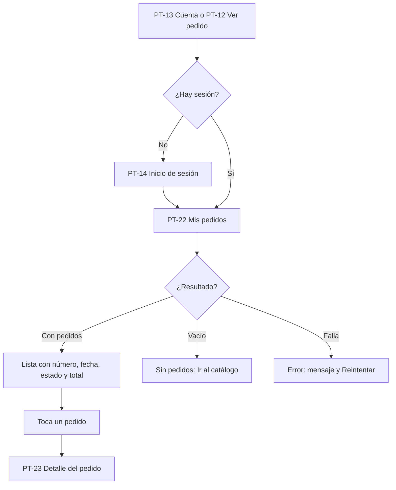

```
PT-22 Mis pedidos                       PT-23 Detalle del pedido
+------------------------------+      +------------------------------+
| (<) Mis pedidos              |      | (<) Pedido n.º 12345         |
| Pedido n.º 12345             |      | (Pagado)    18/11/2026       |
| 18/11/2026   (Pagado)        |      | Productos                    |
| $ 210.000                 >  |      |  Producto A  x2   $ 210.000  |
|------------------------------|      |  Producto B  x1   $  50.000  |
| Pedido n.º 12301             |      | Subtotal           $ 260.000 |
| 02/11/2026 (Pendiente)       |      | Envío / descuento / impuestos|
| $ 85.000                  >  |      |  (solo si el pedido los trae)|
|  ...                         |      | Total              $ 260.000 |
+------------------------------+      | Método de pago: ...          |
                                      +------------------------------+
```

| Aspecto | Diseño | AC / estado |
|---|---|---|
| Lista | Número, fecha `dd/MM/aaaa`, **estado con la etiqueta del servidor** (ícono + texto), total en COP tal como llega (la app no recalcula); orden y tamaño de página | AC-107-1, AC-107-8 (**[A VALIDAR]** AC-107-7: orden y paginación) |
| Vacío | "Aún no tienes pedidos" + "Ir al catálogo" | AC-107-3 |
| Sin sesión | Pide iniciar sesión | AC-107-5 |
| Token vencido | Se renueva o se pide reautenticar sin perder el carrito | AC-107-6 |
| Detalle | Productos con nombre, cantidad y total por línea; subtotal, total y método de pago. **`SUP-H08`** (H-08 no aprobada): muestra además envío, descuento e impuestos **cuando el pedido los trae**, y la imagen si existe; **nunca muestra ceros inventados**. Sin tracking ni dirección (RF-109, fase 2) | AC-108-1, AC-108-2 (CR-053 propone cambiarlo), AC-108-4 |
| Nombres largos | Se ajustan sin desbordar a 360 dp | AC-108-5 |
| Pedido ajeno | Error genérico sin revelar si existe | AC-108-3 |
| Error de carga | `ErrorState` con "Reintentar" | AC-107-9 |
| Datos en memoria | Pedidos solo en memoria; se borran al cerrar sesión | FA §8 |

---

## F12. Perfil, contraseña y direcciones

**Cubre:** RF-104, RF-105, RF-106, RF-041, RF-043, RF-111 (acceso); AC-104-1 a 104-10, AC-105-1 a 105-10, AC-106-1 a 106-8, AC-041-1 a 041-8.

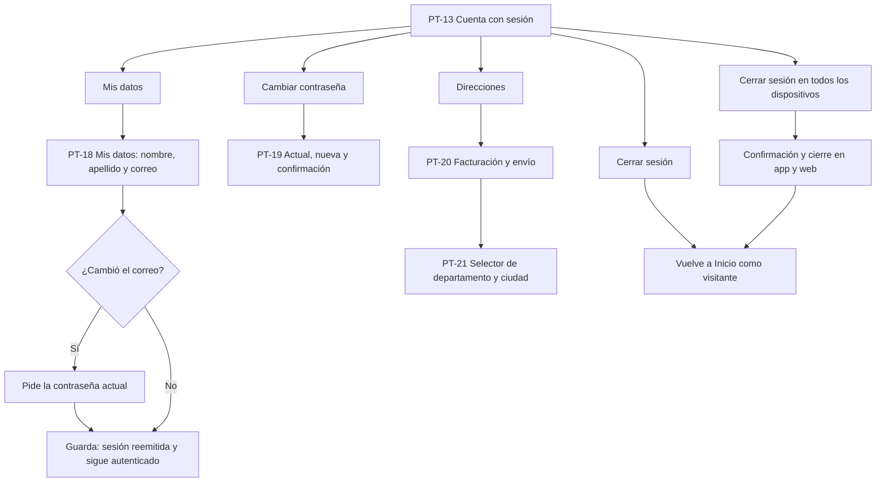

```
PT-13 Cuenta (con sesión)          PT-18 Mis datos                  PT-20 Direcciones
+------------------------+    +------------------------------+  +--------------------------+
| Hola, {nombre}         |    | (<) Mis datos                |  | (<) Direcciones          |
| Mis datos            > |    | Nombre   [               ]   |  | Facturación              |
| Mis pedidos          > |    | Apellido [               ]   |  | Cédula/NIT [          ]  |
| Direcciones          > |    | Correo   [               ]   |  | Nombre / Apellidos [  ]  |
| Cambiar contraseña   > |    | (si cambia el correo:        |  | Dirección  [          ]  |
| Seguridad              |    |  Contraseña actual [      ]) |  | Departamento [elegir >]  |
|  Cerrar sesión en todos|    | [ Guardar cambios ]          |  | Ciudad       [elegir >]  |
|  los dispositivos    > |    +------------------------------+  | Teléfono   [          ]  |
| Ayuda y contacto     > |                                      | Envío  [ ] Igual a factur.|
| Sedes                > |                                      | [ Guardar direcciones ]  |
| Asesoría técnica     > |                                      +--------------------------+
| Documentos legales   > |
| Derechos sobre mis datos|
| Eliminar cuenta      > |
| [ Cerrar sesión ]      |
| Licencias · Versión    |
+------------------------+
```

| Aspecto | Diseño | AC / estado |
|---|---|---|
| Mis datos | Nombre, apellido y correo tal como están en el servidor; guardar con una sola petición (doble toque ignorado) | AC-104-1, AC-104-2, AC-104-8 |
| Cambio de correo | Exige **contraseña actual**; con contraseña errónea, mensaje genérico y el correo no cambia; si es correcto, el token anterior se invalida y la app **reemplaza la sesión sin pedir iniciar de nuevo** | AC-104-3, AC-104-4 |
| Correo ya usado por otra cuenta | Mensaje definido: equilibrio con no revelar existencia de cuentas | AC-104-6 **[A VALIDAR]** PA-02 |
| Sin red | Mensaje de falta de conexión; los cambios escritos se conservan en pantalla sin aplicarse | AC-104-9 |
| Cambiar contraseña | Tres campos enmascarados: actual, nueva (mínimo 8) y confirmación; nueva ≠ confirmación o < 8: error sin petición; éxito: sesión nueva y token anterior invalidado | AC-105-1 a 105-5 |
| Contraseña idéntica a la actual | Comportamiento definido | AC-105-9 **[A VALIDAR]** |
| Efecto en otras sesiones tras cambiar correo/contraseña | Política definida (CR-026 recomienda revocar las demás); la pantalla no lo promete hasta decidirlo | AC-043-6, AC-104-10, AC-105-10 **[A VALIDAR]** |
| Direcciones | Una de facturación y una de envío: cédula/NIT, nombre, apellidos, dirección, departamento, ciudad, teléfono; **solo Colombia**; la ciudad depende del departamento (hoja con buscador PT-21) | RF-106; AC-106-1, AC-106-3 |
| Validación de direcciones | Límites del contrato de la web (cédula/NIT 3–30 con dígitos, guiones o puntos; dirección ≤ 200; teléfono 7–20…); campos obligatorios en el perfil **[A VALIDAR]** | AC-106-2 |
| Reutilización | La dirección guardada prellena el checkout; casilla "Igual a facturación" para no reescribir (WCAG 3.3.7) | AC-106-4; RNF-073 |
| Datos personales | **No** se guardan copias sin cifrar en el dispositivo; perfil y direcciones solo en memoria | AC-106-5, AC-041-4 |
| Cerrar sesión | Sin diálogo (reversible); revoca en el servidor; vuelve a Inicio como visitante; **carrito se conserva** (`SUP-H07`); sin red: se cierra localmente y se reintenta la revocación (AC-041-6 **[A VALIDAR]**) | AC-041-1 a 041-8 |
| Cerrar en todos los dispositivos | Ítem de "Seguridad" **con diálogo de confirmación** ("Cerrarás tu sesión en la app y en la web. ¿Continuar?"); la lista de dispositivos es fase 2 (RF-112) | `SUP-H05` (H-05 no aprobada) |
| Cambios sin guardar | Atrás con datos modificados pide "¿Descartar los cambios?" | navigation.md §9 |
| Capturas de pantalla | Se oculta el contenido en el selector de apps en Cuenta, Pedidos y Checkout (Should) | RNF-035 |

---

## F13. Eliminación de cuenta (y derechos del titular)

**Cubre:** RF-110, RF-111; AC-110-1 a 110-16, AC-111-1 a 111-5, AC-SEC-11.

> **Supuestos y pendientes:** `SUP-H11` (H-11, jurídica, **no aprobada**: sin periodo de gracia, supresión ≤ 15 días hábiles, retención contable fijada por Jurídico); `SUP-H07` (el carrito se borra al eliminar la cuenta). **Los textos de qué se elimina, qué se conserva y por cuánto tiempo los fija Jurídico (APR-08, PA-09, D-12)**: no se inventa ningún plazo ni retención en este documento. Comportamiento con pedido pendiente: **[A VALIDAR]** AC-110-8. Reingreso con el mismo correo: **[A VALIDAR]** AC-110-6.

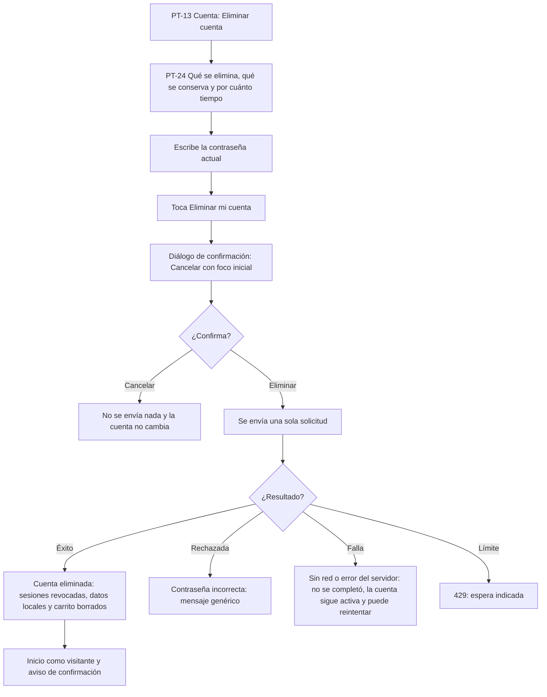

```
PT-24 Eliminar cuenta                 Diálogo de confirmación
+------------------------------+     +------------------------------+
| (<) Eliminar cuenta          |     | ¿Eliminar tu cuenta?         |
| Antes de continuar           |     | Esta acción no se puede      |
|  · Qué datos se eliminan:    |     | deshacer. [Resumen del texto |
|    [texto de Jurídico]       |     | aprobado por Jurídico]       |
|  · Qué datos se conservan y  |     |                              |
|    por cuánto tiempo:        |     | [ Cancelar ] [Eliminar cuenta]|
|    [texto de Jurídico]       |     +------------------------------+
|  · Tus pedidos: [Jurídico]   |      (foco inicial en Cancelar)
| Para confirmar escribe tu    |
| contraseña actual            |
| [ ********          ] (ojo)  |
| [ Eliminar mi cuenta ]  <-   |
|   destructivo, deshabilitado |
|   hasta escribir la clave    |
+------------------------------+
```

| Aspecto | Diseño | AC / estado |
|---|---|---|
| Acceso | "Eliminar cuenta" accesible **desde Cuenta** (sin pasos ocultos) | AC-110-1 |
| Información previa | Qué se elimina, qué se conserva y por cuánto tiempo (**texto de Jurídico**), y qué pasa con los pedidos | AC-110-2, AC-110-7 **[A VALIDAR]** PA-09, D-12 |
| Doble confirmación | Contraseña actual **y** diálogo final (no se elimina con un solo toque); el botón destructivo está deshabilitado hasta escribir la contraseña | AC-110-2, AC-110-3 (la reautenticación es **[A VALIDAR]**: propuesta de PA nueva) |
| Cancelar | Sin petición y sin cambios | AC-110-11 |
| Doble toque | Una sola solicitud | AC-110-10 |
| Contraseña incorrecta | Mensaje genérico; límite de intentos | AC-110-14 **[A VALIDAR]** R-02 |
| Éxito | Sesiones de **todos** los dispositivos revocadas; tokens y datos locales borrados; vuelve a Inicio como visitante; aviso "Tu cuenta fue eliminada." (el texto sobre plazos lo fija Jurídico) | AC-110-4 (eliminación inmediata o diferida **[A VALIDAR]** PA-09), AC-SEC-11 |
| Error o sin red | "No pudimos eliminar tu cuenta. Sigue activa; intenta de nuevo." La app **no** queda en estado ambiguo | AC-110-9 |
| Pedido pendiente | Regla (bloquear, advertir o permitir) pendiente | AC-110-8 **[A VALIDAR]** |
| Tras eliminar, iniciar sesión | Falla con el mismo mensaje genérico | AC-110-5 |
| Exigencia de las tiendas | Debe poder hacerse dentro de la app (verificar guías vigentes) | AC-110-16, S-05 |

### Derechos sobre mis datos (PT-25)

| Aspecto | Diseño | AC / estado |
|---|---|---|
| Acceso | Ítem **"Derechos sobre mis datos"** en Cuenta | AC-111-1 |
| Contenido | Explica consulta, rectificación y supresión; indica que **la supresión de la cuenta puede hacerse directamente desde la app** (enlace a PT-24); canal de solicitud definido por IPR (correo, formulario o PQRS con tipo prellenado) | AC-111-2, AC-111-3 **[A VALIDAR]** D-12 (canal vigente DESCONOCIDO) |
| Datos solicitados | Solo los necesarios; no se guardan en el dispositivo tras el envío | AC-111-4 |
| Sin red | Mensaje y se conserva lo escrito | AC-111-5 |

**VAL-11:** comprensión de qué se conserva y qué se elimina.

---

## F14. Calculadora BTU

**Cubre:** RF-085 a RF-089, RF-006, RF-080; AC-085-1 a 085-7, AC-086-1 a 086-5, AC-087-1 a 087-3, AC-088-1 a 088-4, AC-089-1 a 089-5.

> **Toda la épica K está condicionada a D-08** (Ingeniería IPR debe validar fórmula, rangos y texto de descargo, APR-07). **Sin esa validación el módulo sale del MVP y el acceso de Inicio no se muestra** (AC-006-2). Los números de los wireframes son **ilustrativos** (calculados con la fórmula de COD §6, no validada) y no deben publicarse como datos.

> **Hallazgo en el código web de referencia (a conciliar en D-08):** la lógica implementada (`btu-fields.tsx`, `calcular()`: área × 600, recargo por altura, ocupantes, clima ×1,00/1,05/1,15, equipos × 600; 3 climas: frío, templado, cálido) **no coincide** con el texto de ayuda "¿Cómo calculamos?" de `BtuCalculator.tsx` ("230 × volumen + 476 × (ocupantes + equipos)" y 4 climas: Fresco −10 %, Templado, Cálido +10 %, Muy cálido +20 %). **La app no publica ningún texto "¿Cómo calculamos?" hasta que Ingeniería lo valide.**

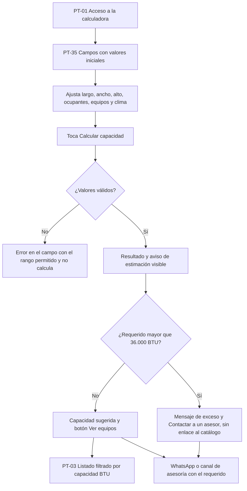

```
PT-35 Calculadora BTU
+------------------------------------+
| (<) Calculadora BTU                |
| Largo (m)       [-]  5,0  [+]  1-15|
| Ancho (m)       [-]  4,0  [+]  1-15|
| Alto (m)        [-]  2,5  [+]  2-4 |
| Ocupantes       [-]   2   [+]  1-10|
| Equipos         [-]   1   [+]  0-10|
| Clima                              |
|  (•) Frío  <19 °C                  |
|  ( ) Templado 19–25 °C             |
|  ( ) Cálido >25 °C                 |
| [ Calcular capacidad ]             |
|------------------------------------|
| Resultado (ilustrativo)            |
| Potencia requerida   13.200 BTU    |
| Capacidad sugerida   18.000 BTU    |
| [i] Este resultado es una          |
|  estimación. [Texto aprobado por   |
|  Ingeniería IPR]                   |
| [ Ver equipos de 18.000 BTU ]      |
| [ Hablar con un asesor ]           |
+------------------------------------+
```

| Aspecto | Diseño | AC / estado |
|---|---|---|
| Campos | Largo, ancho, alto, ocupantes, equipos y clima. **Campos numéricos con botones − y +** (48 dp) en lugar de *sliders* (la web usa *sliders*; el arrastre exige alternativa de un toque, WCAG 2.5.7). Pasos: 0,5 m (largo y ancho), 0,1 m (alto), 1 (ocupantes y equipos) | AC-085-1; RNF-072 → VAL-09 |
| Rangos | Largo y ancho 1–15 m, alto 2–4 m, ocupantes 1–10, equipos 0–10; valores fuera de rango: error en el campo con el rango ("El alto debe estar entre 2 y 4 m."); vacío o no numérico no calcula | AC-085-2, AC-085-3 |
| Enteros | Ocupantes y equipos solo enteros | AC-085-4 **[A VALIDAR]** D-08 |
| Decimales | Acepta coma y punto con el mismo resultado; muestra coma (es-CO) | AC-085-5 **[A VALIDAR]** |
| Valores iniciales | Como la web: 5 × 4 × 2,5 m, 2 ocupantes, 1 equipo, clima templado | AC-085-6 **[A VALIDAR]** D-08 |
| Clima | Selección única con **texto** y rango de temperatura (no solo color); etiquetas finales las aprueba Ingeniería | RNF-076; APR-07 |
| Resultado | Se muestra al tocar "Calcular"; el foco pasa al título del resultado y se anuncia: "Resultado: potencia requerida 13.200 BTU, capacidad sugerida 18.000 BTU" | RNF-070 |
| Capacidad sugerida | Menor capacidad comercial **≥** requerida entre 9.000, 12.000, 18.000, 24.000 y 36.000 BTU (T2 y T8 sugieren la misma capacidad: criterio ≥) | AC-086-1, AC-086-2, AC-088-4 (valores esperados **[A VALIDAR]** D-08) |
| **Aviso de estimación** | Visible **en la misma pantalla del resultado**, sin acción adicional, también cuando no hay capacidad sugerida. Texto final **de Ingeniería** (el de la web hoy: "Este resultado es una estimación. Para mayor seguridad, confírmalo con un asesor o un ingeniero de IPR antes de comprar.") | AC-087-1 a 087-3 **[A VALIDAR]** APR-07 |
| **Más de 36.000 BTU** | "El espacio supera la capacidad máxima que podemos sugerir (36.000 BTU)." + **"Contactar a un asesor"**; **no** muestra "0 BTU", vacío ni "undefined"; **no** se ofrece el enlace al catálogo | AC-088-1, AC-088-3, AC-089-4 |
| Contactar a un asesor | Abre el canal de asesoría (WhatsApp de asesoría general mientras PA-06 no confirme un canal de ingeniería); incluir el requerido en el mensaje **[A VALIDAR]** | AC-088-2; RF-080 |
| Ver equipos | Abre PT-03 filtrado por "capacidad BTU = capacidad sugerida", filtro visible y quitable; sin productos: estado vacío con WhatsApp | AC-089-1 a 089-3, AC-089-5 (**[A VALIDAR]** D-10) |
| Sin red | El cálculo funciona sin red (lógica local); "Ver equipos" requiere red | AC-085-7; FA §9 |
| Sin sesión | Funciona sin autenticación | AC-085-7 |

---

## F15. Sedes

**Cubre:** RF-072 a RF-075; AC-072-1 a 072-6, AC-073-1 a 073-4, AC-074-1 a 074-5, AC-075-1 a 075-5.

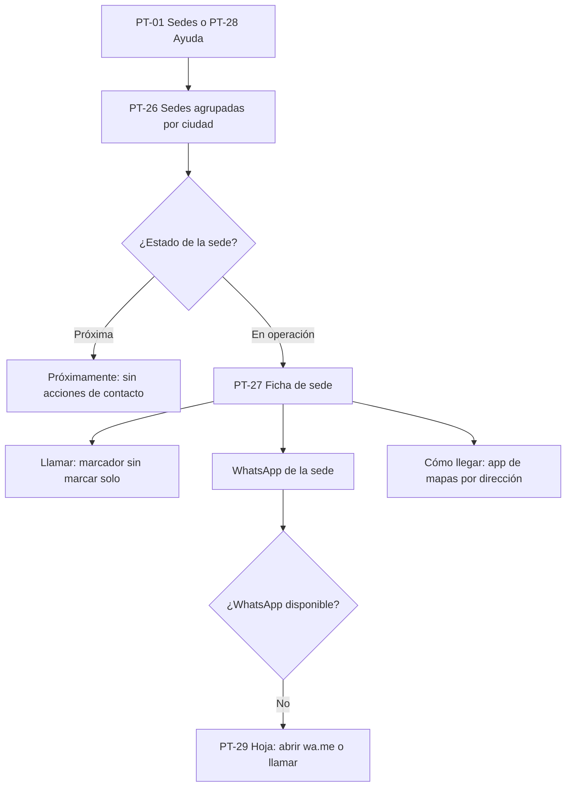

```
PT-26 Sedes                            PT-27 Ficha de sede
+------------------------------+      +------------------------------+
| (<) Sedes                    |      | (<) {Nombre de la sede}      |
| Bogotá                       |      | [ imagen o marcador ]        |
|  Sede A                    > |      | Dirección                    |
|  Sede B                    > |      |  {dirección}                 |
| Medellín                     |      | Teléfonos                    |
|  Sede C                    > |      |  PBX / fijo:        [Llamar] |
| Cartagena                    |      |  Ventas repuestos:  [Llamar] |
|  Sede D  (Próximamente)      |      |  Ventas aire acond.:[Llamar] |
|  ...                         |      | [ Escribir por WhatsApp ]    |
+------------------------------+      | [ Cómo llegar ]              |
(Total y ciudades: las de la fuente;  +------------------------------+
 cifras 31/32 sedes, D-07)             (se omite lo que no exista)
```

| Aspecto | Diseño | AC / estado |
|---|---|---|
| Listado | Agrupado por ciudad con encabezados (semántica de encabezado); el total coincide con la fuente; sin grupos vacíos. Cifras (31 sedes en 9 ciudades frente a 32) **[A VALIDAR]** D-07, D-09 | AC-072-1, AC-072-6 |
| Próximamente | Etiqueta "Próximamente" y **sin** llamar, WhatsApp ni "Cómo llegar" | AC-072-2, AC-074-5 |
| Ficha | Nombre, dirección, teléfonos (fijo/PBX, ventas de repuestos, ventas de aire acondicionado), WhatsApp e imagen; **se omiten** los datos ausentes (sin etiquetas vacías ni "null"); marcador si no hay imagen | AC-073-1 a 073-3 |
| Solo canales corporativos | **Ninguna** persona (nombres de empleados, celulares personales) | AC-073-4 **[A VALIDAR]** D-09, D-12 |
| Llamar | Abre el marcador con el número, **sin marcar automáticamente**; sin telefonía: mensaje claro | AC-074-1; AC-063-5 |
| WhatsApp | Abre WhatsApp con el número de la sede; sin WhatsApp: PT-29; sin número en la fuente: no se muestra el botón | AC-074-2 a 074-4 |
| Cómo llegar | Abre mapas con búsqueda por **texto de dirección** (codificada); sin app de mapas: navegador. **No pide permiso de ubicación**; la precisión es limitada (sin coordenadas) | AC-075-1 a 075-5; RF-077 y RF-078 son fase 2 |
| Sin red | Sedes en caché (fresco 24 h, obsoleto hasta 30 días) con `StaleBanner`; llamar y mapas usan apps del sistema | FA §7.4, §9; AC-072-5 |
| Datos | Vienen del BFF (no hay lista fija en la app); un campo ausente no rompe la ficha | AC-076-2, AC-076-4 |

**VAL-14:** lista por ciudad frente a buscador; orden de acciones.

---

## F16. Ayuda, WhatsApp, asesoría técnica y PQRS

**Cubre:** RF-062 a RF-065, RF-079, RF-080, RF-094 a RF-097, RF-099; AC-062-1 a 062-6, AC-063-1 a 063-5, AC-064-1 a 064-4, AC-065-1 a 065-6, AC-079-1 a 079-5, AC-080-1 a 080-4, AC-094-1 a 094-5, AC-095-1 a 095-4, AC-096-1 a 096-12, AC-099-1 a 099-7.

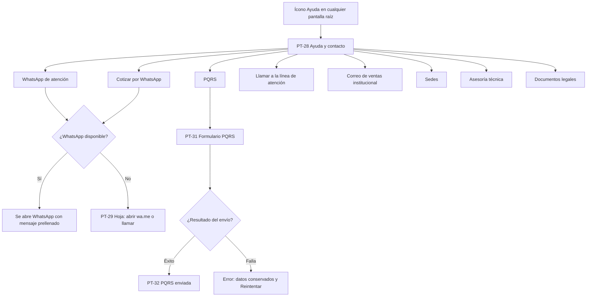

```
PT-28 Ayuda y contacto                  PT-29 Contacto alternativo (hoja)
+------------------------------+       +------------------------------+
| (<) Ayuda y contacto         |       | WhatsApp no está disponible  |
| [ Hablar con un asesor     ] |       | Puedes contactarnos así:     |
| [ Cotizar por WhatsApp     ] |       | [ Abrir WhatsApp Web ]       |
| Otros canales                |       | [ Llamar a la línea de       |
|  Enviar una PQRS           > |       |   atención ]                 |
|  Llamar a atención         > |       | [ Cerrar ]                   |
|  Escribir a ventas         > |       +------------------------------+
|  Sedes                     > |
|  Asesoría técnica          > |
|  Documentos legales        > |
| (sin nombres ni celulares de |
|  personas)                   |
+------------------------------+
```

```
PT-31 Formulario PQRS                        PT-32 PQRS enviada
+------------------------------+            +------------------------------+
| (<) PQRS                     |            |        [ícono éxito]         |
| Tipo                         |            |  Recibimos tu solicitud      |
| (•) Petición ( ) Queja       |            |  [Texto aprobado, p. ej.     |
| ( ) Reclamo  ( ) Sugerencia  |            |  “Su solicitud fue enviada   |
| Nombre (3 a 120)             |            |  correctamente…”]            |
| [                          ] |            |  [ Volver a Ayuda ]          |
| Correo                       |            +------------------------------+
| [                          ] |
| Celular (7 a 20)             |
| [                          ] |
| Pedido o factura (opcional)  |
| [                          ] |
| Mensaje              0/1.000 |
| [                          ] |
| Al enviar aceptas la Política|
| de datos [enlace]            |
| [ Enviar ]                   |
+------------------------------+
```

| Aspecto | Diseño | AC / estado |
|---|---|---|
| Ayuda y contacto | Agrupa WhatsApp, cotizar por WhatsApp, PQRS, teléfono de atención, correo de ventas institucional y sedes; **sin nombres, celulares ni correos de personas** | AC-095-1 a 095-4 |
| WhatsApp de atención | Mensaje prellenado institucional; número y texto **[A VALIDAR]** PA-07; **no se promete tiempo de respuesta** | AC-094-1 a 094-5 |
| Cotizar por WhatsApp | Mensaje de cotización de proyecto o volumen (texto **[A VALIDAR]**) | AC-064-1 a 064-4 |
| "Más información" (fichas sin precio) | Mensaje con **nombre y SKU**, codificado; SKU ausente: solo nombre; intenta abrir WhatsApp aunque no haya red del BFF | AC-062-1 a 062-6 |
| WhatsApp no disponible | PT-29: abrir `wa.me` en el navegador (conserva el mensaje) o llamar (marcador sin marcar solo). La detección en Android 11+ e iOS no debe dar falsos negativos | AC-063-1 a 063-5 |
| Medición de "Más información" | Un evento agregado por toque, **sin datos personales**; WhatsApp se abre igual aunque el evento falle o falte consentimiento | AC-065-1 a 065-6 (**[A VALIDAR]** PA-08, D-12) |
| Asesoría técnica (PT-30) | Contenido informativo de ingeniería de aire acondicionado y refrigeración (texto sin contenido activo) + acción de contacto por **canal corporativo** (WhatsApp de asesoría general mientras PA-06 no confirme otro); sin nombres ni contactos de ingenieros | AC-079-1 a 079-5, AC-080-1 a 080-4 (**[A VALIDAR]** fuente del contenido; PA-06) |
| PQRS: campos | Tipo (petición, queja, reclamo, sugerencia), nombre, correo, celular, pedido/factura (opcional), mensaje con contador | AC-096-1 |
| PQRS: límites | Nombre 3–120; correo válido ≤ 254; celular 7–20 sin letras; pedido/factura ≤ 60; mensaje 1–1.000 (con 1.000 no admite más caracteres; contador 1.000/1.000) | AC-096-2, AC-096-3 |
| PQRS: envío | Una sola solicitud (botón en carga); confirmación al éxito y formulario limpio | AC-096-4, AC-096-5 |
| PQRS: errores | Sin red: mensaje y **todo lo escrito se conserva**, no se presenta como enviado. 500: "No se pudo enviar, intenta más tarde." y datos conservados. 429: "Demasiadas solicitudes, inténtalo de nuevo en unos minutos." (límite y anti-spam adicional **[A VALIDAR]**) | AC-096-6 a 096-8 |
| PQRS: privacidad | Aviso o enlace a la política de datos antes del envío (**[A VALIDAR]** D-12 si exige aceptación); **no** se guardan nombre, correo, teléfono ni mensaje tras el envío ni en logs | AC-096-11, AC-096-12 |
| Documentos legales (PT-33, PT-34) | Lista de términos, política de datos y demás publicadas; se abren en navegador seguro o visor sin scripts; error con "Reintentar"; versión vigente **[A VALIDAR]** D-12; URL pública de privacidad para las tiendas | AC-099-2 a 099-7 |
| Sin sesión | Todo funciona sin autenticación | AC-094-5, AC-095-4, AC-096-10 |

---

## F17. Errores de red y sesión expirada

**Cubre:** RF-009, RF-044, RF-045, RF-050, RF-052; AC-009-1 a 009-7, AC-044-3 a 044-7, AC-043-4, AC-045-1, AC-052-8/-9/-10, AC-107-6; RNF-020 a RNF-027.

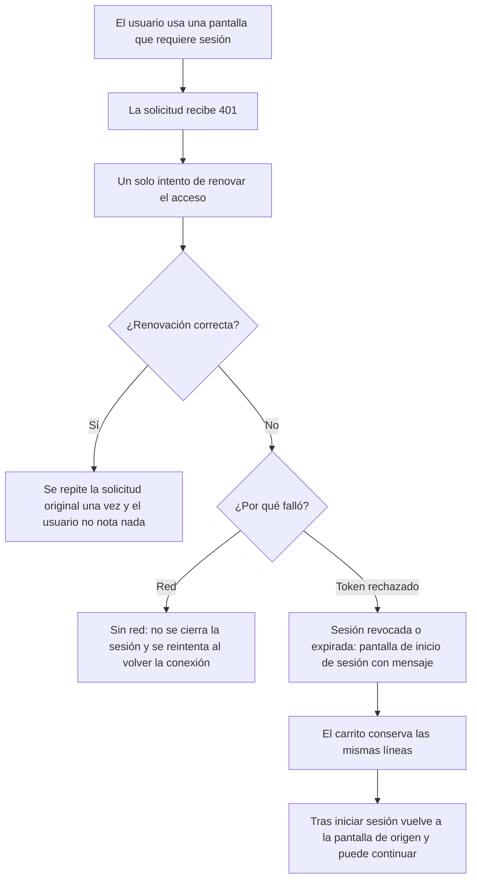

### Matriz de errores (cada pantalla de contenido hereda esta tabla)

| Situación | Qué ve el usuario | Qué se conserva | Acción | AC |
|---|---|---|---|---|
| **Sin red al cargar** | Mensaje no técnico: "No tienes conexión. Revisa tu internet." + "Reintentar"; con caché: contenido guardado + `StaleBanner`. Aviso no bloqueante ≤ 3 s tras detectar fallos | Carrito y datos en caché | Reintentar sin reiniciar la app | AC-009-1, AC-009-3; RNF-020 |
| **Error de servidor (5xx), tiempo agotado o servicio caído** | "La tienda no está disponible en este momento." / "La respuesta está tardando. Intenta de nuevo." | Carrito | Reintentar (la espera respeta `Retry-After`) | AC-009-2 |
| **Falla la página N de un listado** | Pie de lista con "Reintentar" | Páginas 1 a N−1, sin duplicar ni perder ítems | Reintentar solo esa página | AC-009-5, AC-011-6 |
| **Falla una búsqueda o un filtro** | Error con "Reintentar"; **no** "sin resultados" | Listado y filtros previos | Reintentar | AC-009-7, AC-013-5, AC-023-5 |
| **Falla solo un bloque del inicio** | El bloque muestra error; el resto opera | Todo lo demás | Reintentar bloque | AC-003-4 |
| **Carrito sin red** | Se ve; "Pagar" informa que requiere conexión | Carrito | — | AC-009-6, AC-052-8 |
| **Falla la revisión del carrito** | "Pagar" bloqueado con "Reintentar" | Carrito | Reintentar | AC-050-7 |
| **Formularios sin red** (registro, login, PQRS, perfil, direcciones, derechos) | Mensaje de falta de conexión | **Lo escrito** (en login la contraseña puede limpiarse) | Reintentar | AC-038-7, AC-040-5, AC-096-7, AC-104-9, AC-106-8, AC-111-5 |
| **Límite de intentos (429)** | "Demasiados intentos. Espera {tiempo}…" con botón deshabilitado | Lo escrito | Esperar | AC-045-1, AC-096-6 |
| **Sesión expirada o revocada** | "Tu sesión terminó. Inicia sesión de nuevo." | **Carrito intacto** | Iniciar sesión y volver al origen | AC-044-5, AC-043-4, AC-044-11 |
| **Sin red al renovar** | No se cierra la sesión ni se borran tokens | Todo | Reintenta al volver la red | AC-044-7 |
| **Varias solicitudes con el acceso vencido** | Una sola renovación en vuelo | — | Transparente | AC-044-6 |
| **Producto despublicado (404)** | "Este producto ya no está disponible." | — | Volver | AC-026-6 |
| **Bloqueo del WAF (Cloudflare)** | "No pudimos verificar la conexión. Intenta más tarde." | Carrito | Reintentar más tarde | FA §7.3; R-02 |
| **Error de contrato / desconocido** | "Algo salió mal. Intenta de nuevo." (sin trazas ni códigos) | Carrito | Reintentar | RNF-027 |
| **Versión obsoleta** | PT-36 bloqueante | — | Actualizar | RNF-029 |

**Regla de oro:** ningún fallo de red, tiempo, 503 ni 500 borra datos locales (carrito) ni cierra la sesión (FA §7.3). La interfaz nunca muestra HTML crudo, trazas, URLs internas ni mensajes sin traducir (AC-058-6).

---

## 18. Trazabilidad flujo → requisitos y criterios

| Flujo | RF | AC principales |
|---|---|---|
| F01 | RF-037, RF-065 | AC-037-1, AC-037-2, AC-065-3, AC-SEC-10 |
| F02 | RF-001 a RF-007, RF-009 | AC-001-1 a 009-7 (épica A) |
| F03 | RF-020 a RF-023 | AC-020-1 a 023-6 |
| F04 | RF-010 a RF-016, RF-018, RF-019 | AC-010-1 a 019-6 |
| F05 | RF-026 a RF-032, RF-062, RF-063 | AC-026-1 a 032-3, AC-062-1 a 063-5 |
| F06 | RF-038, RF-039, RF-045, RF-099 | AC-038-1 a 039-7, AC-099-1 |
| F07 | RF-040, RF-045, RF-048 | AC-040-1 a 040-9, AC-045-1 a 045-8, AC-048-1 |
| F08 | RF-042, RF-045 | AC-042-1 a 042-8 |
| F09 | RF-049 a RF-051 | AC-049-1 a 051-5 |
| F10 | RF-050 a RF-058 | AC-052-1 a 058-9 |
| F11 | RF-107, RF-108 | AC-107-1 a 108-6 |
| F12 | RF-104 a RF-106, RF-041 | AC-104-1 a 106-8, AC-041-1 a 041-8 |
| F13 | RF-110, RF-111 | AC-110-1 a 111-5 |
| F14 | RF-085 a RF-089 | AC-085-1 a 089-5 |
| F15 | RF-072 a RF-075 | AC-072-1 a 075-5 |
| F16 | RF-062 a RF-065, RF-079, RF-080, RF-094 a RF-096, RF-099 | AC-062-1 a 099-7 |
| F17 | RF-009, RF-044, RF-045 | AC-009-1 a 009-7, AC-044-3 a 044-7 |

**Requisitos del MVP sin pantalla propia (comportamiento o backend):** RF-019, RF-041, RF-043, RF-044, RF-048, RF-053, RF-076, RF-097 (se reflejan en los flujos, no en una pantalla).

---

## 19. Validación de los diagramas Mermaid

Los diagramas Mermaid de este documento son `flowchart TD` con identificadores alfanuméricos, etiquetas entre comillas y sin subgrafos. Se validaron con `mermaid.parse()`. La validación comprueba solo sintaxis, no legibilidad visual.

**Resultado (2026-11-18):** motor `mermaid@11.17.2` bajo Node v24.20.0 con `jsdom@26.1.0` (`mermaid.parse()`), instalación aislada fuera del proyecto. **18 bloques analizados (17 flujos en este archivo + el mapa del sitio de `navigation.md`): 18 válidos, 0 fallos, 0 correcciones.** Control de la herramienta: `parse()` rechaza sintaxis incorrecta (comprobado con diagramas inválidos antes de esta validación), por lo que el resultado es significativo. No se evaluó el render visual.

---

## 20. Clasificación del contenido de este documento

| Tipo | Dónde |
|---|---|
| **Hechos** | Rangos, límites, mensajes citados de AC; hallazgo de la calculadora web; comportamientos documentados en FA y DF |
| **Supuestos** | `SUP-H02`, `SUP-H03`, `SUP-H05`, `SUP-H06`, `SUP-H07`, `SUP-H08`, `SUP-H09`, `SUP-H10`, `SUP-H11` (todos basados en recomendaciones **no aprobadas**) |
| **Propuestas** | Estructura de pantallas, textos, "sin onboarding", dos botones de WhatsApp en Inicio, campos con − y + en la calculadora, variantes de PT-24 |
| **Pendientes** | Marcados **[A VALIDAR]** (arrastrados de los AC), APR-nn y VAL-nn (registro en design_system.md §17) |
