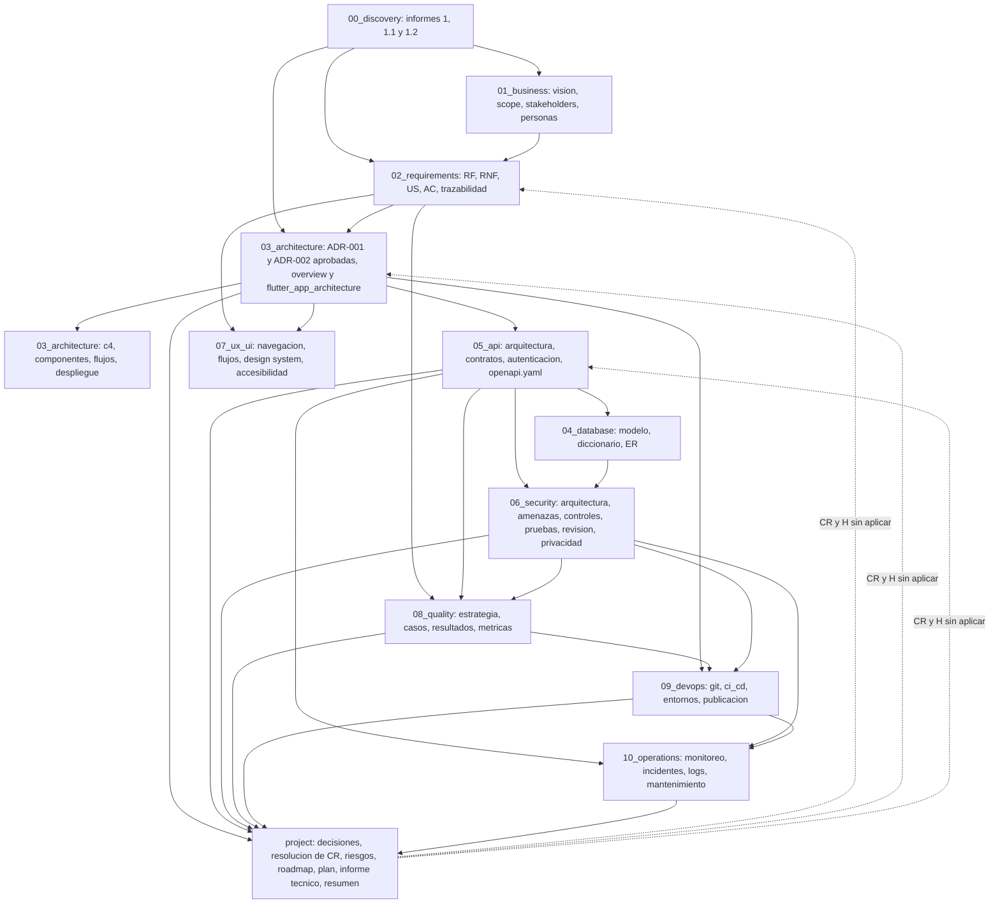

# Documentación del proyecto — App móvil IPR Partes y Repuestos

| | |
|---|---|
| **Proyecto** | App móvil Flutter (Android/iOS) de IPR Partes y Repuestos (Inverprimos S.A.S.) |
| **Fecha del índice** | 2026-11-19 |
| **Estado** | BORRADOR. Índice de toda la documentación de `docs/` (58 archivos: 57 `.md` y `openapi.yaml`). |
| **Informe para ingeniería** | [project/informe_tecnico.md](project/informe_tecnico.md) (incluye la **tabla de verdad** con cifras recontadas por script) |
| **Resumen para la Gerencia** | [project/resumen_ejecutivo.md](project/resumen_ejecutivo.md) |

> ## ADVERTENCIA — leer antes de usar cualquier documento
> 1. **Todos los documentos están pendientes de aprobación humana.** Solo constan como aprobadas por el solicitante (2026-11-18): **ADR-001** (BFF `/mobile/v1`, = D-01), **ADR-002** (alcance del MVP) y las decisiones **D-03** (sin B2B), **D-04** (sin precio: solo WhatsApp) y **D-06** (compra completa). Todo lo demás es **propuesta, pendiente o abierto**, incluidas las recomendaciones H-01..H-12 y las ADR-003..ADR-022.
> 2. **Hay 89 contradicciones entre documentos (CR-001..CR-089) sin resolver ni aplicar.** Hasta que un humano las apruebe y se apliquen, los documentos se contradicen en puntos concretos (p. ej. ruta de retorno del pago, vidas de token, `Idempotency-Key`, importes) y algunas cifras están desactualizadas. Las discrepancias de cifras están en la [tabla de verdad §17.2](project/informe_tecnico.md#17-tabla-de-verdad). Ante una contradicción, ver [resolucion_inconsistencias.md](project/resolucion_inconsistencias.md); donde un documento contradice al código, prevalece el código como evidencia del estado actual.
> 3. **No hay pruebas ejecutadas ni mediciones**, y ningún documento afirma cumplimiento legal o de seguridad. La implementación de la app se indicó como iniciada (rebanada M0 en curso); **nada de lo que describe `docs/` debe darse por construido ni probado** sin evidencia.
> 4. Las secciones `PROPUESTA`, `PENDIENTE`, `SUPUESTO`, `RIESGO`, `DESCONOCIDO` y `NO VERIFICADO` no son requisitos cerrados. Los documentos jurídicos y de privacidad son insumo técnico, **no asesoría legal**.

**Estados usados en este índice:** **Aprobado** = decisión registrada como aprobada por un humano · **Propuesta** = redactado para aprobar, sin aprobar · **Borrador** = documento de trabajo pendiente de revisión · **Plantilla** = estructura sin datos.

---

## 1. Orden de lectura sugerido

| # | Documento | Para qué |
|---|---|---|
| 1 | [project/resumen_ejecutivo.md](project/resumen_ejecutivo.md) | Qué se hizo, qué está aprobado y qué falta (lenguaje no técnico) |
| 2 | [project/informe_tecnico.md](project/informe_tecnico.md) | Visión de ingeniería y cifras verificadas |
| 3 | [project/decisions_log.md](project/decisions_log.md) | Qué está aprobado y qué no |
| 4 | [01_business/scope.md](01_business/scope.md) | Alcance del MVP y fase 2 |
| 5 | [03_architecture/architecture_decisions.md](03_architecture/architecture_decisions.md) y [architecture_overview.md](03_architecture/architecture_overview.md) | ADR aprobadas y propuestas |
| 6 | [03_architecture/c4_diagrams.md](03_architecture/c4_diagrams.md) | Vista general en diagramas |
| 7 | [05_api/api_architecture.md](05_api/api_architecture.md), [api_contracts.md](05_api/api_contracts.md), [authentication.md](05_api/authentication.md) | Contrato y sesiones |
| 8 | [06_security/security_controls.md](06_security/security_controls.md) y [security_review.md](06_security/security_review.md) | Cambios P0 y criterios de no-lanzamiento |
| 9 | [project/resolucion_inconsistencias.md](project/resolucion_inconsistencias.md) | 89 contradicciones y 12 decisiones H |
| 10 | [project/implementation_plan.md](project/implementation_plan.md) y [roadmap.md](project/roadmap.md) | Orden de construcción |
| 11 | El resto, según el rol (§3) | Detalle |

---

## 2. Índice por carpeta

### `00_discovery/` — Descubrimiento (hechos observados)

| Documento | Descripción | Estado |
|---|---|---|
| [informe_investigacion.md](00_discovery/informe_investigacion.md) | Auditoría pasiva de la web pública (2026-11-17); varios "desconocidos" quedaron resueltos por el informe de código | Borrador |
| [informe_codigo_frontend.md](00_discovery/informe_codigo_frontend.md) | Hallazgos del código de `ipr-frontend` (arquitectura real, `ipr/v1`, sesión, Wompi, B2B); prevalece sobre el anterior | Borrador |
| [analisis_capa_woocommerce.md](00_discovery/analisis_capa_woocommerce.md) | Análisis de `lib/woocommerce.ts` y `lib/wc/*` para reutilizarlos en el BFF | Borrador |

### `01_business/` — Negocio

| Documento | Descripción | Estado |
|---|---|---|
| [vision.md](01_business/vision.md) | Visión, objetivos, principios y restricciones del producto | Borrador |
| [scope.md](01_business/scope.md) | Alcance del MVP (76 RF), fuera del MVP y fase 2; decisiones de alcance tomadas | Borrador (con decisiones D-03/D-04/D-06 aprobadas) |
| [stakeholders.md](01_business/stakeholders.md) | Stakeholders por rol (sin nombres) | Borrador |
| [user_personas.md](01_business/user_personas.md) | Perfiles de usuario; B2B como perfil futuro | Borrador |

### `02_requirements/` — Requisitos

| Documento | Descripción | Estado |
|---|---|---|
| [functional_requirements.md](02_requirements/functional_requirements.md) | 113 RF (76 MVP), supuestos S-xx, preguntas PA-xx | Borrador |
| [non_functional_requirements.md](02_requirements/non_functional_requirements.md) | 116 RNF con umbrales **propuestos**, mediciones MED, criterios NL | Borrador |
| [user_stories.md](02_requirements/user_stories.md) | 76 historias (US-xxx ↔ RF-xxx) y backlog de fase 2 | Borrador |
| [acceptance_criteria.md](02_requirements/acceptance_criteria.md) | 490 AC en Dado/cuando/entonces; 107 con `[A VALIDAR]` | Borrador |
| [requirements_traceability.md](02_requirements/requirements_traceability.md) | Matriz RF → US → AC y RNF; **tiene recuentos de RNF erróneos (CR-087)** | Borrador |

### `03_architecture/` — Arquitectura

| Documento | Descripción | Estado |
|---|---|---|
| [architecture_decisions.md](03_architecture/architecture_decisions.md) | Registro de ADR: contiene **solo ADR-001 y ADR-002** | **Aprobado** (únicamente esas dos) |
| [architecture_overview.md](03_architecture/architecture_overview.md) | Visión general, límites de responsabilidad, ADR-003..ADR-012 | Propuesta |
| [flutter_app_architecture.md](03_architecture/flutter_app_architecture.md) | Estructura de la app, estado, red, almacenamiento, tabla de dependencias, spikes | Propuesta |
| [c4_diagrams.md](03_architecture/c4_diagrams.md) | Arquitectura general y C4 niveles 1 y 2 | Borrador |
| [component_diagrams.md](03_architecture/component_diagrams.md) | Componentes de la app, BFF, WordPress y sesiones | Borrador |
| [data_flow.md](03_architecture/data_flow.md) | Flujos de auth, catálogo, checkout, WhatsApp e integraciones (21 diagramas) | Borrador |
| [deployment_architecture.md](03_architecture/deployment_architecture.md) | Despliegue actual y propuesto, CI/CD, entornos | Borrador |
| [mermaid_validation.md](03_architecture/mermaid_validation.md) | Validación sintáctica de 43 diagramas (no valida la legibilidad ni aprueba su contenido) | Informe de verificación |

### `04_database/` — Datos

| Documento | Descripción | Estado |
|---|---|---|
| [data_model.md](04_database/data_model.md) | Modelo conceptual, decisiones DM-xx, riesgos RM-xx | Borrador |
| [data_dictionary.md](04_database/data_dictionary.md) | 41 entidades campo a campo, clasificación y retención | Borrador |
| [entity_relationship.md](04_database/entity_relationship.md) | Diagramas entidad-relación | Borrador |

### `05_api/` — API

| Documento | Descripción | Estado |
|---|---|---|
| [api_architecture.md](05_api/api_architecture.md) | Convenciones de `/mobile/v1`, caché, errores, límites, checkout, cambios FE/WP, ADR-013..ADR-022 | Propuesta |
| [api_contracts.md](05_api/api_contracts.md) | Contrato por endpoint (27, todos propuestos) | Propuesta |
| [authentication.md](05_api/authentication.md) | Sesiones por dispositivo, tokens, tablas de WordPress, recuperación y eliminación de cuenta | Propuesta |
| [openapi.yaml](05_api/openapi.yaml) | OpenAPI 3.1 `1.0.0-draft`; cada operación `x-status: proposed` | Propuesta |

### `06_security/` — Seguridad y privacidad

| Documento | Descripción | Estado |
|---|---|---|
| [security_architecture.md](06_security/security_architecture.md) | Arquitectura de seguridad, supuestos SUP-SEC, MASVS/API Top 10 | Borrador (con correcciones C-01..C-09 aplicadas) |
| [threat_model.md](06_security/threat_model.md) | Modelo STRIDE (78 amenazas) | Borrador |
| [security_controls.md](06_security/security_controls.md) | 77 controles, 41 cambios obligatorios (23 P0), criterios NLS | Borrador (SC-073 y SC-074: propuestas que requieren aprobación) |
| [security_testing.md](06_security/security_testing.md) | 140 pruebas de seguridad, **todas NO EJECUTADO** | Borrador |
| [security_review.md](06_security/security_review.md) | Revisión independiente: aprobable con condiciones; correcciones C-01..C-16; 24 impactos en otros documentos | Informe de revisión |
| [privacy_assessment.md](06_security/privacy_assessment.md) | Análisis técnico de privacidad (Colombia); **no es dictamen legal** | Borrador para Jurídico |

### `07_ux_ui/` — Experiencia de usuario

| Documento | Descripción | Estado |
|---|---|---|
| [navigation.md](07_ux_ui/navigation.md) | Arquitectura de información y navegación (hipótesis a validar con usuarios) | Borrador |
| [user_flows.md](07_ux_ui/user_flows.md) | Flujos F01..F13 y wireframes | Borrador |
| [design_system.md](07_ux_ui/design_system.md) | Tokens, componentes y textos es-CO; modo oscuro pendiente | Borrador |
| [accessibility.md](07_ux_ui/accessibility.md) | Objetivo WCAG 2.2 AA; **nada declarado cumplido** | Borrador |

### `08_quality/` — Calidad

| Documento | Descripción | Estado |
|---|---|---|
| [testing_strategy.md](08_quality/testing_strategy.md) | Pirámide, puertas de CI, entornos, plan para el backend | Borrador |
| [test_cases.md](08_quality/test_cases.md) | 160 casos, todos NO EJECUTADO | Borrador |
| [test_results.md](08_quality/test_results.md) | Registro de resultados: 0 ciclos ejecutados | Plantilla |
| [quality_metrics.md](08_quality/quality_metrics.md) | Umbrales propuestos; medición actual "sin medición" | Borrador |

### `09_devops/` — DevOps

| Documento | Descripción | Estado |
|---|---|---|
| [git_strategy.md](09_devops/git_strategy.md) | Repositorios, trunk-based, protección de ramas, plantilla de PR | Propuesta |
| [ci_cd.md](09_devops/ci_cd.md) | CI/CD de BFF, WordPress y app; YAML ilustrativos no probados | Propuesta |
| [environments.md](09_devops/environments.md) | Entornos, secretos, Wompi sandbox, Cloudflare por entorno | Propuesta |
| [deployment_guide.md](09_devops/deployment_guide.md) | Firma, publicación en tiendas, reversa; lo no comprobado marcado NO VERIFICADO | Propuesta |

### `10_operations/` — Operación

| Documento | Descripción | Estado |
|---|---|---|
| [monitoring.md](10_operations/monitoring.md) | 16 SLO propuestos, 40 alertas, monitoreo sintético | Propuesta |
| [incident_response.md](10_operations/incident_response.md) | Severidades, 10 playbooks, plantillas, obligaciones ante la SIC (A VALIDAR) | Propuesta |
| [logging.md](10_operations/logging.md) | Esquema de logs sin PII, correlación, retención (A VALIDAR) | Propuesta |
| [maintenance.md](10_operations/maintenance.md) | Calendario de mantenimiento, rotación de secretos, versionado | Propuesta |

### `project/` — Gestión del proyecto

| Documento | Descripción | Estado |
|---|---|---|
| [informe_tecnico.md](project/informe_tecnico.md) | Informe técnico para ingeniería y tabla de verdad | Borrador |
| [resumen_ejecutivo.md](project/resumen_ejecutivo.md) | Resumen para la Gerencia | Borrador |
| [decisiones_pendientes.md](project/decisiones_pendientes.md) | D-01..D-16 y H-01..H-12; registra D-01, D-03, D-04 y D-06 como aprobadas | Registro (4 D aprobadas; resto pendiente) |
| [decisions_log.md](project/decisions_log.md) | Registro maestro: ADR-001..022, D, H, DN, DM, DA, AP, PA, J | Borrador de consolidación |
| [resolucion_inconsistencias.md](project/resolucion_inconsistencias.md) | 89 CR con opciones y "cambio exacto"; 12 decisiones H; DESCONOCIDOS | **Propuesta** para aprobación humana |
| [roadmap.md](project/roadmap.md) | Etapas 0..7, ruta crítica, rebanadas M0..M5 (**contiene cifras anteriores a las correcciones de seguridad**) | Borrador |
| [implementation_plan.md](project/implementation_plan.md) | 24 paquetes PT, puertas G1..G4, dependencias | Borrador |
| [risks.md](project/risks.md) | 59 riesgos consolidados | Borrador |
| [README.md](README.md) | Este índice | Borrador |

---

## 3. Índice por rol

| Rol | Empezar por | Después |
|---|---|---|
| **Gerencia** | [resumen_ejecutivo](project/resumen_ejecutivo.md), [decisions_log](project/decisions_log.md) | [decisiones_pendientes](project/decisiones_pendientes.md) (D-14, D-15, D-16, H-xx), [risks](project/risks.md), [roadmap](project/roadmap.md), [scope](01_business/scope.md), [vision](01_business/vision.md), [stakeholders](01_business/stakeholders.md) |
| **Arquitectura** | [informe_tecnico](project/informe_tecnico.md), [architecture_decisions](03_architecture/architecture_decisions.md), [architecture_overview](03_architecture/architecture_overview.md) | [resolucion_inconsistencias](project/resolucion_inconsistencias.md), [c4](03_architecture/c4_diagrams.md), [component_diagrams](03_architecture/component_diagrams.md), [data_flow](03_architecture/data_flow.md), [deployment_architecture](03_architecture/deployment_architecture.md), [implementation_plan](project/implementation_plan.md) |
| **Backend (web/BFF y WordPress)** | [api_architecture](05_api/api_architecture.md) §16, [api_contracts](05_api/api_contracts.md), [openapi.yaml](05_api/openapi.yaml), [authentication](05_api/authentication.md) | [analisis_capa_woocommerce](00_discovery/analisis_capa_woocommerce.md), [informe_codigo_frontend](00_discovery/informe_codigo_frontend.md), [data_model](04_database/data_model.md), [data_dictionary](04_database/data_dictionary.md), [security_controls](06_security/security_controls.md) §3 |
| **Móvil (Flutter)** | [flutter_app_architecture](03_architecture/flutter_app_architecture.md), [architecture_overview](03_architecture/architecture_overview.md) | [openapi.yaml](05_api/openapi.yaml), [functional_requirements](02_requirements/functional_requirements.md), [acceptance_criteria](02_requirements/acceptance_criteria.md), [navigation](07_ux_ui/navigation.md), [user_flows](07_ux_ui/user_flows.md), [design_system](07_ux_ui/design_system.md), [accessibility](07_ux_ui/accessibility.md), [data_flow](03_architecture/data_flow.md) §8 |
| **Seguridad** | [security_review](06_security/security_review.md), [security_controls](06_security/security_controls.md) | [threat_model](06_security/threat_model.md), [security_architecture](06_security/security_architecture.md), [security_testing](06_security/security_testing.md), [authentication](05_api/authentication.md), [incident_response](10_operations/incident_response.md) |
| **QA** | [testing_strategy](08_quality/testing_strategy.md), [test_cases](08_quality/test_cases.md) | [acceptance_criteria](02_requirements/acceptance_criteria.md), [requirements_traceability](02_requirements/requirements_traceability.md), [quality_metrics](08_quality/quality_metrics.md), [test_results](08_quality/test_results.md), [security_testing](06_security/security_testing.md), [non_functional_requirements](02_requirements/non_functional_requirements.md) |
| **DevOps / TI** | [git_strategy](09_devops/git_strategy.md), [ci_cd](09_devops/ci_cd.md), [environments](09_devops/environments.md) | [deployment_guide](09_devops/deployment_guide.md), [deployment_architecture](03_architecture/deployment_architecture.md), [monitoring](10_operations/monitoring.md), [logging](10_operations/logging.md), [maintenance](10_operations/maintenance.md), [incident_response](10_operations/incident_response.md) |
| **Jurídico** | [privacy_assessment](06_security/privacy_assessment.md) (§10 preguntas J-01..J-36, §11.2 documentos a entregar) | [data_dictionary](04_database/data_dictionary.md) (retención), [data_model](04_database/data_model.md) §9.4, [authentication](05_api/authentication.md) §12, [logging](10_operations/logging.md) §7, [incident_response](10_operations/incident_response.md) §9, [deployment_guide](09_devops/deployment_guide.md) (fichas de tienda), [decisiones_pendientes](project/decisiones_pendientes.md) (D-12, H-11) |

---

## 4. Mapa de dependencias entre documentos

Una flecha `A → B` significa "B se apoya en A". Es un mapa de lectura derivado de las secciones "Fuentes" y "Relacionado" de cada documento, no una cadena de aprobación.

**Dependencias que conviene tener presentes:**

| Si cambias… | Revisa también… |
|---|---|
| `openapi.yaml` | `api_contracts.md` (en el mismo PR), `api_architecture.md`, `data_dictionary.md`, `test_cases.md`, `acceptance_criteria.md` |
| Vidas de token o roles (H-04, H-09) | `authentication.md`, `security_controls.md`, `non_functional_requirements.md` (RNF-039..043), `acceptance_criteria.md`, `test_cases.md` |
| Retorno del pago (H-02, CR-001..004) | `architecture_overview.md`, `flutter_app_architecture.md`, `api_architecture.md` §13, `data_flow.md` §8, `component_diagrams.md`, `deployment_architecture.md`, `security_controls.md`, `functional_requirements.md` (RF-055) |
| Eliminación de cuenta o retención (H-11, D-12) | `privacy_assessment.md`, `authentication.md` §12, `data_dictionary.md`, `functional_requirements.md` (RF-110), `acceptance_criteria.md` (AC-110-*), `deployment_guide.md` |
| Cualquier cifra (RF, AC, TM, SC, CH…) | Recontarla por script y actualizar la [tabla de verdad](project/informe_tecnico.md#17-tabla-de-verdad); revisar `roadmap.md`, `implementation_plan.md`, `maintenance.md` y `resumen_ejecutivo.md`, que citan cifras |
| Una ADR (003..022) | Copiarla a `architecture_decisions.md` **solo tras aprobación humana**; actualizar `decisions_log.md` y `resolucion_inconsistencias.md` §3 |

---

## 5. Cifras de referencia (recontadas el 2026-11-19; ver [tabla de verdad](project/informe_tecnico.md#17-tabla-de-verdad))

113 RF (76 MVP) · 116 RNF · 76 US · 490 AC · 160 TC · 78 TM · 77 SC · 140 ST (IDs hasta ST-174) · 41 CH (23 P0) · 27 endpoints · 22 ADR (2 aprobadas) · 89 CR · 59 RK · 12 H · 16 D (4 aprobadas) · 24 PT.

Todos los casos de prueba (160 TC y 140 ST) están en **NO EJECUTADO**.

---

## 6. Reglas de mantenimiento del índice

- Un documento nuevo se añade aquí en el mismo cambio que lo crea, con una línea y su estado.
- El estado "Aprobado" solo se escribe si hay constancia humana en `architecture_decisions.md` o `decisiones_pendientes.md`.
- Convenciones, IDs estables y qué no tocar: [informe_tecnico.md §16](project/informe_tecnico.md#16-cómo-contribuir-a-esta-documentación).
- Sin secretos, IP de origen ni datos personales en ningún documento; no se abre ni se lee `.env`.
