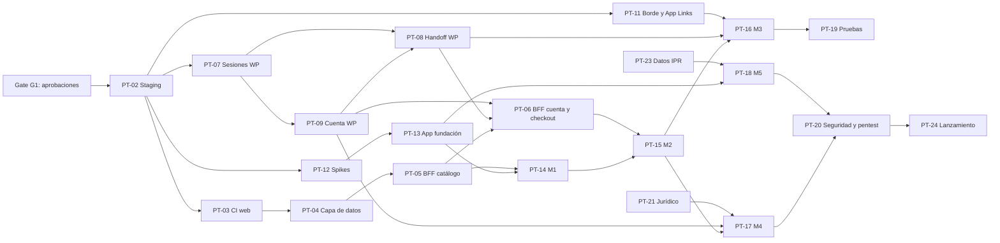

# Plan de implementación por paquetes de trabajo — App móvil IPR

| | |
|---|---|
| **Proyecto** | App móvil Flutter (Android/iOS) de IPR Partes y Repuestos (Inverprimos S.A.S.) |
| **Fecha** | 2026-11-18 |
| **Estado** | **BORRADOR de planificación. No se programa nada.** Describe qué se haría una vez aprobadas las condiciones de entrada (§3); ningún paquete está iniciado ni ningún criterio cumplido. |
| **Relacionado** | [roadmap.md](roadmap.md) · [risks.md](risks.md) · [decisions_log.md](decisions_log.md) · [api_architecture.md §16](../05_api/api_architecture.md) · [security_controls.md §3](../06_security/security_controls.md) · [testing_strategy.md](../08_quality/testing_strategy.md) |

> **Sobre los nombres.** Los "work packages" se llaman **PT-xx (paquete de trabajo)**. Se evita "WP-xx" porque en la documentación `WP-01..WP-16` ya son **cambios de WordPress** ([api_architecture §16.2](../05_api/api_architecture.md)). Los cambios `FE-xx` (frontend/BFF), `WP-xx` (WordPress), `CH-xx` (cambios obligatorios de seguridad) y `RK-xxx` (riesgos) se conservan con su ID original.

**Convención:** HECHO · SUPUESTO · PROPUESTA · PENDIENTE · RIESGO · DESCONOCIDO, como en el [roadmap](roadmap.md). Esfuerzo relativo S/M/L/XL ([roadmap §2.2](roadmap.md)); no hay fechas ni duraciones (D-15). `SUP-H` = recomendación H-01..H-12 aún no aprobada.

---

## 1. Principios de ejecución (PROPUESTA)

| # | Principio | Fuente |
|---|---|---|
| E-1 | **El backend y WordPress van un paso por delante de la app.** La app avanza contra un BFF simulado conforme al OpenAPI hasta que el backend de la rebanada cumpla "listo para integrar" (§3, Gate G2). | testing_strategy §10.2, R-Q04 |
| E-2 | **Ningún cambio toca producción antes de existir staging (C2)** y ninguno se hace sin PR revisado por el responsable técnico (C1). | ADR-001; RNF-095 |
| E-3 | **Los cambios en `lib/woocommerce.ts` no cambian firmas** (`CLAUDE.md:124`); se añaden variantes. Archivo "neurálgico": PR propio. | WCA §7.2 |
| E-4 | **Los cambios en snippets compartidos con la web** (cookie y rol del handoff, formato del ticket, direcciones) llevan regresión de la web. | resolución §5 hallazgo 3 |
| E-5 | **Sin pruebas intrusivas** (carga, seguridad) fuera de staging o sin autorización expresa (D-16). Producción solo recibe monitoreo de solo lectura. | NFR §6; testing §5.1 |
| E-6 | **No se lee ni se versiona `.env`.** Los secretos viven en gestores de secretos; la app no contiene ninguno. | ADR-009; RNF-036 |
| E-7 | **Las puertas de calidad se activan antes del primer código funcional** (`/mobile/v1` y app). | testing §16 paso 6 |
| E-8 | **Un AC con `[A VALIDAR]` no se implementa por suposición:** se registra como decisión pendiente y se ejecuta su parte determinista. | testing §8.2 |

---

## 2. Mapa de paquetes de trabajo

| PT | Nombre | Etapa | Rebanada | Resp. sugerido | Esfuerzo | Depende de |
|---|---|---|---|---|---|---|
| PT-01 | Gobierno de decisiones y cierre del contrato | 1 | — | Arq + BA | M | Decisores humanos; PT-02 (datos) |
| PT-02 | Staging, entornos y datos de prueba (C2) | 2 | — | TI + Web | M | G1 (H-12, D-16, C1) |
| PT-03 | CI/CD y puertas de calidad del repositorio web | 2 | — | Web + TI | M | PT-02 |
| PT-04 | Endurecimiento de la capa de datos compartida | 2 | B1 | Web | L | PT-03 |
| PT-05 | BFF `/mobile/v1`: infraestructura y catálogo público | 3 | B1 | Web | L | PT-04, PT-03 |
| PT-06 | BFF `/mobile/v1`: cuenta, checkout, pedidos y PQRS | 3 | B2-B5 | Web | L | PT-05, PT-07, PT-08, PT-09 |
| PT-07 | WordPress: sesiones por dispositivo y anti fuerza bruta | 2 | B2 | WP | XL | PT-02; H-01, H-04, H-09 |
| PT-08 | WordPress: handoff seguro, checkout móvil y pedidos | 2-3 | B3 | WP | L | PT-02, PT-07, PT-09 (CR-045) |
| PT-09 | WordPress: registro, cuenta, recuperación y eliminación | 3 | B2, B4 | WP + Jur | L | PT-02, PT-07; D-12, H-03, H-11 |
| PT-10 | Configuración remota, sedes y marcas administrables | 3 | B1, B5 | Web + WP | M | PT-05; H-01; D-09 |
| PT-11 | Borde y dominio: Cloudflare, origen, App Links | 2 | B3 | TI + Web | M | PT-02; H-02; D-14 |
| PT-12 | Spikes técnicos y selección de herramientas | 2 | M0 | Móvil | M | PT-02 (SPK-01) |
| PT-13 | App Flutter: fundación | 2 | M0 | Móvil | L | PT-12; DA-01; DA-12 |
| PT-14 | App: catálogo, búsqueda, ficha y contacto | 3 | M1 | Móvil | L | PT-13, PT-05, PT-10 |
| PT-15 | App: cuenta | 3 | M2 | Móvil | L | PT-13, PT-06, PT-07, PT-09 |
| PT-16 | App: carrito y compra | 3 | M3 | Móvil | XL | PT-14, PT-15, PT-08, PT-11, PT-12 |
| PT-17 | App: perfil, pedidos y eliminación de cuenta | 3 | M4 | Móvil | M | PT-15, PT-09, PT-08, PT-21 |
| PT-18 | App: sedes, atención, asesoría y herramientas | 3 | M5 | Móvil | L | PT-13, PT-10, PT-06, PT-23 |
| PT-19 | Pruebas: contrato, BFF, E2E, matriz, accesibilidad y carga | 2-5 | Todas | QA | L | Continuo desde PT-03 |
| PT-20 | Seguridad: SAST, SCA, secretos, MASVS, pentest y aceptaciones | 2-5 | Todas | Seg | L | Continuo; pentest tras M5 |
| PT-21 | Privacidad y revisión jurídica (D-12) | 2-5 | M2, M4 | Jur + BA | M | Documentos de IPR |
| PT-22 | Observabilidad y operación | 3-6 | Todas | TI + Web + Móvil | M | PT-05; DN-02 |
| PT-23 | Datos de catálogo y contenido de IPR | 2-4 | M1, M5 | Cat + Mkt + Ops + Ing | M | Decisiones D-07..D-10, D-13 |
| PT-24 | Lanzamiento: tiendas, piloto y producción | 6 | — | Gerencia + TI + Móvil | M | Gate G4 |

**Total: 24 paquetes de trabajo.**

---

## 3. Condiciones de entrada: de arquitectura a implementación (checklist de aprobaciones humanas)

> **Estado de todas las casillas: ☐ pendiente.** Ningún ítem está cumplido ni aprobado hoy (decisions_log §1). Este checklist no aprueba nada; solo enumera lo que debe constar para pasar cada puerta.

### 3.1 Gate G1 — Inicio de la implementación (Etapa 2)

Sin estas aprobaciones **no se debe empezar a implementar**.

| ✔ | ID | Aprobación o condición | Quién | Fuente | Por qué bloquea el inicio |
|---|---|---|---|---|---|
| ☐ | G1-01 | **D-15:** equipo, roles y presupuesto asignados | Gerencia | decisiones_pendientes D-15 | Sin responsables no hay quien implemente ni revise (RK-001) |
| ☐ | G1-02 | **C1:** conformidad escrita del responsable técnico de `ipr-frontend` y WordPress, con reglas de rama y revisión por PR | Responsable técnico | ADR-001 C1 | El BFF vive en su repositorio y WordPress es su backend (RK-002) |
| ☐ | G1-03 | **H-12 / D-16:** autorizar staging con Wompi sandbox y lectura de solo lectura del servidor | Solicitante + líder técnico web | decisiones_pendientes H-12, D-16 | Resolver los DESCONOCIDOS y poder probar (RK-003) |
| ☐ | G1-04 | **C2:** staging confirmado o aprobada su creación, con responsable y dominio por entorno | TI / equipo web | ADR-001 C2; DA-13 | NLS-08: sin staging no se puede probar autenticación, checkout ni carga |
| ☐ | G1-05 | **H-01:** enmienda de ADR-001 §2 (alcance de `ipr/v1/m/*`) y aclaración de §4 (CR-002) | Solicitante | resolución §4.3; CR-038 | Fija el alcance de PT-07/08/09/10 (RK-005) |
| ☐ | G1-06 | **ADR-013 y ADR-014 aprobadas** (con los valores de CR-022) y **ADR-008 con ADR-017 fusionada** (H-02) | Responsable técnico web + seguridad (AP-01) | ARQ §18; CR-003 | Son la base de PT-07, PT-06 y PT-11 |
| ☐ | G1-07 | **H-04:** vidas de token (access 15 min; refresh 30 d de inactividad / 90 d absolutos; revocación inmediata) | TI + seguridad | DN-04; AP-02; CR-022, 025 | Parámetros de PT-07 |
| ☐ | G1-08 | **ADR-016 y ADR-006 aprobadas** (errores y taxonomía) | Responsable técnico | resolución §3 | PT-04 y PT-05 definen los códigos de error |
| ☐ | G1-09 | **ADR-015 aprobada con la condición SA-01** (n.º de procesos Node verificado) | TI web | CR-035 | Si hay más de un proceso, Redis pasa a P0 y cambia PT-04/PT-07 |
| ☐ | G1-10 | **DA-01:** ADR-003..005, 007, 009, 012 aprobadas para la fundación de la app | Solicitante + responsable técnico | OV §9 | Estructura del repositorio (PT-13) |
| ☐ | G1-11 | **DA-12 / D-14:** identificadores de app por *flavor* y titular de las cuentas de tienda | Gerencia + TI | FA §16 | El identificador de producción no se puede cambiar tras publicar; el `.well-known` y las huellas de firma dependen de él (PT-11, PT-13) |
| ☐ | G1-12 | Autorización para cambiar los **snippets compartidos con la web** con regresión (CR-010, CR-012, CR-045) | Responsable técnico | resolución §5 hallazgo 3 | RK-024 |

**Bloquean una pieza concreta, no el inicio global** (pueden resolverse mientras avanza lo demás, pero antes de la pieza que se indica):

| ✔ | ID | Aprobación | Bloquea | Fuente |
|---|---|---|---|---|
| ☐ | G1-13 | **H-09** roles permitidos (con recuento de roles en staging) | Cierre de PT-07 y PT-08 (CH-05) | CR-028 |
| ☐ | G1-14 | **H-05** "cerrar todas" también cierra la web | PT-07; M2 | CR-027 |
| ☐ | G1-15 | **H-03** registro uniforme + verificación de correo, o `409` con riesgo firmado | PT-09 y M2 (cambia el alcance) | CR-030 |
| ☐ | G1-16 | **H-06** "bajo pedido" no comprable | PT-05 (`purchasable`), M1, M3 | CR-017 |
| ☐ | G1-17 | **H-07** carrito: conservar al cerrar sesión, borrar al eliminar la cuenta | M2, M4 | CR-040 |
| ☐ | G1-18 | **H-08** detalle de pedido con envío, descuento e impuestos | PT-08 (WP-07), M4 | CR-053 |
| ☐ | G1-19 | **H-10** sin compra de invitado | M3 | CR-013 |
| ☐ | G1-20 | **AP-05 / DM-09** fuente canónica de marcas; **AP-06** orden por precio | PT-10, PT-05 | api_architecture §17.3 |
| ☐ | G1-21 | **DM-05** importes enteros COP y demás correcciones de contrato (CR-041..CR-079 aplicables) | PT-01 (OpenAPI `1.0.0`) | resolución Bloque C-D |

### 3.2 Gate G2 — "Listo para integrar" una rebanada con su backend

Definición tomada de [testing_strategy §10.2](../08_quality/testing_strategy.md); se aplica **por rebanada** (propuesta).

| ✔ | ID | Condición verificable | Evidencia |
|---|---|---|---|
| ☐ | G2-01 | Los endpoints de la rebanada dejan de ser `x-status: proposed` y el OpenAPI está versionado en el repositorio web | OpenAPI `1.0.0` y su historial |
| ☐ | G2-02 | BE-01..BE-12 de la rebanada en verde en CI del repositorio web y `deploy.yml` depende de ellas | Ejecución de CI; configuración del workflow |
| ☐ | G2-03 | BE-13..BE-19 de la rebanada en verde contra el WordPress de staging | Ejecución en staging |
| ☐ | G2-04 | Staging operativo con fixtures `QA-*` y cuentas `CLI-*` | Guion de siembra ejecutado |
| ☐ | G2-05 | QG-B01..QG-B07 activas | Configuración de CI |
| ☐ | G2-06 | Resultado de las pruebas de seguridad del backend de la rebanada, o plan acordado | Informe de seguridad |

| Rebanada | Backend mínimo para G2 |
|---|---|
| **B1 → M1** | PT-04 (FE-01, 02, 05, 06, 07, 08), PT-05 (FE-03, FE-04, EP-13..EP-21, EP-01), PT-10 en lo de EP-01; BE-01..06, 08, 09, 10, 11, 12 |
| **B2 → M2** | PT-07 (WP-01..05, 12), PT-09 (WP-10, 11) y EP-02..EP-06 en PT-06; BE-13, 14, 16, 19 |
| **B3 → M3** | PT-08 (WP-06, 07), PT-06 (FE-09, EP-21, EP-23, EP-24), PT-11 (`.well-known`, `/app/pedido`); BE-07, 08, 15, 17; Wompi resuelto (D-02) |
| **B4 → M4** | PT-09 (WP-08, 09, CR-045), EP-07..EP-12, EP-25, EP-26; BE-18; textos legales aprobados |
| **B5 → M5** | PT-10 (WP-13, FE-14, FE-15), PT-06 (FE-16, EP-27); PA-08 y D-08 si se mantienen RF-065 y módulo K |

### 3.3 Gate G3 — Inicio de la verificación formal (Etapa 5)

| ✔ | ID | Condición | Fuente |
|---|---|---|---|
| ☐ | G3-01 | M0..M5 integradas en staging y estables | roadmap Etapa 3 |
| ☐ | G3-02 | 100 % de los AC no-seguridad con TC; los 75 AC delegados a seguridad coordinados | testing §16 paso 5 |
| ☐ | G3-03 | Los 22 cambios P0 implementados (aún sin evidencia final) | security_controls §3.1 |
| ☐ | G3-04 | **DN-13:** presupuesto y proveedor del pentest | D-15; CH-21 |
| ☐ | G3-05 | Textos legales y de tiendas aprobados por Jurídico | testing §9 F4 |

### 3.4 Gate G4 — Piloto y lanzamiento (Etapa 6)

| ✔ | ID | Condición | Quién | Fuente |
|---|---|---|---|---|
| ☐ | G4-01 | **D-12:** J-01..J-13 respondidas y dictamen archivado; **H-11** | Jurídico | privacy_assessment §10.1 |
| ☐ | G4-02 | **D-02 / PA-11 / PA-12** cerradas: 0 duplicados en 100 interrupciones por plataforma (CH-16) | Web + Finanzas | TM-027 |
| ☐ | G4-03 | **D-14:** titularidad y custodia de cuentas y firmas | Gerencia + TI | NL-11; CH-20 |
| ☐ | G4-04 | **DA-15 / CH-22:** aceptación firmada del riesgo residual (sin *pinning*, root ni atestación) | Seguridad + Gerencia | NLS-09 |
| ☐ | G4-05 | **C1..C4** de ADR-001 cumplidas (C3 y C4 con evidencia) | TI + Web | NL-12; QG-R15 |
| ☐ | G4-06 | NL-01..NL-14 y NLS-01..NLS-09 en verde | Seguridad + QA | NFR §5.1; security_controls §4 |
| ☐ | G4-07 | S-05 verificado contra las guías vigentes de las tiendas | Móvil + Jurídico | RNF-080 |
| ☐ | G4-08 | Decisión de lanzamiento firmada | Gerencia + TI | testing §13 |

---

## 4. Paquetes de trabajo

> En cada paquete, los criterios de aceptación remiten a RF y AC de [requirements_traceability.md](../02_requirements/requirements_traceability.md) (los AC de un RF son `AC-xxx-1..n`; AC-SEC-1..13 son los transversales), a RNF, a cambios CH y a los casos BE/ST/QG/TC de [testing_strategy](../08_quality/testing_strategy.md) y [security_controls](../06_security/security_controls.md). "Estado" de todos: **No iniciado**.

### PT-01 — Gobierno de decisiones y cierre del contrato

| Campo | Contenido |
|---|---|
| **Alcance** | Aprobar o rechazar ADR-003..022 y la fusión ADR-017→ADR-008; decidir H-01..H-12; aplicar o descartar las 89 CR con su "cambio exacto"; copiar las ADR a `architecture_decisions.md`; abrir RF-114 (B2B, CR-089); regenerar la trazabilidad (CR-087); dejar el OpenAPI en `1.0.0` sin `x-status: proposed` en el MVP. |
| **Entradas** | [resolucion_inconsistencias.md](resolucion_inconsistencias.md) §1-4; [decisiones_pendientes §E](decisiones_pendientes.md); OV §9; ARQ §18; [decisions_log.md](decisions_log.md). |
| **Salidas** | Registro de ADR con estados finales; OpenAPI `1.0.0`; RF/AC/NFR/TR corregidos; lista de CR aplicadas con aprobador. |
| **Dependencias** | Decisores humanos; PT-02 para las 8 CR que dependen de un dato DESCONOCIDO. |
| **Criterios de aceptación** | 0 ADR en "Propuesta" para el MVP; H-01..H-12 respondidas; 89 CR con estado; trazabilidad regenerada sin los errores de CR-087; condición 1 de testing §10.2. |
| **Riesgos** | RK-004, RK-005, RK-017 |
| **Pruebas** | Revisión documental; re-ejecución del script de trazabilidad. |
| **Resp. / esfuerzo** | Arq + BA; decide el solicitante y el responsable técnico · **M** |

### PT-02 — Staging, entornos y datos de prueba (C2)

| Campo | Contenido |
|---|---|
| **Alcance** | Staging de frontend + WooCommerce/WordPress + Wompi sandbox; dominio propio por entorno con `.well-known` (CR-076); no indexable y con acceso restringido (SC-067); datos sintéticos `QA-*` y `CLI-*` y guion de siembra; acceso de solo lectura a producción (D-16) para resolver los DESCONOCIDOS; mediciones MED-03, 04, 14, 15, 16, 17; transacciones Wompi de prueba que registren los estados de WooCommerce. |
| **Entradas** | G1-03, G1-04; testing §5; resolución Anexo B. |
| **Salidas** | Entorno operativo; informe de DESCONOCIDOS con valor, fecha y fuente (n.º de procesos Node, Cloudflare delante de WordPress, estados Wompi y doble pago, roles, zona horaria, longitud de `user_email`, PHP/WordPress/Node, caché de objetos, clave de la cédula/NIT, dominio de staging); fixtures; credenciales en gestor de secretos. |
| **Dependencias** | G1; TI y equipo web (C1); D-15. |
| **Criterios de aceptación** | Una transacción Wompi sandbox pagada y una rechazada con sus estados registrados (CR-018, MED-14); BE-21 parcial; NLS-08 levantado; catálogo `QA-*` con los casos de testing §5.2 (con precio, sin precio, agotado, bajo pedido, oferta, nombre largo, sin imagen). |
| **Riesgos** | RK-003, RK-015, RK-020, RK-021, RK-022 |
| **Pruebas** | BE-21; MED-14; TC-067..TC-069 posteriores. |
| **Resp. / esfuerzo** | TI + Web; apoyo QA · **M** (con espera externa) |

### PT-03 — CI/CD y puertas de calidad del repositorio web

| Campo | Contenido |
|---|---|
| **Alcance** | FE-11: `tsc --noEmit`, ESLint, SCA (`npm audit`/OSV), escaneo de secretos del historial y por PR, pruebas de contrato de `/mobile/v1`; `deploy.yml` depende de las puertas; rama principal protegida con revisión obligatoria; acciones de CI fijadas por SHA; pruebas de caracterización de `lib/woocommerce.ts` (BE-01); decisión de la versión de Node y del ejecutor de pruebas (spike Q-07). |
| **Entradas** | api_architecture §16.1 (FE-11); testing §7.1 (QG-B01..B07); SC-048..SC-051; MED-09. |
| **Salidas** | Workflow con puertas; informe inicial de SCA y de secretos; pruebas de caracterización. |
| **Dependencias** | PT-02 (para pruebas contra staging); C1. |
| **Criterios de aceptación** | `deploy.yml` falla si falla `tsc`, lint, SCA, secretos o pruebas (verificable con un PR de prueba); QG-B01..QG-B07 activas; **CH-12** (ST-010, 011, 013, 015, 153); **CH-13** (ST-020, 021, 023): 0 hallazgos verdaderos o rotación documentada; RNF-049, 088, 090, 095. |
| **Riesgos** | RK-023, RK-034, RK-041, RK-002 |
| **Pruebas** | BE-01; QG-B01..B07; ST-010..015, ST-020..024, ST-153. |
| **Resp. / esfuerzo** | Web + TI · **M** |

### PT-04 — Endurecimiento de la capa de datos compartida

| Campo | Contenido |
|---|---|
| **Alcance** | FE-01 (`status=publish`, `catalog_visibility`, contraseña, en ficha, listados, búsqueda e índice); FE-02 (variantes con resultado discriminado `ok`/`not_found`/`unavailable` sin cambiar firmas); FE-05 (rate limit LRU, `CF-Connecting-IP`); FE-06 (cola de `wcGet` con tope y espera ≤ 3 s, `deadlineMs`); FE-07 (señal "índice en construcción", verificación del módulo, alerta si `totalPages > 100`); FE-08 (disponibilidad por ids con caché por id); P1: FE-13 (`/api/revalidate` solo HMAC, **CH-23**). |
| **Entradas** | WCA §7.2; api_architecture §4 y §16.1; ADR-016. |
| **Salidas** | Variantes y funciones nuevas en `lib/woocommerce.ts` y `lib/wc/*`; limitador corregido; pruebas de contrato de la capa. |
| **Dependencias** | PT-03; G1-08, G1-09; C1 (archivo "neurálgico"). |
| **Criterios de aceptación** | **CH-07** parcial y **CH-10**: ST-064, 065, 061, 062, 070 aprobadas; BE-02, BE-03, BE-09, BE-10, BE-11; la web sigue igual (QG-B06); RNF-018, 022, 023, 112; NL-13. |
| **Riesgos** | RK-018, RK-019, RK-020, RK-035 |
| **Pruebas** | BE-02, 03, 09, 10, 11, 12; ST-061..065, ST-070, ST-075; TC-104, TC-152. |
| **Resp. / esfuerzo** | Web · **L** (seis cambios en un archivo crítico) |

### PT-05 — BFF `/mobile/v1`: infraestructura y catálogo público

| Campo | Contenido |
|---|---|
| **Alcance** | FE-03 (DTO por lista blanca, sin `stockQuantity`, precio `null` si es 0, HTML saneado en servidor); FE-04 (rutas `src/app/mobile/v1/**`, `lib/mobile/{http,errors,schemas,dto,rate-limit}`, RFC 9457, Zod `strict`, request id, logs sin PII, `Cache-Control`/`ETag`, `426`, rechazo de token en la URL); endpoints EP-01 (en su parte pública), EP-13..EP-21; límites de ARQ §10.2. |
| **Entradas** | [openapi.yaml](../05_api/openapi.yaml) `1.0.0`; api_contracts EP-13..EP-21; WCA §3; H-06 (`purchasable`). |
| **Salidas** | Endpoints públicos con contrato verificado; métricas con `origin=mobile` (FE-12 en PT-22). |
| **Dependencias** | PT-04, PT-03; PT-10 para la configuración (EP-01) y las marcas (EP-19). |
| **Criterios de aceptación** | RF-002, 003, 010..016, 018..023, 026..032 (parte servidor), 037, 050, 051; AC-050-10, AC-SEC-7; **CH-08** (ST-067: 100 % de vectores XSS neutralizados), **CH-09** (ST-054, 055, 057, 060, 063, 068..072, 078), **CH-07** (ST-066: diff de respuestas contra OpenAPI sin campos extra); RNF-011, 022, 023, 041, 044, 047, 099; RF-019 (frescura ≤ 10 min, RNF-111, BE-12). |
| **Riesgos** | RK-017, RK-018, RK-019, RK-035, RK-037, RK-038, RK-047 |
| **Pruebas** | BE-04, 05, 06, 08, 10; TC-144, 145, 146; QG-B03..B05; TC-099..106 (errores 404/503). |
| **Resp. / esfuerzo** | Web · **L** |

### PT-06 — BFF `/mobile/v1`: cuenta, checkout, pedidos y PQRS

| Campo | Contenido |
|---|---|
| **Alcance** | EP-02..EP-12 (proxys hacia `ipr/v1/m/*` con `X-IPR-BFF-Secret`); EP-23, EP-24 (FE-09: ticket, `checkoutRef`, `Idempotency-Key` **obligatoria** según CR-005, consulta del resultado; `paymentState` según CR-007/008/009); EP-25, EP-26; EP-27 (FE-16: `lib/pqrs.ts` compartido); FE-17 (timeouts en `auth.ts`, **CH-30**); límite de `/api/checkout` de la web (**CH-24**); cliente `ipr-client.ts` con timeout 8 s; límites compartidos para PQRS (**CH-18**). |
| **Entradas** | api_contracts EP-02..EP-12, 23..27; AUT §9; CR-005, 007, 008, 009, 014, 029, 032. |
| **Salidas** | Endpoints privados y de checkout; contrato verificado; PQRS con límite compartido. |
| **Dependencias** | PT-05; PT-07, PT-08, PT-09 (rutas de WordPress); H-02 (retorno), H-10. |
| **Criterios de aceptación** | RF-038..045, 048, 052..058, 096, 097, 104..108, 110 (parte servidor); AC-052-6 (un toque = una solicitud), AC-052-13/14, AC-055-4, AC-056-1/6, AC-057-*; **CH-15** (ST-077, 081..088, 124..127), **CH-18** (ST-143); RNF-021, 024..026, 042, 044, 045. |
| **Riesgos** | RK-015, RK-016, RK-033, RK-040, RK-046, RK-053, RK-054 |
| **Pruebas** | BE-07 (idempotencia), BE-08 (mapeo de estados), BE-17; TC-147, TC-151, TC-150; ST-077..092, ST-143. |
| **Resp. / esfuerzo** | Web · **L** |

### PT-07 — WordPress: sesiones por dispositivo y anti fuerza bruta

| Campo | Contenido |
|---|---|
| **Alcance** | WP-01 (tablas `{prefix}ipr_auth_sessions`, rutas `ipr/v1/m/sessions*`: login, refresh rotativo con detección de reutilización, ventana de gracia de 30 s, revocación por dispositivo y global); WP-02 (`permission_callback` real: secreto del BFF + access token); WP-03 (`ipr_auth_throttle`: por cuenta 5/15 min con bloqueo progresivo 1-5-15-60 min, por IP 20/15 min; respuestas uniformes); WP-04 (token solo por cabecera); WP-05 (revocación global ante cambios de credenciales, `after_password_reset`, `profile_update`, `delete_user`); WP-12 (`ipr_auth_events` y limpieza); regla de roles CR-028 (lista de permitidos + bloqueo por capacidad); P1: WP-14 (sustituir `__return_true` heredados, **CH-25**). Plugin propio (`mu-plugin`) con `dbDelta` versionado (AUT RS-02). |
| **Entradas** | AUT §3, §8, §9, §13; ARQ §16.2; SC-001..SC-012; decisiones H-01, H-04, H-05, H-09; datos de PT-02 (roles, `user_email`, PHP). |
| **Salidas** | Esquema creado y versionado; rutas nuevas; eventos de auditoría; la web sigue funcionando. |
| **Dependencias** | PT-02; G1-05, G1-06, G1-07; coordinación con PT-11 (límites de Cloudflare en `/auth/*`). |
| **Criterios de aceptación** | RF-041, 043, 044, 045, 048; AC-041-*, 043-*, 044-* (p. ej. AC-044-2 token no en URL, AC-044-6 un solo refresh, AC-044-7 error de red), 045-* (AC-045-1/4/5), 048-*; AC-SEC-5, AC-SEC-9; RNF-039..043, 017; **CH-01** (ST-030..036, 047, 058), **CH-02** (ST-040..043, 144), **CH-03** (ST-033, 118), **CH-04** (ST-037..039, 046); NL-05. |
| **Riesgos** | RK-030, RK-031, RK-032, RK-029, RK-020 |
| **Pruebas** | BE-13, BE-14, BE-16; TC-148, TC-149, TC-031; QG-R04; pruebas de AUT §15 (13 pruebas mínimas). |
| **Resp. / esfuerzo** | WP; apoyo Seg · **XL** (WP-01 es L; sumado a WP-02, 03, 05, 12 y a la regla de roles) |

### PT-08 — WordPress: handoff seguro, checkout móvil y pedidos

| Campo | Contenido |
|---|---|
| **Alcance** | WP-06 (`handoff-ticket`: acepta el access token de sesión móvil; guarda `user_id`, no el token; `checkoutRef` y `channel`; cookie **no persistente** para `app`; meta `_ipr_checkout_ref` y `_ipr_channel` en el pedido; **denegar roles administrativos también en el handoff de la web**; ticket de la app sin `email`, `billing`, `shipping`, `nationalId`, `orderNotes` ni `authToken`, condicionado a CR-045); WP-07 (`ipr/v1/m/orders` paginado y `orders/{id}` con control de propiedad, filtro `checkout_ref`, mapeo de envío/descuento/impuestos si se aprueba H-08); WP-15 (paginar `/orders` heredado, P1). Documentar estados reales de Wompi. |
| **Entradas** | ARQ §13; AUT; CR-010, 011, 012, 015, 018, 053; SC-014, 020..029, 072; resultados de PT-02. |
| **Salidas** | Handoff y pedidos seguros; evidencia de regresión de la web. |
| **Dependencias** | PT-02 (staging), PT-07 (validación de token), PT-09 (migración CR-045 para minimizar el ticket); H-08, H-09. |
| **Criterios de aceptación** | RF-052, 054..057, 107, 108 (parte servidor); AC-052-*, AC-055-*, AC-056-*, AC-057-*, AC-107-*, AC-108-*; **CH-05** (ST-044, 045, 084, 090), **CH-06** (ST-050..053 con dos cuentas sintéticas); NLS-05; RNF-043, 045. |
| **Riesgos** | RK-024, RK-025, RK-032, RK-033, RK-053, RK-015 |
| **Pruebas** | BE-15, BE-17; TC-067, 073, 086, 150; ST-081..091; QG-B06 (humo de la web). |
| **Resp. / esfuerzo** | WP · **L** |

### PT-09 — WordPress: registro, cuenta, recuperación y eliminación de cuenta

| Campo | Contenido |
|---|---|
| **Alcance** | **Primero:** migración de direcciones a `WC_Customer` con respaldo del meta heredado (CR-045; DM-03). WP-08 (`ipr/v1/m/me*`: perfil, nombres, correo, contraseña, direcciones con lista blanca; sin `roles` ni `username`); WP-10 (recuperación por API, `202` uniforme; ADR-021); WP-11 (registro con aceptación de términos y política registrada por versión, fecha y canal; tabla `ipr_consents`; resultado de H-03); WP-09 (eliminación en dos tiempos: `pending_deletion`, revocación total, anonimización programada, correo de confirmación; sujeta a D-12, H-11). |
| **Entradas** | AUT §6, §10..§12; ARQ §15.D; DM; privacy_assessment §5, §10; H-03, H-07, H-11; textos legales (PT-21). |
| **Salidas** | Rutas de cuenta; consentimientos con prueba; eliminación probada E2E. |
| **Dependencias** | PT-02, PT-07; D-12 (J-01, 04, 05, 09, 17); H-03; H-11. |
| **Criterios de aceptación** | RF-038, 039, 042, 104..106, 110, 111; AC-038-*, 039-*, 042-*, 104-*, 105-*, 110-* (p. ej. AC-110-3 contraseña actual, AC-110-5 login bloqueado, AC-110-13 sin id en la solicitud); RNF-056..059, 062, 063; **CH-17** (ST-056, 107, 133, 134; dictamen de Jurídico archivado); **CH-04**. |
| **Riesgos** | RK-025, RK-039, RK-048, RK-049, RK-050, RK-053, RK-054 |
| **Pruebas** | BE-18, BE-19; TC-006, TC-087..092; ST-037..039, 043, 046, 056. |
| **Resp. / esfuerzo** | WP + Jur · **L** |

### PT-10 — Configuración remota, sedes y marcas administrables

| Campo | Contenido |
|---|---|
| **Alcance** | WP-13 (tipo de contenido de sedes y opción `ipr_mobile_config` con `ipr/v1/m/stores` y `/config`); FE-15 (`GET /mobile/v1/stores` y `/config`, caché 1 h y 60 s, respaldo empaquetado de `sedes-data.ts`); FE-14 (`getBrands()`, `GET /brands`, logos a URL absoluta); controles de integridad de la configuración (SC-044, SUP-SEC-10: edición restringida y auditada, validación del número de WhatsApp); versiones legales y `accountDeletionNotice` servidos por la configuración. |
| **Entradas** | ADR-018; EP-01, EP-19, EP-22; D-09 y AP-05 (datos de PT-23). |
| **Salidas** | Sedes y configuración editables sin recompilar; marcas con fuente canónica. |
| **Dependencias** | PT-05; H-01; PT-23. |
| **Criterios de aceptación** | RF-076 (AC-076-*), RF-072..075, RF-005, 062, 094, 095, 099, 111 (datos de EP-01), RF-016, RF-004; RNF-029, RNF-114; **ST-141**; el administrador cambia una sede y se refleja en ≤ 5 min (RNF-029). |
| **Riesgos** | RK-012, RK-026, RK-045 |
| **Pruebas** | TC-144; ST-141; verificación de sedes (RNF-114). |
| **Resp. / esfuerzo** | Web + WP · **M** |

### PT-11 — Borde y dominio: Cloudflare, origen y App Links

| Campo | Contenido |
|---|---|
| **Alcance** | FE-10 (`.well-known/assetlinks.json` y `apple-app-site-association` con `Content-Type` correcto, solo `/app/*`; página de respaldo `/app/pedido` `noindex`; `robots.txt` con `Disallow: /mobile/`); reglas de Cloudflare (C3): *Cache Rule* solo para rutas públicas, sin desafíos interactivos en `/mobile/v1/*` y `/.well-known/*`, límites por IP; origen de Next.js y WordPress solo desde rangos de Cloudflare o *Authenticated Origin Pulls* (**CH-11**); IP de origen fuera de archivos versionados; no registrar la query `ipr_ticket` y `returnUrl` solo `https` (**CH-27**, P1). Un dominio y `.well-known` por entorno (SUP-SEC-16). |
| **Entradas** | ARQ §8, §10, §13.3; SC-005, 010, 026, 053, 067, 072; DA-03; DA-12/D-14 (identificador y huellas de firma); H-02. |
| **Salidas** | Reglas de Cloudflare archivadas; `.well-known` por entorno; origen restringido. |
| **Dependencias** | PT-02; D-14; plan de Cloudflare (AP-08, DESCONOCIDO). |
| **Criterios de aceptación** | RF-055; RNF-032, 037, 046; **CH-11** (ST-150, 151, con evidencia de configuración y **sin sondear producción** sin autorización D-16); ST-124..127; BE-21 (Cloudflare no desafía a la app ni a `.well-known`); AC-SEC-13. |
| **Riesgos** | RK-021, RK-022, RK-014, RK-038 |
| **Pruebas** | BE-21; ST-124..127, ST-150, ST-151, ST-091; TC-032, TC-082. |
| **Resp. / esfuerzo** | TI + Web · **M** |

### PT-12 — Spikes técnicos y selección de herramientas

| Campo | Contenido |
|---|---|
| **Alcance** | SPK-01 (retorno del pago por plataforma y versión; `flutter_web_auth_2` frente a `url_launcher`; ¿`patrol` lo automatiza?); SPK-02 (mínimos reales de Android/iOS con Flutter 3.50 y plugins; arranque y tamaño; MED-11); SPK-03 (`flutter_secure_storage`: Keychain, reinstalación, backend de Android, backups); SPK-04 (renderizado de descripciones reales saneadas); spike de herramientas del BFF (Vitest/Jest/MSW frente al Node de producción, Q-07); decisión sobre k6 (licencia AGPL). |
| **Entradas** | FA §19; testing §6, §15; PT-02 (staging, SPK-01). |
| **Salidas** | Un informe por spike con decisión registrada (componente de navegador seguro, DN-01, DA-14, herramienta de pruebas). |
| **Dependencias** | PT-02 para SPK-01; D-14 para el identificador de la app. |
| **Criterios de aceptación** | Cada spike con informe, datos y decisión; ADR-008 completada con el componente elegido; DN-01 con valores medidos; MED-11 registrada. |
| **Riesgos** | RK-014, RK-027, RK-043, RK-058 |
| **Pruebas** | Mediciones en dispositivo de referencia; ver MED-11. |
| **Resp. / esfuerzo** | Móvil · **M** |

### PT-13 — App Flutter: fundación (rebanada M0)

| Campo | Contenido |
|---|---|
| **Alcance** | Repositorio con Flutter 3.50 fijado; estructura *feature-first* (ADR-003); *flavors* `dev`/`staging`/`prod` con `--dart-define-from-file` y sin secretos (ADR-009); CI con QG-M01..M12 (incluye ejecutor para iOS); `core` (red con Dio e interceptores, sesión, almacenamiento seguro, errores tipados, configuración remota, observabilidad detrás de interfaces); `shared` (design system con tokens y verde accesible según DA-07, formato COP con `Money` entero, `AsyncView`); router con go_router y guardas; es-CO; BFF simulado con `shelf` y fixtures del OpenAPI; script de reglas de dependencia; umbrales de cobertura. |
| **Entradas** | FA; OV §9; testing §6, §7; OpenAPI; G1-10, G1-11. |
| **Salidas** | App que compila en Android e iOS, con CI y sin funcionalidades de negocio. |
| **Dependencias** | PT-12; DA-01; DA-12/D-14; PT-03 (convenciones). |
| **Criterios de aceptación** | RNF-087..096 (QG-M01..M12 en verde); RNF-036 (0 secretos, ST-020..022); AC-SEC-1..4 base; RNF-021 y 027 (red); RNF-068..071 (guías de accesibilidad activas); compila en ambas plataformas (QG-M10). |
| **Riesgos** | RK-028, RK-043, RK-059, RK-027 |
| **Pruebas** | QG-M01..M12; ST-100..ST-103 (almacenamiento), ST-111..ST-114 (TLS), ST-120..ST-123. |
| **Resp. / esfuerzo** | Móvil · **L** |

### PT-14 — App: catálogo, búsqueda, ficha y contacto (rebanada M1)

| Campo | Contenido |
|---|---|
| **Alcance** | RF-001, 002, 003, 004, 005, 007, 009, 010, 011, 012, 013, 014, 015, 016, 018, 019, 020, 021, 022, 023, 026, 027, 028, 030, 031, 032, 037, 062, 063, 064 (30 RF). Inicio, categorías, listados con carga progresiva, filtros, orden, búsqueda con *debounce* y cancelación, ficha con descripción nativa sin JavaScript, "Más información" → WhatsApp, estados de error y sin conexión con caché pública. |
| **Entradas** | EP-01, 13..20; FA §6, §10; PT-05, PT-10 y datos de PT-23. |
| **Salidas** | Navegación pública completa contra staging. |
| **Dependencias** | PT-13, PT-05, PT-10; H-06 (RF-031); PA-05 (RF-003). |
| **Criterios de aceptación** | AC de los 30 RF en verde (AC-011-*, 012-*, 022-*, 026-*, 027-*, 030-*, 031-*, 062-*, etc.); NL-13: 0 "$0", 0 productos con precio ≤ 0 comprables, 0 no publicados visibles (QG-R09); AC-SEC-7, AC-SEC-12 (HTML sin JavaScript); RNF-001..013 medidos (MED-11). |
| **Riesgos** | RK-011, RK-018, RK-019, RK-026, RK-037, RK-059 |
| **Pruebas** | TC-052..057, TC-060 (precio y WhatsApp); TC-099..110 (errores, sin conexión, SKU); TC-053, 054, 104; QG-R09. |
| **Resp. / esfuerzo** | Móvil · **L** |

### PT-15 — App: cuenta (rebanada M2)

| Campo | Contenido |
|---|---|
| **Alcance** | RF-038, 039, 040, 041, 042, 043, 044, 045, 048, 099 (10 RF). Registro con aceptación de políticas, login, logout con revocación, recuperación, sesión por dispositivo con access en memoria y refresh en almacén seguro, refresh de vuelo único, cierre de sesión forzado ante `refresh_token_reused`, páginas legales accesibles antes del registro. |
| **Entradas** | EP-02..EP-06; AUT §3..§5; CR-019, 020, 021, 039; textos de PT-21. |
| **Salidas** | Autenticación integrada contra staging. |
| **Dependencias** | PT-13, PT-06, PT-07, PT-09 (WP-10/11); H-03, H-05, H-07. |
| **Criterios de aceptación** | AC-038-*..AC-045-*, AC-048-*, AC-099-*; RF-043: login en web y en otro dispositivo no cierra la app (NL-05); AC-SEC-5, AC-SEC-9; RNF-034, 062 (inspección del sistema de archivos tras cerrar sesión). |
| **Riesgos** | RK-030, RK-031, RK-039, RK-043, RK-048 |
| **Pruebas** | TC-001..TC-035; TC-148, TC-149; ST-030..ST-036, ST-100..ST-107; QG-R04. |
| **Resp. / esfuerzo** | Móvil · **L** |

### PT-16 — App: carrito y compra (rebanada M3)

| Campo | Contenido |
|---|---|
| **Alcance** | RF-029, 049, 050, 051, 052, 053, 054, 055, 056, 057, 058 (11 RF). Carrito local persistente (1-99 por producto, ≤ 100 líneas), revalidación contra EP-21 sin borrar ítems por error de red, subtotal "informativo", `POST /checkout` con `Idempotency-Key`, apertura en navegador seguro (Custom Tabs; `ASWebAuthenticationSession` efímera en iOS) solo si el host ∈ `allowedHosts`, máquina de estados del checkout, retorno por enlace como pista y consulta EP-24 como verdad (sondeo 2, 4, 8, 16 s y luego cada 15 s hasta 120 s), vaciado del carrito solo con `paid`. |
| **Entradas** | EP-21, 23, 24; ADR-008; FA §6.3; SPK-01; CR-001..009. |
| **Salidas** | Compra extremo a extremo en staging. |
| **Dependencias** | PT-14, PT-15, PT-06, PT-08, PT-11, PT-12; D-02/PA-11/PA-12 resueltas (Wompi). |
| **Criterios de aceptación** | AC-049-*..AC-058-*, AC-029-*; AC-052-6, 13, 14; AC-055-4; AC-056-1/6; NL-02: compra aprobada, rechazada y cancelada en Android **e** iOS con Wompi sandbox (QG-R02) y **0 duplicados** (QG-R03); **CH-15** (ST-077, 081..088, 124..127); **CH-16** (ST-086, 089); AC-SEC-1, 6, 13. |
| **Riesgos** | RK-014, RK-015, RK-016, RK-018, RK-046, RK-058 |
| **Pruebas** | TC-036..TC-050 (carrito); TC-061..TC-082 (checkout); TC-062, 071, 073, 147 (duplicados); QG-R02, QG-R03. |
| **Resp. / esfuerzo** | Móvil · **XL** (mayor seguridad y mayor dependencia externa) |

### PT-17 — App: perfil, pedidos y eliminación de cuenta (rebanada M4)

| Campo | Contenido |
|---|---|
| **Alcance** | RF-104, 105, 106, 107, 108, 110, 111 (7 RF). Datos de perfil, cambio de contraseña, direcciones, historial y detalle de pedidos, eliminación con confirmación y contraseña actual, aviso de qué se conserva (texto de Jurídico), canal de derechos del titular. |
| **Entradas** | EP-07..EP-12, EP-25, EP-26; textos de PT-21; H-07, H-08, H-11. |
| **Salidas** | Gestión de cuenta integrada contra staging. |
| **Dependencias** | PT-15, PT-09, PT-08, PT-21. |
| **Criterios de aceptación** | AC-104-*..AC-108-*, AC-110-* (16), AC-111-*; NL-07: eliminación E2E con revisión de datos tras la baja (QG-R10); AC-SEC-8, AC-SEC-11; RNF-058, 059, 062. |
| **Riesgos** | RK-033, RK-049, RK-050, RK-053 |
| **Pruebas** | TC-083..TC-092; TC-086, 089, 092; ST-056, ST-107, ST-134; QG-R10. |
| **Resp. / esfuerzo** | Móvil · **M** |

### PT-18 — App: sedes, atención, asesoría y herramientas (rebanada M5)

| Campo | Contenido |
|---|---|
| **Alcance** | RF-006, 065, 072, 073, 074, 075, 076, 079, 080, 085, 086, 087, 088, 089, 094, 095, 096, 097 (18 RF). Sedes por ciudad con llamar, WhatsApp y "Cómo llegar"; ayuda con canales corporativos; PQRS con `Idempotency-Key` y sin persistencia local; asesoría técnica; calculadora BTU como lógica local pura con ≥ 30 vectores validados; medición agregada de "Más información" (si PA-08 y D-12 lo permiten). |
| **Entradas** | EP-01, EP-22, EP-27; COD §6; datos de PT-23 (D-08, D-09, PA-06, PA-07). |
| **Salidas** | Sedes, atención y herramientas integradas. |
| **Dependencias** | PT-13, PT-10, PT-06, PT-23. |
| **Criterios de aceptación** | AC de los 18 RF; RF-097: el límite de PQRS no depende de la memoria de un proceso (**CH-18**, ST-143); RF-085..089 con tabla de vectores firmada por Ingeniería (RNF-092); RNF-065 (0 datos de empleados). |
| **Riesgos** | RK-012, RK-013, RK-040, RK-054 |
| **Pruebas** | TC de PQRS (ST-143); unitarias con vectores BTU (RNF-092); ST-122, ST-141 (lanzamientos externos). |
| **Resp. / esfuerzo** | Móvil · **L** |

### PT-19 — Pruebas: contrato, BFF, E2E, matriz, accesibilidad y carga

| Campo | Contenido |
|---|---|
| **Alcance** | Completar los TC de los 26 AC no-seguridad sin caso; coordinar los 75 AC delegados a seguridad; fixtures y cuentas (con PT-02); pruebas de caracterización y de contrato del BFF (BE-01..BE-12); pruebas de WordPress contra staging (BE-13..BE-19); E2E de compra; matriz de dispositivos (≥ 8 físicos) y perfiles de red; accesibilidad automática y manual; carga con el perfil acordado (BE-20); herramienta de gestión de casos y defectos (Q-08); `test_results.md` con el primer ciclo solo cuando exista una prueba ejecutada con evidencia. |
| **Entradas** | testing_strategy completo; test_cases.md; acceptance_criteria.md; PT-02. |
| **Salidas** | Suite ejecutable por capas; reportes de trazabilidad AC→TC; resultados por ciclo. |
| **Dependencias** | Continuo desde PT-03; E2E requiere M3 y staging; carga requiere perfil acordado (DN-07, MED-01). |
| **Criterios de aceptación** | QG-R01..R13 y R15 en verde; BE-01..BE-21 en verde; 100 % de los AC no-seguridad con TC o delegados; 0 pruebas huérfanas (QG-M08); NL-14 (QG-R08). |
| **Riesgos** | RK-058, RK-004, RK-019, RK-059, RK-027 |
| **Pruebas** | Todas las de testing_strategy; TC-157..160. |
| **Resp. / esfuerzo** | QA · **L** (continuo) |

### PT-20 — Seguridad: SAST, SCA, secretos, MASVS, pentest y aceptaciones

| Campo | Contenido |
|---|---|
| **Alcance** | SAST (SC-049), SCA (SC-048), secretos (SC-038, 039), SBOM (SC-051); verificación MASVS L1 sobre el *build* de *release* (**CH-14**); **prueba de penetración independiente** con reprueba (**CH-21**, DN-13); aceptaciones firmadas de riesgo residual (**CH-22**, DA-15); rotación de secretos con doble valor y `IPR_HANDOFF_SECRET` solo en `wp-config.php` (**CH-26**, WP-16); **CH-25** (inventario de API, `/api/health` sin versión); seguimiento del riesgo de la web de campañas (**CH-31**). |
| **Entradas** | security_controls; threat_model; security_testing (ST-001..ST-160); testing §7.4. |
| **Salidas** | Informes archivados; documento de aceptación de riesgos firmado; SBOM por versión. |
| **Dependencias** | PT-03, PT-13; M5 para el pentest; presupuesto D-15. |
| **Criterios de aceptación** | NLS-01..NLS-09 en verde; 0 críticos y altos abiertos tras la reprueba (ST-160); **CH-12, CH-13, CH-14, CH-21, CH-22** con su criterio de cierre cumplido y evidenciado; ST-116 aprobada. |
| **Riesgos** | RK-034, RK-041, RK-042, RK-057, RK-028 |
| **Pruebas** | ST-001..ST-160 aplicables; QG-M09, QG-R11. |
| **Resp. / esfuerzo** | Seg · **L** (continuo; pentest al final) |

### PT-21 — Privacidad y revisión jurídica (D-12)

| Campo | Contenido |
|---|---|
| **Alcance** | Entregar a Jurídico los 16 documentos de privacy_assessment §11.2; responder J-01..J-13 (P0) y J-14..J-27 (P1); política y términos actualizados y versionados; textos de `accountDeletionNotice`, `acceptsDataPolicy` y avisos; tabla de retención y de qué se conserva al eliminar la cuenta (J-04, J-05, J-17; H-11); DM-02, DM-04, DM-08; contratos con encargados e inventario de transferencias (J-06, J-19, J-27); RNBD (J-03); canal y área de derechos del titular (J-11); protocolo de incidentes (J-26); firma del inventario de datos (RNF-060, J-13); etiquetas de las tiendas (J-20). |
| **Entradas** | privacy_assessment; data_model §7, §9.4; AUT §12. |
| **Salidas** | Dictamen de Jurídico archivado; textos aprobados; política publicada; tabla de retención. |
| **Dependencias** | Documentos y datos de IPR; DN-02/DA-04. |
| **Criterios de aceptación** | RNF-056..066; NL-07; QG-R10, QG-R13; **CH-17** (dictamen archivado); J-01..J-13 respondidas. |
| **Riesgos** | RK-048, RK-049, RK-050, RK-051, RK-052, RK-053, RK-054, RK-055, RK-056 |
| **Pruebas** | TC-006, TC-035, TC-143; revisión de UI por Jurídico (RNF-057). |
| **Resp. / esfuerzo** | Jur + BA · **M** (del lado de IPR) |

### PT-22 — Observabilidad y operación

| Campo | Contenido |
|---|---|
| **Alcance** | Logs sin PII con `userRef`/`deviceRef` y valores canario (**CH-19**); FE-12 (`origin=mobile` y panel mínimo); alertas mínimas (breaker abierto > 60 s, 5xx > 2 % en 5 min, p95, `refresh_token_reused`, índice > 15 min); reporte de fallos con el proveedor elegido (ADR-010, DN-02); monitoreo sintético de solo lectura (RNF-102); runbooks ensayados (revocación masiva, rotación de secretos, interruptor de checkout, versión mínima forzada: **CH-29**); monitoreo de Certificate Transparency (**CH-28**); soporte (DN-06, PA-07). |
| **Entradas** | ARQ §12; RNF-097..105; SC-045..SC-047, 065, 066. |
| **Salidas** | Panel y alertas; runbooks; proveedor de fallos integrado detrás de interfaz. |
| **Dependencias** | PT-05; DN-02/DA-04; PT-13. |
| **Criterios de aceptación** | NL-09; **CH-19** (ST-108, 109, 155); RNF-097..105 (simulacro de cada alerta, RNF-101); **CH-29** (ST-156, ST-128). |
| **Riesgos** | RK-008, RK-044, RK-047, RK-051, RK-055 |
| **Pruebas** | ST-108, 109, 128, 155, 156. |
| **Resp. / esfuerzo** | TI + Web + Móvil · **M** |

### PT-23 — Datos de catálogo y contenido de IPR

| Campo | Contenido |
|---|---|
| **Alcance** | (Trabajo de IPR, no de desarrollo.) Reglas mínimas del catálogo y auditoría MED-06 (D-10); cifras oficiales (D-07); hoja maestra de sedes (D-09); criterio de "más vendidos" (PA-05); fuente canónica de marcas (AP-05); manual de marca, paleta y licencias de fuentes (D-13); validación de la fórmula y el descargo de la calculadora (D-08) con tabla de vectores; canal corporativo de ingeniería (PA-06); SLA de WhatsApp y PQRS (PA-07); textos de garantía; decisión de variantes de imagen (DN-03). |
| **Entradas** | MED-06, MED-07; scope §7; FR §5. |
| **Salidas** | Documentos firmados por cada responsable; datos cargados en WooCommerce y WordPress. |
| **Dependencias** | Decisiones D-07..D-10, D-13; responsables por área (D-15). |
| **Criterios de aceptación** | RNF-106..116; NL-13 (QG-R09); documento de D-08 firmado por Ingeniería (RF-085..089); hoja maestra entregada (RF-076, RF-072). |
| **Riesgos** | RK-011, RK-012, RK-013, RK-026, RK-059 |
| **Pruebas** | Verificación automática del catálogo (RNF-106..116); revisión manual de contenido (RNF-115). |
| **Resp. / esfuerzo** | Cat + Mkt + Ops + Ing · **M** |

### PT-24 — Lanzamiento: tiendas, piloto y producción

| Campo | Contenido |
|---|---|
| **Alcance** | Cuentas de Google Play y Apple a nombre de Inverprimos S.A.S., custodia de firmas con ≥ 2 custodios y 2FA (**CH-20**); fichas con política de privacidad, eliminación de cuenta (ruta en la app y enlace web) y etiquetas coherentes con el tráfico real; verificación de las guías vigentes (S-05, RNF-080); piloto en distribución cerrada con monitoreo y alertas (QG-R14); piloto de carga C4 (BE-20); runbooks; versión mínima forzable; despliegue a producción con C1..C4 registradas. |
| **Entradas** | Gate G4; PT-20, PT-21, PT-22; D-14. |
| **Salidas** | Apps publicadas; informe del piloto; registro de C1..C4; decisión de lanzamiento firmada. |
| **Dependencias** | Gate G4 completo. |
| **Criterios de aceptación** | NL-01..NL-14 y NLS-01..NLS-09 en verde; QG-R01..R15; ≥ 99,5 % de usuarios sin fallos y ANR ≤ 0,3 % en el piloto, 0 S1, 0 duplicados; **CH-20** (ST-154); **CH-22** firmado. |
| **Riesgos** | RK-009, RK-010, RK-019, RK-008, RK-050 |
| **Pruebas** | QG-R14; ST-154; BE-20. |
| **Resp. / esfuerzo** | Gerencia + TI + Móvil · **M** |

---

## 5. Dependencias entre paquetes

(PT-08 recibe de PT-09 solo la migración de direcciones CR-045, que debe entregarse primero dentro de PT-09; no hay dependencia circular.)

---

## 6. Trazabilidad de cambios a paquetes

### 6.1 `ipr-frontend` (FE) y WordPress (WP) — [api_architecture §16](../05_api/api_architecture.md)

| Cambio | Prior. | Paquete | Cambio | Prior. | Paquete |
|---|---|---|---|---|---|
| FE-01 | P0 | PT-04 | WP-01 | P0 | PT-07 |
| FE-02 | P0 | PT-04 | WP-02 | P0 | PT-07 |
| FE-03 | P0 | PT-05 | WP-03 | P0 | PT-07 |
| FE-04 | P0 | PT-05 (+PT-06) | WP-04 | P0 | PT-07 |
| FE-05 | P0 | PT-04 | WP-05 | P0 | PT-07 |
| FE-06 | P0 | PT-04 | WP-06 | P0 | PT-08 |
| FE-07 | P0 | PT-04 | WP-07 | P0 | PT-08 |
| FE-08 | P0 | PT-04 (función) + PT-05 (endpoint) | WP-08 | P0 | PT-09 |
| FE-09 | P0 | PT-06 | WP-09 | P0 | PT-09 |
| FE-10 | P0 | PT-11 | WP-10 | P0 | PT-09 |
| FE-11 | P0 | PT-03 | WP-11 | P0 | PT-09 |
| FE-12 | P1 | PT-22 | WP-12 | P0 | PT-07 |
| FE-13 | P1 | PT-04 | WP-13 | P1 | PT-10 |
| FE-14 | P1 | PT-10 | WP-14 | P1 | PT-07 |
| FE-15 | P1 | PT-10 | WP-15 | P1 | PT-08 |
| FE-16 | P1 | PT-06 | WP-16 | P2 | PT-20 (adelantado por CH-26) |
| FE-17 | P1 | PT-06 | | | |
| FE-18 | P2 | Etapa 7 (fuera de los paquetes) | | | |

### 6.2 Cambios obligatorios de seguridad (CH) — [security_controls §3](../06_security/security_controls.md)

| CH | Paquete(s) | CH | Paquete(s) |
|---|---|---|---|
| CH-01 | PT-07 | CH-17 | PT-09, PT-21 |
| CH-02 | PT-07, PT-11 | CH-18 | PT-06, PT-11 |
| CH-03 | PT-07 | CH-19 | PT-22 |
| CH-04 | PT-07 | CH-20 | PT-24 |
| CH-05 | PT-08 | CH-21 | PT-20 |
| CH-06 | PT-08 | CH-22 | PT-20 |
| CH-07 | PT-04, PT-05, PT-09 | CH-23 (P1) | PT-04 |
| CH-08 | PT-05 | CH-24 (P1) | PT-06 |
| CH-09 | PT-05, PT-06 | CH-25 (P1) | PT-07, PT-20 |
| CH-10 | PT-04 | CH-26 (P1) | PT-20 |
| CH-11 | PT-11 | CH-27 (P1) | PT-11 |
| CH-12 | PT-03, PT-20 | CH-28 (P1) | PT-22 |
| CH-13 | PT-03, PT-20 | CH-29 (P1) | PT-22 |
| CH-14 | PT-13..PT-18, verificación en PT-20 | CH-30 (P1) | PT-06 |
| CH-15 | PT-06, PT-11, PT-16 | CH-31 (P1, web) | PT-20 (seguimiento) |
| CH-16 | PT-02, PT-08, PT-16 | CH-32..CH-37 (P2) | Etapa 7 |

---

## 7. Datos DESCONOCIDOS que se resuelven en PT-02 (y paquetes que dependen de ellos)

Fuente: [resolución Anexo B](resolucion_inconsistencias.md). Todos **pendientes**.

| Dato | CR | Cómo obtenerlo | Afecta a |
|---|---|---|---|
| N.º de procesos Node en producción | CR-035 | Unidad systemd o PM2 del servidor (lectura, D-16) | PT-04, PT-07 (ADR-015, DN-09) |
| ¿Cloudflare delante de WordPress? ¿Origen restringido? | CR-075 | Cabeceras `cf-ray`/`server`, DNS, reglas del firewall | PT-11 (CH-11) |
| Estados que produce Wompi; doble pago | CR-018 | Transacciones sandbox en staging | PT-06, PT-08, PT-16 (CH-16) |
| Roles existentes de los clientes | CR-028 | Recuento por rol en staging | PT-07 (H-09) |
| Zona horaria del sitio | CR-052 | `timezone_string` en staging | PT-08 |
| Longitud de `user_email` | CR-060 | `DESCRIBE wp_users` en staging | PT-09 |
| Versiones de PHP, WordPress y Node | CR-079 | Site Health; `node -v` | PT-03, PT-07 |
| Caché de objetos persistente (TTL de transients) | CR-011 | `wp cache type` / Site Health | PT-08 |
| Clave de usermeta de la cédula/NIT | CR-044 | Cliente de prueba tras pagar en staging | PT-09 (CR-045) |
| Dominio de staging | CR-076 | Decisión de infraestructura (C2) | PT-02, PT-11 |

---

## 8. Qué no incluye este plan

- No contiene fechas, horas, costos ni dotación (D-15).
- No incluye push, favoritos, B2B, cotización estructurada, mapa con coordenadas, seguimiento de envío ni contenido editorial (fase 2, [scope §5](../01_business/scope.md)).
- No ejecuta ni da por ejecutada ninguna prueba; `test_results.md` sigue siendo una plantilla.
- No autoriza pruebas intrusivas sobre producción.

*Fin del documento. BORRADOR: ningún paquete iniciado, ninguna condición cumplida.*
