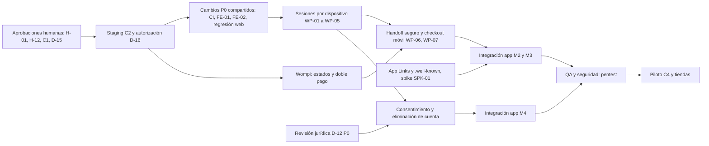

# Roadmap del proyecto — App móvil IPR (etapas 0 a 7)

| | |
|---|---|
| **Proyecto** | App móvil Flutter (Android/iOS) de IPR Partes y Repuestos (Inverprimos S.A.S.) |
| **Fecha** | 2026-11-18 |
| **Estado** | **BORRADOR de planificación para aprobación humana.** Consolida documentación existente; no programa nada, no declara nada cumplido que no se haya ejecutado. |
| **Rol** | Business Analyst / Planificador técnico |
| **Relacionado** | [risks.md](risks.md) · [decisions_log.md](decisions_log.md) · [implementation_plan.md](implementation_plan.md) · [decisiones_pendientes.md](decisiones_pendientes.md) · [resolucion_inconsistencias.md](resolucion_inconsistencias.md) · [scope.md](../01_business/scope.md) · [ADR](../03_architecture/architecture_decisions.md) |

> **Regla de este documento (D-15):** el equipo, el presupuesto y los recursos de IPR son **DESCONOCIDOS**. Por eso **no hay fechas, semanas ni duraciones**. El esfuerzo se expresa en escala relativa S/M/L/XL (§2.2) y solo sirve para comparar etapas entre sí.

**Convención de clasificación:** **HECHO** (verificado en un documento o en el código, con cita) · **SUPUESTO** (se asume para planificar) · **PROPUESTA** (recomendación de este documento, requiere aprobación) · **PENDIENTE** (decisión humana abierta) · **RIESGO** (`RK-xxx`, ver [risks.md](risks.md)) · **DESCONOCIDO** (sin evidencia). Las recomendaciones H-01 a H-12 de [decisiones_pendientes.md §E](decisiones_pendientes.md) **no están aprobadas** y aquí se tratan como supuestos marcados **`SUP-H`**.

---

## 1. Estado real del proyecto (hoy, 2026-11-18)

| # | Etapa | Estado real | Evidencia (hecho) | Qué falta |
|---|---|---|---|---|
| 0 | Descubrimiento | **Mayormente documentada; no cerrada** | Informe de investigación (2026-11-17), informe del código del frontend (1.1) y análisis de la capa WooCommerce (1.2); stakeholders y perfiles | Los DESCONOCIDOS que exigen staging o lectura de servidor (H-12), las 18 mediciones MED-01..MED-18 (ninguna ejecutada), `npm audit`/OSV (MED-09), PDF legales sin leer |
| 1 | Arquitectura | **Documentada (borrador completo) pero sin aprobar** | Solo **ADR-001 y ADR-002** están aprobadas. ADR-003..022 en estado Propuesta; OpenAPI `1.0.0-draft` con 27 endpoints `x-status: proposed`; 72 controles de seguridad, 62 amenazas, 490 AC, 116 RNF, 160 casos de prueba; **89 contradicciones (CR) sin aplicar** | Aprobar o rechazar las ADR, resolver H-01..H-12 y aplicar las CR aprobadas a los documentos (nada se ha editado) |
| 2 | Fundación | **No iniciada** | Ningún repositorio de la app, ningún cambio en `ipr-frontend` ni en WordPress | Todo; está **bloqueada por el Gate G1** (aprobaciones humanas, [implementation_plan.md §3](implementation_plan.md)) |
| 3 | MVP | **No iniciada** | — | Depende de la Etapa 2 |
| 4 | Integraciones | **No iniciada** | — | Staging (C2) y Wompi sandbox no confirmados |
| 5 | QA y seguridad | **Solo diseñada** | Estrategia de pruebas, 160 TC y plan de pruebas de seguridad: **ninguna prueba ejecutada** (testing_strategy, aviso central) | Todo lo ejecutable |
| 6 | Lanzamiento | **No iniciada** | Titularidad de cuentas de tienda DESCONOCIDA (D-14) | Todo |
| 7 | Evolución | **Solo candidatos** | 32 RF en "fase 2" (scope §5) | Priorización posterior al lanzamiento |

---

## 2. Supuestos de planificación

### 2.1 Supuestos de equipo (no verificados)

| ID | Supuesto | Si es falso |
|---|---|---|
| SUP-EQ-01 | Equipo, presupuesto y dedicación **DESCONOCIDOS** (D-15). Ningún esfuerzo de este documento es una estimación en horas. | Todo el plan se recalibra con la dotación real. |
| SUP-EQ-02 | Para dar escala se usa un **equipo de referencia hipotético** (solo para definir S/M/L/XL, no es una propuesta de dotación): 1 persona web/BFF (TypeScript, Next.js), 1 persona WordPress/PHP, 1-2 personas Flutter, 1 QA, apoyo parcial de TI y de seguridad, y el equipo web de IPR revisando los PR. | Con menos gente el esfuerzo relativo no cambia; sí cambia el tiempo de calendario y desaparece el paralelismo (ver §7). |
| SUP-EQ-03 | Las esperas externas (aprobaciones, Jurídico, tiendas, Wompi, TI) **no son esfuerzo** pero **sí están en la ruta crítica**. | — |
| SUP-EQ-04 | El responsable técnico de `ipr-frontend` y WordPress acepta revisar por PR (ADR-001 C1). | Si no, no hay implementación posible (RK-002). |

### 2.2 Escala de esfuerzo relativo

| Nivel | Significado (relativo, sin horas) |
|---|---|
| **S** | Un rol, alcance acotado, pocas dependencias externas. |
| **M** | Uno o dos roles, varias actividades, algunas dependencias o revisión de terceros. |
| **L** | Varios roles y repositorios, dependencias múltiples, riesgo técnico medio o alto. |
| **XL** | Concentra el mayor riesgo y varios equipos; suele explicar el grueso del calendario. |

### 2.3 Responsables sugeridos (roles, sin nombres)

**Gerencia/Solicitante** (decide alcance y presupuesto) · **Arq** (arquitecto) · **BA** (analista de negocio) · **Web** (equipo de `ipr-frontend`/BFF) · **WP** (quien mantiene WordPress y los snippets) · **Móvil** (equipo Flutter, D-15) · **TI** (infraestructura, Cloudflare, CI) · **Seg** (seguridad) · **QA** · **Jur** (Jurídico) · **Prod** (producto/Comercial) · **Cat/Mkt/Ops/Ing** (Catálogo, Marketing, Operaciones, Ingeniería de IPR). Fuente: [stakeholders.md](../01_business/stakeholders.md), [security_controls.md §1](../06_security/security_controls.md).

---

## 3. Ruta crítica

> **PROPUESTA.** La app no puede cerrar sus rebanadas con sesión, compra o eliminación de cuenta hasta que el backend y WordPress las soporten. El trabajo de app que **no** depende de ellos (fundación M0, pantallas contra un BFF simulado conforme al OpenAPI) puede avanzar antes (mitigación de R-Q04, [testing_strategy §14](../08_quality/testing_strategy.md)).

| # | Elemento de la ruta crítica | Por qué es crítico | Fuente | Riesgo |
|---|---|---|---|---|
| RC-1 | **Conformidad del responsable técnico (C1)** y aprobación de la enmienda de ADR-001 (H-01) | Sin revisión por PR no se toca `ipr-frontend` ni WordPress; sin la enmienda, el alcance de `ipr/v1/m/*` contradice el "únicamente" de ADR-001 §2 | ADR-001 C1; CR-038 | RK-002, RK-005 |
| RC-2 | **Staging con Wompi sandbox (C2) y autorización D-16/H-12** | Habilita resolver los DESCONOCIDOS, probar cambios en snippets compartidos sin riesgo para la web y ejecutar E2E; su ausencia es criterio de no-lanzamiento | ADR-001 C2; NLS-08; R-Q01 | RK-003 |
| RC-3 | **Cambios P0 compartidos** en `ipr-frontend` (CI con puertas, FE-01 `status=publish`, FE-02 errores discriminados) y los tres cambios en snippets compartidos (CR-010, CR-012, CR-045) con regresión de la web | El BFF hereda la capa de datos; el despliegue está acoplado a la web y hoy no tiene pruebas | RB-01, RB-02, RB-09; resolución §5 hallazgo 3 | RK-023, RK-024 |
| RC-4 | **Sesiones por dispositivo** (WP-01..WP-05, WP-12): tablas, rotación, revocación, anti fuerza bruta persistente | Lo más grande de WordPress (esfuerzo L en la fuente); bloquea M2, M3 y M4 (RF-041, 043, 044, 045); NL-05 | ARQ §16.2; CH-01..04 | RK-030, RK-031 |
| RC-5 | **Wompi: estados, webhook y doble pago** (D-02, PA-11, PA-12) | TM-027 es "no aceptable sin cerrar D-02/PA-11"; si no se resuelve, D-06 preveía la opción (b) (compra en fase 2), que sería una **decisión humana nueva** | TM §5.3; resolución §5 hallazgo 4 | RK-015 |
| RC-6 | **Revisión jurídica (D-12; J-01..J-13 P0)** | Texto de eliminación de cuenta, retención, consentimiento, política; sin ella no hay M4 final, ni tiendas (NL-07) | privacy_assessment §10.1 | RK-048, RK-049 |
| RC-7 | **App Links / Universal Links** (`.well-known`, ruta `/app/pedido`, SPK-01, DA-03) y reglas de Cloudflare (C3) | RF-055 y el retorno del pago; no verificado el comportamiento tras la redirección en Custom Tabs/ASWebAuthenticationSession; el diseño no depende del enlace pero sí de la consulta EP-24 | OV RA-01; ARQ §13.3; CR-001..004 | RK-014, RK-021 |

**Fuera de la ruta crítica (holgura):** calculadora BTU (D-08, módulo condicionado), datos de sedes (D-09; hay respaldo empaquetado, ADR-018), fuente canónica de marcas (AP-05), analítica (PA-08), push y favoritos (fase 2).

---

## 4. Etapas

### Etapa 0 — Descubrimiento

| Campo | Contenido |
|---|---|
| **Estado real** | Mayormente documentada; **no cerrada** (§1). |
| **Objetivos** | Cerrar los datos DESCONOCIDOS que cambian el diseño o el plan; disponer de líneas base medidas antes de fijar umbrales definitivos. |
| **Actividades** | (1) Obtener la autorización D-16/H-12 (staging y lectura de servidor, sin pruebas intrusivas en producción). (2) Resolver los DESCONOCIDOS de [resolución Anexo B](resolucion_inconsistencias.md): n.º de procesos Node, Cloudflare delante de WordPress y origen restringido, estados de Wompi y doble pago, roles de clientes, zona horaria, longitud de `user_email`, versiones de PHP/WordPress/Node, caché de objetos, clave de metadato de la cédula/NIT, dominio de staging. (3) Ejecutar las mediciones de fase F1 de [NFR §6](../02_requirements/non_functional_requirements.md): MED-01, 02, 04, 05, 06, 07, 09, 10, 12, 13, 18; y MED-03, 14, 15, 16, 17 cuando exista staging. (4) Entregar a Jurídico los 16 documentos de [privacy_assessment §11.2](../06_security/privacy_assessment.md). (5) Reunión técnica con TI/equipo web (preguntas críticas 1-5 de WCA §7.3 y COD §8). (6) Confirmar responsables por área (stakeholders §5). |
| **Entregables** | Informe de DESCONOCIDOS resueltos (valor, fecha, fuente); informes MED archivados; acuse de entrega a Jurídico; respuestas a las preguntas críticas. |
| **Dependencias** | H-12/D-16; D-15; acceso de TI; Jurídico (documentos). |
| **Riesgos** | RK-003, RK-001, RK-006, RK-011, RK-034, RK-048 |
| **Criterios de finalización (verificables)** | (a) Cada fila del Anexo B de la resolución tiene valor, fecha y evidencia, o está marcada "no obtenible" con decisión humana. (b) Informe de `npm audit`/OSV (MED-09) archivado y revisado (levanta NLS-04 en su parte de "no ejecutado"). (c) MED de F1 ejecutadas con informe, o replanificadas con motivo escrito. (d) Respuestas escritas a las 5 preguntas críticas de WCA §7.3. (e) Acuse de recibo de Jurídico de los documentos de §11.2. |
| **Esfuerzo relativo** | **S**. Es sobre todo coordinación y lectura; pocas horas técnicas, **alta dependencia externa** (acceso, autorizaciones). |
| **Responsable sugerido** | BA (coordina) · TI/Web (datos de servidor) · Jur (legal) · Gerencia (autorización) |

### Etapa 1 — Arquitectura

| Campo | Contenido |
|---|---|
| **Estado real** | Borrador completo, **sin aprobar** salvo ADR-001/002 (§1). Ningún documento existente fue editado para aplicar las 89 CR. |
| **Objetivos** | Cerrar el registro de decisiones, el contrato `/mobile/v1` y los documentos para que la implementación parta de una sola versión coherente. |
| **Actividades** | (1) Decidir H-01..H-12 y las ADR en el orden propuesto (resolución §3: enmienda ADR-001 → ADR-013/014/008 fusionada → ADR-016/006 → ADR-015 con el dato SA-01 → resto). (2) Copiar ADR-003..022 a `architecture_decisions.md` con su estado final (hoy solo contiene ADR-001/002). (3) Aplicar o descartar las 89 CR (74 técnicas, 10 de producto, 5 legales). (4) Resolver `[A VALIDAR]` (107 AC) o registrarlos como decisión pendiente (testing_strategy §8.2). (5) Actualizar RF/AC/OpenAPI (p. ej. RF-114 B2B "Won't/fase 2", `OrderDetail`, `paymentState`), regenerar trazabilidad (CR-087). (6) Registrar la aceptación de riesgo residual (DA-15). |
| **Entregables** | `architecture_decisions.md` con estados finales; `decisions_log.md` actualizado; OpenAPI `1.0.0` sin `x-status: proposed` en los endpoints del MVP; RF/AC/NFR/TR corregidos; lista de CR aplicadas. |
| **Dependencias** | Decisores humanos (Solicitante + responsable técnico); Etapa 0 para los 8 CR que dependen de un dato DESCONOCIDO (CR-018, 028, 035, 052, 060, 075, 076, 079). |
| **Riesgos** | RK-004, RK-005, RK-017, RK-002 |
| **Criterios de finalización (verificables)** | (a) 0 ADR en estado "Propuesta" para el MVP (cada una Aprobada o Rechazada, con fecha y quién decidió). (b) H-01..H-12 con respuesta registrada. (c) Las 89 CR con estado (aplicada / descartada / diferida) y nota de quién aprobó. (d) OpenAPI en `1.0.0` y condición 1 de [testing_strategy §10.2](../08_quality/testing_strategy.md) cumplida. (e) Matriz de trazabilidad regenerada sin los errores de CR-087. (f) Tabla de aprobaciones del Gate G1 completa ([implementation_plan §3](implementation_plan.md)). |
| **Esfuerzo relativo** | **M**. Volumen documental alto (89 CR con cambios exactos ya redactados) pero sin riesgo técnico; el cuello de botella es la decisión humana, no el trabajo. |
| **Responsable sugerido** | Arq + BA (preparan y aplican) · Solicitante + responsable técnico (deciden) · Jur (CR legales) |

### Etapa 2 — Fundación

| Campo | Contenido |
|---|---|
| **Estado real** | **No iniciada.** Bloqueada por el Gate G1. |
| **Objetivos** | Dejar listos entorno, puertas de calidad y cimientos del backend que condicionan todo lo demás, sin depender aún de las rebanadas funcionales. |
| **Actividades** | Paquetes PT-02 (staging), PT-03 (CI/CD con puertas), PT-04 (endurecer la capa de datos compartida: FE-01, 02, 05, 06, 07, 08), PT-07 (sesiones por dispositivo y anti fuerza bruta en WordPress), PT-08 (handoff seguro: CR-010 y CR-012, con regresión de la web), PT-11 (Cloudflare, origen, `.well-known`), PT-12 (spikes SPK-01..04), PT-13 (fundación de la app, rebanada M0). En paralelo desde IPR: PT-21 (arranque de la revisión jurídica) y PT-23 (datos y contenido). Detalle en [implementation_plan.md](implementation_plan.md). |
| **Entregables** | Staging operativo con Wompi sandbox; puertas QG-B01..B07 activas y obligatorias para desplegar; capa de datos con resultado discriminado (sin cambiar firmas); tablas y rutas de sesión en WordPress; informes de spikes; repositorio de la app con CI (QG-M01..M12) y BFF simulado. |
| **Dependencias** | Gate G1 completo; C1 y C2; D-14/DA-12 (identificador de la app y titular de cuentas, para firmas y `.well-known`); SPK-01 requiere staging. |
| **Riesgos** | RK-003, RK-023, RK-024, RK-025, RK-030, RK-031, RK-014, RK-027 |
| **Criterios de finalización (verificables)** | (a) Staging: una transacción Wompi sandbox pagada y una rechazada ejecutadas y los estados de WooCommerce registrados (CR-018, MED-14). (b) `deploy.yml` depende de `tsc`, ESLint, SCA, secretos y pruebas (QG-B01..B07); verificable en la configuración y en un PR de prueba. (c) BE-01..BE-03, BE-09..BE-11 en verde; ST-064, ST-065 aprobadas. (d) BE-13 y BE-14 en verde contra el WordPress de staging; el contador de intentos sobrevive a un reinicio. (e) Prueba de humo de la web (QG-B06) en verde tras los cambios en `handoff.php`/`auth-rest.php`. (f) SPK-01..04 con informe y decisión registrada. (g) La app (M0) compila en Android e iOS con QG-M01..M12 en verde y 0 secretos. |
| **Esfuerzo relativo** | **L**. Ocho paquetes, varios de tamaño M; la carga se concentra en WordPress (sesiones, esfuerzo L en la fuente) y en la capa de datos "neurálgica" (`CLAUDE.md:106`). Incertidumbre alta por los DESCONOCIDOS. |
| **Responsable sugerido** | Web (PT-03, 04) · WP (PT-07, 08) · TI (PT-02, 11) · Móvil (PT-12, 13) · QA (puertas) · Seg (revisión) |

### Etapa 3 — MVP

| Campo | Contenido |
|---|---|
| **Estado real** | **No iniciada.** |
| **Objetivos** | Entregar los 76 RF del MVP por rebanadas (M1..M5, §5), con el backend siempre un paso por delante de la app. |
| **Actividades** | **Carril backend:** PT-05 (BFF catálogo público), PT-06 (BFF cuenta, checkout, pedidos, PQRS), PT-09 (WordPress cuenta y eliminación, incluida la migración de direcciones CR-045), PT-10 (configuración remota, sedes y marcas). **Carril app:** PT-14 (M1), PT-15 (M2), PT-16 (M3), PT-17 (M4), PT-18 (M5). **Transversal:** PT-19 (pruebas), PT-21 y PT-23 (IPR). |
| **Entregables** | Cada rebanada integrada contra staging, con sus AC en verde y sus casos de prueba ejecutados; contrato versionado; textos legales aprobados incorporados. |
| **Dependencias** | Etapa 2 (parcialmente por rebanada: ver "listo para integrar", implementation_plan §3 Gate G2); D-12 para M2/M4; D-02 resuelta para M3; D-08 para el módulo K. |
| **Riesgos** | RK-004, RK-005, RK-011, RK-014, RK-015, RK-016, RK-018, RK-019, RK-025, RK-048, RK-049 |
| **Criterios de finalización (verificables)** | Por rebanada: (a) 100 % de los AC no-seguridad de sus RF con caso ejecutado en verde (trazabilidad RF→US→AC→TC, testing_strategy §4.2). (b) Los `[A VALIDAR]` de esos AC resueltos o registrados como decisión pendiente. (c) Contrato: 100 % de los endpoints de la rebanada con caso feliz, error y autenticación (QG-B04). (d) 0 defectos S1 abiertos. (e) Puertas QG-M y QG-B en verde. Global: los 76 RF del MVP con US y AC aprobados y los criterios de salida del MVP ([scope §8](../01_business/scope.md)) verificados en staging. |
| **Esfuerzo relativo** | **XL**. 76 RF, 76 US y 477 AC, tres repositorios (app, `ipr-frontend`, WordPress), tres de las rebanadas con seguridad crítica (M2, M3, M4) y el checkout con tercero (Wompi). |
| **Responsable sugerido** | Móvil · Web · WP · QA · Prod (aceptación) |

### Etapa 4 — Integraciones

| Campo | Contenido |
|---|---|
| **Estado real** | **No iniciada.** Las piezas de integración con mayor riesgo (Wompi, Cloudflare, App Links) se **adelantan a la Etapa 2** para no descubrirlas tarde; esta etapa las **verifica de extremo a extremo** con la app real. |
| **Objetivos** | Confirmar el comportamiento real de los terceros con la app compilada, en las dos plataformas y en las versiones mínimas. |
| **Actividades** | (1) Compra E2E con Wompi sandbox: aprobado, rechazado, cancelado, pendiente, abandono, doble toque, ticket vencido (TC-067..TC-082; QG-R02, QG-R03). (2) Retorno por App Link/Universal Link y por consulta EP-24 en cada versión mínima (ST-124..ST-126). (3) Cloudflare no desafía a la app ni a `.well-known` (BE-21, MED-15). (4) PQRS por SMTP al buzón corporativo (RF-097). (5) Reporte de fallos del proveedor elegido (DN-02) sin PII. (6) Lanzamientos externos (WhatsApp, teléfono, mapas) con lista cerrada de esquemas (SC-043). (7) Pruebas en compilaciones de distribución cerrada (testing_strategy §5.1). |
| **Entregables** | Evidencia fechada por plataforma; matriz por versión de SO del retorno del pago; informe de Cloudflare; decisión final sobre el componente de navegador seguro y sobre `patrol`/alternativa. |
| **Dependencias** | Etapa 3 (M3 como mínimo); PT-02, PT-08, PT-11; D-14 (identificadores y huellas de firma). |
| **Riesgos** | RK-014, RK-015, RK-016, RK-021, RK-058, RK-045 |
| **Criterios de finalización (verificables)** | (a) TC-067, TC-068, TC-069 aprobados en Android **e** iOS (QG-R02). (b) 0 pedidos o cobros duplicados en la prueba de interrupciones (QG-R03; ST-086, ST-089: 100 interrupciones por plataforma). (c) El estado mostrado en la app es siempre el devuelto por EP-24; solo `paid` vacía el carrito (ST-082, ST-083). (d) BE-21 aprobado. (e) El resultado de SPK-01 aplicado y registrado en ADR-008. |
| **Esfuerzo relativo** | **M**, con riesgo de crecer a **L** si los DESCONOCIDOS de Wompi (webhook, doble pago, estado pendiente) resultan adversos o si el sandbox no simula el estado pendiente (R-Q02). |
| **Responsable sugerido** | QA · Móvil · WP · TI · Finanzas (medios de pago y estados) |

### Etapa 5 — QA y seguridad

| Campo | Contenido |
|---|---|
| **Estado real** | **Solo diseñada.** Ninguna prueba ejecutada. Las puertas de CI deben existir desde la Etapa 2; esta etapa es la **verificación formal previa al lanzamiento**. |
| **Objetivos** | Demostrar con evidencia el cumplimiento de los 22 cambios P0, los criterios de no-lanzamiento y los AC; cerrar la parte legal. |
| **Actividades** | (1) Completar los TC de los AC sin caso (26 no seguridad; 75 AC delegados a seguridad). (2) Ejecutar la suite completa (QG-R01..R15). (3) Pruebas de seguridad ST-001..ST-160 aplicables, MASVS L1, SAST/SCA/secretos. (4) **Prueba de penetración independiente** con reprueba (CH-21; DN-13; presupuesto D-15). (5) Carga del BFF con el perfil acordado y degradación de la web ≤ 10 % (BE-20; RNF-015). (6) Matriz de dispositivos, accesibilidad (TalkBack, VoiceOver, texto al 200 %), rendimiento. (7) Cerrar J-01..J-13 con Jurídico y archivar el dictamen (CH-17). (8) Firmar la aceptación de riesgo residual (CH-22/DA-15). |
| **Entregables** | `test_results.md` con ciclos ejecutados (hoy es plantilla); informe de pentest; informe SCA/SAST/secretos; SBOM; dictamen de Jurídico; documento de aceptación de riesgos firmado. |
| **Dependencias** | Etapas 3 y 4; Jurídico; presupuesto de pentest; staging. |
| **Riesgos** | RK-034, RK-058, RK-004, RK-048, RK-049, RK-050, RK-042, RK-059 |
| **Criterios de finalización (verificables)** | (a) Los 9 criterios absolutos NLS-01..NLS-09 y los 14 NL-01..NL-14 en verde con evidencia. (b) 0 vulnerabilidades críticas o altas abiertas tras la reprueba (NLS-01). (c) Los 22 cambios P0 (CH-01..CH-22) con su criterio de cierre cumplido y evidenciado (NLS-02). (d) 0 defectos S1 y S2 abiertos (QG-R12) salvo aceptación formal si el criterio es condicional. (e) Dictamen de Jurídico archivado (QG-R10, QG-R13). |
| **Esfuerzo relativo** | **L**. Volumen alto (490 AC, 160 TC, 72 controles) pero en su mayor parte automatizable y planificado; el pentest y el cierre jurídico añaden dependencias externas. |
| **Responsable sugerido** | QA · Seg · Gerencia (presupuesto, aceptación) · Jur |

### Etapa 6 — Lanzamiento

| Campo | Contenido |
|---|---|
| **Estado real** | **No iniciada.** Titularidad de cuentas de tienda DESCONOCIDA (D-14). |
| **Objetivos** | Publicar de forma controlada (piloto y luego tiendas) con monitoreo y capacidad de reversa. |
| **Actividades** | (1) Cuentas de Google Play y Apple a nombre de Inverprimos S.A.S., custodia de firmas con ≥ 2 custodios y 2FA (CH-20; NL-11). (2) Fichas de las tiendas coherentes con el tráfico real (J-20). (3) Verificar los requisitos de las tiendas vigentes (S-05, RNF-080) antes de publicar. (4) **Piloto** en distribución cerrada con monitoreo y alertas activos (NL-09). (5) Prueba de carga y piloto de la condición C4. (6) Runbooks ensayados (revocación masiva, rotación de secretos, interruptor de checkout, versión mínima forzada). (7) Despliegue a producción con las condiciones C1..C4 documentadas. |
| **Entregables** | Aplicaciones publicadas; informe del piloto; registro de las condiciones C1..C4; manual de incidentes. |
| **Dependencias** | Etapa 5 completa; D-14; D-12; Gerencia (decisión de lanzamiento). |
| **Riesgos** | RK-009, RK-010, RK-008, RK-019, RK-050, RK-055, RK-047 |
| **Criterios de finalización (verificables)** | (a) QG-R14: ≥ 99,5 % de usuarios sin fallos y ANR ≤ 0,3 % en el piloto, 0 S1, 0 pedidos duplicados. (b) C1..C4 de ADR-001 cumplidas (NL-12; QG-R15). (c) Cuentas de tienda con titularidad de IPR (NL-11). (d) Decisión de lanzamiento firmada por Gerencia + TI. (e) Monitoreo y alertas verificadas con simulacro (RNF-101). |
| **Esfuerzo relativo** | **M**. Poco desarrollo; mucha coordinación (tiendas, firmas, soporte) y espera de revisión de las tiendas, que no se controla. |
| **Responsable sugerido** | Gerencia · TI · Móvil · Prod · QA |

### Etapa 7 — Evolución

| Campo | Contenido |
|---|---|
| **Estado real** | **Solo candidatos** documentados. |
| **Objetivos** | Operar, medir y priorizar la fase 2 con datos reales. |
| **Actividades** | (1) Operación mensual: métricas, estabilidad, dependencias (RNF-094, RNF-098), revisión anual de mínimos de SO y de tiendas (RNF-080). (2) Cambios P2: CH-32..CH-37 (migrar la sesión web a la tabla de sesiones FE-18, verificación de correo si no entró al MVP, atestación de app, reevaluar *pinning*, CSP y `localStorage` en la web, `Origin` en POST web) y rotación de secretos con doble valor (WP-16). (3) Priorizar el backlog de fase 2 con las metas que IPR defina (O-1..O-5 hoy sin metas). |
| **Backlog candidato (propuesta, sin priorizar)** | Cotización estructurada (RF-066/067) · B2B y precios por rol (RF-114 propuesto) · favoritos (RF-068..070) · push transaccional (RF-090..093; D-11, J-28) · sedes con coordenadas y horarios (RF-077/078; D-09) · lista de sesiones por dispositivo (RF-112) · seguimiento de envío (RF-109) · contenido editorial (RF-017, 082, 084) · enlaces de producto que abren la app (RF-036) · carrito en servidor (RF-059) · tema oscuro (RF-113). Fuente: [scope §5](../01_business/scope.md). |
| **Dependencias** | Lanzamiento estable; decisiones de negocio D-03, D-04, D-11, D-12; datos D-09. |
| **Riesgos** | RK-006, RK-007, RK-008, RK-028, RK-047, RK-056 |
| **Criterios de finalización (verificables)** | Etapa continua: (a) revisión mensual de métricas registrada; (b) backlog de fase 2 priorizado y aprobado por Gerencia; (c) cada ítem con requisito, decisión de negocio asociada y dueño. |
| **Esfuerzo relativo** | **L** y sin tope (continuo). Cada ítem de fase 2 se estima aparte cuando se priorice. |
| **Responsable sugerido** | Gerencia · Prod · Móvil · Web · WP · Seg |

### 4.1 Resumen de esfuerzo relativo

| Etapa | Esfuerzo | Nota |
|---|---|---|
| 0 Descubrimiento | S | Mucha espera externa |
| 1 Arquitectura | M | Cuello de botella: decisión humana |
| 2 Fundación | L | Concentra WordPress y capa de datos |
| 3 MVP | XL | 76 RF, tres repositorios |
| 4 Integraciones | M (puede subir a L) | Depende de Wompi |
| 5 QA y seguridad | L | Pentest y cierre jurídico |
| 6 Lanzamiento | M | Tiendas y firmas |
| 7 Evolución | L (continuo) | Sin tope |

---

## 5. Rebanadas del MVP (PROPUESTA a aprobar)

Se propone dividir los **76 RF del MVP** en seis rebanadas entregables (la numeración M0..M5 respeta la sugerida en el encargo y añade M5). **Una rebanada es un incremento integrado y probado en staging; no se publica por separado**: el lanzamiento exige todas (M0..M5), porque la eliminación de cuenta (RF-110, M4) y la política de privacidad (RF-099, M2) son requisitos de las tiendas (supuesto S-05, a verificar) y la cuenta (M2) existe desde el registro.

| Rebanada | Contenido | RF (MVP) | N.º RF | Paquetes | Depende del backend | Condición para darla por entregada |
|---|---|---|---|---|---|---|
| **M0 Fundación** | Repositorio, *flavors*, CI de la app, red, sesión, almacenamiento, errores tipados, design system, BFF simulado | (habilitadora; sin RF propio; cubre la base de RNF-087..096 y AC-SEC-1..4) | 0 | PT-13 (+PT-12) | No (BFF simulado) | QG-M01..M12 en verde; compila en Android e iOS; 0 secretos |
| **M1 Catálogo y búsqueda sin sesión** | Inicio, categorías, listados, filtros, búsqueda, ficha, "Más información" → WhatsApp, estados de error/sin conexión, acceso sin sesión | RF-001, 002, 003, 004, 005, 007, 009, 010, 011, 012, 013, 014, 015, 016, 018, 019, 020, 021, 022, 023, 026, 027, 028, 030, 031, 032, 037, 062, 063, 064 | 30 | PT-14 (backend: PT-04, PT-05, PT-10) | Sí: PT-04/05 (EP-13..EP-20, EP-01) | AC de los 30 RF en verde; NL-13 en staging (0 "$0", 0 no publicados visibles); AC-SEC-7 |
| **M2 Cuenta** | Registro con aceptación de políticas, login, logout, recuperación, sesión por dispositivo, tokens seguros, protección de fuerza bruta, rol administrativo bloqueado, páginas legales | RF-038, 039, 040, 041, 042, 043, 044, 045, 048, 099 | 10 | PT-15 (backend: PT-06, PT-07, PT-09) | Sí: **ruta crítica** (WP-01..05, 10, 11) | NL-05: login web + app + otro dispositivo sin cierres mutuos; ST-030..ST-047; AC-044-*; AC-045-* |
| **M3 Carrito y compra** | Carrito local, revalidación, resumen informativo, checkout con ticket, retorno, resultado verificado, pago fallido, errores legibles | RF-029, 049, 050, 051, 052, 053, 054, 055, 056, 057, 058 | 11 | PT-16 (backend: PT-06, PT-08, PT-11) | Sí: **ruta crítica** (WP-06, EP-21, EP-23, EP-24, `.well-known`) | NL-02: compra E2E en staging con Wompi sandbox, Android e iOS; 0 duplicados |
| **M4 Perfil, pedidos y eliminación de cuenta** | Datos de perfil, contraseña, direcciones, pedidos y detalle, eliminación de cuenta, derechos del titular | RF-104, 105, 106, 107, 108, 110, 111 | 7 | PT-17 (backend: PT-09, PT-08) | Sí: WP-07, 08, 09 y **texto de Jurídico** | NL-07: eliminación E2E con revisión de datos tras la baja; dictamen de Jurídico |
| **M5 Sedes, atención, asesoría y herramientas** | Sedes, ayuda, PQRS, WhatsApp de atención, asesoría técnica, calculadora BTU, medición de "Más información", acceso a la calculadora desde el inicio | RF-006, 065, 072, 073, 074, 075, 076, 079, 080, 085, 086, 087, 088, 089, 094, 095, 096, 097 | 18 | PT-18 (backend: PT-10, PT-06) | Parcial: EP-22, EP-27, EP-01; RF-065 requiere PA-08 y D-12; módulo K requiere D-08 | RF-097: el límite de PQRS no depende de memoria de un proceso; calculadora con ≥ 30 vectores validados por Ingeniería (FA §15) |
| **Total** | | | **76** | | | |

> Verificación aritmética (propuesta): 30 + 10 + 11 + 7 + 18 = 76. Cada RF del MVP aparece exactamente una vez. Dependencias entre rebanadas que conviene tener presentes: RF-054 (prellenado, M3) usa los datos de cuenta de RF-106 (M4) y la migración CR-045; RF-029 (M3) es el botón "Añadir al carrito" de la ficha que se construye en M1; RF-099 (páginas legales) está en M2 porque RF-039 (aceptación de políticas en el registro) la necesita.

**Orden de integración (derivado de la ruta crítica):** M0 → M1 → M2 → M3 → M4 → M5 en el carril de la app; el backend avanza un paso adelante (B1 catálogo → B2 sesiones y cuenta → B3 handoff, checkout y pedidos → B4 eliminación y privacidad). M5 puede empezar en paralelo con M2..M4 si hay personas, porque casi no depende de la cuenta.

---

## 6. Qué recortar si el equipo es pequeño (PROPUESTA a aprobar)

Cualquier recorte cambia el alcance aprobado en [scope.md](../01_business/scope.md) y debe decidirlo el humano; aquí solo se ordena por **menor costo de oportunidad**. No se propone recortar ADR-002 (compra completa) salvo la contingencia ya prevista en D-06(b).

### 6.1 Candidatos a diferir a fase 2 (en orden de preferencia)

| Prioridad de recorte | RF | MoSCoW | Efecto de diferirlo | Condición o riesgo |
|---|---|---|---|---|
| 1 | **Módulo K completo** RF-085..089 (calculadora BTU) y RF-006 | Should/Must condicionado | Menos pantallas y menos pruebas; sale 5-6 RF | Ya está **condicionado a D-08** (scope §7). Si Ingeniería no valida la fórmula, sale por decisión previa |
| 2 | RF-065 (medición agregada de "Más información") | Should | Se pierde la medición de demanda de ADR-002 (RK-007) | Bloqueado de todos modos por PA-08 y D-12; sin herramienta ni consentimiento |
| 3 | RF-003 (más vendidos) | Should | Inicio más simple | Criterio "más vendidos" DESCONOCIDO (PA-05) |
| 4 | RF-079, RF-080 (asesoría técnica) | Should | Menos contenido | Canal corporativo de ingeniería DESCONOCIDO (PA-06); RF-095 ya agrupa los canales |
| 5 | RF-018, RF-007 (liquidaciones) | Should | Sin sección de ofertas | Sube la dependencia de datos de precio regular |
| 6 | RF-016, RF-004 (directorio de marcas) | Should | Se mantiene el filtro por marca (RF-013, Must) | Fuente canónica de marcas pendiente (AP-05; heurística con falsos positivos, RB-08) |
| 7 | RF-014, RF-015, RF-021 (filtros por atributo, orden, sugerencias) | Should | Búsqueda y listados más básicos | RF-021 reduce la carga sobre el índice en RAM (RK-019); RF-022 (SKU exacto, Must) se conserva |
| 8 | RF-028, RF-032, RF-023 (atributos técnicos, avisos, vacío con WhatsApp) | Should | Ficha y búsqueda más austeras | RF-032 requiere texto de garantía validado (D-12) |
| 9 | RF-054 + RF-106 (prellenado y direcciones) | Should | El checkout de WooCommerce pide los datos faltantes | Aun así hace falta la migración CR-045 si se quiere minimizar el ticket (RK-025); sube la fricción de compra |
| 10 | RF-063, RF-064, RF-075, RF-095, RF-108 | Should | Menos alternativas de contacto, detalle de pedido más simple | RF-108 cambia con H-08 (envío, impuestos, descuento) |

### 6.2 No recortables (propuesta)

- Todo requisito **Must** (47 en el total; los del MVP están en las rebanadas).
- **RF-111** (canal de derechos del titular; Ley 1581, RK-050) y **RF-099** (políticas legibles antes del registro): obligación legal y de tiendas.
- **RF-048** (bloqueo de roles administrativos), **RF-009** (errores y sin conexión) y **RF-058** (errores del checkout): bajo costo y alto efecto en seguridad y soporte.
- Todo lo que cubre un criterio de no-lanzamiento: sesiones por dispositivo (NL-05), eliminación de cuenta (NL-07), compra E2E (NL-02).

### 6.3 Contingencia ya prevista (decisión humana nueva, no recomendada por defecto)

Si los DESCONOCIDOS de Wompi (D-02, PA-11) no se resuelven a tiempo, [D-06](decisiones_pendientes.md) preveía la opción (b): MVP con catálogo, cuenta y WhatsApp, y **compra en fase 2** (resolución §5 hallazgo 4; TM-027 "no aceptable sin cerrar D-02/PA-11"). Reabrirla contradice la decisión aprobada D-06/ADR-002 y requiere decisión explícita del solicitante.

### 6.4 Efecto de un equipo pequeño en el calendario (no en el esfuerzo)

- Las rebanadas M1..M5 pasan de **paralelas** a **secuenciales**; el orden de §5 se mantiene.
- Los paquetes de WordPress (PT-07, PT-08, PT-09) son un solo carril: con una sola persona de WordPress son la restricción que fija el ritmo de M2..M4. Considerar priorizar PT-07 sobre todo lo demás.
- Las puertas de calidad (PT-03, PT-13) **no se recortan**: son lo que permite a un equipo pequeño detectar regresiones de la web (RK-023).

---

## 7. Decisiones y aprobaciones que condicionan el roadmap

La lista completa, con estado y qué desbloquea cada una, está en [decisions_log.md](decisions_log.md). La lista de verificación por Gate está en [implementation_plan.md §3](implementation_plan.md).

| Gate | Qué habilita | Aprobaciones clave (resumen) |
|---|---|---|
| **G1** | Inicio de la implementación (Etapa 2) | D-15 · C1 · H-12/D-16 y plan de staging (C2) · H-01 (enmienda ADR-001) · aprobación de ADR-013/014/008 · H-04 |
| **G2** | Integrar una rebanada con su backend | "Listo para integrar" ([testing_strategy §10.2](../08_quality/testing_strategy.md)) por rebanada |
| **G3** | Verificación formal y pentest (Etapa 5) | M0..M5 integradas; staging estable; presupuesto de pentest (DN-13) |
| **G4** | Piloto y lanzamiento (Etapa 6) | D-12 P0 (J-01..J-13) · H-11 · D-02 cerrada · D-14 · DA-15 firmada · C1..C4 |

---

## 8. Fuentes consolidadas

[scope.md](../01_business/scope.md) · [vision.md](../01_business/vision.md) · [stakeholders.md](../01_business/stakeholders.md) · [functional_requirements.md](../02_requirements/functional_requirements.md) · [non_functional_requirements.md](../02_requirements/non_functional_requirements.md) · [requirements_traceability.md](../02_requirements/requirements_traceability.md) · [architecture_decisions.md](../03_architecture/architecture_decisions.md) · [architecture_overview.md](../03_architecture/architecture_overview.md) · [flutter_app_architecture.md](../03_architecture/flutter_app_architecture.md) · [api_architecture.md](../05_api/api_architecture.md) · [authentication.md](../05_api/authentication.md) · [api_contracts.md](../05_api/api_contracts.md) · [data_model.md](../04_database/data_model.md) · [security_controls.md](../06_security/security_controls.md) · [threat_model.md](../06_security/threat_model.md) · [privacy_assessment.md](../06_security/privacy_assessment.md) · [testing_strategy.md](../08_quality/testing_strategy.md) · [decisiones_pendientes.md](decisiones_pendientes.md) · [resolucion_inconsistencias.md](resolucion_inconsistencias.md) · [informe_codigo_frontend.md](../00_discovery/informe_codigo_frontend.md) · [analisis_capa_woocommerce.md](../00_discovery/analisis_capa_woocommerce.md).

*Fin del documento. BORRADOR: nada de lo descrito está ejecutado.*
